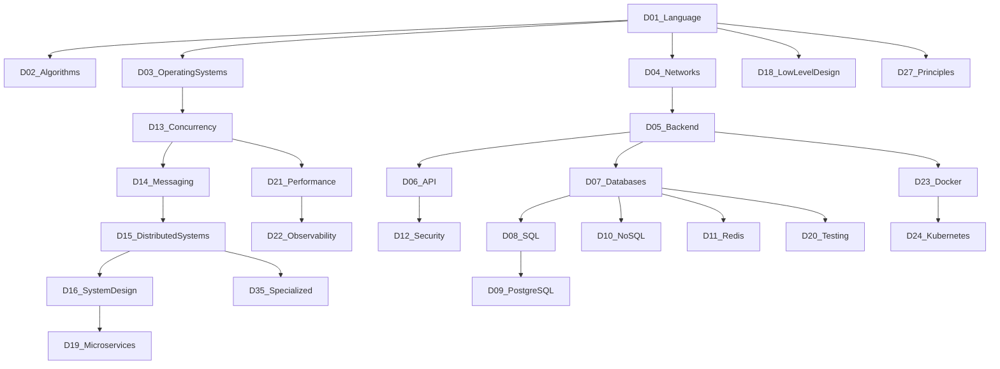

# Dependency map

Learn in this order. Later domains assume the anchor topics of the domains they depend on.
Each topic also depends on the previous topic in its own domain, and on that domain's first topic once you are past the second bullet.
Per-topic edges are listed below and in the inventory. Root topics have no dependencies.

## Domain order

How to read the diagram: an arrow means the source domain should be understood before the destination. It is a study order, not a runtime call graph.

## Domain prerequisites

| Domain | Depends on |
| --- | --- |
| D01 Programming Language Fundamentals | — |
| D02 Data Structures and Algorithms | D01 Programming Language Fundamentals |
| D03 Operating Systems | D01 Programming Language Fundamentals |
| D04 Computer Networks | D01 Programming Language Fundamentals, D03 Operating Systems |
| D05 Backend Development Fundamentals | D01 Programming Language Fundamentals, D04 Computer Networks |
| D06 API Design and REST | D04 Computer Networks, D05 Backend Development Fundamentals |
| D07 Database Fundamentals | D01 Programming Language Fundamentals, D05 Backend Development Fundamentals |
| D08 SQL — Advanced Topics | D07 Database Fundamentals |
| D09 PostgreSQL Internals | D07 Database Fundamentals, D08 SQL — Advanced Topics |
| D10 NoSQL Databases | D07 Database Fundamentals |
| D11 Redis and Caching | D07 Database Fundamentals, D05 Backend Development Fundamentals |
| D12 Authentication, Authorization and Security | D04 Computer Networks, D05 Backend Development Fundamentals, D06 API Design and REST |
| D13 Concurrency and Parallel Processing | D01 Programming Language Fundamentals, D03 Operating Systems |
| D14 Messaging and Event-Driven Architecture | D04 Computer Networks, D05 Backend Development Fundamentals, D13 Concurrency and Parallel Processing |
| D15 Distributed Systems | D03 Operating Systems, D04 Computer Networks, D13 Concurrency and Parallel Processing, D14 Messaging and Event-Driven Architecture |
| D16 System Design Fundamentals | D05 Backend Development Fundamentals, D06 API Design and REST, D07 Database Fundamentals, D15 Distributed Systems |
| D17 Common System Design Problems | D16 System Design Fundamentals, D07 Database Fundamentals, D11 Redis and Caching |
| D18 Low-Level Design (LLD) and Object-Oriented Design | D01 Programming Language Fundamentals |
| D19 Microservices Architecture | D15 Distributed Systems, D16 System Design Fundamentals, D14 Messaging and Event-Driven Architecture |
| D20 Software Testing | D05 Backend Development Fundamentals, D07 Database Fundamentals |
| D21 Performance Engineering | D02 Data Structures and Algorithms, D07 Database Fundamentals, D13 Concurrency and Parallel Processing |
| D22 Observability and Production Operations | D05 Backend Development Fundamentals, D21 Performance Engineering |
| D23 Docker and Containerization | D03 Operating Systems, D05 Backend Development Fundamentals |
| D24 Kubernetes and Cloud Infrastructure | D23 Docker and Containerization, D22 Observability and Production Operations |
| D25 CI/CD and Release Engineering | D23 Docker and Containerization, D20 Software Testing |
| D26 Linux and Backend Troubleshooting | D03 Operating Systems, D23 Docker and Containerization |
| D27 Software Engineering Principles | D01 Programming Language Fundamentals |
| D28 Advanced Backend Topics That Make You Stand Out | D15 Distributed Systems, D19 Microservices Architecture, D12 Authentication, Authorization and Security |
| D29 Search and Specialized Storage | D07 Database Fundamentals, D10 NoSQL Databases |
| D30 AI/LLM Backend Engineering | D05 Backend Development Fundamentals, D12 Authentication, Authorization and Security, D29 Search and Specialized Storage |
| D31 Backend Frameworks — Choose One Deeply | D01 Programming Language Fundamentals, D05 Backend Development Fundamentals, D07 Database Fundamentals |
| D32 Backend Interview Communication | D16 System Design Fundamentals, D17 Common System Design Problems |
| D33 Real-World Engineering Scenarios | D15 Distributed Systems, D22 Observability and Production Operations, D07 Database Fundamentals |
| D34 Practical Project Validation Checklist | D05 Backend Development Fundamentals, D06 API Design and REST, D07 Database Fundamentals, D11 Redis and Caching, D20 Software Testing, D23 Docker and Containerization |
| D35 Advanced and Specialized Topics | D15 Distributed Systems, D09 PostgreSQL Internals, D02 Data Structures and Algorithms |

## Topic edges

- `D01-T001` Data types, variables, operators, type conversion is a root topic
- `D01-T002` Control flow, loops, functions, recursion depends on `D01-T001`
- `D01-T003` Pointers, references, memory management depends on `D01-T002`, `D01-T001`
- `D01-T004` Stack vs heap memory depends on `D01-T003`, `D01-T001`
- `D01-T005` Value vs reference semantics depends on `D01-T004`, `D01-T001`
- `D01-T006` Object-oriented programming (OOP) depends on `D01-T005`, `D01-T001`
- `D01-T007` Encapsulation, abstraction, inheritance, polymorphism depends on `D01-T006`, `D01-T001`
- `D01-T008` Composition vs inheritance depends on `D01-T007`, `D01-T001`
- `D01-T009` Interfaces, abstract classes, generics depends on `D01-T008`, `D01-T001`
- `D01-T010` Exception handling and custom exceptions depends on `D01-T009`, `D01-T001`
- `D01-T011` Immutability and mutability depends on `D01-T010`, `D01-T001`
- `D01-T012` Collections and data structures depends on `D01-T011`, `D01-T001`
- `D01-T013` Iterators, generators, streams depends on `D01-T012`, `D01-T001`
- `D01-T014` Functional programming concepts depends on `D01-T013`, `D01-T001`
- `D01-T015` Lambdas, closures, higher-order functions depends on `D01-T014`, `D01-T001`
- `D01-T016` Concurrency and parallelism depends on `D01-T015`, `D01-T001`
- `D01-T017` Memory leaks and garbage collection depends on `D01-T016`, `D01-T001`
- `D01-T018` Runtime, compilation, interpretation depends on `D01-T017`, `D01-T001`
- `D01-T019` Language-specific internals (Java/Python/Go/Node.js) depends on `D01-T018`, `D01-T001`
- `D01-T020` Clean code, naming, readability, maintainability depends on `D01-T019`, `D01-T001`
- `D02-T001` Time and space complexity depends on `D01-T001`, `D01-T002`
- `D02-T002` Big-O, Big-Theta, Big-Omega depends on `D02-T001`, `D01-T001`, `D01-T002`
- `D02-T003` Arrays and strings depends on `D02-T002`, `D02-T001`, `D01-T001`, `D01-T002`
- `D02-T004` Linked lists depends on `D02-T003`, `D02-T001`, `D01-T001`, `D01-T002`
- `D02-T005` Stacks and queues depends on `D02-T004`, `D02-T001`, `D01-T001`, `D01-T002`
- `D02-T006` Hash maps and hash sets depends on `D02-T005`, `D02-T001`, `D01-T001`, `D01-T002`
- `D02-T007` Trees and binary search trees depends on `D02-T006`, `D02-T001`, `D01-T001`, `D01-T002`
- `D02-T008` Heaps and priority queues depends on `D02-T007`, `D02-T001`, `D01-T001`, `D01-T002`
- `D02-T009` Tries depends on `D02-T008`, `D02-T001`, `D01-T001`, `D01-T002`
- `D02-T010` Graphs and graph representations depends on `D02-T009`, `D02-T001`, `D01-T001`, `D01-T002`
- `D02-T011` BFS and DFS depends on `D02-T010`, `D02-T001`, `D01-T001`, `D01-T002`
- `D02-T012` Topological sorting depends on `D02-T011`, `D02-T001`, `D01-T001`, `D01-T002`
- `D02-T013` Shortest-path algorithms depends on `D02-T012`, `D02-T001`, `D01-T001`, `D01-T002`
- `D02-T014` Union-Find / Disjoint Set Union depends on `D02-T013`, `D02-T001`, `D01-T001`, `D01-T002`
- `D02-T015` Sorting and searching depends on `D02-T014`, `D02-T001`, `D01-T001`, `D01-T002`
- `D02-T016` Binary search patterns depends on `D02-T015`, `D02-T001`, `D01-T001`, `D01-T002`
- `D02-T017` Two pointers and sliding window depends on `D02-T016`, `D02-T001`, `D01-T001`, `D01-T002`
- `D02-T018` Prefix sums and difference arrays depends on `D02-T017`, `D02-T001`, `D01-T001`, `D01-T002`
- `D02-T019` Monotonic stacks and queues depends on `D02-T018`, `D02-T001`, `D01-T001`, `D01-T002`
- `D02-T020` Greedy algorithms depends on `D02-T019`, `D02-T001`, `D01-T001`, `D01-T002`
- `D02-T021` Backtracking depends on `D02-T020`, `D02-T001`, `D01-T001`, `D01-T002`
- `D02-T022` Dynamic programming depends on `D02-T021`, `D02-T001`, `D01-T001`, `D01-T002`
- `D02-T023` Bit manipulation depends on `D02-T022`, `D02-T001`, `D01-T001`, `D01-T002`
- `D02-T024` Intervals and sweep-line algorithms depends on `D02-T023`, `D02-T001`, `D01-T001`, `D01-T002`
- `D02-T025` Randomized algorithms depends on `D02-T024`, `D02-T001`, `D01-T001`, `D01-T002`
- `D02-T026` Amortized analysis depends on `D02-T025`, `D02-T001`, `D01-T001`, `D01-T002`
- `D02-T027` Problem-solving patterns and edge cases depends on `D02-T026`, `D02-T001`, `D01-T001`, `D01-T002`
- `D03-T001` Processes vs threads depends on `D01-T001`, `D01-T002`
- `D03-T002` Process lifecycle and context switching depends on `D03-T001`, `D01-T001`, `D01-T002`
- `D03-T003` User mode vs kernel mode depends on `D03-T002`, `D03-T001`, `D01-T001`, `D01-T002`
- `D03-T004` System calls depends on `D03-T003`, `D03-T001`, `D01-T001`, `D01-T002`
- `D03-T005` CPU scheduling depends on `D03-T004`, `D03-T001`, `D01-T001`, `D01-T002`
- `D03-T006` Threads and thread pools depends on `D03-T005`, `D03-T001`, `D01-T001`, `D01-T002`
- `D03-T007` Concurrency vs parallelism depends on `D03-T006`, `D03-T001`, `D01-T001`, `D01-T002`
- `D03-T008` Race conditions depends on `D03-T007`, `D03-T001`, `D01-T001`, `D01-T002`
- `D03-T009` Critical sections and synchronization depends on `D03-T008`, `D03-T001`, `D01-T001`, `D01-T002`
- `D03-T010` Mutexes, semaphores, read-write locks depends on `D03-T009`, `D03-T001`, `D01-T001`, `D01-T002`
- `D03-T011` Deadlocks: prevention, detection, recovery depends on `D03-T010`, `D03-T001`, `D01-T001`, `D01-T002`
- `D03-T012` Starvation and livelocks depends on `D03-T011`, `D03-T001`, `D01-T001`, `D01-T002`
- `D03-T013` Atomic operations and compare-and-swap depends on `D03-T012`, `D03-T001`, `D01-T001`, `D01-T002`
- `D03-T014` Memory management and virtual memory depends on `D03-T013`, `D03-T001`, `D01-T001`, `D01-T002`
- `D03-T015` Paging and segmentation depends on `D03-T014`, `D03-T001`, `D01-T001`, `D01-T002`
- `D03-T016` Page faults depends on `D03-T015`, `D03-T001`, `D01-T001`, `D01-T002`
- `D03-T017` File descriptors and file systems depends on `D03-T016`, `D03-T001`, `D01-T001`, `D01-T002`
- `D03-T018` I/O buffering depends on `D03-T017`, `D03-T001`, `D01-T001`, `D01-T002`
- `D03-T019` Blocking vs non-blocking I/O depends on `D03-T018`, `D03-T001`, `D01-T001`, `D01-T002`
- `D03-T020` Synchronous vs asynchronous execution depends on `D03-T019`, `D03-T001`, `D01-T001`, `D01-T002`
- `D03-T021` Event loops depends on `D03-T020`, `D03-T001`, `D01-T001`, `D01-T002`
- `D03-T022` Signals and inter-process communication depends on `D03-T021`, `D03-T001`, `D01-T001`, `D01-T002`
- `D03-T023` Linux process and networking commands depends on `D03-T022`, `D03-T001`, `D01-T001`, `D01-T002`
- `D03-T024` Resource limits and process isolation depends on `D03-T023`, `D03-T001`, `D01-T001`, `D01-T002`
- `D04-T001` OSI and TCP/IP models depends on `D01-T001`, `D01-T002`, `D03-T001`, `D03-T002`
- `D04-T002` IP addressing, subnetting, CIDR depends on `D04-T001`, `D01-T001`, `D01-T002`, `D03-T001`, `D03-T002`
- `D04-T003` MAC addresses, ARP depends on `D04-T002`, `D04-T001`, `D01-T001`, `D01-T002`, `D03-T001`, `D03-T002`
- `D04-T004` TCP vs UDP depends on `D04-T003`, `D04-T001`, `D01-T001`, `D01-T002`, `D03-T001`, `D03-T002`
- `D04-T005` TCP handshake and connection termination depends on `D04-T004`, `D04-T001`, `D01-T001`, `D01-T002`, `D03-T001`, `D03-T002`
- `D04-T006` Sequence numbers, ACKs, retransmission depends on `D04-T005`, `D04-T001`, `D01-T001`, `D01-T002`, `D03-T001`, `D03-T002`
- `D04-T007` Flow control and congestion control depends on `D04-T006`, `D04-T001`, `D01-T001`, `D01-T002`, `D03-T001`, `D03-T002`
- `D04-T008` TCP connection states and TIME_WAIT depends on `D04-T007`, `D04-T001`, `D01-T001`, `D01-T002`, `D03-T001`, `D03-T002`
- `D04-T009` HTTP/1.1, HTTP/2, HTTP/3 depends on `D04-T008`, `D04-T001`, `D01-T001`, `D01-T002`, `D03-T001`, `D03-T002`
- `D04-T010` HTTP methods, headers, status codes depends on `D04-T009`, `D04-T001`, `D01-T001`, `D01-T002`, `D03-T001`, `D03-T002`
- `D04-T011` HTTP caching semantics depends on `D04-T010`, `D04-T001`, `D01-T001`, `D01-T002`, `D03-T001`, `D03-T002`
- `D04-T012` DNS resolution and record types depends on `D04-T011`, `D04-T001`, `D01-T001`, `D01-T002`, `D03-T001`, `D03-T002`
- `D04-T013` TLS/SSL handshake depends on `D04-T012`, `D04-T001`, `D01-T001`, `D01-T002`, `D03-T001`, `D03-T002`
- `D04-T014` Certificates, CAs, public/private keys depends on `D04-T013`, `D04-T001`, `D01-T001`, `D01-T002`, `D03-T001`, `D03-T002`
- `D04-T015` Symmetric vs asymmetric encryption depends on `D04-T014`, `D04-T001`, `D01-T001`, `D01-T002`, `D03-T001`, `D03-T002`
- `D04-T016` WebSockets and Server-Sent Events depends on `D04-T015`, `D04-T001`, `D01-T001`, `D01-T002`, `D03-T001`, `D03-T002`
- `D04-T017` Long polling depends on `D04-T016`, `D04-T001`, `D01-T001`, `D01-T002`, `D03-T001`, `D03-T002`
- `D04-T018` REST vs gRPC depends on `D04-T017`, `D04-T001`, `D01-T001`, `D01-T002`, `D03-T001`, `D03-T002`
- `D04-T019` Proxies, reverse proxies and load balancers depends on `D04-T018`, `D04-T001`, `D01-T001`, `D01-T002`, `D03-T001`, `D03-T002`
- `D04-T020` NAT, firewalls and ports depends on `D04-T019`, `D04-T001`, `D01-T001`, `D01-T002`, `D03-T001`, `D03-T002`
- `D04-T021` CDN and edge networking depends on `D04-T020`, `D04-T001`, `D01-T001`, `D01-T002`, `D03-T001`, `D03-T002`
- `D04-T022` Connection pooling and keep-alive depends on `D04-T021`, `D04-T001`, `D01-T001`, `D01-T002`, `D03-T001`, `D03-T002`
- `D04-T023` Latency, bandwidth, throughput and packet loss depends on `D04-T022`, `D04-T001`, `D01-T001`, `D01-T002`, `D03-T001`, `D03-T002`
- `D05-T001` Client-server architecture depends on `D01-T001`, `D01-T002`, `D04-T001`, `D04-T002`
- `D05-T002` Request-response lifecycle depends on `D05-T001`, `D01-T001`, `D01-T002`, `D04-T001`, `D04-T002`
- `D05-T003` Routing and middleware depends on `D05-T002`, `D05-T001`, `D01-T001`, `D01-T002`, `D04-T001`, `D04-T002`
- `D05-T004` Controllers, services and repositories depends on `D05-T003`, `D05-T001`, `D01-T001`, `D01-T002`, `D04-T001`, `D04-T002`
- `D05-T005` Dependency injection depends on `D05-T004`, `D05-T001`, `D01-T001`, `D01-T002`, `D04-T001`, `D04-T002`
- `D05-T006` Configuration and environment variables depends on `D05-T005`, `D05-T001`, `D01-T001`, `D01-T002`, `D04-T001`, `D04-T002`
- `D05-T007` Input validation and sanitization depends on `D05-T006`, `D05-T001`, `D01-T001`, `D01-T002`, `D04-T001`, `D04-T002`
- `D05-T008` Serialization and deserialization depends on `D05-T007`, `D05-T001`, `D01-T001`, `D01-T002`, `D04-T001`, `D04-T002`
- `D05-T009` Error handling and exception mapping depends on `D05-T008`, `D05-T001`, `D01-T001`, `D01-T002`, `D04-T001`, `D04-T002`
- `D05-T010` Centralized logging depends on `D05-T009`, `D05-T001`, `D01-T001`, `D01-T002`, `D04-T001`, `D04-T002`
- `D05-T011` Authentication and authorization depends on `D05-T010`, `D05-T001`, `D01-T001`, `D01-T002`, `D04-T001`, `D04-T002`
- `D05-T012` Pagination: offset vs cursor depends on `D05-T011`, `D05-T001`, `D01-T001`, `D01-T002`, `D04-T001`, `D04-T002`
- `D05-T013` Filtering, sorting and searching depends on `D05-T012`, `D05-T001`, `D01-T001`, `D01-T002`, `D04-T001`, `D04-T002`
- `D05-T014` File uploads and downloads depends on `D05-T013`, `D05-T001`, `D01-T001`, `D01-T002`, `D04-T001`, `D04-T002`
- `D05-T015` Background jobs depends on `D05-T014`, `D05-T001`, `D01-T001`, `D01-T002`, `D04-T001`, `D04-T002`
- `D05-T016` Email, SMS and push notifications depends on `D05-T015`, `D05-T001`, `D01-T001`, `D01-T002`, `D04-T001`, `D04-T002`
- `D05-T017` Scheduled jobs and cron depends on `D05-T016`, `D05-T001`, `D01-T001`, `D01-T002`, `D04-T001`, `D04-T002`
- `D05-T018` Graceful startup and shutdown depends on `D05-T017`, `D05-T001`, `D01-T001`, `D01-T002`, `D04-T001`, `D04-T002`
- `D05-T019` Health checks and readiness checks depends on `D05-T018`, `D05-T001`, `D01-T001`, `D01-T002`, `D04-T001`, `D04-T002`
- `D05-T020` API versioning depends on `D05-T019`, `D05-T001`, `D01-T001`, `D01-T002`, `D04-T001`, `D04-T002`
- `D05-T021` Database connection pooling depends on `D05-T020`, `D05-T001`, `D01-T001`, `D01-T002`, `D04-T001`, `D04-T002`
- `D05-T022` Configuration and secret management depends on `D05-T021`, `D05-T001`, `D01-T001`, `D01-T002`, `D04-T001`, `D04-T002`
- `D05-T023` Request context and correlation IDs depends on `D05-T022`, `D05-T001`, `D01-T001`, `D01-T002`, `D04-T001`, `D04-T002`
- `D05-T024` Graceful degradation depends on `D05-T023`, `D05-T001`, `D01-T001`, `D01-T002`, `D04-T001`, `D04-T002`
- `D06-T001` REST architectural constraints depends on `D04-T001`, `D04-T002`, `D05-T001`, `D05-T002`
- `D06-T002` Resource-oriented URL design depends on `D06-T001`, `D04-T001`, `D04-T002`, `D05-T001`, `D05-T002`
- `D06-T003` HTTP methods and idempotency depends on `D06-T002`, `D06-T001`, `D04-T001`, `D04-T002`, `D05-T001`, `D05-T002`
- `D06-T004` HTTP status codes depends on `D06-T003`, `D06-T001`, `D04-T001`, `D04-T002`, `D05-T001`, `D05-T002`
- `D06-T005` Request and response schemas depends on `D06-T004`, `D06-T001`, `D04-T001`, `D04-T002`, `D05-T001`, `D05-T002`
- `D06-T006` API contracts and schema evolution depends on `D06-T005`, `D06-T001`, `D04-T001`, `D04-T002`, `D05-T001`, `D05-T002`
- `D06-T007` Path vs query vs header parameters depends on `D06-T006`, `D06-T001`, `D04-T001`, `D04-T002`, `D05-T001`, `D05-T002`
- `D06-T008` Validation and consistent error responses depends on `D06-T007`, `D06-T001`, `D04-T001`, `D04-T002`, `D05-T001`, `D05-T002`
- `D06-T009` Pagination, filtering and sorting depends on `D06-T008`, `D06-T001`, `D04-T001`, `D04-T002`, `D05-T001`, `D05-T002`
- `D06-T010` Versioning strategies depends on `D06-T009`, `D06-T001`, `D04-T001`, `D04-T002`, `D05-T001`, `D05-T002`
- `D06-T011` Idempotency keys depends on `D06-T010`, `D06-T001`, `D04-T001`, `D04-T002`, `D05-T001`, `D05-T002`
- `D06-T012` Rate limiting and quotas depends on `D06-T011`, `D06-T001`, `D04-T001`, `D04-T002`, `D05-T001`, `D05-T002`
- `D06-T013` Conditional requests: ETag, If-Match depends on `D06-T012`, `D06-T001`, `D04-T001`, `D04-T002`, `D05-T001`, `D05-T002`
- `D06-T014` Caching: Cache-Control, ETag, Last-Modified depends on `D06-T013`, `D06-T001`, `D04-T001`, `D04-T002`, `D05-T001`, `D05-T002`
- `D06-T015` HATEOAS and when it is useful depends on `D06-T014`, `D06-T001`, `D04-T001`, `D04-T002`, `D05-T001`, `D05-T002`
- `D06-T016` OpenAPI and Swagger depends on `D06-T015`, `D06-T001`, `D04-T001`, `D04-T002`, `D05-T001`, `D05-T002`
- `D06-T017` API gateways depends on `D06-T016`, `D06-T001`, `D04-T001`, `D04-T002`, `D05-T001`, `D05-T002`
- `D06-T018` Webhooks and signature verification depends on `D06-T017`, `D06-T001`, `D04-T001`, `D04-T002`, `D05-T001`, `D05-T002`
- `D06-T019` API deprecation strategies depends on `D06-T018`, `D06-T001`, `D04-T001`, `D04-T002`, `D05-T001`, `D05-T002`
- `D06-T020` REST vs GraphQL vs gRPC vs RPC depends on `D06-T019`, `D06-T001`, `D04-T001`, `D04-T002`, `D05-T001`, `D05-T002`
- `D06-T021` API compatibility and backward compatibility depends on `D06-T020`, `D06-T001`, `D04-T001`, `D04-T002`, `D05-T001`, `D05-T002`
- `D07-T001` Relational vs non-relational databases depends on `D01-T001`, `D01-T002`, `D05-T001`, `D05-T002`
- `D07-T002` Tables, rows, columns and schemas depends on `D07-T001`, `D01-T001`, `D01-T002`, `D05-T001`, `D05-T002`
- `D07-T003` Primary and foreign keys depends on `D07-T002`, `D07-T001`, `D01-T001`, `D01-T002`, `D05-T001`, `D05-T002`
- `D07-T004` Candidate, composite and surrogate keys depends on `D07-T003`, `D07-T001`, `D01-T001`, `D01-T002`, `D05-T001`, `D05-T002`
- `D07-T005` Constraints and data integrity depends on `D07-T004`, `D07-T001`, `D01-T001`, `D01-T002`, `D05-T001`, `D05-T002`
- `D07-T006` Normalization: 1NF, 2NF, 3NF, BCNF depends on `D07-T005`, `D07-T001`, `D01-T001`, `D01-T002`, `D05-T001`, `D05-T002`
- `D07-T007` Denormalization depends on `D07-T006`, `D07-T001`, `D01-T001`, `D01-T002`, `D05-T001`, `D05-T002`
- `D07-T008` One-to-one, one-to-many, many-to-many relationships depends on `D07-T007`, `D07-T001`, `D01-T001`, `D01-T002`, `D05-T001`, `D05-T002`
- `D07-T009` Joins and subqueries depends on `D07-T008`, `D07-T001`, `D01-T001`, `D01-T002`, `D05-T001`, `D05-T002`
- `D07-T010` Aggregations and grouping depends on `D07-T009`, `D07-T001`, `D01-T001`, `D01-T002`, `D05-T001`, `D05-T002`
- `D07-T011` Transactions depends on `D07-T010`, `D07-T001`, `D01-T001`, `D01-T002`, `D05-T001`, `D05-T002`
- `D07-T012` ACID properties depends on `D07-T011`, `D07-T001`, `D01-T001`, `D01-T002`, `D05-T001`, `D05-T002`
- `D07-T013` Isolation levels depends on `D07-T012`, `D07-T001`, `D01-T001`, `D01-T002`, `D05-T001`, `D05-T002`
- `D07-T014` Dirty reads, non-repeatable reads, phantom reads depends on `D07-T013`, `D07-T001`, `D01-T001`, `D01-T002`, `D05-T001`, `D05-T002`
- `D07-T015` Locks and deadlocks depends on `D07-T014`, `D07-T001`, `D01-T001`, `D01-T002`, `D05-T001`, `D05-T002`
- `D07-T016` Optimistic vs pessimistic concurrency control depends on `D07-T015`, `D07-T001`, `D01-T001`, `D01-T002`, `D05-T001`, `D05-T002`
- `D07-T017` MVCC depends on `D07-T016`, `D07-T001`, `D01-T001`, `D01-T002`, `D05-T001`, `D05-T002`
- `D07-T018` Database indexes depends on `D07-T017`, `D07-T001`, `D01-T001`, `D01-T002`, `D05-T001`, `D05-T002`
- `D07-T019` Composite and covering indexes depends on `D07-T018`, `D07-T001`, `D01-T001`, `D01-T002`, `D05-T001`, `D05-T002`
- `D07-T020` Clustered vs non-clustered indexes depends on `D07-T019`, `D07-T001`, `D01-T001`, `D01-T002`, `D05-T001`, `D05-T002`
- `D07-T021` B-tree and hash indexes depends on `D07-T020`, `D07-T001`, `D01-T001`, `D01-T002`, `D05-T001`, `D05-T002`
- `D07-T022` Query execution plans depends on `D07-T021`, `D07-T001`, `D01-T001`, `D01-T002`, `D05-T001`, `D05-T002`
- `D07-T023` EXPLAIN and EXPLAIN ANALYZE depends on `D07-T022`, `D07-T001`, `D01-T001`, `D01-T002`, `D05-T001`, `D05-T002`
- `D07-T024` Slow query optimization depends on `D07-T023`, `D07-T001`, `D01-T001`, `D01-T002`, `D05-T001`, `D05-T002`
- `D07-T025` Connection pooling depends on `D07-T024`, `D07-T001`, `D01-T001`, `D01-T002`, `D05-T001`, `D05-T002`
- `D07-T026` Migrations and schema evolution depends on `D07-T025`, `D07-T001`, `D01-T001`, `D01-T002`, `D05-T001`, `D05-T002`
- `D07-T027` Backup, restore and point-in-time recovery depends on `D07-T026`, `D07-T001`, `D01-T001`, `D01-T002`, `D05-T001`, `D05-T002`
- `D07-T028` Replication and failover depends on `D07-T027`, `D07-T001`, `D01-T001`, `D01-T002`, `D05-T001`, `D05-T002`
- `D07-T029` Partitioning and sharding depends on `D07-T028`, `D07-T001`, `D01-T001`, `D01-T002`, `D05-T001`, `D05-T002`
- `D07-T030` Read replicas and read/write splitting depends on `D07-T029`, `D07-T001`, `D01-T001`, `D01-T002`, `D05-T001`, `D05-T002`
- `D07-T031` Data archival and retention depends on `D07-T030`, `D07-T001`, `D01-T001`, `D01-T002`, `D05-T001`, `D05-T002`
- `D08-T001` Advanced joins depends on `D07-T001`, `D07-T002`
- `D08-T002` Correlated subqueries depends on `D08-T001`, `D07-T001`, `D07-T002`
- `D08-T003` Common Table Expressions (CTEs) depends on `D08-T002`, `D08-T001`, `D07-T001`, `D07-T002`
- `D08-T004` Recursive CTEs depends on `D08-T003`, `D08-T001`, `D07-T001`, `D07-T002`
- `D08-T005` Window functions depends on `D08-T004`, `D08-T001`, `D07-T001`, `D07-T002`
- `D08-T006` Ranking functions depends on `D08-T005`, `D08-T001`, `D07-T001`, `D07-T002`
- `D08-T007` Running totals and moving averages depends on `D08-T006`, `D08-T001`, `D07-T001`, `D07-T002`
- `D08-T008` CASE, COALESCE, NULLIF depends on `D08-T007`, `D08-T001`, `D07-T001`, `D07-T002`
- `D08-T009` NULL semantics and three-valued logic depends on `D08-T008`, `D08-T001`, `D07-T001`, `D07-T002`
- `D08-T010` Upserts and conflict handling depends on `D08-T009`, `D08-T001`, `D07-T001`, `D07-T002`
- `D08-T011` Transactions and savepoints depends on `D08-T010`, `D08-T001`, `D07-T001`, `D07-T002`
- `D08-T012` Locking reads depends on `D08-T011`, `D08-T001`, `D07-T001`, `D07-T002`
- `D08-T013` Advisory locks depends on `D08-T012`, `D08-T001`, `D07-T001`, `D07-T002`
- `D08-T014` Generated and computed columns depends on `D08-T013`, `D08-T001`, `D07-T001`, `D07-T002`
- `D08-T015` Views and materialized views depends on `D08-T014`, `D08-T001`, `D07-T001`, `D07-T002`
- `D08-T016` Stored procedures and triggers depends on `D08-T015`, `D08-T001`, `D07-T001`, `D07-T002`
- `D08-T017` JSON and JSONB querying depends on `D08-T016`, `D08-T001`, `D07-T001`, `D07-T002`
- `D08-T018` Full-text search depends on `D08-T017`, `D08-T001`, `D07-T001`, `D07-T002`
- `D08-T019` Geospatial queries depends on `D08-T018`, `D08-T001`, `D07-T001`, `D07-T002`
- `D08-T020` Index selectivity and cardinality depends on `D08-T019`, `D08-T001`, `D07-T001`, `D07-T002`
- `D08-T021` N+1 query problem depends on `D08-T020`, `D08-T001`, `D07-T001`, `D07-T002`
- `D08-T022` Keyset pagination depends on `D08-T021`, `D08-T001`, `D07-T001`, `D07-T002`
- `D08-T023` Database performance troubleshooting depends on `D08-T022`, `D08-T001`, `D07-T001`, `D07-T002`
- `D09-T001` PostgreSQL architecture depends on `D07-T001`, `D07-T002`, `D08-T001`, `D08-T002`
- `D09-T002` MVCC and tuple visibility depends on `D09-T001`, `D07-T001`, `D07-T002`, `D08-T001`, `D08-T002`
- `D09-T003` WAL (Write-Ahead Logging) depends on `D09-T002`, `D09-T001`, `D07-T001`, `D07-T002`, `D08-T001`, `D08-T002`
- `D09-T004` Checkpoints and crash recovery depends on `D09-T003`, `D09-T001`, `D07-T001`, `D07-T002`, `D08-T001`, `D08-T002`
- `D09-T005` Vacuum and autovacuum depends on `D09-T004`, `D09-T001`, `D07-T001`, `D07-T002`, `D08-T001`, `D08-T002`
- `D09-T006` Dead tuples and table bloat depends on `D09-T005`, `D09-T001`, `D07-T001`, `D07-T002`, `D08-T001`, `D08-T002`
- `D09-T007` Heap storage and TOAST depends on `D09-T006`, `D09-T001`, `D07-T001`, `D07-T002`, `D08-T001`, `D08-T002`
- `D09-T008` B-tree, GIN, GiST and BRIN indexes depends on `D09-T007`, `D09-T001`, `D07-T001`, `D07-T002`, `D08-T001`, `D08-T002`
- `D09-T009` Query planner and optimizer depends on `D09-T008`, `D09-T001`, `D07-T001`, `D07-T002`, `D08-T001`, `D08-T002`
- `D09-T010` Statistics and ANALYZE depends on `D09-T009`, `D09-T001`, `D07-T001`, `D07-T002`, `D08-T001`, `D08-T002`
- `D09-T011` Isolation and row-level locking depends on `D09-T010`, `D09-T001`, `D07-T001`, `D07-T002`, `D08-T001`, `D08-T002`
- `D09-T012` Advisory locks depends on `D09-T011`, `D09-T001`, `D07-T001`, `D07-T002`, `D08-T001`, `D08-T002`
- `D09-T013` Streaming and logical replication depends on `D09-T012`, `D09-T001`, `D07-T001`, `D07-T002`, `D08-T001`, `D08-T002`
- `D09-T014` Table partitioning depends on `D09-T013`, `D09-T001`, `D07-T001`, `D07-T002`, `D08-T001`, `D08-T002`
- `D09-T015` Connection poolers depends on `D09-T014`, `D09-T001`, `D07-T001`, `D07-T002`, `D08-T001`, `D08-T002`
- `D09-T016` Replication lag depends on `D09-T015`, `D09-T001`, `D07-T001`, `D07-T002`, `D08-T001`, `D08-T002`
- `D09-T017` Backup and recovery depends on `D09-T016`, `D09-T001`, `D07-T001`, `D07-T002`, `D08-T001`, `D08-T002`
- `D09-T018` High availability and failover depends on `D09-T017`, `D09-T001`, `D07-T001`, `D07-T002`, `D08-T001`, `D08-T002`
- `D10-T001` SQL vs NoSQL trade-offs depends on `D07-T001`, `D07-T002`
- `D10-T002` Key-value stores depends on `D10-T001`, `D07-T001`, `D07-T002`
- `D10-T003` Document databases depends on `D10-T002`, `D10-T001`, `D07-T001`, `D07-T002`
- `D10-T004` Wide-column databases depends on `D10-T003`, `D10-T001`, `D07-T001`, `D07-T002`
- `D10-T005` Graph databases depends on `D10-T004`, `D10-T001`, `D07-T001`, `D07-T002`
- `D10-T006` Data modeling for access patterns depends on `D10-T005`, `D10-T001`, `D07-T001`, `D07-T002`
- `D10-T007` Denormalization and embedding vs referencing depends on `D10-T006`, `D10-T001`, `D07-T001`, `D07-T002`
- `D10-T008` Secondary indexes depends on `D10-T007`, `D10-T001`, `D07-T001`, `D07-T002`
- `D10-T009` TTL and expiration depends on `D10-T008`, `D10-T001`, `D07-T001`, `D07-T002`
- `D10-T010` Consistency models depends on `D10-T009`, `D10-T001`, `D07-T001`, `D07-T002`
- `D10-T011` Partition keys and hot partitions depends on `D10-T010`, `D10-T001`, `D07-T001`, `D07-T002`
- `D10-T012` Replication and sharding depends on `D10-T011`, `D10-T001`, `D07-T001`, `D07-T002`
- `D10-T013` Quorums depends on `D10-T012`, `D10-T001`, `D07-T001`, `D07-T002`
- `D10-T014` Eventual consistency depends on `D10-T013`, `D10-T001`, `D07-T001`, `D07-T002`
- `D10-T015` MongoDB indexes and aggregation pipelines depends on `D10-T014`, `D10-T001`, `D07-T001`, `D07-T002`
- `D10-T016` MongoDB transactions depends on `D10-T015`, `D10-T001`, `D07-T001`, `D07-T002`
- `D10-T017` DynamoDB partition and sort keys depends on `D10-T016`, `D10-T001`, `D07-T001`, `D07-T002`
- `D10-T018` Cassandra data modeling depends on `D10-T017`, `D10-T001`, `D07-T001`, `D07-T002`
- `D10-T019` Choosing the right database for a workload depends on `D10-T018`, `D10-T001`, `D07-T001`, `D07-T002`
- `D11-T001` Why caching works depends on `D07-T001`, `D07-T002`, `D05-T001`, `D05-T002`
- `D11-T002` Cache hit ratio and cache efficiency depends on `D11-T001`, `D07-T001`, `D07-T002`, `D05-T001`, `D05-T002`
- `D11-T003` Cache-aside depends on `D11-T002`, `D11-T001`, `D07-T001`, `D07-T002`, `D05-T001`, `D05-T002`
- `D11-T004` Read-through and write-through depends on `D11-T003`, `D11-T001`, `D07-T001`, `D07-T002`, `D05-T001`, `D05-T002`
- `D11-T005` Write-behind and write-around depends on `D11-T004`, `D11-T001`, `D07-T001`, `D07-T002`, `D05-T001`, `D05-T002`
- `D11-T006` TTL and expiration depends on `D11-T005`, `D11-T001`, `D07-T001`, `D07-T002`, `D05-T001`, `D05-T002`
- `D11-T007` Cache invalidation depends on `D11-T006`, `D11-T001`, `D07-T001`, `D07-T002`, `D05-T001`, `D05-T002`
- `D11-T008` Cache stampede depends on `D11-T007`, `D11-T001`, `D07-T001`, `D07-T002`, `D05-T001`, `D05-T002`
- `D11-T009` Cache penetration depends on `D11-T008`, `D11-T001`, `D07-T001`, `D07-T002`, `D05-T001`, `D05-T002`
- `D11-T010` Cache avalanche depends on `D11-T009`, `D11-T001`, `D07-T001`, `D07-T002`, `D05-T001`, `D05-T002`
- `D11-T011` Hot keys and key design depends on `D11-T010`, `D11-T001`, `D07-T001`, `D07-T002`, `D05-T001`, `D05-T002`
- `D11-T012` Redis strings, hashes, lists, sets, sorted sets depends on `D11-T011`, `D11-T001`, `D07-T001`, `D07-T002`, `D05-T001`, `D05-T002`
- `D11-T013` Redis Streams depends on `D11-T012`, `D11-T001`, `D07-T001`, `D07-T002`, `D05-T001`, `D05-T002`
- `D11-T014` Pub/Sub depends on `D11-T013`, `D11-T001`, `D07-T001`, `D07-T002`, `D05-T001`, `D05-T002`
- `D11-T015` Persistence: RDB and AOF depends on `D11-T014`, `D11-T001`, `D07-T001`, `D07-T002`, `D05-T001`, `D05-T002`
- `D11-T016` Eviction policies depends on `D11-T015`, `D11-T001`, `D07-T001`, `D07-T002`, `D05-T001`, `D05-T002`
- `D11-T017` Redis transactions and Lua scripts depends on `D11-T016`, `D11-T001`, `D07-T001`, `D07-T002`, `D05-T001`, `D05-T002`
- `D11-T018` Distributed locks and their limitations depends on `D11-T017`, `D11-T001`, `D07-T001`, `D07-T002`, `D05-T001`, `D05-T002`
- `D11-T019` Rate limiting with Redis depends on `D11-T018`, `D11-T001`, `D07-T001`, `D07-T002`, `D05-T001`, `D05-T002`
- `D11-T020` Sliding-window counters depends on `D11-T019`, `D11-T001`, `D07-T001`, `D07-T002`, `D05-T001`, `D05-T002`
- `D11-T021` Leaderboards and ranking depends on `D11-T020`, `D11-T001`, `D07-T001`, `D07-T002`, `D05-T001`, `D05-T002`
- `D11-T022` Redis replication and Sentinel depends on `D11-T021`, `D11-T001`, `D07-T001`, `D07-T002`, `D05-T001`, `D05-T002`
- `D11-T023` Redis Cluster depends on `D11-T022`, `D11-T001`, `D07-T001`, `D07-T002`, `D05-T001`, `D05-T002`
- `D11-T024` Cache consistency with a primary database depends on `D11-T023`, `D11-T001`, `D07-T001`, `D07-T002`, `D05-T001`, `D05-T002`
- `D11-T025` When not to use caching depends on `D11-T024`, `D11-T001`, `D07-T001`, `D07-T002`, `D05-T001`, `D05-T002`
- `D12-T001` Authentication vs authorization depends on `D04-T001`, `D04-T002`, `D05-T001`, `D05-T002`, `D06-T001`, `D06-T002`
- `D12-T002` Sessions and cookies depends on `D12-T001`, `D04-T001`, `D04-T002`, `D05-T001`, `D05-T002`, `D06-T001`
- `D12-T003` JWT structure and validation depends on `D12-T002`, `D12-T001`, `D04-T001`, `D04-T002`, `D05-T001`, `D05-T002`
- `D12-T004` Access and refresh tokens depends on `D12-T003`, `D12-T001`, `D04-T001`, `D04-T002`, `D05-T001`, `D05-T002`
- `D12-T005` OAuth 2.0 depends on `D12-T004`, `D12-T001`, `D04-T001`, `D04-T002`, `D05-T001`, `D05-T002`
- `D12-T006` OpenID Connect depends on `D12-T005`, `D12-T001`, `D04-T001`, `D04-T002`, `D05-T001`, `D05-T002`
- `D12-T007` SSO and identity providers depends on `D12-T006`, `D12-T001`, `D04-T001`, `D04-T002`, `D05-T001`, `D05-T002`
- `D12-T008` RBAC and ABAC depends on `D12-T007`, `D12-T001`, `D04-T001`, `D04-T002`, `D05-T001`, `D05-T002`
- `D12-T009` Multi-factor authentication depends on `D12-T008`, `D12-T001`, `D04-T001`, `D04-T002`, `D05-T001`, `D05-T002`
- `D12-T010` Password hashing: Argon2, bcrypt depends on `D12-T009`, `D12-T001`, `D04-T001`, `D04-T002`, `D05-T001`, `D05-T002`
- `D12-T011` Password reset and account recovery depends on `D12-T010`, `D12-T001`, `D04-T001`, `D04-T002`, `D05-T001`, `D05-T002`
- `D12-T012` API keys and service credentials depends on `D12-T011`, `D12-T001`, `D04-T001`, `D04-T002`, `D05-T001`, `D05-T002`
- `D12-T013` TLS and certificate validation depends on `D12-T012`, `D12-T001`, `D04-T001`, `D04-T002`, `D05-T001`, `D05-T002`
- `D12-T014` CORS and preflight requests depends on `D12-T013`, `D12-T001`, `D04-T001`, `D04-T002`, `D05-T001`, `D05-T002`
- `D12-T015` CSRF depends on `D12-T014`, `D12-T001`, `D04-T001`, `D04-T002`, `D05-T001`, `D05-T002`
- `D12-T016` XSS depends on `D12-T015`, `D12-T001`, `D04-T001`, `D04-T002`, `D05-T001`, `D05-T002`
- `D12-T017` SQL and NoSQL injection depends on `D12-T016`, `D12-T001`, `D04-T001`, `D04-T002`, `D05-T001`, `D05-T002`
- `D12-T018` SSRF depends on `D12-T017`, `D12-T001`, `D04-T001`, `D04-T002`, `D05-T001`, `D05-T002`
- `D12-T019` Path traversal depends on `D12-T018`, `D12-T001`, `D04-T001`, `D04-T002`, `D05-T001`, `D05-T002`
- `D12-T020` Broken access control and IDOR/BOLA depends on `D12-T019`, `D12-T001`, `D04-T001`, `D04-T002`, `D05-T001`, `D05-T002`
- `D12-T021` Request smuggling depends on `D12-T020`, `D12-T001`, `D04-T001`, `D04-T002`, `D05-T001`, `D05-T002`
- `D12-T022` Replay attacks depends on `D12-T021`, `D12-T001`, `D04-T001`, `D04-T002`, `D05-T001`, `D05-T002`
- `D12-T023` Rate limiting and brute-force protection depends on `D12-T022`, `D12-T001`, `D04-T001`, `D04-T002`, `D05-T001`, `D05-T002`
- `D12-T024` Input validation and output encoding depends on `D12-T023`, `D12-T001`, `D04-T001`, `D04-T002`, `D05-T001`, `D05-T002`
- `D12-T025` Secrets management and rotation depends on `D12-T024`, `D12-T001`, `D04-T001`, `D04-T002`, `D05-T001`, `D05-T002`
- `D12-T026` Encryption at rest and in transit depends on `D12-T025`, `D12-T001`, `D04-T001`, `D04-T002`, `D05-T001`, `D05-T002`
- `D12-T027` Audit logging depends on `D12-T026`, `D12-T001`, `D04-T001`, `D04-T002`, `D05-T001`, `D05-T002`
- `D12-T028` OWASP Top 10 depends on `D12-T027`, `D12-T001`, `D04-T001`, `D04-T002`, `D05-T001`, `D05-T002`
- `D12-T029` Least privilege and zero-trust principles depends on `D12-T028`, `D12-T001`, `D04-T001`, `D04-T002`, `D05-T001`, `D05-T002`
- `D12-T030` Dependency and supply-chain security depends on `D12-T029`, `D12-T001`, `D04-T001`, `D04-T002`, `D05-T001`, `D05-T002`
- `D12-T031` Threat modeling and security testing depends on `D12-T030`, `D12-T001`, `D04-T001`, `D04-T002`, `D05-T001`, `D05-T002`
- `D13-T001` Threads vs processes depends on `D01-T001`, `D01-T002`, `D03-T001`, `D03-T002`
- `D13-T002` Async/await depends on `D13-T001`, `D01-T001`, `D01-T002`, `D03-T001`, `D03-T002`
- `D13-T003` Event-driven concurrency depends on `D13-T002`, `D13-T001`, `D01-T001`, `D01-T002`, `D03-T001`, `D03-T002`
- `D13-T004` Thread pools and worker pools depends on `D13-T003`, `D13-T001`, `D01-T001`, `D01-T002`, `D03-T001`, `D03-T002`
- `D13-T005` Futures and promises depends on `D13-T004`, `D13-T001`, `D01-T001`, `D01-T002`, `D03-T001`, `D03-T002`
- `D13-T006` Race conditions and atomicity depends on `D13-T005`, `D13-T001`, `D01-T001`, `D01-T002`, `D03-T001`, `D03-T002`
- `D13-T007` Mutexes and semaphores depends on `D13-T006`, `D13-T001`, `D01-T001`, `D01-T002`, `D03-T001`, `D03-T002`
- `D13-T008` Read-write locks depends on `D13-T007`, `D13-T001`, `D01-T001`, `D01-T002`, `D03-T001`, `D03-T002`
- `D13-T009` Lock-free programming basics depends on `D13-T008`, `D13-T001`, `D01-T001`, `D01-T002`, `D03-T001`, `D03-T002`
- `D13-T010` Producer-consumer pattern depends on `D13-T009`, `D13-T001`, `D01-T001`, `D01-T002`, `D03-T001`, `D03-T002`
- `D13-T011` Bounded queues and backpressure depends on `D13-T010`, `D13-T001`, `D01-T001`, `D01-T002`, `D03-T001`, `D03-T002`
- `D13-T012` Concurrent collections depends on `D13-T011`, `D13-T001`, `D01-T001`, `D01-T002`, `D03-T001`, `D03-T002`
- `D13-T013` Deadlock prevention depends on `D13-T012`, `D13-T001`, `D01-T001`, `D01-T002`, `D03-T001`, `D03-T002`
- `D13-T014` Task scheduling depends on `D13-T013`, `D13-T001`, `D01-T001`, `D01-T002`, `D03-T001`, `D03-T002`
- `D13-T015` CPU-bound vs I/O-bound workloads depends on `D13-T014`, `D13-T001`, `D01-T001`, `D01-T002`, `D03-T001`, `D03-T002`
- `D13-T016` Python GIL and multiprocessing depends on `D13-T015`, `D13-T001`, `D01-T001`, `D01-T002`, `D03-T001`, `D03-T002`
- `D13-T017` Java memory model depends on `D13-T016`, `D13-T001`, `D01-T001`, `D01-T002`, `D03-T001`, `D03-T002`
- `D13-T018` Go goroutines and channels depends on `D13-T017`, `D13-T001`, `D01-T001`, `D01-T002`, `D03-T001`, `D03-T002`
- `D13-T019` Node.js event loop and worker threads depends on `D13-T018`, `D13-T001`, `D01-T001`, `D01-T002`, `D03-T001`, `D03-T002`
- `D13-T020` Concurrency limits and bulkheads depends on `D13-T019`, `D13-T001`, `D01-T001`, `D01-T002`, `D03-T001`, `D03-T002`
- `D13-T021` Cancellation and timeouts depends on `D13-T020`, `D13-T001`, `D01-T001`, `D01-T002`, `D03-T001`, `D03-T002`
- `D13-T022` Structured concurrency concepts depends on `D13-T021`, `D13-T001`, `D01-T001`, `D01-T002`, `D03-T001`, `D03-T002`
- `D14-T001` Message queues vs event streams depends on `D04-T001`, `D04-T002`, `D05-T001`, `D05-T002`, `D13-T001`, `D13-T002`
- `D14-T002` Synchronous vs asynchronous communication depends on `D14-T001`, `D04-T001`, `D04-T002`, `D05-T001`, `D05-T002`, `D13-T001`
- `D14-T003` Kafka architecture depends on `D14-T002`, `D14-T001`, `D04-T001`, `D04-T002`, `D05-T001`, `D05-T002`
- `D14-T004` Topics, partitions and offsets depends on `D14-T003`, `D14-T001`, `D04-T001`, `D04-T002`, `D05-T001`, `D05-T002`
- `D14-T005` Producers and consumers depends on `D14-T004`, `D14-T001`, `D04-T001`, `D04-T002`, `D05-T001`, `D05-T002`
- `D14-T006` Consumer groups and rebalancing depends on `D14-T005`, `D14-T001`, `D04-T001`, `D04-T002`, `D05-T001`, `D05-T002`
- `D14-T007` Partition keys and ordering depends on `D14-T006`, `D14-T001`, `D04-T001`, `D04-T002`, `D05-T001`, `D05-T002`
- `D14-T008` Replication and ISR depends on `D14-T007`, `D14-T001`, `D04-T001`, `D04-T002`, `D05-T001`, `D05-T002`
- `D14-T009` Delivery semantics: at-most-once, at-least-once, exactly-once depends on `D14-T008`, `D14-T001`, `D04-T001`, `D04-T002`, `D05-T001`, `D05-T002`
- `D14-T010` Idempotent producers depends on `D14-T009`, `D14-T001`, `D04-T001`, `D04-T002`, `D05-T001`, `D05-T002`
- `D14-T011` Idempotent consumers depends on `D14-T010`, `D14-T001`, `D04-T001`, `D04-T002`, `D05-T001`, `D05-T002`
- `D14-T012` Retries and retry topics depends on `D14-T011`, `D14-T001`, `D04-T001`, `D04-T002`, `D05-T001`, `D05-T002`
- `D14-T013` Dead-letter queues (DLQs) depends on `D14-T012`, `D14-T001`, `D04-T001`, `D04-T002`, `D05-T001`, `D05-T002`
- `D14-T014` Delayed messages depends on `D14-T013`, `D14-T001`, `D04-T001`, `D04-T002`, `D05-T001`, `D05-T002`
- `D14-T015` Backpressure and consumer lag depends on `D14-T014`, `D14-T001`, `D04-T001`, `D04-T002`, `D05-T001`, `D05-T002`
- `D14-T016` Offset commits depends on `D14-T015`, `D14-T001`, `D04-T001`, `D04-T002`, `D05-T001`, `D05-T002`
- `D14-T017` Message schemas and schema registry depends on `D14-T016`, `D14-T001`, `D04-T001`, `D04-T002`, `D05-T001`, `D05-T002`
- `D14-T018` Schema evolution and compatibility depends on `D14-T017`, `D14-T001`, `D04-T001`, `D04-T002`, `D05-T001`, `D05-T002`
- `D14-T019` Event sourcing depends on `D14-T018`, `D14-T001`, `D04-T001`, `D04-T002`, `D05-T001`, `D05-T002`
- `D14-T020` CQRS depends on `D14-T019`, `D14-T001`, `D04-T001`, `D04-T002`, `D05-T001`, `D05-T002`
- `D14-T021` Transactional outbox depends on `D14-T020`, `D14-T001`, `D04-T001`, `D04-T002`, `D05-T001`, `D05-T002`
- `D14-T022` CDC (Change Data Capture) depends on `D14-T021`, `D14-T001`, `D04-T001`, `D04-T002`, `D05-T001`, `D05-T002`
- `D14-T023` Sagas and compensating actions depends on `D14-T022`, `D14-T001`, `D04-T001`, `D04-T002`, `D05-T001`, `D05-T002`
- `D14-T024` RabbitMQ exchanges, queues and bindings depends on `D14-T023`, `D14-T001`, `D04-T001`, `D04-T002`, `D05-T001`, `D05-T002`
- `D14-T025` Acknowledgments and redelivery depends on `D14-T024`, `D14-T001`, `D04-T001`, `D04-T002`, `D05-T001`, `D05-T002`
- `D14-T026` RabbitMQ vs Kafka depends on `D14-T025`, `D14-T001`, `D04-T001`, `D04-T002`, `D05-T001`, `D05-T002`
- `D14-T027` Pub/Sub systems depends on `D14-T026`, `D14-T001`, `D04-T001`, `D04-T002`, `D05-T001`, `D05-T002`
- `D14-T028` Ordering guarantees depends on `D14-T027`, `D14-T001`, `D04-T001`, `D04-T002`, `D05-T001`, `D05-T002`
- `D14-T029` Poison messages depends on `D14-T028`, `D14-T001`, `D04-T001`, `D04-T002`, `D05-T001`, `D05-T002`
- `D14-T030` Message deduplication depends on `D14-T029`, `D14-T001`, `D04-T001`, `D04-T002`, `D05-T001`, `D05-T002`
- `D14-T031` Replay and reprocessing depends on `D14-T030`, `D14-T001`, `D04-T001`, `D04-T002`, `D05-T001`, `D05-T002`
- `D14-T032` Workflow orchestration vs choreography depends on `D14-T031`, `D14-T001`, `D04-T001`, `D04-T002`, `D05-T001`, `D05-T002`
- `D15-T001` Distributed system fundamentals depends on `D03-T001`, `D03-T002`, `D04-T001`, `D04-T002`, `D13-T001`, `D13-T002`
- `D15-T002` Partial failures depends on `D15-T001`, `D03-T001`, `D03-T002`, `D04-T001`, `D04-T002`, `D13-T001`
- `D15-T003` Network partitions depends on `D15-T002`, `D15-T001`, `D03-T001`, `D03-T002`, `D04-T001`, `D04-T002`
- `D15-T004` CAP theorem depends on `D15-T003`, `D15-T001`, `D03-T001`, `D03-T002`, `D04-T001`, `D04-T002`
- `D15-T005` PACELC theorem depends on `D15-T004`, `D15-T001`, `D03-T001`, `D03-T002`, `D04-T001`, `D04-T002`
- `D15-T006` Strong, eventual and causal consistency depends on `D15-T005`, `D15-T001`, `D03-T001`, `D03-T002`, `D04-T001`, `D04-T002`
- `D15-T007` Linearizability and sequential consistency depends on `D15-T006`, `D15-T001`, `D03-T001`, `D03-T002`, `D04-T001`, `D04-T002`
- `D15-T008` Availability and fault tolerance depends on `D15-T007`, `D15-T001`, `D03-T001`, `D03-T002`, `D04-T001`, `D04-T002`
- `D15-T009` Replication strategies depends on `D15-T008`, `D15-T001`, `D03-T001`, `D03-T002`, `D04-T001`, `D04-T002`
- `D15-T010` Leader-follower architecture depends on `D15-T009`, `D15-T001`, `D03-T001`, `D03-T002`, `D04-T001`, `D04-T002`
- `D15-T011` Leader election depends on `D15-T010`, `D15-T001`, `D03-T001`, `D03-T002`, `D04-T001`, `D04-T002`
- `D15-T012` Quorum reads and writes depends on `D15-T011`, `D15-T001`, `D03-T001`, `D03-T002`, `D04-T001`, `D04-T002`
- `D15-T013` Split-brain scenarios depends on `D15-T012`, `D15-T001`, `D03-T001`, `D03-T002`, `D04-T001`, `D04-T002`
- `D15-T014` Consensus: Raft and Paxos concepts depends on `D15-T013`, `D15-T001`, `D03-T001`, `D03-T002`, `D04-T001`, `D04-T002`
- `D15-T015` Distributed locking depends on `D15-T014`, `D15-T001`, `D03-T001`, `D03-T002`, `D04-T001`, `D04-T002`
- `D15-T016` Clock skew and clock synchronization depends on `D15-T015`, `D15-T001`, `D03-T001`, `D03-T002`, `D04-T001`, `D04-T002`
- `D15-T017` Logical clocks and vector clocks depends on `D15-T016`, `D15-T001`, `D03-T001`, `D03-T002`, `D04-T001`, `D04-T002`
- `D15-T018` At-most-once and at-least-once execution depends on `D15-T017`, `D15-T001`, `D03-T001`, `D03-T002`, `D04-T001`, `D04-T002`
- `D15-T019` Idempotency depends on `D15-T018`, `D15-T001`, `D03-T001`, `D03-T002`, `D04-T001`, `D04-T002`
- `D15-T020` Exactly-once processing limitations depends on `D15-T019`, `D15-T001`, `D03-T001`, `D03-T002`, `D04-T001`, `D04-T002`
- `D15-T021` Retries, timeouts and exponential backoff depends on `D15-T020`, `D15-T001`, `D03-T001`, `D03-T002`, `D04-T001`, `D04-T002`
- `D15-T022` Jitter and retry storms depends on `D15-T021`, `D15-T001`, `D03-T001`, `D03-T002`, `D04-T001`, `D04-T002`
- `D15-T023` Circuit breakers depends on `D15-T022`, `D15-T001`, `D03-T001`, `D03-T002`, `D04-T001`, `D04-T002`
- `D15-T024` Bulkheads depends on `D15-T023`, `D15-T001`, `D03-T001`, `D03-T002`, `D04-T001`, `D04-T002`
- `D15-T025` Failover and recovery depends on `D15-T024`, `D15-T001`, `D03-T001`, `D03-T002`, `D04-T001`, `D04-T002`
- `D15-T026` Service discovery depends on `D15-T025`, `D15-T001`, `D03-T001`, `D03-T002`, `D04-T001`, `D04-T002`
- `D15-T027` Heartbeats and failure detection depends on `D15-T026`, `D15-T001`, `D03-T001`, `D03-T002`, `D04-T001`, `D04-T002`
- `D15-T028` Distributed transactions depends on `D15-T027`, `D15-T001`, `D03-T001`, `D03-T002`, `D04-T001`, `D04-T002`
- `D15-T029` Two-phase commit depends on `D15-T028`, `D15-T001`, `D03-T001`, `D03-T002`, `D04-T001`, `D04-T002`
- `D15-T030` Sagas depends on `D15-T029`, `D15-T001`, `D03-T001`, `D03-T002`, `D04-T001`, `D04-T002`
- `D15-T031` Data partitioning and rebalancing depends on `D15-T030`, `D15-T001`, `D03-T001`, `D03-T002`, `D04-T001`, `D04-T002`
- `D15-T032` Hotspots and load skew depends on `D15-T031`, `D15-T001`, `D03-T001`, `D03-T002`, `D04-T001`, `D04-T002`
- `D15-T033` Split-brain prevention depends on `D15-T032`, `D15-T001`, `D03-T001`, `D03-T002`, `D04-T001`, `D04-T002`
- `D15-T034` Graceful degradation depends on `D15-T033`, `D15-T001`, `D03-T001`, `D03-T002`, `D04-T001`, `D04-T002`
- `D16-T001` Functional requirements depends on `D05-T001`, `D05-T002`, `D06-T001`, `D06-T002`, `D07-T001`, `D07-T002`
- `D16-T002` Non-functional requirements depends on `D16-T001`, `D05-T001`, `D05-T002`, `D06-T001`, `D06-T002`, `D07-T001`
- `D16-T003` Requirement clarification depends on `D16-T002`, `D16-T001`, `D05-T001`, `D05-T002`, `D06-T001`, `D06-T002`
- `D16-T004` Capacity estimation depends on `D16-T003`, `D16-T001`, `D05-T001`, `D05-T002`, `D06-T001`, `D06-T002`
- `D16-T005` QPS and peak traffic estimation depends on `D16-T004`, `D16-T001`, `D05-T001`, `D05-T002`, `D06-T001`, `D06-T002`
- `D16-T006` Bandwidth and storage estimation depends on `D16-T005`, `D16-T001`, `D05-T001`, `D05-T002`, `D06-T001`, `D06-T002`
- `D16-T007` Latency budgets depends on `D16-T006`, `D16-T001`, `D05-T001`, `D05-T002`, `D06-T001`, `D06-T002`
- `D16-T008` SLOs and availability targets depends on `D16-T007`, `D16-T001`, `D05-T001`, `D05-T002`, `D06-T001`, `D06-T002`
- `D16-T009` API and data model design depends on `D16-T008`, `D16-T001`, `D05-T001`, `D05-T002`, `D06-T001`, `D06-T002`
- `D16-T010` High-level architecture diagrams depends on `D16-T009`, `D16-T001`, `D05-T001`, `D05-T002`, `D06-T001`, `D06-T002`
- `D16-T011` Low-level design depends on `D16-T010`, `D16-T001`, `D05-T001`, `D05-T002`, `D06-T001`, `D06-T002`
- `D16-T012` Monolith vs modular monolith vs microservices depends on `D16-T011`, `D16-T001`, `D05-T001`, `D05-T002`, `D06-T001`, `D06-T002`
- `D16-T013` Layered architecture depends on `D16-T012`, `D16-T001`, `D05-T001`, `D05-T002`, `D06-T001`, `D06-T002`
- `D16-T014` Hexagonal / ports-and-adapters architecture depends on `D16-T013`, `D16-T001`, `D05-T001`, `D05-T002`, `D06-T001`, `D06-T002`
- `D16-T015` Clean architecture depends on `D16-T014`, `D16-T001`, `D05-T001`, `D05-T002`, `D06-T001`, `D06-T002`
- `D16-T016` Domain-driven design (DDD) depends on `D16-T015`, `D16-T001`, `D05-T001`, `D05-T002`, `D06-T001`, `D06-T002`
- `D16-T017` Bounded contexts and aggregates depends on `D16-T016`, `D16-T001`, `D05-T001`, `D05-T002`, `D06-T001`, `D06-T002`
- `D16-T018` SOLID principles depends on `D16-T017`, `D16-T001`, `D05-T001`, `D05-T002`, `D06-T001`, `D06-T002`
- `D16-T019` Design patterns depends on `D16-T018`, `D16-T001`, `D05-T001`, `D05-T002`, `D06-T001`, `D06-T002`
- `D16-T020` Separation of concerns depends on `D16-T019`, `D16-T001`, `D05-T001`, `D05-T002`, `D06-T001`, `D06-T002`
- `D16-T021` Stateless vs stateful services depends on `D16-T020`, `D16-T001`, `D05-T001`, `D05-T002`, `D06-T001`, `D06-T002`
- `D16-T022` Horizontal vs vertical scaling depends on `D16-T021`, `D16-T001`, `D05-T001`, `D05-T002`, `D06-T001`, `D06-T002`
- `D16-T023` Load balancing depends on `D16-T022`, `D16-T001`, `D05-T001`, `D05-T002`, `D06-T001`, `D06-T002`
- `D16-T024` Caching layers depends on `D16-T023`, `D16-T001`, `D05-T001`, `D05-T002`, `D06-T001`, `D06-T002`
- `D16-T025` Database selection depends on `D16-T024`, `D16-T001`, `D05-T001`, `D05-T002`, `D06-T001`, `D06-T002`
- `D16-T026` Replication and partitioning depends on `D16-T025`, `D16-T001`, `D05-T001`, `D05-T002`, `D06-T001`, `D06-T002`
- `D16-T027` Synchronous vs asynchronous workflows depends on `D16-T026`, `D16-T001`, `D05-T001`, `D05-T002`, `D06-T001`, `D06-T002`
- `D16-T028` Single points of failure depends on `D16-T027`, `D16-T001`, `D05-T001`, `D05-T002`, `D06-T001`, `D06-T002`
- `D16-T029` Failure scenarios and recovery depends on `D16-T028`, `D16-T001`, `D05-T001`, `D05-T002`, `D06-T001`, `D06-T002`
- `D16-T030` Consistency vs availability trade-offs depends on `D16-T029`, `D16-T001`, `D05-T001`, `D05-T002`, `D06-T001`, `D06-T002`
- `D16-T031` Cost optimization depends on `D16-T030`, `D16-T001`, `D05-T001`, `D05-T002`, `D06-T001`, `D06-T002`
- `D16-T032` Security and observability depends on `D16-T031`, `D16-T001`, `D05-T001`, `D05-T002`, `D06-T001`, `D06-T002`
- `D16-T033` Architecture decision records (ADRs) depends on `D16-T032`, `D16-T001`, `D05-T001`, `D05-T002`, `D06-T001`, `D06-T002`
- `D17-T001` URL shortener depends on `D16-T001`, `D16-T002`, `D07-T001`, `D07-T002`, `D11-T001`, `D11-T002`
- `D17-T002` Rate limiter depends on `D17-T001`, `D16-T001`, `D16-T002`, `D07-T001`, `D07-T002`, `D11-T001`
- `D17-T003` API gateway depends on `D17-T002`, `D17-T001`, `D16-T001`, `D16-T002`, `D07-T001`, `D07-T002`
- `D17-T004` Notification service depends on `D17-T003`, `D17-T001`, `D16-T001`, `D16-T002`, `D07-T001`, `D07-T002`
- `D17-T005` Email delivery system depends on `D17-T004`, `D17-T001`, `D16-T001`, `D16-T002`, `D07-T001`, `D07-T002`
- `D17-T006` Chat application depends on `D17-T005`, `D17-T001`, `D16-T001`, `D16-T002`, `D07-T001`, `D07-T002`
- `D17-T007` WhatsApp/Telegram-like messaging depends on `D17-T006`, `D17-T001`, `D16-T001`, `D16-T002`, `D07-T001`, `D07-T002`
- `D17-T008` Slack-like multi-tenant application depends on `D17-T007`, `D17-T001`, `D16-T001`, `D16-T002`, `D07-T001`, `D07-T002`
- `D17-T009` Social media news feed depends on `D17-T008`, `D17-T001`, `D16-T001`, `D16-T002`, `D07-T001`, `D07-T002`
- `D17-T010` File storage / Google Drive depends on `D17-T009`, `D17-T001`, `D16-T001`, `D16-T002`, `D07-T001`, `D07-T002`
- `D17-T011` S3-style object storage depends on `D17-T010`, `D17-T001`, `D16-T001`, `D16-T002`, `D07-T001`, `D07-T002`
- `D17-T012` Video streaming platform depends on `D17-T011`, `D17-T001`, `D16-T001`, `D16-T002`, `D07-T001`, `D07-T002`
- `D17-T013` Search autocomplete depends on `D17-T012`, `D17-T001`, `D16-T001`, `D16-T002`, `D07-T001`, `D07-T002`
- `D17-T014` Web crawler depends on `D17-T013`, `D17-T001`, `D16-T001`, `D16-T002`, `D07-T001`, `D07-T002`
- `D17-T015` E-commerce platform depends on `D17-T014`, `D17-T001`, `D16-T001`, `D16-T002`, `D07-T001`, `D07-T002`
- `D17-T016` Amazon-like order management depends on `D17-T015`, `D17-T001`, `D16-T001`, `D16-T002`, `D07-T001`, `D07-T002`
- `D17-T017` Inventory management depends on `D17-T016`, `D17-T001`, `D16-T001`, `D16-T002`, `D07-T001`, `D07-T002`
- `D17-T018` Payment processing system depends on `D17-T017`, `D17-T001`, `D16-T001`, `D16-T002`, `D07-T001`, `D07-T002`
- `D17-T019` Ticket booking system depends on `D17-T018`, `D17-T001`, `D16-T001`, `D16-T002`, `D07-T001`, `D07-T002`
- `D17-T020` Ride-hailing service depends on `D17-T019`, `D17-T001`, `D16-T001`, `D16-T002`, `D07-T001`, `D07-T002`
- `D17-T021` Food delivery platform depends on `D17-T020`, `D17-T001`, `D16-T001`, `D16-T002`, `D07-T001`, `D07-T002`
- `D17-T022` Hotel reservation system depends on `D17-T021`, `D17-T001`, `D16-T001`, `D16-T002`, `D07-T001`, `D07-T002`
- `D17-T023` Job scheduler depends on `D17-T022`, `D17-T001`, `D16-T001`, `D16-T002`, `D07-T001`, `D07-T002`
- `D17-T024` Distributed task queue depends on `D17-T023`, `D17-T001`, `D16-T001`, `D16-T002`, `D07-T001`, `D07-T002`
- `D17-T025` Logging and metrics platform depends on `D17-T024`, `D17-T001`, `D16-T001`, `D16-T002`, `D07-T001`, `D07-T002`
- `D17-T026` Metrics monitoring system depends on `D17-T025`, `D17-T001`, `D16-T001`, `D16-T002`, `D07-T001`, `D07-T002`
- `D17-T027` Feature flag service depends on `D17-T026`, `D17-T001`, `D16-T001`, `D16-T002`, `D07-T001`, `D07-T002`
- `D17-T028` Distributed cache depends on `D17-T027`, `D17-T001`, `D16-T001`, `D16-T002`, `D07-T001`, `D07-T002`
- `D17-T029` Recommendation system depends on `D17-T028`, `D17-T001`, `D16-T001`, `D16-T002`, `D07-T001`, `D07-T002`
- `D17-T030` Multi-tenant SaaS platform depends on `D17-T029`, `D17-T001`, `D16-T001`, `D16-T002`, `D07-T001`, `D07-T002`
- `D17-T031` Real-time location tracking depends on `D17-T030`, `D17-T001`, `D16-T001`, `D16-T002`, `D07-T001`, `D07-T002`
- `D17-T032` Leaderboard service depends on `D17-T031`, `D17-T001`, `D16-T001`, `D16-T002`, `D07-T001`, `D07-T002`
- `D17-T033` Webhook delivery platform depends on `D17-T032`, `D17-T001`, `D16-T001`, `D16-T002`, `D07-T001`, `D07-T002`
- `D17-T034` Audit log service depends on `D17-T033`, `D17-T001`, `D16-T001`, `D16-T002`, `D07-T001`, `D07-T002`
- `D17-T035` Search engine depends on `D17-T034`, `D17-T001`, `D16-T001`, `D16-T002`, `D07-T001`, `D07-T002`
- `D17-T036` AI/RAG inference service depends on `D17-T035`, `D17-T001`, `D16-T001`, `D16-T002`, `D07-T001`, `D07-T002`
- `D18-T001` SOLID principles depends on `D01-T001`, `D01-T002`
- `D18-T002` DRY, KISS and YAGNI depends on `D18-T001`, `D01-T001`, `D01-T002`
- `D18-T003` Encapsulation and composition depends on `D18-T002`, `D18-T001`, `D01-T001`, `D01-T002`
- `D18-T004` Interfaces and abstractions depends on `D18-T003`, `D18-T001`, `D01-T001`, `D01-T002`
- `D18-T005` Dependency inversion and injection depends on `D18-T004`, `D18-T001`, `D01-T001`, `D01-T002`
- `D18-T006` UML class and sequence diagrams depends on `D18-T005`, `D18-T001`, `D01-T001`, `D01-T002`
- `D18-T007` Class responsibility and collaboration depends on `D18-T006`, `D18-T001`, `D01-T001`, `D01-T002`
- `D18-T008` Object lifecycle and ownership depends on `D18-T007`, `D18-T001`, `D01-T001`, `D01-T002`
- `D18-T009` Factory and Abstract Factory depends on `D18-T008`, `D18-T001`, `D01-T001`, `D01-T002`
- `D18-T010` Builder depends on `D18-T009`, `D18-T001`, `D01-T001`, `D01-T002`
- `D18-T011` Singleton and its pitfalls depends on `D18-T010`, `D18-T001`, `D01-T001`, `D01-T002`
- `D18-T012` Prototype depends on `D18-T011`, `D18-T001`, `D01-T001`, `D01-T002`
- `D18-T013` Strategy depends on `D18-T012`, `D18-T001`, `D01-T001`, `D01-T002`
- `D18-T014` Observer depends on `D18-T013`, `D18-T001`, `D01-T001`, `D01-T002`
- `D18-T015` Adapter depends on `D18-T014`, `D18-T001`, `D01-T001`, `D01-T002`
- `D18-T016` Decorator depends on `D18-T015`, `D18-T001`, `D01-T001`, `D01-T002`
- `D18-T017` Facade depends on `D18-T016`, `D18-T001`, `D01-T001`, `D01-T002`
- `D18-T018` Proxy depends on `D18-T017`, `D18-T001`, `D01-T001`, `D01-T002`
- `D18-T019` Command depends on `D18-T018`, `D18-T001`, `D01-T001`, `D01-T002`
- `D18-T020` State depends on `D18-T019`, `D18-T001`, `D01-T001`, `D01-T002`
- `D18-T021` Template Method depends on `D18-T020`, `D18-T001`, `D01-T001`, `D01-T002`
- `D18-T022` Chain of Responsibility depends on `D18-T021`, `D18-T001`, `D01-T001`, `D01-T002`
- `D18-T023` Repository and Unit of Work depends on `D18-T022`, `D18-T001`, `D01-T001`, `D01-T002`
- `D18-T024` Dependency injection containers depends on `D18-T023`, `D18-T001`, `D01-T001`, `D01-T002`
- `D18-T025` Extensibility and testability depends on `D18-T024`, `D18-T001`, `D01-T001`, `D01-T002`
- `D18-T026` Concurrency-safe object design depends on `D18-T025`, `D18-T001`, `D01-T001`, `D01-T002`
- `D18-T027` Domain modeling and invariants depends on `D18-T026`, `D18-T001`, `D01-T001`, `D01-T002`
- `D18-T028` Refactoring and avoiding overengineering depends on `D18-T027`, `D18-T001`, `D01-T001`, `D01-T002`
- `D19-T001` Microservices principles depends on `D15-T001`, `D15-T002`, `D16-T001`, `D16-T002`, `D14-T001`, `D14-T002`
- `D19-T002` Service boundaries depends on `D19-T001`, `D15-T001`, `D15-T002`, `D16-T001`, `D16-T002`, `D14-T001`
- `D19-T003` Domain-driven decomposition depends on `D19-T002`, `D19-T001`, `D15-T001`, `D15-T002`, `D16-T001`, `D16-T002`
- `D19-T004` API gateway patterns depends on `D19-T003`, `D19-T001`, `D15-T001`, `D15-T002`, `D16-T001`, `D16-T002`
- `D19-T005` Service discovery depends on `D19-T004`, `D19-T001`, `D15-T001`, `D15-T002`, `D16-T001`, `D16-T002`
- `D19-T006` Inter-service communication depends on `D19-T005`, `D19-T001`, `D15-T001`, `D15-T002`, `D16-T001`, `D16-T002`
- `D19-T007` REST vs gRPC between services depends on `D19-T006`, `D19-T001`, `D15-T001`, `D15-T002`, `D16-T001`, `D16-T002`
- `D19-T008` Synchronous vs asynchronous calls depends on `D19-T007`, `D19-T001`, `D15-T001`, `D15-T002`, `D16-T001`, `D16-T002`
- `D19-T009` Centralized configuration depends on `D19-T008`, `D19-T001`, `D15-T001`, `D15-T002`, `D16-T001`, `D16-T002`
- `D19-T010` Distributed tracing depends on `D19-T009`, `D19-T001`, `D15-T001`, `D15-T002`, `D16-T001`, `D16-T002`
- `D19-T011` Service authentication depends on `D19-T010`, `D19-T001`, `D15-T001`, `D15-T002`, `D16-T001`, `D16-T002`
- `D19-T012` Resilience patterns depends on `D19-T011`, `D19-T001`, `D15-T001`, `D15-T002`, `D16-T001`, `D16-T002`
- `D19-T013` Circuit breakers and bulkheads depends on `D19-T012`, `D19-T001`, `D15-T001`, `D15-T002`, `D16-T001`, `D16-T002`
- `D19-T014` Timeouts and retries depends on `D19-T013`, `D19-T001`, `D15-T001`, `D15-T002`, `D16-T001`, `D16-T002`
- `D19-T015` Saga pattern depends on `D19-T014`, `D19-T001`, `D15-T001`, `D15-T002`, `D16-T001`, `D16-T002`
- `D19-T016` Transactional outbox depends on `D19-T015`, `D19-T001`, `D15-T001`, `D15-T002`, `D16-T001`, `D16-T002`
- `D19-T017` CQRS and event sourcing depends on `D19-T016`, `D19-T001`, `D15-T001`, `D15-T002`, `D16-T001`, `D16-T002`
- `D19-T018` Distributed data ownership depends on `D19-T017`, `D19-T001`, `D15-T001`, `D15-T002`, `D16-T001`, `D16-T002`
- `D19-T019` Database-per-service depends on `D19-T018`, `D19-T001`, `D15-T001`, `D15-T002`, `D16-T001`, `D16-T002`
- `D19-T020` Cross-service consistency depends on `D19-T019`, `D19-T001`, `D15-T001`, `D15-T002`, `D16-T001`, `D16-T002`
- `D19-T021` API composition depends on `D19-T020`, `D19-T001`, `D15-T001`, `D15-T002`, `D16-T001`, `D16-T002`
- `D19-T022` Aggregation and fan-out depends on `D19-T021`, `D19-T001`, `D15-T001`, `D15-T002`, `D16-T001`, `D16-T002`
- `D19-T023` Service versioning depends on `D19-T022`, `D19-T001`, `D15-T001`, `D15-T002`, `D16-T001`, `D16-T002`
- `D19-T024` Backward-compatible deployments depends on `D19-T023`, `D19-T001`, `D15-T001`, `D15-T002`, `D16-T001`, `D16-T002`
- `D19-T025` Strangler pattern depends on `D19-T024`, `D19-T001`, `D15-T001`, `D15-T002`, `D16-T001`, `D16-T002`
- `D19-T026` Service mesh basics depends on `D19-T025`, `D19-T001`, `D15-T001`, `D15-T002`, `D16-T001`, `D16-T002`
- `D19-T027` Sidecars and proxies depends on `D19-T026`, `D19-T001`, `D15-T001`, `D15-T002`, `D16-T001`, `D16-T002`
- `D19-T028` Monolith-to-microservices migration depends on `D19-T027`, `D19-T001`, `D15-T001`, `D15-T002`, `D16-T001`, `D16-T002`
- `D19-T029` Microservices failure modes depends on `D19-T028`, `D19-T001`, `D15-T001`, `D15-T002`, `D16-T001`, `D16-T002`
- `D19-T030` When not to use microservices depends on `D19-T029`, `D19-T001`, `D15-T001`, `D15-T002`, `D16-T001`, `D16-T002`
- `D20-T001` Unit testing depends on `D05-T001`, `D05-T002`, `D07-T001`, `D07-T002`
- `D20-T002` Integration testing depends on `D20-T001`, `D05-T001`, `D05-T002`, `D07-T001`, `D07-T002`
- `D20-T003` Component testing depends on `D20-T002`, `D20-T001`, `D05-T001`, `D05-T002`, `D07-T001`, `D07-T002`
- `D20-T004` API testing depends on `D20-T003`, `D20-T001`, `D05-T001`, `D05-T002`, `D07-T001`, `D07-T002`
- `D20-T005` End-to-end testing depends on `D20-T004`, `D20-T001`, `D05-T001`, `D05-T002`, `D07-T001`, `D07-T002`
- `D20-T006` Contract testing depends on `D20-T005`, `D20-T001`, `D05-T001`, `D05-T002`, `D07-T001`, `D07-T002`
- `D20-T007` Consumer-driven contracts depends on `D20-T006`, `D20-T001`, `D05-T001`, `D05-T002`, `D07-T001`, `D07-T002`
- `D20-T008` Regression testing depends on `D20-T007`, `D20-T001`, `D05-T001`, `D05-T002`, `D07-T001`, `D07-T002`
- `D20-T009` Smoke and sanity testing depends on `D20-T008`, `D20-T001`, `D05-T001`, `D05-T002`, `D07-T001`, `D07-T002`
- `D20-T010` Acceptance testing depends on `D20-T009`, `D20-T001`, `D05-T001`, `D05-T002`, `D07-T001`, `D07-T002`
- `D20-T011` Test doubles, mocks, stubs and fakes depends on `D20-T010`, `D20-T001`, `D05-T001`, `D05-T002`, `D07-T001`, `D07-T002`
- `D20-T012` Fixtures and test data management depends on `D20-T011`, `D20-T001`, `D05-T001`, `D05-T002`, `D07-T001`, `D07-T002`
- `D20-T013` Database integration tests depends on `D20-T012`, `D20-T001`, `D05-T001`, `D05-T002`, `D07-T001`, `D07-T002`
- `D20-T014` Testing transactions and rollbacks depends on `D20-T013`, `D20-T001`, `D05-T001`, `D05-T002`, `D07-T001`, `D07-T002`
- `D20-T015` Testing asynchronous workflows depends on `D20-T014`, `D20-T001`, `D05-T001`, `D05-T002`, `D07-T001`, `D07-T002`
- `D20-T016` Testing Kafka consumers and producers depends on `D20-T015`, `D20-T001`, `D05-T001`, `D05-T002`, `D07-T001`, `D07-T002`
- `D20-T017` Concurrency and race testing depends on `D20-T016`, `D20-T001`, `D05-T001`, `D05-T002`, `D07-T001`, `D07-T002`
- `D20-T018` Property-based testing depends on `D20-T017`, `D20-T001`, `D05-T001`, `D05-T002`, `D07-T001`, `D07-T002`
- `D20-T019` Fuzz testing depends on `D20-T018`, `D20-T001`, `D05-T001`, `D05-T002`, `D07-T001`, `D07-T002`
- `D20-T020` Mutation testing depends on `D20-T019`, `D20-T001`, `D05-T001`, `D05-T002`, `D07-T001`, `D07-T002`
- `D20-T021` Performance testing depends on `D20-T020`, `D20-T001`, `D05-T001`, `D05-T002`, `D07-T001`, `D07-T002`
- `D20-T022` Load, stress, spike and soak testing depends on `D20-T021`, `D20-T001`, `D05-T001`, `D05-T002`, `D07-T001`, `D07-T002`
- `D20-T023` Fault injection and chaos testing depends on `D20-T022`, `D20-T001`, `D05-T001`, `D05-T002`, `D07-T001`, `D07-T002`
- `D20-T024` Test coverage vs test quality depends on `D20-T023`, `D20-T001`, `D05-T001`, `D05-T002`, `D07-T001`, `D07-T002`
- `D20-T025` CI test pipelines depends on `D20-T024`, `D20-T001`, `D05-T001`, `D05-T002`, `D07-T001`, `D07-T002`
- `D20-T026` Testcontainers and ephemeral dependencies depends on `D20-T025`, `D20-T001`, `D05-T001`, `D05-T002`, `D07-T001`, `D07-T002`
- `D21-T001` Latency percentiles: p50, p90, p95, p99 depends on `D02-T001`, `D02-T002`, `D07-T001`, `D07-T002`, `D13-T001`, `D13-T002`
- `D21-T002` Throughput and concurrency depends on `D21-T001`, `D02-T001`, `D02-T002`, `D07-T001`, `D07-T002`, `D13-T001`
- `D21-T003` Profiling CPU and memory depends on `D21-T002`, `D21-T001`, `D02-T001`, `D02-T002`, `D07-T001`, `D07-T002`
- `D21-T004` Flame graphs depends on `D21-T003`, `D21-T001`, `D02-T001`, `D02-T002`, `D07-T001`, `D07-T002`
- `D21-T005` Memory leaks and allocation pressure depends on `D21-T004`, `D21-T001`, `D02-T001`, `D02-T002`, `D07-T001`, `D07-T002`
- `D21-T006` Garbage collection tuning depends on `D21-T005`, `D21-T001`, `D02-T001`, `D02-T002`, `D07-T001`, `D07-T002`
- `D21-T007` Database query optimization depends on `D21-T006`, `D21-T001`, `D02-T001`, `D02-T002`, `D07-T001`, `D07-T002`
- `D21-T008` Index tuning depends on `D21-T007`, `D21-T001`, `D02-T001`, `D02-T002`, `D07-T001`, `D07-T002`
- `D21-T009` N+1 queries depends on `D21-T008`, `D21-T001`, `D02-T001`, `D02-T002`, `D07-T001`, `D07-T002`
- `D21-T010` Connection pool tuning depends on `D21-T009`, `D21-T001`, `D02-T001`, `D02-T002`, `D07-T001`, `D07-T002`
- `D21-T011` Caching and cache hit rates depends on `D21-T010`, `D21-T001`, `D02-T001`, `D02-T002`, `D07-T001`, `D07-T002`
- `D21-T012` Async I/O depends on `D21-T011`, `D21-T001`, `D02-T001`, `D02-T002`, `D07-T001`, `D07-T002`
- `D21-T013` Batching and bulk operations depends on `D21-T012`, `D21-T001`, `D02-T001`, `D02-T002`, `D07-T001`, `D07-T002`
- `D21-T014` Compression depends on `D21-T013`, `D21-T001`, `D02-T001`, `D02-T002`, `D07-T001`, `D07-T002`
- `D21-T015` Payload size optimization depends on `D21-T014`, `D21-T001`, `D02-T001`, `D02-T002`, `D07-T001`, `D07-T002`
- `D21-T016` Network overhead depends on `D21-T015`, `D21-T001`, `D02-T001`, `D02-T002`, `D07-T001`, `D07-T002`
- `D21-T017` Thread pool sizing depends on `D21-T016`, `D21-T001`, `D02-T001`, `D02-T002`, `D07-T001`, `D07-T002`
- `D21-T018` Backpressure depends on `D21-T017`, `D21-T001`, `D02-T001`, `D02-T002`, `D07-T001`, `D07-T002`
- `D21-T019` Queue depth and consumer lag depends on `D21-T018`, `D21-T001`, `D02-T001`, `D02-T002`, `D07-T001`, `D07-T002`
- `D21-T020` Load testing and benchmarking depends on `D21-T019`, `D21-T001`, `D02-T001`, `D02-T002`, `D07-T001`, `D07-T002`
- `D21-T021` Little's Law depends on `D21-T020`, `D21-T001`, `D02-T001`, `D02-T002`, `D07-T001`, `D07-T002`
- `D21-T022` Amdahl's Law depends on `D21-T021`, `D21-T001`, `D02-T001`, `D02-T002`, `D07-T001`, `D07-T002`
- `D21-T023` Bottleneck identification depends on `D21-T022`, `D21-T001`, `D02-T001`, `D02-T002`, `D07-T001`, `D07-T002`
- `D21-T024` Tail latency depends on `D21-T023`, `D21-T001`, `D02-T001`, `D02-T002`, `D07-T001`, `D07-T002`
- `D21-T025` Capacity planning depends on `D21-T024`, `D21-T001`, `D02-T001`, `D02-T002`, `D07-T001`, `D07-T002`
- `D22-T001` Structured logging depends on `D05-T001`, `D05-T002`, `D21-T001`, `D21-T002`
- `D22-T002` Log levels and log sampling depends on `D22-T001`, `D05-T001`, `D05-T002`, `D21-T001`, `D21-T002`
- `D22-T003` Metrics, logs and traces depends on `D22-T002`, `D22-T001`, `D05-T001`, `D05-T002`, `D21-T001`, `D21-T002`
- `D22-T004` Golden signals depends on `D22-T003`, `D22-T001`, `D05-T001`, `D05-T002`, `D21-T001`, `D21-T002`
- `D22-T005` RED and USE methods depends on `D22-T004`, `D22-T001`, `D05-T001`, `D05-T002`, `D21-T001`, `D21-T002`
- `D22-T006` Prometheus depends on `D22-T005`, `D22-T001`, `D05-T001`, `D05-T002`, `D21-T001`, `D21-T002`
- `D22-T007` Grafana depends on `D22-T006`, `D22-T001`, `D05-T001`, `D05-T002`, `D21-T001`, `D21-T002`
- `D22-T008` OpenTelemetry depends on `D22-T007`, `D22-T001`, `D05-T001`, `D05-T002`, `D21-T001`, `D21-T002`
- `D22-T009` Distributed tracing depends on `D22-T008`, `D22-T001`, `D05-T001`, `D05-T002`, `D21-T001`, `D21-T002`
- `D22-T010` Correlation and trace IDs depends on `D22-T009`, `D22-T001`, `D05-T001`, `D05-T002`, `D21-T001`, `D21-T002`
- `D22-T011` Loki / Elasticsearch-based logging depends on `D22-T010`, `D22-T001`, `D05-T001`, `D05-T002`, `D21-T001`, `D21-T002`
- `D22-T012` Health, liveness and readiness probes depends on `D22-T011`, `D22-T001`, `D05-T001`, `D05-T002`, `D21-T001`, `D21-T002`
- `D22-T013` SLIs, SLOs and SLAs depends on `D22-T012`, `D22-T001`, `D05-T001`, `D05-T002`, `D21-T001`, `D21-T002`
- `D22-T014` Error budgets depends on `D22-T013`, `D22-T001`, `D05-T001`, `D05-T002`, `D21-T001`, `D21-T002`
- `D22-T015` Alert design and noise reduction depends on `D22-T014`, `D22-T001`, `D05-T001`, `D05-T002`, `D21-T001`, `D21-T002`
- `D22-T016` Dashboards depends on `D22-T015`, `D22-T001`, `D05-T001`, `D05-T002`, `D21-T001`, `D21-T002`
- `D22-T017` Incident response depends on `D22-T016`, `D22-T001`, `D05-T001`, `D05-T002`, `D21-T001`, `D21-T002`
- `D22-T018` Root cause analysis (RCA) depends on `D22-T017`, `D22-T001`, `D05-T001`, `D05-T002`, `D21-T001`, `D21-T002`
- `D22-T019` Postmortems and corrective actions depends on `D22-T018`, `D22-T001`, `D05-T001`, `D05-T002`, `D21-T001`, `D21-T002`
- `D22-T020` On-call fundamentals depends on `D22-T019`, `D22-T001`, `D05-T001`, `D05-T002`, `D21-T001`, `D21-T002`
- `D22-T021` Runbooks and playbooks depends on `D22-T020`, `D22-T001`, `D05-T001`, `D05-T002`, `D21-T001`, `D21-T002`
- `D22-T022` Production debugging depends on `D22-T021`, `D22-T001`, `D05-T001`, `D05-T002`, `D21-T001`, `D21-T002`
- `D22-T023` Memory, CPU and connection saturation depends on `D22-T022`, `D22-T001`, `D05-T001`, `D05-T002`, `D21-T001`, `D21-T002`
- `D22-T024` Queue lag and database saturation depends on `D22-T023`, `D22-T001`, `D05-T001`, `D05-T002`, `D21-T001`, `D21-T002`
- `D22-T025` Dependency failures depends on `D22-T024`, `D22-T001`, `D05-T001`, `D05-T002`, `D21-T001`, `D21-T002`
- `D22-T026` Service-level and end-to-end monitoring depends on `D22-T025`, `D22-T001`, `D05-T001`, `D05-T002`, `D21-T001`, `D21-T002`
- `D23-T001` Containers vs virtual machines depends on `D03-T001`, `D03-T002`, `D05-T001`, `D05-T002`
- `D23-T002` Images and layers depends on `D23-T001`, `D03-T001`, `D03-T002`, `D05-T001`, `D05-T002`
- `D23-T003` Dockerfile instructions depends on `D23-T002`, `D23-T001`, `D03-T001`, `D03-T002`, `D05-T001`, `D05-T002`
- `D23-T004` Multi-stage builds depends on `D23-T003`, `D23-T001`, `D03-T001`, `D03-T002`, `D05-T001`, `D05-T002`
- `D23-T005` Image size optimization depends on `D23-T004`, `D23-T001`, `D03-T001`, `D03-T002`, `D05-T001`, `D05-T002`
- `D23-T006` Build cache depends on `D23-T005`, `D23-T001`, `D03-T001`, `D03-T002`, `D05-T001`, `D05-T002`
- `D23-T007` Docker Compose depends on `D23-T006`, `D23-T001`, `D03-T001`, `D03-T002`, `D05-T001`, `D05-T002`
- `D23-T008` Container networking depends on `D23-T007`, `D23-T001`, `D03-T001`, `D03-T002`, `D05-T001`, `D05-T002`
- `D23-T009` Volumes and bind mounts depends on `D23-T008`, `D23-T001`, `D03-T001`, `D03-T002`, `D05-T001`, `D05-T002`
- `D23-T010` Environment variables and secrets depends on `D23-T009`, `D23-T001`, `D03-T001`, `D03-T002`, `D05-T001`, `D05-T002`
- `D23-T011` Health checks depends on `D23-T010`, `D23-T001`, `D03-T001`, `D03-T002`, `D05-T001`, `D05-T002`
- `D23-T012` Resource limits depends on `D23-T011`, `D23-T001`, `D03-T001`, `D03-T002`, `D05-T001`, `D05-T002`
- `D23-T013` Container logs depends on `D23-T012`, `D23-T001`, `D03-T001`, `D03-T002`, `D05-T001`, `D05-T002`
- `D23-T014` Non-root containers depends on `D23-T013`, `D23-T001`, `D03-T001`, `D03-T002`, `D05-T001`, `D05-T002`
- `D23-T015` Image scanning depends on `D23-T014`, `D23-T001`, `D03-T001`, `D03-T002`, `D05-T001`, `D05-T002`
- `D23-T016` Container registries depends on `D23-T015`, `D23-T001`, `D03-T001`, `D03-T002`, `D05-T001`, `D05-T002`
- `D23-T017` Container startup and shutdown depends on `D23-T016`, `D23-T001`, `D03-T001`, `D03-T002`, `D05-T001`, `D05-T002`
- `D23-T018` Service dependency management depends on `D23-T017`, `D23-T001`, `D03-T001`, `D03-T002`, `D05-T001`, `D05-T002`
- `D23-T019` Docker debugging depends on `D23-T018`, `D23-T001`, `D03-T001`, `D03-T002`, `D05-T001`, `D05-T002`
- `D23-T020` Persistent storage depends on `D23-T019`, `D23-T001`, `D03-T001`, `D03-T002`, `D05-T001`, `D05-T002`
- `D23-T021` Development vs production images depends on `D23-T020`, `D23-T001`, `D03-T001`, `D03-T002`, `D05-T001`, `D05-T002`
- `D23-T022` Reproducible builds depends on `D23-T021`, `D23-T001`, `D03-T001`, `D03-T002`, `D05-T001`, `D05-T002`
- `D24-T001` Kubernetes architecture depends on `D23-T001`, `D23-T002`, `D22-T001`, `D22-T002`
- `D24-T002` Pods and Deployments depends on `D24-T001`, `D23-T001`, `D23-T002`, `D22-T001`, `D22-T002`
- `D24-T003` ReplicaSets depends on `D24-T002`, `D24-T001`, `D23-T001`, `D23-T002`, `D22-T001`, `D22-T002`
- `D24-T004` Services and service discovery depends on `D24-T003`, `D24-T001`, `D23-T001`, `D23-T002`, `D22-T001`, `D22-T002`
- `D24-T005` Ingress and Gateway API depends on `D24-T004`, `D24-T001`, `D23-T001`, `D23-T002`, `D22-T001`, `D22-T002`
- `D24-T006` ConfigMaps and Secrets depends on `D24-T005`, `D24-T001`, `D23-T001`, `D23-T002`, `D22-T001`, `D22-T002`
- `D24-T007` Namespaces depends on `D24-T006`, `D24-T001`, `D23-T001`, `D23-T002`, `D22-T001`, `D22-T002`
- `D24-T008` Liveness, readiness and startup probes depends on `D24-T007`, `D24-T001`, `D23-T001`, `D23-T002`, `D22-T001`, `D22-T002`
- `D24-T009` Resource requests and limits depends on `D24-T008`, `D24-T001`, `D23-T001`, `D23-T002`, `D22-T001`, `D22-T002`
- `D24-T010` Horizontal Pod Autoscaler depends on `D24-T009`, `D24-T001`, `D23-T001`, `D23-T002`, `D22-T001`, `D22-T002`
- `D24-T011` Persistent Volumes and Claims depends on `D24-T010`, `D24-T001`, `D23-T001`, `D23-T002`, `D22-T001`, `D22-T002`
- `D24-T012` StatefulSets and DaemonSets depends on `D24-T011`, `D24-T001`, `D23-T001`, `D23-T002`, `D22-T001`, `D22-T002`
- `D24-T013` Jobs and CronJobs depends on `D24-T012`, `D24-T001`, `D23-T001`, `D23-T002`, `D22-T001`, `D22-T002`
- `D24-T014` Rolling updates and rollbacks depends on `D24-T013`, `D24-T001`, `D23-T001`, `D23-T002`, `D22-T001`, `D22-T002`
- `D24-T015` Pod disruption budgets depends on `D24-T014`, `D24-T001`, `D23-T001`, `D23-T002`, `D22-T001`, `D22-T002`
- `D24-T016` RBAC and service accounts depends on `D24-T015`, `D24-T001`, `D23-T001`, `D23-T002`, `D22-T001`, `D22-T002`
- `D24-T017` Network policies depends on `D24-T016`, `D24-T001`, `D23-T001`, `D23-T002`, `D22-T001`, `D22-T002`
- `D24-T018` Helm depends on `D24-T017`, `D24-T001`, `D23-T001`, `D23-T002`, `D22-T001`, `D22-T002`
- `D24-T019` Kubernetes troubleshooting depends on `D24-T018`, `D24-T001`, `D23-T001`, `D23-T002`, `D22-T001`, `D22-T002`
- `D24-T020` Cloud networking fundamentals depends on `D24-T019`, `D24-T001`, `D23-T001`, `D23-T002`, `D22-T001`, `D22-T002`
- `D24-T021` VPCs, subnets, routing and firewalls depends on `D24-T020`, `D24-T001`, `D23-T001`, `D23-T002`, `D22-T001`, `D22-T002`
- `D24-T022` IAM and least privilege depends on `D24-T021`, `D24-T001`, `D23-T001`, `D23-T002`, `D22-T001`, `D22-T002`
- `D24-T023` Compute, storage and managed databases depends on `D24-T022`, `D24-T001`, `D23-T001`, `D23-T002`, `D22-T001`, `D22-T002`
- `D24-T024` Object storage depends on `D24-T023`, `D24-T001`, `D23-T001`, `D23-T002`, `D22-T001`, `D22-T002`
- `D24-T025` Load balancers and CDNs depends on `D24-T024`, `D24-T001`, `D23-T001`, `D23-T002`, `D22-T001`, `D22-T002`
- `D24-T026` Autoscaling depends on `D24-T025`, `D24-T001`, `D23-T001`, `D23-T002`, `D22-T001`, `D22-T002`
- `D24-T027` Availability zones and regions depends on `D24-T026`, `D24-T001`, `D23-T001`, `D23-T002`, `D22-T001`, `D22-T002`
- `D24-T028` Disaster recovery depends on `D24-T027`, `D24-T001`, `D23-T001`, `D23-T002`, `D22-T001`, `D22-T002`
- `D24-T029` RTO and RPO depends on `D24-T028`, `D24-T001`, `D23-T001`, `D23-T002`, `D22-T001`, `D22-T002`
- `D24-T030` Infrastructure as Code: Terraform depends on `D24-T029`, `D24-T001`, `D23-T001`, `D23-T002`, `D22-T001`, `D22-T002`
- `D24-T031` Cost monitoring and optimization depends on `D24-T030`, `D24-T001`, `D23-T001`, `D23-T002`, `D22-T001`, `D22-T002`
- `D25-T001` Git fundamentals and branching strategies depends on `D23-T001`, `D23-T002`, `D20-T001`, `D20-T002`
- `D25-T002` Pull requests and code reviews depends on `D25-T001`, `D23-T001`, `D23-T002`, `D20-T001`, `D20-T002`
- `D25-T003` Merge vs rebase depends on `D25-T002`, `D25-T001`, `D23-T001`, `D23-T002`, `D20-T001`, `D20-T002`
- `D25-T004` CI pipelines depends on `D25-T003`, `D25-T001`, `D23-T001`, `D23-T002`, `D20-T001`, `D20-T002`
- `D25-T005` Automated testing depends on `D25-T004`, `D25-T001`, `D23-T001`, `D23-T002`, `D20-T001`, `D20-T002`
- `D25-T006` Build artifacts and versioning depends on `D25-T005`, `D25-T001`, `D23-T001`, `D23-T002`, `D20-T001`, `D20-T002`
- `D25-T007` Container image publishing depends on `D25-T006`, `D25-T001`, `D23-T001`, `D23-T002`, `D20-T001`, `D20-T002`
- `D25-T008` CD pipelines depends on `D25-T007`, `D25-T001`, `D23-T001`, `D23-T002`, `D20-T001`, `D20-T002`
- `D25-T009` Jenkins / GitHub Actions / GitLab CI depends on `D25-T008`, `D25-T001`, `D23-T001`, `D23-T002`, `D20-T001`, `D20-T002`
- `D25-T010` Environment promotion depends on `D25-T009`, `D25-T001`, `D23-T001`, `D23-T002`, `D20-T001`, `D20-T002`
- `D25-T011` Deployment strategies depends on `D25-T010`, `D25-T001`, `D23-T001`, `D23-T002`, `D20-T001`, `D20-T002`
- `D25-T012` Rolling deployments depends on `D25-T011`, `D25-T001`, `D23-T001`, `D23-T002`, `D20-T001`, `D20-T002`
- `D25-T013` Blue-green deployments depends on `D25-T012`, `D25-T001`, `D23-T001`, `D23-T002`, `D20-T001`, `D20-T002`
- `D25-T014` Canary releases depends on `D25-T013`, `D25-T001`, `D23-T001`, `D23-T002`, `D20-T001`, `D20-T002`
- `D25-T015` Feature flags depends on `D25-T014`, `D25-T001`, `D23-T001`, `D23-T002`, `D20-T001`, `D20-T002`
- `D25-T016` Database migration safety depends on `D25-T015`, `D25-T001`, `D23-T001`, `D23-T002`, `D20-T001`, `D20-T002`
- `D25-T017` Backward-compatible changes depends on `D25-T016`, `D25-T001`, `D23-T001`, `D23-T002`, `D20-T001`, `D20-T002`
- `D25-T018` Rollbacks and roll-forwards depends on `D25-T017`, `D25-T001`, `D23-T001`, `D23-T002`, `D20-T001`, `D20-T002`
- `D25-T019` Release automation depends on `D25-T018`, `D25-T001`, `D23-T001`, `D23-T002`, `D20-T001`, `D20-T002`
- `D25-T020` GitOps and Argo CD depends on `D25-T019`, `D25-T001`, `D23-T001`, `D23-T002`, `D20-T001`, `D20-T002`
- `D25-T021` Artifact and dependency security depends on `D25-T020`, `D25-T001`, `D23-T001`, `D23-T002`, `D20-T001`, `D20-T002`
- `D25-T022` Supply-chain security depends on `D25-T021`, `D25-T001`, `D23-T001`, `D23-T002`, `D20-T001`, `D20-T002`
- `D25-T023` Secrets in CI/CD depends on `D25-T022`, `D25-T001`, `D23-T001`, `D23-T002`, `D20-T001`, `D20-T002`
- `D25-T024` Release verification depends on `D25-T023`, `D25-T001`, `D23-T001`, `D23-T002`, `D20-T001`, `D20-T002`
- `D26-T001` Filesystem and permissions depends on `D03-T001`, `D03-T002`, `D23-T001`, `D23-T002`
- `D26-T002` Users, groups and ownership depends on `D26-T001`, `D03-T001`, `D03-T002`, `D23-T001`, `D23-T002`
- `D26-T003` Processes: ps, top, htop depends on `D26-T002`, `D26-T001`, `D03-T001`, `D03-T002`, `D23-T001`, `D23-T002`
- `D26-T004` Signals and process termination depends on `D26-T003`, `D26-T001`, `D03-T001`, `D03-T002`, `D23-T001`, `D23-T002`
- `D26-T005` grep, sed, awk, find depends on `D26-T004`, `D26-T001`, `D03-T001`, `D03-T002`, `D23-T001`, `D23-T002`
- `D26-T006` Pipes and redirection depends on `D26-T005`, `D26-T001`, `D03-T001`, `D03-T002`, `D23-T001`, `D23-T002`
- `D26-T007` curl and wget depends on `D26-T006`, `D26-T001`, `D03-T001`, `D03-T002`, `D23-T001`, `D23-T002`
- `D26-T008` ss, netstat, lsof depends on `D26-T007`, `D26-T001`, `D03-T001`, `D03-T002`, `D23-T001`, `D23-T002`
- `D26-T009` dig, nslookup, ping, traceroute depends on `D26-T008`, `D26-T001`, `D03-T001`, `D03-T002`, `D23-T001`, `D23-T002`
- `D26-T010` Disk and memory diagnostics depends on `D26-T009`, `D26-T001`, `D03-T001`, `D03-T002`, `D23-T001`, `D23-T002`
- `D26-T011` df, du, free, vmstat depends on `D26-T010`, `D26-T001`, `D03-T001`, `D03-T002`, `D23-T001`, `D23-T002`
- `D26-T012` CPU profiling and system load depends on `D26-T011`, `D26-T001`, `D03-T001`, `D03-T002`, `D23-T001`, `D23-T002`
- `D26-T013` strace basics depends on `D26-T012`, `D26-T001`, `D03-T001`, `D03-T002`, `D23-T001`, `D23-T002`
- `D26-T014` Environment variables depends on `D26-T013`, `D26-T001`, `D03-T001`, `D03-T002`, `D23-T001`, `D23-T002`
- `D26-T015` Shell scripting depends on `D26-T014`, `D26-T001`, `D03-T001`, `D03-T002`, `D23-T001`, `D23-T002`
- `D26-T016` Log inspection and rotation depends on `D26-T015`, `D26-T001`, `D03-T001`, `D03-T002`, `D23-T001`, `D23-T002`
- `D26-T017` File descriptor limits depends on `D26-T016`, `D26-T001`, `D03-T001`, `D03-T002`, `D23-T001`, `D23-T002`
- `D26-T018` Port conflicts depends on `D26-T017`, `D26-T001`, `D03-T001`, `D03-T002`, `D23-T001`, `D23-T002`
- `D26-T019` TLS certificate debugging depends on `D26-T018`, `D26-T001`, `D03-T001`, `D03-T002`, `D23-T001`, `D23-T002`
- `D26-T020` DNS and connectivity debugging depends on `D26-T019`, `D26-T001`, `D03-T001`, `D03-T002`, `D23-T001`, `D23-T002`
- `D26-T021` Out-of-memory failures depends on `D26-T020`, `D26-T001`, `D03-T001`, `D03-T002`, `D23-T001`, `D23-T002`
- `D26-T022` Disk exhaustion depends on `D26-T021`, `D26-T001`, `D03-T001`, `D03-T002`, `D23-T001`, `D23-T002`
- `D26-T023` Process crashes and restarts depends on `D26-T022`, `D26-T001`, `D03-T001`, `D03-T002`, `D23-T001`, `D23-T002`
- `D27-T001` SOLID depends on `D01-T001`, `D01-T002`
- `D27-T002` DRY, KISS, YAGNI depends on `D27-T001`, `D01-T001`, `D01-T002`
- `D27-T003` Separation of concerns depends on `D27-T002`, `D27-T001`, `D01-T001`, `D01-T002`
- `D27-T004` High cohesion and low coupling depends on `D27-T003`, `D27-T001`, `D01-T001`, `D01-T002`
- `D27-T005` Dependency inversion depends on `D27-T004`, `D27-T001`, `D01-T001`, `D01-T002`
- `D27-T006` Encapsulation and information hiding depends on `D27-T005`, `D27-T001`, `D01-T001`, `D01-T002`
- `D27-T007` Clean code and refactoring depends on `D27-T006`, `D27-T001`, `D01-T001`, `D01-T002`
- `D27-T008` Technical debt management depends on `D27-T007`, `D27-T001`, `D01-T001`, `D01-T002`
- `D27-T009` Code review practices depends on `D27-T008`, `D27-T001`, `D01-T001`, `D01-T002`
- `D27-T010` Design documentation depends on `D27-T009`, `D27-T001`, `D01-T001`, `D01-T002`
- `D27-T011` Architecture Decision Records depends on `D27-T010`, `D27-T001`, `D01-T001`, `D01-T002`
- `D27-T012` API and schema compatibility depends on `D27-T011`, `D27-T001`, `D01-T001`, `D01-T002`
- `D27-T013` Backward and forward compatibility depends on `D27-T012`, `D27-T001`, `D01-T001`, `D01-T002`
- `D27-T014` Semantic versioning depends on `D27-T013`, `D27-T001`, `D01-T001`, `D01-T002`
- `D27-T015` Feature flags depends on `D27-T014`, `D27-T001`, `D01-T001`, `D01-T002`
- `D27-T016` Configuration management depends on `D27-T015`, `D27-T001`, `D01-T001`, `D01-T002`
- `D27-T017` Secure coding depends on `D27-T016`, `D27-T001`, `D01-T001`, `D01-T002`
- `D27-T018` Maintainability and extensibility depends on `D27-T017`, `D27-T001`, `D01-T001`, `D01-T002`
- `D27-T019` Debugging methodology depends on `D27-T018`, `D27-T001`, `D01-T001`, `D01-T002`
- `D27-T020` Root cause analysis depends on `D27-T019`, `D27-T001`, `D01-T001`, `D01-T002`
- `D27-T021` Engineering trade-offs depends on `D27-T020`, `D27-T001`, `D01-T001`, `D01-T002`
- `D27-T022` Documentation and knowledge sharing depends on `D27-T021`, `D27-T001`, `D01-T001`, `D01-T002`
- `D28-T001` Multi-tenancy: shared DB vs schema vs database per tenant depends on `D15-T001`, `D15-T002`, `D19-T001`, `D19-T002`, `D12-T001`, `D12-T002`
- `D28-T002` Tenant isolation and tenant-aware authorization depends on `D28-T001`, `D15-T001`, `D15-T002`, `D19-T001`, `D19-T002`, `D12-T001`
- `D28-T003` Fairness and noisy-neighbor protection depends on `D28-T002`, `D28-T001`, `D15-T001`, `D15-T002`, `D19-T001`, `D19-T002`
- `D28-T004` API quotas and tenant-level rate limiting depends on `D28-T003`, `D28-T001`, `D15-T001`, `D15-T002`, `D19-T001`, `D19-T002`
- `D28-T005` Distributed rate limiting depends on `D28-T004`, `D28-T001`, `D15-T001`, `D15-T002`, `D19-T001`, `D19-T002`
- `D28-T006` Idempotent payment and order workflows depends on `D28-T005`, `D28-T001`, `D15-T001`, `D15-T002`, `D19-T001`, `D19-T002`
- `D28-T007` Double-entry ledger fundamentals depends on `D28-T006`, `D28-T001`, `D15-T001`, `D15-T002`, `D19-T001`, `D19-T002`
- `D28-T008` Exactly-once business effects depends on `D28-T007`, `D28-T001`, `D15-T001`, `D15-T002`, `D19-T001`, `D19-T002`
- `D28-T009` Transactional outbox and inbox patterns depends on `D28-T008`, `D28-T001`, `D15-T001`, `D15-T002`, `D19-T001`, `D19-T002`
- `D28-T010` CDC-based integrations depends on `D28-T009`, `D28-T001`, `D15-T001`, `D15-T002`, `D19-T001`, `D19-T002`
- `D28-T011` Distributed scheduling depends on `D28-T010`, `D28-T001`, `D15-T001`, `D15-T002`, `D19-T001`, `D19-T002`
- `D28-T012` Leader election and leases depends on `D28-T011`, `D28-T001`, `D15-T001`, `D15-T002`, `D19-T001`, `D19-T002`
- `D28-T013` Workflow engines and durable execution depends on `D28-T012`, `D28-T001`, `D15-T001`, `D15-T002`, `D19-T001`, `D19-T002`
- `D28-T014` Long-running transactions and compensations depends on `D28-T013`, `D28-T001`, `D15-T001`, `D15-T002`, `D19-T001`, `D19-T002`
- `D28-T015` Data consistency across services depends on `D28-T014`, `D28-T001`, `D15-T001`, `D15-T002`, `D19-T001`, `D19-T002`
- `D28-T016` Hot-key mitigation depends on `D28-T015`, `D28-T001`, `D15-T001`, `D15-T002`, `D19-T001`, `D19-T002`
- `D28-T017` Multi-region architecture depends on `D28-T016`, `D28-T001`, `D15-T001`, `D15-T002`, `D19-T001`, `D19-T002`
- `D28-T018` Disaster recovery and failover depends on `D28-T017`, `D28-T001`, `D15-T001`, `D15-T002`, `D19-T001`, `D19-T002`
- `D28-T019` Data retention and deletion workflows depends on `D28-T018`, `D28-T001`, `D15-T001`, `D15-T002`, `D19-T001`, `D19-T002`
- `D28-T020` Auditability and compliance depends on `D28-T019`, `D28-T001`, `D15-T001`, `D15-T002`, `D19-T001`, `D19-T002`
- `D28-T021` Tenant migration depends on `D28-T020`, `D28-T001`, `D15-T001`, `D15-T002`, `D19-T001`, `D19-T002`
- `D28-T022` Zero-downtime schema migrations depends on `D28-T021`, `D28-T001`, `D15-T001`, `D15-T002`, `D19-T001`, `D19-T002`
- `D28-T023` Backpressure and load shedding depends on `D28-T022`, `D28-T001`, `D15-T001`, `D15-T002`, `D19-T001`, `D19-T002`
- `D28-T024` Admission control depends on `D28-T023`, `D28-T001`, `D15-T001`, `D15-T002`, `D19-T001`, `D19-T002`
- `D28-T025` Graceful degradation depends on `D28-T024`, `D28-T001`, `D15-T001`, `D15-T002`, `D19-T001`, `D19-T002`
- `D28-T026` Cost-aware architecture depends on `D28-T025`, `D28-T001`, `D15-T001`, `D15-T002`, `D19-T001`, `D19-T002`
- `D28-T027` Feature flags and progressive delivery depends on `D28-T026`, `D28-T001`, `D15-T001`, `D15-T002`, `D19-T001`, `D19-T002`
- `D28-T028` Production readiness reviews depends on `D28-T027`, `D28-T001`, `D15-T001`, `D15-T002`, `D19-T001`, `D19-T002`
- `D28-T029` Chaos engineering depends on `D28-T028`, `D28-T001`, `D15-T001`, `D15-T002`, `D19-T001`, `D19-T002`
- `D28-T030` Capacity planning and load forecasting depends on `D28-T029`, `D28-T001`, `D15-T001`, `D15-T002`, `D19-T001`, `D19-T002`
- `D29-T001` Elasticsearch / OpenSearch architecture depends on `D07-T001`, `D07-T002`, `D10-T001`, `D10-T002`
- `D29-T002` Inverted indexes depends on `D29-T001`, `D07-T001`, `D07-T002`, `D10-T001`, `D10-T002`
- `D29-T003` Full-text search and analyzers depends on `D29-T002`, `D29-T001`, `D07-T001`, `D07-T002`, `D10-T001`, `D10-T002`
- `D29-T004` Tokenization and relevance scoring depends on `D29-T003`, `D29-T001`, `D07-T001`, `D07-T002`, `D10-T001`, `D10-T002`
- `D29-T005` Filtering, sorting and aggregations depends on `D29-T004`, `D29-T001`, `D07-T001`, `D07-T002`, `D10-T001`, `D10-T002`
- `D29-T006` Index mappings and schema evolution depends on `D29-T005`, `D29-T001`, `D07-T001`, `D07-T002`, `D10-T001`, `D10-T002`
- `D29-T007` Reindexing and alias swaps depends on `D29-T006`, `D29-T001`, `D07-T001`, `D07-T002`, `D10-T001`, `D10-T002`
- `D29-T008` Search pagination and deep pagination depends on `D29-T007`, `D29-T001`, `D07-T001`, `D07-T002`, `D10-T001`, `D10-T002`
- `D29-T009` Geo-spatial queries depends on `D29-T008`, `D29-T001`, `D07-T001`, `D07-T002`, `D10-T001`, `D10-T002`
- `D29-T010` Vector databases depends on `D29-T009`, `D29-T001`, `D07-T001`, `D07-T002`, `D10-T001`, `D10-T002`
- `D29-T011` Object storage and multipart uploads depends on `D29-T010`, `D29-T001`, `D07-T001`, `D07-T002`, `D10-T001`, `D10-T002`
- `D29-T012` Pre-signed URLs depends on `D29-T011`, `D29-T001`, `D07-T001`, `D07-T002`, `D10-T001`, `D10-T002`
- `D29-T013` Content hashing and deduplication depends on `D29-T012`, `D29-T001`, `D07-T001`, `D07-T002`, `D10-T001`, `D10-T002`
- `D29-T014` Metadata storage vs blob storage depends on `D29-T013`, `D29-T001`, `D07-T001`, `D07-T002`, `D10-T001`, `D10-T002`
- `D29-T015` Lifecycle and archival policies depends on `D29-T014`, `D29-T001`, `D07-T001`, `D07-T002`, `D10-T001`, `D10-T002`
- `D30-T001` LLM API integration depends on `D05-T001`, `D05-T002`, `D12-T001`, `D12-T002`, `D29-T001`, `D29-T002`
- `D30-T002` Streaming responses depends on `D30-T001`, `D05-T001`, `D05-T002`, `D12-T001`, `D12-T002`, `D29-T001`
- `D30-T003` Token budgets and context windows depends on `D30-T002`, `D30-T001`, `D05-T001`, `D05-T002`, `D12-T001`, `D12-T002`
- `D30-T004` Rate limits and quotas depends on `D30-T003`, `D30-T001`, `D05-T001`, `D05-T002`, `D12-T001`, `D12-T002`
- `D30-T005` Retries and timeouts for model APIs depends on `D30-T004`, `D30-T001`, `D05-T001`, `D05-T002`, `D12-T001`, `D12-T002`
- `D30-T006` Prompt templates and versioning depends on `D30-T005`, `D30-T001`, `D05-T001`, `D05-T002`, `D12-T001`, `D12-T002`
- `D30-T007` Structured outputs and schema validation depends on `D30-T006`, `D30-T001`, `D05-T001`, `D05-T002`, `D12-T001`, `D12-T002`
- `D30-T008` Tool calling depends on `D30-T007`, `D30-T001`, `D05-T001`, `D05-T002`, `D12-T001`, `D12-T002`
- `D30-T009` MCP (Model Context Protocol) depends on `D30-T008`, `D30-T001`, `D05-T001`, `D05-T002`, `D12-T001`, `D12-T002`
- `D30-T010` Agent orchestration depends on `D30-T009`, `D30-T001`, `D05-T001`, `D05-T002`, `D12-T001`, `D12-T002`
- `D30-T011` LangChain and LangGraph depends on `D30-T010`, `D30-T001`, `D05-T001`, `D05-T002`, `D12-T001`, `D12-T002`
- `D30-T012` RAG architecture depends on `D30-T011`, `D30-T001`, `D05-T001`, `D05-T002`, `D12-T001`, `D12-T002`
- `D30-T013` Document ingestion and chunking depends on `D30-T012`, `D30-T001`, `D05-T001`, `D05-T002`, `D12-T001`, `D12-T002`
- `D30-T014` Embeddings and vector search depends on `D30-T013`, `D30-T001`, `D05-T001`, `D05-T002`, `D12-T001`, `D12-T002`
- `D30-T015` Hybrid retrieval and reranking depends on `D30-T014`, `D30-T001`, `D05-T001`, `D05-T002`, `D12-T001`, `D12-T002`
- `D30-T016` Retrieval evaluation depends on `D30-T015`, `D30-T001`, `D05-T001`, `D05-T002`, `D12-T001`, `D12-T002`
- `D30-T017` Hallucination and grounding controls depends on `D30-T016`, `D30-T001`, `D05-T001`, `D05-T002`, `D12-T001`, `D12-T002`
- `D30-T018` Conversation state and memory depends on `D30-T017`, `D30-T001`, `D05-T001`, `D05-T002`, `D12-T001`, `D12-T002`
- `D30-T019` Background ingestion pipelines depends on `D30-T018`, `D30-T001`, `D05-T001`, `D05-T002`, `D12-T001`, `D12-T002`
- `D30-T020` Async inference jobs depends on `D30-T019`, `D30-T001`, `D05-T001`, `D05-T002`, `D12-T001`, `D12-T002`
- `D30-T021` LLM caching and semantic caching depends on `D30-T020`, `D30-T001`, `D05-T001`, `D05-T002`, `D12-T001`, `D12-T002`
- `D30-T022` Prompt injection and tool security depends on `D30-T021`, `D30-T001`, `D05-T001`, `D05-T002`, `D12-T001`, `D12-T002`
- `D30-T023` PII handling and data isolation depends on `D30-T022`, `D30-T001`, `D05-T001`, `D05-T002`, `D12-T001`, `D12-T002`
- `D30-T024` Model fallback and provider routing depends on `D30-T023`, `D30-T001`, `D05-T001`, `D05-T002`, `D12-T001`, `D12-T002`
- `D30-T025` Cost, latency and token observability depends on `D30-T024`, `D30-T001`, `D05-T001`, `D05-T002`, `D12-T001`, `D12-T002`
- `D30-T026` LLM evaluation and regression tests depends on `D30-T025`, `D30-T001`, `D05-T001`, `D05-T002`, `D12-T001`, `D12-T002`
- `D30-T027` Queue-based inference scaling depends on `D30-T026`, `D30-T001`, `D05-T001`, `D05-T002`, `D12-T001`, `D12-T002`
- `D30-T028` Human-in-the-loop workflows depends on `D30-T027`, `D30-T001`, `D05-T001`, `D05-T002`, `D12-T001`, `D12-T002`
- `D30-T029` AI service reliability and graceful degradation depends on `D30-T028`, `D30-T001`, `D05-T001`, `D05-T002`, `D12-T001`, `D12-T002`
- `D31-T001` Spring Boot: IoC, beans, DI, auto-configuration depends on `D01-T001`, `D01-T002`, `D05-T001`, `D05-T002`, `D07-T001`, `D07-T002`
- `D31-T002` Spring MVC and request lifecycle depends on `D31-T001`, `D01-T001`, `D01-T002`, `D05-T001`, `D05-T002`, `D07-T001`
- `D31-T003` Spring Security depends on `D31-T002`, `D31-T001`, `D01-T001`, `D01-T002`, `D05-T001`, `D05-T002`
- `D31-T004` Spring Data JPA and Hibernate depends on `D31-T003`, `D31-T001`, `D01-T001`, `D01-T002`, `D05-T001`, `D05-T002`
- `D31-T005` Transactions and propagation depends on `D31-T004`, `D31-T001`, `D01-T001`, `D01-T002`, `D05-T001`, `D05-T002`
- `D31-T006` Entity lifecycle and persistence context depends on `D31-T005`, `D31-T001`, `D01-T001`, `D01-T002`, `D05-T001`, `D05-T002`
- `D31-T007` Lazy vs eager loading depends on `D31-T006`, `D31-T001`, `D01-T001`, `D01-T002`, `D05-T001`, `D05-T002`
- `D31-T008` N+1 queries depends on `D31-T007`, `D31-T001`, `D01-T001`, `D01-T002`, `D05-T001`, `D05-T002`
- `D31-T009` Bean scopes and lifecycle depends on `D31-T008`, `D31-T001`, `D01-T001`, `D01-T002`, `D05-T001`, `D05-T002`
- `D31-T010` Filters, interceptors and AOP depends on `D31-T009`, `D31-T001`, `D01-T001`, `D01-T002`, `D05-T001`, `D05-T002`
- `D31-T011` FastAPI routing and dependency injection depends on `D31-T010`, `D31-T001`, `D01-T001`, `D01-T002`, `D05-T001`, `D05-T002`
- `D31-T012` Pydantic validation and serialization depends on `D31-T011`, `D31-T001`, `D01-T001`, `D01-T002`, `D05-T001`, `D05-T002`
- `D31-T013` ASGI and Uvicorn depends on `D31-T012`, `D31-T001`, `D01-T001`, `D01-T002`, `D05-T001`, `D05-T002`
- `D31-T014` SQLAlchemy sessions and transactions depends on `D31-T013`, `D31-T001`, `D01-T001`, `D01-T002`, `D05-T001`, `D05-T002`
- `D31-T015` FastAPI background tasks depends on `D31-T014`, `D31-T001`, `D01-T001`, `D01-T002`, `D05-T001`, `D05-T002`
- `D31-T016` Node.js event loop and asynchronous I/O depends on `D31-T015`, `D31-T001`, `D01-T001`, `D01-T002`, `D05-T001`, `D05-T002`
- `D31-T017` Express middleware and error handling depends on `D31-T016`, `D31-T001`, `D01-T001`, `D01-T002`, `D05-T001`, `D05-T002`
- `D31-T018` Go net/http, contexts and goroutines depends on `D31-T017`, `D31-T001`, `D01-T001`, `D01-T002`, `D05-T001`, `D05-T002`
- `D31-T019` Framework testing and dependency overrides depends on `D31-T018`, `D31-T001`, `D01-T001`, `D01-T002`, `D05-T001`, `D05-T002`
- `D31-T020` Framework security and performance depends on `D31-T019`, `D31-T001`, `D01-T001`, `D01-T002`, `D05-T001`, `D05-T002`
- `D31-T021` Production deployment and configuration depends on `D31-T020`, `D31-T001`, `D01-T001`, `D01-T002`, `D05-T001`, `D05-T002`
- `D32-T001` Clarifying ambiguous requirements depends on `D16-T001`, `D16-T002`, `D17-T001`, `D17-T002`
- `D32-T002` Explaining assumptions explicitly depends on `D32-T001`, `D16-T001`, `D16-T002`, `D17-T001`, `D17-T002`
- `D32-T003` Breaking down a problem systematically depends on `D32-T002`, `D32-T001`, `D16-T001`, `D16-T002`, `D17-T001`, `D17-T002`
- `D32-T004` Writing readable code under time pressure depends on `D32-T003`, `D32-T001`, `D16-T001`, `D16-T002`, `D17-T001`, `D17-T002`
- `D32-T005` Explaining time and space complexity depends on `D32-T004`, `D32-T001`, `D16-T001`, `D16-T002`, `D17-T001`, `D17-T002`
- `D32-T006` Discussing edge cases depends on `D32-T005`, `D32-T001`, `D16-T001`, `D16-T002`, `D17-T001`, `D17-T002`
- `D32-T007` Comparing alternative designs depends on `D32-T006`, `D32-T001`, `D16-T001`, `D16-T002`, `D17-T001`, `D17-T002`
- `D32-T008` Justifying technology choices depends on `D32-T007`, `D32-T001`, `D16-T001`, `D16-T002`, `D17-T001`, `D17-T002`
- `D32-T009` Explaining trade-offs rather than naming tools depends on `D32-T008`, `D32-T001`, `D16-T001`, `D16-T002`, `D17-T001`, `D17-T002`
- `D32-T010` Debugging unfamiliar code depends on `D32-T009`, `D32-T001`, `D16-T001`, `D16-T002`, `D17-T001`, `D17-T002`
- `D32-T011` Discussing failures and recovery depends on `D32-T010`, `D32-T001`, `D16-T001`, `D16-T002`, `D17-T001`, `D17-T002`
- `D32-T012` Explaining your own projects end-to-end depends on `D32-T011`, `D32-T001`, `D16-T001`, `D16-T002`, `D17-T001`, `D17-T002`
- `D32-T013` Presenting measurable project outcomes depends on `D32-T012`, `D32-T001`, `D16-T001`, `D16-T002`, `D17-T001`, `D17-T002`
- `D32-T014` Handling follow-up questions depends on `D32-T013`, `D32-T001`, `D16-T001`, `D16-T002`, `D17-T001`, `D17-T002`
- `D32-T015` Communicating uncertainty honestly depends on `D32-T014`, `D32-T001`, `D16-T001`, `D16-T002`, `D17-T001`, `D17-T002`
- `D32-T016` Explaining a production incident using root cause and remediation depends on `D32-T015`, `D32-T001`, `D16-T001`, `D16-T002`, `D17-T001`, `D17-T002`
- `D32-T017` Describing ownership, collaboration and technical decisions depends on `D32-T016`, `D32-T001`, `D16-T001`, `D16-T002`, `D17-T001`, `D17-T002`
- `D33-T001` API latency suddenly increases depends on `D15-T001`, `D15-T002`, `D22-T001`, `D22-T002`, `D07-T001`, `D07-T002`
- `D33-T002` Database CPU reaches 100% depends on `D33-T001`, `D15-T001`, `D15-T002`, `D22-T001`, `D22-T002`, `D07-T001`
- `D33-T003` Connection pool is exhausted depends on `D33-T002`, `D33-T001`, `D15-T001`, `D15-T002`, `D22-T001`, `D22-T002`
- `D33-T004` Redis becomes unavailable depends on `D33-T003`, `D33-T001`, `D15-T001`, `D15-T002`, `D22-T001`, `D22-T002`
- `D33-T005` Kafka consumer lag grows continuously depends on `D33-T004`, `D33-T001`, `D15-T001`, `D15-T002`, `D22-T001`, `D22-T002`
- `D33-T006` Duplicate events create duplicate orders depends on `D33-T005`, `D33-T001`, `D15-T001`, `D15-T002`, `D22-T001`, `D22-T002`
- `D33-T007` An external payment provider times out depends on `D33-T006`, `D33-T001`, `D15-T001`, `D15-T002`, `D22-T001`, `D22-T002`
- `D33-T008` A service returns intermittent 5xx errors depends on `D33-T007`, `D33-T001`, `D15-T001`, `D15-T002`, `D22-T001`, `D22-T002`
- `D33-T009` A deployment causes elevated errors depends on `D33-T008`, `D33-T001`, `D15-T001`, `D15-T002`, `D22-T001`, `D22-T002`
- `D33-T010` Database migration fails halfway depends on `D33-T009`, `D33-T001`, `D15-T001`, `D15-T002`, `D22-T001`, `D22-T002`
- `D33-T011` A cache stampede overloads the database depends on `D33-T010`, `D33-T001`, `D15-T001`, `D15-T002`, `D22-T001`, `D22-T002`
- `D33-T012` A tenant monopolizes shared resources depends on `D33-T011`, `D33-T001`, `D15-T001`, `D15-T002`, `D22-T001`, `D22-T002`
- `D33-T013` A distributed lock expires during work depends on `D33-T012`, `D33-T001`, `D15-T001`, `D15-T002`, `D22-T001`, `D22-T002`
- `D33-T014` A retry storm overloads dependencies depends on `D33-T013`, `D33-T001`, `D15-T001`, `D15-T002`, `D22-T001`, `D22-T002`
- `D33-T015` A message is permanently failing depends on `D33-T014`, `D33-T001`, `D15-T001`, `D15-T002`, `D22-T001`, `D22-T002`
- `D33-T016` A region becomes unavailable depends on `D33-T015`, `D33-T001`, `D15-T001`, `D15-T002`, `D22-T001`, `D22-T002`
- `D33-T017` Data is accidentally deleted depends on `D33-T016`, `D33-T001`, `D15-T001`, `D15-T002`, `D22-T001`, `D22-T002`
- `D33-T018` A secret or credential is exposed depends on `D33-T017`, `D33-T001`, `D15-T001`, `D15-T002`, `D22-T001`, `D22-T002`
- `D33-T019` A queue grows faster than consumers process it depends on `D33-T018`, `D33-T001`, `D15-T001`, `D15-T002`, `D22-T001`, `D22-T002`
- `D33-T020` A service must handle 10× traffic depends on `D33-T019`, `D33-T001`, `D15-T001`, `D15-T002`, `D22-T001`, `D22-T002`
- `D33-T021` An API change breaks old clients depends on `D33-T020`, `D33-T001`, `D15-T001`, `D15-T002`, `D22-T001`, `D22-T002`
- `D33-T022` A background job runs twice depends on `D33-T021`, `D33-T001`, `D15-T001`, `D15-T002`, `D22-T001`, `D22-T002`
- `D33-T023` Two requests update the same resource concurrently depends on `D33-T022`, `D33-T001`, `D15-T001`, `D15-T002`, `D22-T001`, `D22-T002`
- `D33-T024` A downstream service is slow but not fully down depends on `D33-T023`, `D33-T001`, `D15-T001`, `D15-T002`, `D22-T001`, `D22-T002`
- `D34-T001` Clear requirements and architecture diagrams depends on `D05-T001`, `D05-T002`, `D06-T001`, `D06-T002`, `D07-T001`, `D07-T002`
- `D34-T002` REST APIs with documented contracts depends on `D34-T001`, `D05-T001`, `D05-T002`, `D06-T001`, `D06-T002`, `D07-T001`
- `D34-T003` Authentication and authorization depends on `D34-T002`, `D34-T001`, `D05-T001`, `D05-T002`, `D06-T001`, `D06-T002`
- `D34-T004` PostgreSQL schema and optimized queries depends on `D34-T003`, `D34-T001`, `D05-T001`, `D05-T002`, `D06-T001`, `D06-T002`
- `D34-T005` Redis caching where justified depends on `D34-T004`, `D34-T001`, `D05-T001`, `D05-T002`, `D06-T001`, `D06-T002`
- `D34-T006` Background processing or message queues where justified depends on `D34-T005`, `D34-T001`, `D05-T001`, `D05-T002`, `D06-T001`, `D06-T002`
- `D34-T007` Idempotency and duplicate-request protection depends on `D34-T006`, `D34-T001`, `D05-T001`, `D05-T002`, `D06-T001`, `D06-T002`
- `D34-T008` Retries, timeouts and failure handling depends on `D34-T007`, `D34-T001`, `D05-T001`, `D05-T002`, `D06-T001`, `D06-T002`
- `D34-T009` Unit, integration and API tests depends on `D34-T008`, `D34-T001`, `D05-T001`, `D05-T002`, `D06-T001`, `D06-T002`
- `D34-T010` Load testing and performance measurements depends on `D34-T009`, `D34-T001`, `D05-T001`, `D05-T002`, `D06-T001`, `D06-T002`
- `D34-T011` Structured logs, metrics and distributed tracing depends on `D34-T010`, `D34-T001`, `D05-T001`, `D05-T002`, `D06-T001`, `D06-T002`
- `D34-T012` Dockerized services and reproducible startup depends on `D34-T011`, `D34-T001`, `D05-T001`, `D05-T002`, `D06-T001`, `D06-T002`
- `D34-T013` CI/CD pipeline depends on `D34-T012`, `D34-T001`, `D05-T001`, `D05-T002`, `D06-T001`, `D06-T002`
- `D34-T014` Database migrations and recovery plan depends on `D34-T013`, `D34-T001`, `D05-T001`, `D05-T002`, `D06-T001`, `D06-T002`
- `D34-T015` Security review depends on `D34-T014`, `D34-T001`, `D05-T001`, `D05-T002`, `D06-T001`, `D06-T002`
- `D34-T016` Failure scenarios documented depends on `D34-T015`, `D34-T001`, `D05-T001`, `D05-T002`, `D06-T001`, `D06-T002`
- `D34-T017` README, API docs and architecture diagrams depends on `D34-T016`, `D34-T001`, `D05-T001`, `D05-T002`, `D06-T001`, `D06-T002`
- `D34-T018` Measurable benchmarks and documented trade-offs depends on `D34-T017`, `D34-T001`, `D05-T001`, `D05-T002`, `D06-T001`, `D06-T002`
- `D35-T001` Raft consensus in depth depends on `D15-T001`, `D15-T002`, `D09-T001`, `D09-T002`, `D02-T001`, `D02-T002`
- `D35-T002` Distributed transactions and isolation depends on `D35-T001`, `D15-T001`, `D15-T002`, `D09-T001`, `D09-T002`, `D02-T001`
- `D35-T003` CRDTs and conflict-free replication depends on `D35-T002`, `D35-T001`, `D15-T001`, `D15-T002`, `D09-T001`, `D09-T002`
- `D35-T004` LSM trees and storage-engine internals depends on `D35-T003`, `D35-T001`, `D15-T001`, `D15-T002`, `D09-T001`, `D09-T002`
- `D35-T005` B-trees and database storage internals depends on `D35-T004`, `D35-T001`, `D15-T001`, `D15-T002`, `D09-T001`, `D09-T002`
- `D35-T006` Write amplification and compaction depends on `D35-T005`, `D35-T001`, `D15-T001`, `D15-T002`, `D09-T001`, `D09-T002`
- `D35-T007` Bloom filters depends on `D35-T006`, `D35-T001`, `D15-T001`, `D15-T002`, `D09-T001`, `D09-T002`
- `D35-T008` Consistent hashing and virtual nodes depends on `D35-T007`, `D35-T001`, `D15-T001`, `D15-T002`, `D09-T001`, `D09-T002`
- `D35-T009` Gossip protocols depends on `D35-T008`, `D35-T001`, `D15-T001`, `D15-T002`, `D09-T001`, `D09-T002`
- `D35-T010` Merkle trees and anti-entropy depends on `D35-T009`, `D35-T001`, `D15-T001`, `D15-T002`, `D09-T001`, `D09-T002`
- `D35-T011` Distributed snapshots depends on `D35-T010`, `D35-T001`, `D15-T001`, `D15-T002`, `D09-T001`, `D09-T002`
- `D35-T012` Eventual consistency repair depends on `D35-T011`, `D35-T001`, `D15-T001`, `D15-T002`, `D09-T001`, `D09-T002`
- `D35-T013` Tail-tolerant systems depends on `D35-T012`, `D35-T001`, `D15-T001`, `D15-T002`, `D09-T001`, `D09-T002`
- `D35-T014` Hedged requests depends on `D35-T013`, `D35-T001`, `D15-T001`, `D15-T002`, `D09-T001`, `D09-T002`
- `D35-T015` Adaptive concurrency limits depends on `D35-T014`, `D35-T001`, `D15-T001`, `D15-T002`, `D09-T001`, `D09-T002`
- `D35-T016` Queueing theory depends on `D35-T015`, `D35-T001`, `D15-T001`, `D15-T002`, `D09-T001`, `D09-T002`
- `D35-T017` Load shedding and overload control depends on `D35-T016`, `D35-T001`, `D15-T001`, `D15-T002`, `D09-T001`, `D09-T002`
- `D35-T018` Multi-region replication depends on `D35-T017`, `D35-T001`, `D15-T001`, `D15-T002`, `D09-T001`, `D09-T002`
- `D35-T019` Data locality and placement depends on `D35-T018`, `D35-T001`, `D15-T001`, `D15-T002`, `D09-T001`, `D09-T002`
- `D35-T020` eBPF and advanced Linux observability depends on `D35-T019`, `D35-T001`, `D15-T001`, `D15-T002`, `D09-T001`, `D09-T002`
- `D35-T021` Kernel networking and socket internals depends on `D35-T020`, `D35-T001`, `D15-T001`, `D15-T002`, `D09-T001`, `D09-T002`
- `D35-T022` Advanced JVM / Python / Go runtime profiling depends on `D35-T021`, `D35-T001`, `D15-T001`, `D15-T002`, `D09-T001`, `D09-T002`
- `D35-T023` Storage and network cost optimization depends on `D35-T022`, `D35-T001`, `D15-T001`, `D15-T002`, `D09-T001`, `D09-T002`
