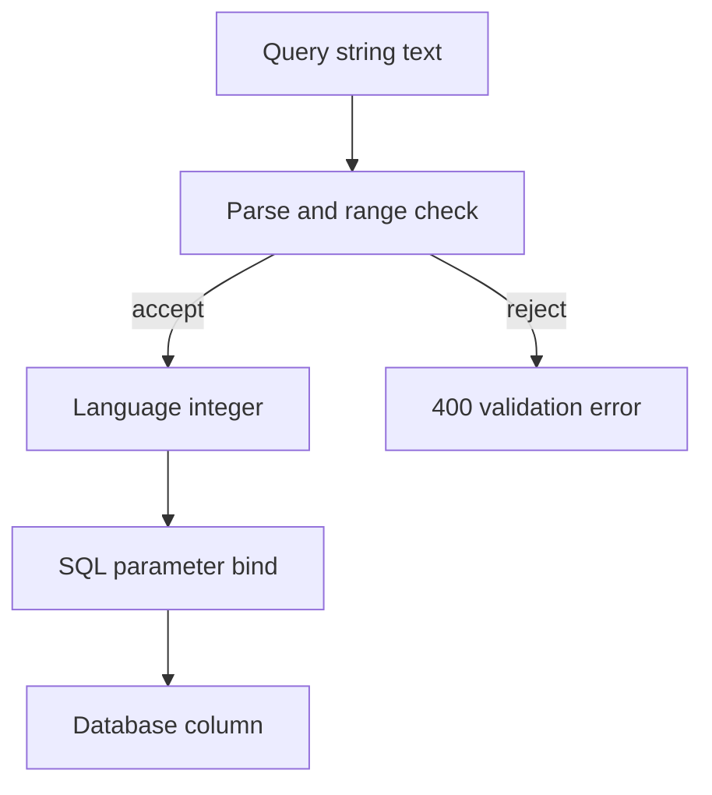

# D01-T001 — Data types, variables, operators, type conversion

Topic ID: `D01-T001`
Domain: Programming Language Fundamentals
Subdomain: Data types, variables, operators, type conversion
Importance: core
Complexity: fundamentals
Dependencies: none (root topic)
Execution status of the code in section F: executed (CPython, local)

## A. Topic Overview

A data type is the set of values a piece of storage may hold and the operations that are legal on those values. A variable is a name bound to a value. Operators combine values. Type conversion changes a value from one type to another.

The concept exists because hardware stores only bit patterns. The language has to decide whether those bits are an integer, a floating-point number, a pointer, or an object header. Without that decision, addition, indexing, and hashing are undefined.

In production this shows up in every API boundary: JSON numbers, database column types, request query strings, and money. Interviewers use it to see whether you notice coercion bugs, overflow, and the difference between primitive and reference types.

Prerequisites: none. Later topics, especially value versus reference semantics (`D01-T005`) and collections (`D01-T012`), assume this one.

## B. First-Principles Explanation

Hardware memory is a sequence of bytes. A type tells the compiler or runtime how many bytes to use and which instructions are legal. An `int` might be 32 bits in two's complement. A `float` is a sign, exponent, and fraction under IEEE 754. A string might be a pointer to bytes plus a length.

Early languages made the programmer track this manually. Assembly has no type checker, so adding a pointer to a float is a silent bug. Typed languages move that check earlier. Static typing checks at compile time. Dynamic typing tags values and checks when the operation runs.

What happens internally:

1. The source names a variable and, in a static language, a type.
2. The compiler reserves a slot (stack slot, register, or object field) sized for that type.
3. An operator is type-checked. `1 + 2` can be an integer add. `1 + "2"` is either rejected or coerced.
4. Conversion either reinterprets bits when the conversion is free and safe, or allocates a new value and translates.

Why it works: every operator's meaning is defined only for specific types, so the compiler can pick one machine instruction. Limitations: finite integers overflow, binary floating point cannot represent most decimal fractions, and implicit conversion hides data loss. Alternatives are arbitrary-precision integers (Python `int`), decimal types for money, and explicit casts that fail closed.

Terms used here: a **primitive** is stored as the value itself. A **reference type** stores a pointer to a heap object. **Coercion** is an implicit conversion. A **cast** is an explicit conversion.

## C. Internal Working and Architecture

Components:

- The type declares size, alignment, and legal operations.
- The variable binding maps a name to a slot in a stack frame, an object field, or a register.
- The operator implementation is either a CPU instruction or a runtime function.
- The converter allocates or reuses a value of the destination type.

Execution for `total = price * quantity` in a static language:

1. Look up `price` and `quantity` and confirm both are numeric.
2. Apply the language's promotion rules (for example Java promotes `int` operands of `*` to `int` multiplication, and promotes mixed `int`/`long` to `long`).
3. Emit a multiply instruction.
4. Store the bits into `total`'s slot.
5. If `total` is a wider type, sign-extend or zero-extend.

In Python the same line loads two objects, reads their type tags, and may call `nb_multiply` on the type object. Integers grow instead of overflowing. That is why Python integers are not a fixed 32-bit slot.

Data flow at an HTTP boundary is the usual backend case: the query string is text, the handler converts it to `int`, the driver binds that integer as a SQL parameter, and the database stores it in an `integer` or `bigint` column. A failed conversion should stop in validation, not become a 500 from the driver.

State is simple. A binding is either uninitialized, holding a value of the declared type, or, in languages with null, holding a null reference. Operators do not change the type of an existing slot. They produce a new value.

Memory: a Java `int` field is 4 bytes inside the object. A Java `Integer` is a heap object with a header plus 4 bytes, and the variable holds a reference. Python integers above a small interned range are full objects.

## D. Diagrams and Visual Models



Read this top to bottom. The only successful path parses text into a typed integer before it touches the database. The side path is a client error, not a cast inside SQL.

## E. Examples and Analogies

Analogy, not an implementation: a type is the shape of a socket. A two-pin plug does not fit a three-pin socket. Conversion is an adapter. A bad adapter that files the pin down will fit and then overheat. Implicit string-to-number coercion is that kind of adapter.

Small technical example: in IEEE 754 double precision, `0.1 + 0.2` is not `0.3` because `0.1` is a repeating binary fraction. Money should be integer minor units or a decimal type, not `float`.

Backend example: a pagination parameter `limit=20` arrives as a string. Convert it with an explicit parse, reject non-integers, and reject values outside 1..100. Then bind the integer to SQL. Do not concatenate it into the query text.

Do not use implicit conversion when the loss matters. JavaScript `==` coerces, so `0 == ""` is true. Use `===` at boundaries. Do not use floating point for ledger balances. Do not store a phone number as an integer. Leading zeros and the plus sign are data, not arithmetic.

## F. Code Examples

File: `examples/d01_t001_types.py`

Dependencies: Python 3 standard library only.

```python
def parse_limit(raw: str, default: int = 20, upper: int = 100) -> int:
    """Convert a query-string limit to an int, or raise ValueError."""
    if raw is None or raw.strip() == "":
        return default
    try:
        value = int(raw, 10)
    except ValueError as exc:
        raise ValueError("limit must be an integer") from exc
    if value < 1 or value > upper:
        raise ValueError(f"limit must be between 1 and {upper}")
    return value


if __name__ == "__main__":
    assert parse_limit("20") == 20
    assert parse_limit("") == 20
    assert parse_limit("100") == 100
    try:
        parse_limit("20abc")
    except ValueError as exc:
        assert str(exc) == "limit must be an integer"
    else:
        raise AssertionError("expected ValueError")
    try:
        parse_limit("0")
    except ValueError:
        pass
    else:
        raise AssertionError("expected range error")
    print("ok", parse_limit("15"))
```

How to run: `python examples/d01_t001_types.py` from this topic's folder, or run the same file under `backend-engineering-knowledge-base/EXERCISES/examples/d01_t001_types.py`.

Expected output: `ok 15`

Important lines: `int(raw, 10)` forces base 10 so a leading zero is not an octal surprise in languages that still have that rule. The range check is part of conversion at a trust boundary, not a separate afterthought. `ValueError` is the failure behavior for malformed input. Callers map it to HTTP 400. They do not catch it and substitute a silent default, because a client that sent `limit=0` asked for something illegal.

Edge cases: whitespace, empty string, `+20` (Python `int` accepts it), values above the upper bound, and boolean values if a JSON parser already turned `true` into a bool. In Python `int(True)` is `1`, so reject `bool` before calling `int` when the source is JSON.

This example was executed with the system Python. Output was `ok 15` and the asserts passed.

## G. Practical Backend Application

A request hits a handler with query parameters as strings. Validation converts and bounds them. The service method then sees only typed values: `user_id: int`, `amount_cents: int`, `currency: str` of length 3. The repository binds those values as parameters. Logs record the typed fields, not the raw string, after redacting secrets.

Concurrent requests do not share these locals. Each call has its own stack bindings. The hazard is shared mutable objects, which is `D01-T005`, not the integer itself.

Error handling: conversion failure is a client error. Overflow when casting a JSON number into a 32-bit database column is also a client error if you detect it, and a data bug if you truncate. Security: parse and bound before the value reaches a shell, a file path, or SQL text. Observability: count conversion failures by field name so a bad client deploy is visible. Scaling: conversion is CPU-cheap compared with the database round trip. The operational cost is inconsistent types across services, which breaks clients during a rollout.

## H. Advantages, Limitations and Trade-offs

| Choice | Benefit | Cost | Choose when | Avoid when |
| --- | --- | --- | --- | --- |
| Static types | Fail before production | More syntax, slower edit cycle | Large services, refactors | Tiny scripts you will throw away |
| Dynamic types | Fast to write | Type errors reach runtime | Prototypes, heterogeneous data | Money, identifiers, public APIs |
| Fixed-width integers | Predictable memory, fast math | Overflow | Counters that fit, bit flags | Values that grow without a bound |
| Arbitrary-precision integers | No overflow | Allocations, slower math | Python domain logic | Tight loops that need primitive speed |
| Decimal or integer cents | Exact money | Awkward math, more storage | Prices, ledgers | Scientific measurement |
| Binary float | Fast, hardware support | Rounding error | Metrics, graphics, ML | Currency |

Under load, boxing millions of `Integer` objects in Java creates allocation and GC pressure. Prefer primitives in hot arrays. Implicit coercion under load does not get slower. It gets wrong in the same way, more often.

Failure modes: silent truncation, `NaN` propagating through aggregates, and locale-dependent decimal commas (`1,25` versus `1.25`).

## I. Common Mistakes and Misconceptions

- Treating JSON numbers as integers. JSON has one number type. A value above 2^53 is not exact in JavaScript. Parse large identifiers as strings.
- Using `float` for money because "it is a number". The mistake comes from the school definition of number. Store minor units.
- Assuming `==` and `===` are the same. In JavaScript `==` coerces. The fix is to convert at the edge and compare with the strict operator.
- Catching a failed parse and using zero. Zero is a real quantity. The caller cannot tell failure from a legitimate zero. Return an error.
- Mutating a numeric wrapper and expecting it to change the caller's primitive. Java `Integer` is immutable. Reassignment binds a new object. The caller still holds the old reference.
- Depending on integer width. Java `int` is 32-bit. Python `int` is unbounded. Go `int` is 32 or 64 bits depending on the architecture. Specify `int64` when the width matters.

A weak interview answer is "types make code safer" with no example of a bug they prevent. A strong answer names overflow, coercion, or a boundary conversion.

## J. Debugging and Troubleshooting

Symptoms: a handler returns 500 on `?limit=abc`. A balance report is off by a cent. A Java service throws `NumberFormatException`. A JavaScript client sends `userId` as a number and the last digits change.

Those are symptoms. Root causes are different: missing validation, binary floating point, a 32-bit column, or JSON number precision.

Diagnosis:

1. Log the raw field type and a redacted value at the boundary.
2. Reproduce with the exact payload. For money, print the value with full decimal expansion, not rounded display.
3. Check the database column type (`integer` versus `bigint` versus `numeric`).
4. In JavaScript, check whether an identifier ever passed through a `number`.

Example message: `ValueError: invalid literal for int() with base 10: '20abc'`.

Immediate mitigation: reject the request with 400 and a field error. Do not coerce. Long-term: one parser per field, contract tests for the boundary, and `numeric` or integer cents in the schema.

Metrics: rate of validation errors by field. A spike after a client release means the client started sending a new shape.

## K. Interview Preparation

### Beginner

#### Q1. What is a data type?

**Answer:** It is the set of legal values and the operations allowed on them. The type tells the language how many bits to use and which instruction implements `+` or indexing. Without it, a bit pattern has no meaning. Interviewers want that link to memory, not only the word "category".

#### Q2. What is the difference between a variable and a value?

**Answer:** A value is the data. A variable is a name bound to storage that currently holds a value. Assignment can replace the binding. In Java, assigning an `int` copies the bits. Assigning an object copies the reference, which is the next topic after this one, but the distinction starts here: the variable is not the object.

#### Q3. What is type conversion?

**Answer:** It produces a value of a different type that represents the source, when that is possible. Widening an `int` to a `long` does not lose magnitude. Narrowing a `long` to an `int` can. Parsing `"20"` into the integer 20 is a conversion from text, not a cast of bits. Failed conversions should be errors at the boundary.

#### Q4. Why is `0.1 + 0.2` not `0.3` in most languages?

**Answer:** Those literals are binary floating-point values. `0.1` has no finite binary expansion, so the stored value is already rounded. Adding two rounded values does not land on the rounded value of `0.3`. This is not a compiler bug. Use integers or a decimal type when the exact decimal matters.

#### Q5. Where do types show up in a web API?

**Answer:** Query strings and form bodies arrive as text. JSON has strings, numbers, booleans, null, arrays, and objects. The database has its own column types. The handler's job is to convert at each boundary and reject values that do not fit, before business logic runs.

### Intermediate

#### Q1. How does Java autoboxing change a loop that increments a counter?

**Answer:** A primitive `int` add is a register operation. An `Integer` counter boxes a new object on each assignment once you leave the cached range, and unboxes to do arithmetic. That allocates and adds GC pressure. It is still correct. It is the wrong representation for a hot counter. Use a primitive, and never use a boxed integer as a lock target that you reassign.

#### Q2. Why can a JavaScript client corrupt a 64-bit identifier?

**Answer:** JavaScript's only number type is IEEE 754 double. Integers above `2^53 - 1` are not all representable. If a service sends a snowflake id as a JSON number, the client rounds it. The fix is to send identifiers as strings, or use a decimal string format the client never puts through `Number`.

#### Q3. What is the difference between implicit and explicit conversion, and when is implicit conversion acceptable?

**Answer:** Implicit conversion happens without syntax at the call site. Explicit conversion is written down. Implicit widening that cannot lose information is reasonable (`int` to `long`). Implicit conversion that changes meaning (`string` to `number`, float to int by truncation) hides bugs. At a service boundary, make the conversion explicit and fail on garbage.

#### Q4. How do Python and Java integers differ when a counter grows without bound?

**Answer:** A Java `int` wraps modulo 2^32 in two's complement. A Java `long` wraps at 64 bits. A Python `int` allocates more digits and does not wrap. Code ported from Python to Java can pass tests with small inputs and wrap in production. Choose the width deliberately, and check the database column matches it.

#### Q5. How should money be typed?

**Answer:** Store an integer in minor units, or a decimal with a fixed scale, plus a currency code. Do not store money as `float` or `double`. Arithmetic on minor units is integer arithmetic. Display formatting is a separate step and must not be the storage format. Mixing currencies in one number is a domain bug, not a conversion bug.

### Advanced

#### Q1. What is integer overflow, and why is it a security bug as well as a logic bug?

**Answer:** Overflow is a result that does not fit the destination width. Two's complement wrap can turn a large positive size into a small or negative size. If that size is used for an allocation or a bounds check, a later copy can write past the buffer. Java does not trap overflow. Languages with checked arithmetic or arbitrary precision do. At a boundary, reject values outside the range you can store. Do not allocate based on an unchecked converted length.

#### Q2. How does a dynamic language implement operators?

**Answer:** Each value carries a type tag or a pointer to a type object. The operator looks up a slot such as "add" on that type and calls it. Python's `nb_add` may return `NotImplemented` so the other operand gets a chance. This is why user classes can overload `+`. It is also why a hot loop in CPython is slower than a Java primitive loop: each add is a call with type checks, not one instruction.

#### Q3. What does a compiler do with a widening conversion versus a narrowing conversion?

**Answer:** Widening integer conversion sign-extends or zero-extends into a larger register. It preserves the value. Narrowing truncates high bits. On floats, widening from single to double preserves the already-rounded single value. It does not recover digits that single precision never stored. A cast in source code is not a request for infinite precision.

#### Q4. Why is `Integer` caching in Java a type-related trap?

**Answer:** The JVM interns `Integer` values from -128 through 127. `Integer.valueOf(1) == Integer.valueOf(1)` can be true because both are the same object. The same comparison for 1000 is false because those are different objects with equal values. `==` on wrappers compares identity, not numeric value. Use `equals` or unbox first. This is a direct consequence of reference types pretending to be numbers.

#### Q5. How do you design conversion at a public API so old and new clients both work?

**Answer:** Accept the documented type only. If you must accept a string or a number for a transition, normalize to one internal type immediately and emit metrics for the legacy shape. Do not let both shapes leak into the domain model. Version the contract when the type changes, because changing a JSON field from number to string breaks clients that already parsed it as a number. That is an API compatibility problem built on this topic.

### Scenarios

#### Q1. Users report that a discount of 10% on 0.10 currency units sometimes charges a cent too much. What do you look at?

**Answer:** Look at the type used for money before you look at the pricing rule. If the column or the service uses binary floating point, the error is representation, not rounding policy. Reproduce with the exact decimal. Move storage to integer minor units. Apply the percentage with integer arithmetic and an explicit rounding mode (half away from zero or banker's rounding) that product agrees to. Add a regression test with values that are not dyadic rationals: 0.10, 0.20, 19.99.

#### Q2. A Go service and a Python service disagree about a user id that started as a JSON number. How can both be correct and still disagree?

**Answer:** The Python side may have kept an arbitrary-precision int. A JavaScript hop in between may have rounded it. Go's `encoding/json` decodes numbers into `float64` by default unless you use `json.Number` or a string. Each service followed its default. The fix is a shared contract: ids are strings, or they are decimal strings parsed into a 64-bit integer with an overflow check. Add a contract test that uses an id above 2^53.

#### Q3. Logs show `NumberFormatException` spikes after a mobile release. The database is healthy. What is the failing component?

**Answer:** The new client is sending a field the server parses as a number, in a shape the parser rejects: empty string, a decimal, a thousands separator, or a locale comma. The database is not involved yet. Check the access log for the raw query or body. Compare with the previous app version. Tighten the error so the response names the field, and fix the client. Do not loosen the parser to accept commas unless the contract says so.

#### Q4. A batch job writes `int` counts into a Java `int` and the dashboard shows negative request totals after a traffic spike. What happened?

**Answer:** The counter overflowed 2^31 - 1 and wrapped to a negative value. The spike is the trigger, not the root cause. The root cause is a fixed-width accumulator. Move the counter to a 64-bit integer, and check the metric type as well, because some client libraries use 32-bit fields. Add an alert on negative totals, which are impossible for a count.

#### Q5. You must accept CSV uploads of amounts from finance. The file uses comma decimals. What conversion rules do you publish?

**Answer:** Publish the expected column types, the decimal separator, the currency column, and the rejection rules. Parse with an explicit locale or, better, require a normalized format (dot decimal, no thousands separator) and give finance a template. Reject rows you cannot parse. Do not guess. Store accepted rows as integer cents. Return a row-level error report so a bad file does not become a silent zero.

### Follow-ups

#### Q1. How does this connect to database column types?

**Answer:** The application type and the column type are two types with a driver conversion between them. A mismatch (Python `int` into a 32-bit `integer`, or a decimal into `float`) reintroduces overflow or rounding after you fixed it in the service. The column is part of the type design, not a storage detail. See `D07-T002`.

#### Q2. What happens to types under concurrency?

**Answer:** An immutable primitive on the stack is not a race. A shared mutable variable written by two threads is a race even when the type is `int`, because the read-modify-write is not atomic. The type does not give you atomicity. That is `D01-T016` and `D13-T006`.

#### Q3. Why do API schema tools exist if the language is already typed?

**Answer:** The language type checker does not see the JSON document a client in another language will send. A schema (OpenAPI, JSON Schema, protobuf) is the cross-language type. Code generation keeps the two from drifting. The runtime still has to validate, because the network does not enforce the schema.

## L. Practical Exercises

Solutions are in `EXERCISES/solutions/D01-T001.md`. Try these before opening that file.

### Exercise 1 — implementation

Implement `parse_limit` as in section F, plus a `parse_user_id` that accepts only a positive base-10 integer and rejects boolean JSON values if you add a JSON entry point. Acceptance: empty limit uses the default, `20abc` and `0` and `101` raise, `100` is accepted, and ids above 2^31 - 1 are rejected if the destination column is 32-bit.

### Exercise 2 — debugging

A statement shows a charge of `0.30000000000000004` for three items priced `0.10`. Identify the type bug, name the storage type you would migrate to, and list two amounts you would put in a regression test. Acceptance: you reject binary float as the store of record and you name an explicit rounding rule for display.

### Exercise 3 — trade-off

A public API currently returns `"id": 123`. Product wants snowflake ids. Choose string or number for the JSON field. State what breaks for existing JavaScript clients if you keep the field as a number, and how you would version the change. Acceptance: you mention the 53-bit mantissa and a compatibility plan, not only "use a string".

## M. Revision Notes

- A type defines values, size, and legal operations.
- Convert at boundaries. Fail on garbage. Do not coerce quietly.
- Fixed-width integers wrap. Python integers do not. JavaScript numbers are doubles.
- `0.1 + 0.2 != 0.3` is floating point, not a mystery.
- Money is integer minor units or decimal, plus a currency code.
- `==` on boxed numbers can mean identity.
- Query strings are text until you parse them.

Flashcards:

- What is coercion? An implicit conversion.
- What is a cast? An explicit conversion.
- Why send large ids as strings in JSON? IEEE 754 doubles cannot represent every integer above 2^53.

## N. Related Topics

Understand this before: nothing.

This topic supports: `D01-T002` control flow (conditions use booleans), `D01-T005` value versus reference semantics, `D01-T012` collections (hashing depends on equality and stable types).

Often confused with: type conversion versus casting bits, and JSON number versus integer.

Interviewers combine this with `D06-T005` request schemas, `D07-T002` column types, and `D12-T024` input validation.

## O. Completion Criteria

- Explain a type as values plus operations plus representation, without reading this note.
- Draw the path from query text to a bound SQL parameter, including the rejection path.
- Implement a parser that rejects malformed and out-of-range input.
- Debug a one-cent money error and a wrapped counter as type bugs.
- Choose integer, decimal, or float for a new field and say why.
- Answer why a JavaScript client corrupts a 64-bit id.
