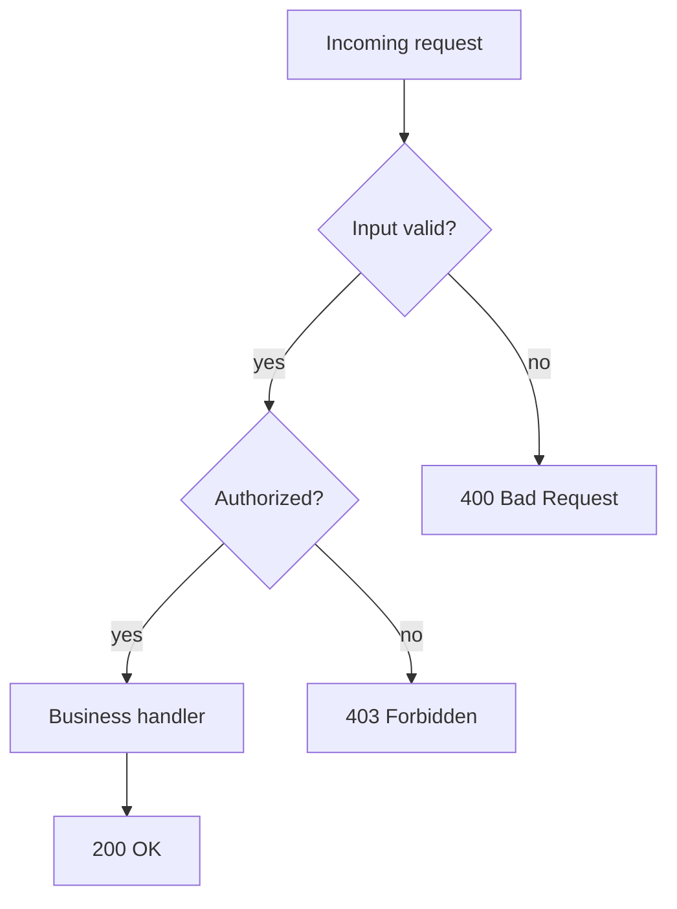

# D01-T002 — Control flow, loops, functions, recursion

Topic ID: `D01-T002`
Domain: Programming Language Fundamentals
Subdomain: Control flow, loops, functions, recursion
Importance: core
Complexity: fundamentals
Dependencies: `D01-T001` (booleans and types in conditions)
Execution status of the code in section F: not executed in this authoring session (run locally to verify)

## A. Topic Overview

Control flow decides which statements run next. Loops repeat work until a condition changes. Functions package named behavior with parameters and return values. Recursion solves a problem by calling the same function on a smaller instance of the same problem.

These ideas exist because real programs are not linear scripts. Services branch on auth results, retry failed calls, paginate through data, and walk trees. Without structured control flow, duplication and bugs multiply.

In backend work you see this in request handlers (early returns on validation failure), worker loops (poll until shutdown), middleware chains, and recursive directory or JSON traversal. Interviewers use recursion and loop invariants to test whether you can reason about termination, stack depth, and side effects.

Prerequisites: `D01-T001` for boolean conditions and comparison operators. Later topics on concurrency (`D01-T016`) assume you know what a function call and a loop body mean.

## B. First-Principles Explanation

A CPU executes instructions in order until a branch instruction jumps elsewhere. High-level languages compile `if`, `while`, and `for` into compare-and-branch sequences. A function call pushes a new stack frame with parameters and locals, runs the body, then pops the frame and jumps back with a return value.

A loop is a branch that jumps backward. Termination requires a guard that eventually becomes false, or an explicit break. An infinite loop is often a missing increment or a condition that never changes.

Recursion is a call that targets the same function before the current call finishes. The runtime must save each incomplete call on the call stack. Each recursive step should move toward a base case where no further call happens. Without that, you get stack overflow, not an infinite loop in the source text.

Functions exist to name behavior, hide implementation, and pass data through parameters instead of globals. Pure functions (no observable side effects) are easier to test. Impure functions that mutate shared state need clear contracts.

Why it works: the call stack is a LIFO structure of frames; each frame has its own locals. Limitations: deep recursion costs stack space; mutual recursion can confuse readers; loops with hidden side effects are hard to parallelize. Alternatives: iteration with an explicit stack for tree walks, trampolining in functional languages, and async event loops instead of blocking retry loops.

## C. Internal Working and Architecture

Components:

- The condition evaluator reads values and produces a boolean (or truthy/falsy in some languages).
- The branch selects one of two (or more) code paths.
- The loop header re-evaluates the guard each iteration.
- The function call mechanism allocates a frame, binds parameters, executes the body, then returns.

Execution for `retry_with_backoff` style logic:

1. Enter function with `attempt = 1`.
2. Try the operation in a try/catch or equivalent.
3. On success, return immediately (early exit).
4. On failure, if attempts remain, sleep with computed delay and increment attempt.
5. If attempts exhausted, re-raise or wrap the last error.

For recursion on `factorial(n)`:

1. If `n <= 1`, return 1 without another call (base case).
2. Otherwise return `n * factorial(n - 1)`, which pushes a new frame with `n-1`.
3. Frames unwind when each call completes, multiplying on the way back.

Data flow in a handler: validate input → if invalid return 400 → else call service → if not found return 404 → else return 200 with body. Each branch short-circuits; no nested else-pyramid is required if you use guard clauses.

State: loop variables and locals live in the frame. Shared mutable state outside the function is visible to every iteration unless you shadow or copy it. Recursion does not create a new thread; it is still one stack on one thread.

Memory: each recursive call adds a frame (parameters, return address, locals). A loop reuses one frame. That is why iterative factorial is preferred for very large `n` in stack-limited environments.

## D. Diagrams and Visual Models



Read this left to right and top to bottom. Each diamond is a decision; only one outgoing path is taken per request. Early exits prevent unauthorized or invalid work from reaching the handler. This is guard-clause control flow, not a deep nested if-tree.

## E. Examples and Analogies

Analogy: a function is a recipe with ingredients (parameters) and a finished dish (return value). A loop is washing dishes until the sink is empty. Recursion is Russian nested dolls: open one doll only to find a smaller doll until you reach the solid core (base case).

Backend example: polling a queue in a worker `while not shutdown: message = dequeue(); process(message)`. The shutdown flag is the loop guard. Processing is a function call so tests can call `process` without the loop.

Recursion example: walking a JSON object for a field path `a.b.c`. Each object level is one recursive step; arrays may need iteration inside the function.

Do not use recursion when depth is unbounded (filesystem paths, attacker-controlled JSON). Use an explicit stack or iteration. Do not retry forever without backoff and a cap; you will DDoS your own dependencies. Do not put heavy work in a finally block that runs on every branch unless you intend that cost.

## F. Code Examples

File: `examples/d01_t002_control_flow.py`

Dependencies: Python 3 standard library only.

```python
def retry_with_backoff(fn, *, max_attempts=5, base_delay_sec=0.01, jitter=0.005):
    if max_attempts < 1:
        raise ValueError("max_attempts must be >= 1")
    last_exc = None
    for attempt in range(1, max_attempts + 1):
        try:
            return fn()
        except Exception as exc:
            last_exc = exc
            if attempt == max_attempts:
                break
            delay = base_delay_sec * (2 ** (attempt - 1)) + random.uniform(0, jitter)
            time.sleep(delay)
    raise last_exc


def factorial_iter(n: int) -> int:
    if n < 0:
        raise ValueError("n must be non-negative")
    result = 1
    for k in range(2, n + 1):
        result *= k
    return result


def factorial_rec(n: int) -> int:
    if n < 0:
        raise ValueError("n must be non-negative")
    if n <= 1:
        return 1
    return n * factorial_rec(n - 1)
```

How to run: `python backend-engineering-knowledge-base/EXERCISES/examples/d01_t002_control_flow.py`

Expected output: `ok 720 3` (factorial of 6 and three calls before flaky succeeds)

Important lines: the `for attempt in range` loop is the retry guard; `break` on last failure avoids sleeping unnecessarily. `factorial_rec` shows base case `n <= 1` before the recursive multiply. `factorial_iter` is the production-safe form for large `n` in CPython because recursion depth is limited.

Edge cases: `max_attempts=0` should raise; `n=0` factorial is 1 by convention; flaky callee that always fails exhausts attempts and re-raises; concurrent retries need jitter to avoid thundering herd.

This example was not executed during authoring. Run locally and update the header execution status after verification.

## G. Practical Backend Application

HTTP handlers use guard clauses: validate, authorize, then execute. Service methods return errors as values or exceptions; the controller maps them to status codes. Background workers combine `while` loops with graceful shutdown signals.

Retry logic belongs in a small function with caps, exponential backoff, and idempotency checks on the operation. Recursion appears in permission trees, category paths, and parsing nested expressions; cap depth and reject cycles.

Error handling: distinguish retryable (503, timeout) from permanent (400, 404). Logging inside tight loops needs sampling. Security: do not recurse on user-controlled depth without a limit. Observability: count retry attempts and loop iterations per job. Scaling: tight loops on hot paths should avoid allocations; prefer iteration over deep recursion.

## H. Advantages, Limitations and Trade-offs

| Choice | Benefit | Cost | Choose when | Avoid when |
| --- | --- | --- | --- | --- |
| Guard clauses | Flat readable handlers | Many early returns | HTTP APIs | When every branch needs shared cleanup |
| `for` loop | Clear iteration count | Off-by-one bugs | Known ranges, collections | Infinite streams without break |
| `while` loop | Unknown iteration count | Forgotten guard → hang | Poll until condition | Condition never updates |
| Recursion | Matches tree problem shape | Stack depth, overhead | Small bounded depth | Adversarial depth |
| Named functions | Testable units | Indirection | Any reused logic | One-line wrappers everywhere |
| Tail recursion | Theoretical stack reuse | Not guaranteed in Python/Java | Languages that optimize it | CPython hot paths |

Failure modes: infinite retry storm, stack overflow on deep JSON, off-by-one pagination skipping a page, and returning inside a loop by mistake when you meant to continue.

## I. Common Mistakes and Misconceptions

- Using recursion for simple linear scans. A `for` loop is clearer and cheaper.
- Missing base case in recursion, or base case that never triggers for some inputs.
- `continue`/`break` confusion in nested loops; label or refactor instead of guessing.
- Catching `Exception` too broadly in retry loops and retrying programmer bugs.
- Mutating a loop variable that is also the iteration range (skipping elements).
- Thinking `return` inside a `lambda` returns from the outer function (it does not in Python).

Weak interview answer: "recursion is always elegant." Strong answer: names base case, stack cost, and when iteration or an explicit stack wins.

## J. Debugging and Troubleshooting

Symptoms: worker CPU at 100% with no progress (infinite loop). Stack overflow on import or request (runaway recursion). Intermittent 503s (retry without backoff). Wrong page counts (off-by-one).

Diagnosis:

1. Log loop guard variables each N iterations in staging.
2. Reproduce recursion depth with the smallest input that fails.
3. Count retry attempts in metrics; graph versus dependency latency.
4. Use a debugger breakpoint on the suspicious branch condition.

Example: `RecursionError: maximum recursion depth exceeded` means add iteration or raise the limit only after proving depth is bounded.

Mitigation: max attempts, circuit breaker, recursion depth counter, and property tests for loop invariants.

## K. Interview Preparation

### Beginner

#### Q1. What is an if/else statement for?

**Answer:** It chooses one of two blocks based on whether a condition is true or false. Only one branch runs per evaluation. In backends it implements validation gates and authorization checks. Without it every request would run the same path regardless of input.

#### Q2. What is the difference between a for loop and a while loop?

**Answer:** A for loop iterates over a known sequence or range, which makes the number of steps predictable when the collection length is fixed. A while loop repeats while a condition holds, which fits polling and read-until-EOF patterns. Both need a clear termination story; a while loop fails more often when the condition never changes.

#### Q3. What does a function return value represent?

**Answer:** It is the output of the function call expression, passed back to the caller. The caller can assign it, pass it onward, or ignore it. Returning early avoids extra nesting when invalid input is detected. Void or unit return means the function is used only for side effects.

#### Q4. What is a base case in recursion?

**Answer:** It is the input size or shape where the function returns without calling itself again. It stops the chain of calls. For factorial, `n <= 1` returning 1 is the base case. Without a base case the calls never end until the stack overflows.

#### Q5. Why use functions instead of copying code?

**Answer:** Functions give one place to fix bugs and one place to test behavior. Parameters make dependencies explicit instead of relying on globals. Names document intent at the call site. Duplicated loops diverge over time when one copy gets a bugfix and the other does not.

### Intermediate

#### Q1. How does early return change error handling in a handler?

**Answer:** Each validation failure returns immediately with the appropriate status code. The happy path stays at the left margin without deep else chains. Callers never see partially validated state enter the service layer. This pattern maps cleanly to middleware that short-circuits before the controller.

#### Q2. When is recursion preferable to a loop?

**Answer:** When the data is naturally recursive and depth is bounded, such as a fixed-max-depth config tree. The code mirrors the data shape, which can reduce bugs in tree walks. When depth can grow with user input, prefer an explicit stack or iteration. Interviewers want you to name the depth bound.

#### Q3. What is exponential backoff in a retry loop?

**Answer:** After each failure the sleep duration multiplies by a factor before the next attempt. It spreads retries in time so a recovering dependency is not hit by all clients at once. A cap on attempts prevents infinite load. Jitter adds randomness so synchronized clients do not retry in lockstep.

#### Q4. What is a loop invariant?

**Answer:** It is a property that remains true before and after each iteration. For binary search, the target remains inside the narrowed range if it was ever present. Stating the invariant proves termination and correctness. It is a common follow-up when you write a while loop in an interview.

#### Q5. How do break and continue differ?

**Answer:** `break` exits the innermost loop entirely and continues after the loop. `continue` skips the rest of the current iteration and jumps to the next guard check. Misusing them in nested loops causes skipped elements or accidental infinite loops. Refactoring to a helper function often clarifies intent.

### Advanced

#### Q1. What is tail recursion and does Python optimize it?

**Answer:** Tail recursion is when the recursive call is the last action in the function, so theoretically the frame can be reused. CPython does not eliminate tail calls; deep recursion still consumes stack. Some functional languages and LLVM backends do optimize it. In Python you rewrite to a loop or use trampolining if you need deep linear recursion.

#### Q2. How can mutual recursion cause subtle bugs?

**Answer:** Two functions call each other, which spreads logic across names and makes the call graph harder to follow. Termination depends on both functions respecting the same shrinking measure. Stack traces become longer and harder to read in production. Refactoring to one function with an explicit state machine often improves debuggability.

#### Q3. What happens to the call stack on an exception before Python 3.11?

**Answer:** Frames are unwound while exception handlers run; finally blocks execute on the way out. If a finally block raises or returns, it can mask the original error. In async code, the logical stack spans tasks, which complicates tracing. Modern tracebacks chain exceptions with `raise ... from` for clarity.

#### Q4. Why avoid retrying non-idempotent POST without care?

**Answer:** A retry may execute the side effect twice if the first attempt succeeded but the response was lost. Control flow that blindly loops on any exception can double-charge or duplicate records. Retries belong behind idempotency keys or deduplication stores. The loop guard must distinguish retryable transport errors from business failures.

#### Q5. How do you bound work in a recursive JSON walk?

**Answer:** Track depth and abort when it exceeds a limit. Detect cycles with a visited set of object ids for graphs, not just trees. Reject documents over a size cap before parsing. These limits are control-flow decisions as much as security policy.

### Scenarios

#### Q1. A worker loop never stops after deploy even though the queue is empty. What do you check?

**Answer:** Inspect the while condition and whether dequeue blocks forever versus returning null. A common bug is `while True` without checking the shutdown flag or receiving a poison pill. Another is treating an empty poll as an error and continuing without sleep, burning CPU. Add metrics on idle iterations and verify the shutdown signal is wired.

#### Q2. An API times out when resolving nested org units ten levels deep. Recursion or iteration?

**Answer:** Ten levels is fine for either if each call does O(1) work. If each level hits the database, the problem is N round trips, not recursion itself. Batch load the tree or cache the hierarchy. If user-controlled depth can be thousands, enforce a max depth and return 400 instead of overflowing stack or timing out.

#### Q3. Clients see duplicate orders after a gateway blip. Which control-flow bug fits?

**Answer:** A retry loop or client SDK retry fired again after the server committed but the ACK was lost. The handler was not idempotent. Fix with idempotency keys checked in a transaction before insert. Retries should only happen for known-safe failures, not for a generic catch-all.

#### Q4. Pagination skips every other page after a code change. What loop mistake?

**Answer:** Likely an off-by-one in the offset or cursor update, or `continue` after fetching without advancing the cursor. Compare the loop invariant: after each iteration, the cursor should point to the next unseen row. Reproduce with two pages of test data and log cursor values.

#### Q5. Stack overflow in a template engine rendering nested includes. What now?

**Answer:** User or designer created a cyclic include. Recursion has no base case. Detect cycles with a visited set of template names or cap include depth. Return a clear error at render time instead of crashing the process.

### Follow-ups

#### Q1. How does control flow interact with concurrency?

**Answer:** Each thread has its own stack and runs its own control flow independently. A loop in one thread does not advance another thread's loop variable. Shared state still needs locks regardless of how tidy the if statements are. See `D01-T016`.

#### Q2. How do exceptions change flow compared to return codes?

**Answer:** Exceptions unwind the stack until a matching handler runs, skipping normal returns on the path. Return codes require the caller to check every time. Many Java and C# services use exceptions for exceptional paths and result types for expected failures. Mixing both in one module confuses readers.

#### Q3. Where do functions meet API design?

**Answer:** Each endpoint handler is a thin function mapping HTTP to a service call. Service functions should be small enough to unit test without HTTP. Recursive internal helpers should not leak to public API surfaces. See `D06-T005` for schema boundaries.

## L. Practical Exercises

Solutions are in `EXERCISES/solutions/D01-T002.md`. Try these before opening that file.

### Exercise 1 — implementation

Implement `retry_with_backoff` and both factorial functions as in section F. Add a `max_total_sleep_sec` cap so retries never sleep longer than that budget in aggregate. Acceptance: succeeds on third flaky attempt, raises after max attempts, rejects negative `n`, and respects the sleep budget.

### Exercise 2 — debugging

A paginated export uses `offset += limit` inside a `for page in range(total_pages)` but also `continue` on empty rows, skipping offsets. Explain the bug and write the invariant the loop should maintain. Acceptance: names off-by-one or double advance and states cursor monotonicity.

### Exercise 3 — trade-off

Choose recursion versus an explicit stack for walking a comment thread tree with unknown depth. State stack limits, cycle detection, and how you would test depth limits. Acceptance: mentions adversarial depth and explicit max depth policy.

## M. Revision Notes

- Guard clauses flatten handlers; validate then authorize then work.
- Every loop needs a termination argument; state the invariant for while loops.
- Recursion needs a base case; depth must be bounded for user data.
- Retry with cap, backoff, and jitter; only retry idempotent or deduped work.
- Prefer iteration when depth or performance matters in CPython and JVM.
- `break` exits the loop; `continue` skips to the next iteration.

Flashcards:

- Base case? The recursive input where no further call happens.
- Thundering herd? Many clients retry at once without jitter.
- Guard clause? Early return on failure before main logic.

## N. Related Topics

Understand this before: `D01-T001` for conditions and types.

This topic supports: `D01-T003` pointers and references (parameters pass by value or reference), `D01-T012` collections (iteration), `D01-T016` concurrency (loops across threads).

Often confused with: recursion versus iteration efficiency, and retry versus duplicate side effects.

Interviewers combine this with `D13-T003` resilience patterns and `D12-T024` validation at handler entry.

## O. Completion Criteria

- Draw a request path with validation, auth, and handler branches.
- Implement capped retry with exponential backoff and explain jitter.
- Write factorial iteratively and recursively and state stack trade-offs.
- Debug an infinite worker loop and an off-by-one pagination loop.
- Choose recursion or iteration for a tree walk with a depth policy.
- Answer tail-recursion and idempotent retry questions with concrete examples.
