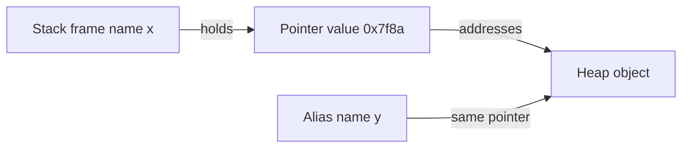

# D01-T003 — Pointers, references, memory management

Topic ID: `D01-T003`
Domain: Programming Language Fundamentals
Subdomain: Pointers, references, memory management
Importance: core
Complexity: fundamentals
Dependencies: `D01-T001`, `D01-T002`
Execution status of the code in section F: not executed in this authoring session (run locally to verify)

## A. Topic Overview

A pointer is a value that holds the address of another value in memory. A reference (in C++ or Java) is an alias to an existing object, usually with safer syntax than raw pointers. Memory management is the discipline of allocating storage, using it, and releasing it so the program does not leak or corrupt memory.

These concepts exist because the CPU only understands addresses and bytes. High-level languages hide addresses, but bugs still appear when multiple names refer to the same heap object, when dangling pointers outlive allocations, or when garbage collectors pause under load.

Backend engineers meet this in C/C++ extensions, Rust services, JNI boundaries, and in every language when they pass collections by reference, share caches, or debug "it changed under me" mutations. Interviewers test whether you know the difference between copying a pointer and copying the pointed-to data.

Prerequisites: variables and functions (`D01-T001`, `D01-T002`). Stack versus heap (`D01-T004`) and value versus reference semantics (`D01-T005`) deepen the same picture.

## B. First-Principles Explanation

Physical RAM is indexed by address. A pointer stores that index (or an offset into a virtual address space). Loading through a pointer reads bytes at that address according to a type. Writing through a pointer mutates those bytes.

In managed languages like Java or Python, variables for objects hold references (handles) to heap objects, not the object bits themselves. You cannot take the numeric address in safe Java; Python exposes `id()` for identity debugging but not arbitrary pointer arithmetic.

Memory management strategies:

1. Manual: `malloc`/`free` in C; programmer owns lifetime.
2. Scoped: Rust ownership and borrow checker; C++ smart pointers.
3. Garbage collection: JVM, Go, Python trace unreachable objects.

A dangling pointer points to freed memory. Use-after-free is undefined behavior in C and a security class bug. Double free corrupts allocators. Leaks forget to free, so long-running servers grow until OOM.

Why references help: function parameters can alias the same object without copying. Why they hurt: hidden mutations and data races when aliases cross threads without synchronization.

Alternatives: value semantics (copy on write), immutable data structures, and arena allocators for request-scoped lifetimes in high-throughput servers.

## C. Internal Working and Architecture

Components:

- The address space maps virtual addresses to physical pages via the MMU.
- The stack pointer and heap allocator track where new storage may go.
- A pointer value is typically one word (4 or 8 bytes) holding an address.
- A reference type in the language may compile to a pointer with restrictions (no null in Rust references, no reseating in C++ references).

Call flow passing a pointer in C:

1. Caller pushes the address of a local or heap object.
2. Callee receives the pointer value in a parameter slot.
3. Callee dereferences to read or write the object.
4. If callee frees the object and caller dereferences again, UB.

In Python `bind_alias(container, key, value)`:

1. `container` is a reference to a dict object on the heap.
2. Assignment `container[key] = value` mutates that object.
3. Returning `container` returns the same reference; `alias is original` is true.

Data flow in a cache: service holds a reference to a shared map; a request handler mutates an entry; another request sees the change unless you copy defensively at the boundary.

State: manual memory has explicit states (allocated, freed). GC objects are reachable or unreachable from roots (stacks, globals, registers). Rust tracks moved versus borrowed at compile time.

Memory: pointer size limits how much address space is directly reachable. On 64-bit systems user space is large but not infinite; leaks still matter in 64-bit servers.

## D. Diagrams and Visual Models



Read left to right: the name `x` in a stack frame stores a pointer word. That word points at the heap object. Another name `y` can hold the same pointer value, so both names alias one object. Mutations through either name are visible to both.

## E. Examples and Analogies

Analogy: a pointer is a street address on an envelope. The house is the object. Two envelopes with the same address deliver mail to the same house. Burning the house (free) while someone still has the address is use-after-free.

Backend example: a shared in-memory rate-limit map keyed by API key. Each goroutine holds a reference to the same map struct. Updates are visible everywhere; you need mutexes or sharded maps.

Python example: `id(a) == id(b)` means same object, not equal value. `is` tests identity (reference), `==` tests value.

Do not return a pointer to a stack local in C after the function returns. Do not share mutable singletons across requests without locking. Do not assume `deepcopy` is free; it is a correctness tool.

## F. Code Examples

File: `examples/d01_t003_references.py`

Dependencies: Python 3 standard library only.

```python
from copy import deepcopy


def bind_alias(container, key, value):
    container[key] = value
    return container


def shallow_snapshot(data):
    return dict(data)


if __name__ == "__main__":
    original = {"user_id": 42, "tags": ["a"]}
    alias = bind_alias(original, "user_id", 99)
    assert alias is original
    snap = shallow_snapshot(original)
    snap["tags"].append("b")
    assert "b" in original["tags"]
    deep = deepcopy(original)
    deep["tags"].append("c")
    assert "c" not in original["tags"]
    print("ok", id(original) == id(alias))
```

How to run: `python backend-engineering-knowledge-base/EXERCISES/examples/d01_t003_references.py`

Expected output: `ok True`

Important lines: `alias is original` shows reference semantics for dicts. Shallow copy duplicates the outer dict but shares nested lists. `deepcopy` breaks all sharing for nested mutable structures.

Edge cases: immutable values (ints, strings) look like copying because reassignment binds a new object; mutating methods on shared lists still alias. `replace_outer` that returns a new dict does not change the caller's binding unless assigned.

This example was not executed during authoring. Run locally and update the header execution status after verification.

## G. Practical Backend Application

JNI and FFI pass pointers across language boundaries; lifetime must be documented. Rust services expose `&str` borrows versus owned `String` in APIs. Go passes slices and maps by reference-like headers pointing to underlying arrays.

Connection pools hand out references to live connections; returning a connection to the pool is explicit lifetime management. ORM entities are often mutable references tied to a session scope.

Error handling: null pointer dereference crashes native code; NPE in Java is the managed equivalent. Security: use-after-free enables exploit chains in native code. Observability: heap dumps and GC logs reveal retention. Scaling: reduce sharing of mutable references; prefer immutable snapshots per request.

## H. Advantages, Limitations and Trade-offs

| Choice | Benefit | Cost | Choose when | Avoid when |
| --- | --- | --- | --- | --- |
| Raw pointers | Zero-cost indirection | UB if misused | Systems code, hot paths | Application business logic |
| Smart pointers | Automatic release | Overhead, learning curve | Modern C++ | C ABI boundaries |
| GC | No manual free | Pauses, retention bugs | Most services | Hard real-time |
| Borrowing (Rust) | Compile-time safety | Compiler friction | New systems services | Rapid throwaway scripts |
| Shallow copy | Fast | Shared nested mutation | Read-mostly trees | Hand-off across threads |
| Deep copy | Isolation | CPU and memory | Per-request snapshots | Huge graphs every call |

Failure modes: leak, double free, stale cache reference after invalidation, and accidental global mutable singleton.

## I. Common Mistakes and Misconceptions

- Thinking assignment copies objects in Java/Python for all types. It copies references for objects.
- Using `==` when you need identity for interned or cached objects.
- Returning interior pointers to freed buffers in C extensions.
- Holding a reference to a ORM entity after the session closes (lazy load fails).
- Believing GC eliminates all memory bugs; retention keeps objects alive forever.
- Confusing pointer constness with deep immutability of nested structures.

Weak answer: "Python has no pointers." Strong answer: "Python has references; `is` and aliasing behave like pointers without arithmetic."

## J. Debugging and Troubleshooting

Symptoms: memory grows until OOM; random crashes in native module; "works in dev" when single-threaded but corrupts under load.

Diagnosis:

1. Heap dump or `tracemalloc` in Python; MAT or async-profiler in JVM.
2. Valgrind or ASan for native leaks and use-after-free.
3. Log `id()` or object identity when mutation surprises appear.
4. Check for static mutable caches keyed by request data.

Mitigation: scope-bound lifetimes, weak references for caches, copy at trust boundaries, and Rust/ownership at FFI edges.

## K. Interview Preparation

### Beginner

#### Q1. What is a pointer?

**Answer:** It is a value that stores the address of another value in memory. Dereferencing the pointer reads or writes the bytes at that address. In C you can perform arithmetic on pointers within an array. Managed languages hide the numeric address but still use references to heap objects.

#### Q2. What is the difference between a pointer and a reference in C++?

**Answer:** A reference must bind to an existing object and cannot be reseated to another object later. A pointer can be null and can be reassigned to point elsewhere. References are often implemented as pointers under the hood with syntax sugar. Neither copies the object unless you dereference and assign fields or use an explicit copy constructor.

#### Q3. What is a memory leak?

**Answer:** Allocated memory is never freed and remains unreachable but not collectable in manual management. In GC languages a leak is often lingering references that keep objects reachable. Symptoms are steady RSS growth on long-running servers. Fixing it requires finding who still holds the reference or who skipped `free`.

#### Q4. What does dereferencing mean?

**Answer:** It follows the pointer to access the object it points to. In C `*p` reads the value at `p`. If `p` is invalid, the program may crash or corrupt data. In Java, object field access through a reference is a safe dereference with null checks.

#### Q5. Why can two variables change the same object?

**Answer:** Both variables hold references or pointers to the same heap object. Mutation through one name is visible through the other because there is only one object in memory. Assignment of the reference copies the address word, not the whole object. This is aliasing.

### Intermediate

#### Q1. What is use-after-free?

**Answer:** Code dereferences a pointer after the memory has been freed. The allocator may hand the same address to another object, so writes corrupt unrelated data. It is undefined behavior in C and a critical security issue. Smart pointers and clear ownership boundaries prevent it.

#### Q2. How does Java pass arguments to methods?

**Answer:** Java passes all arguments by value. For objects, the value copied is the reference, so the callee can mutate the object but cannot rebind the caller's variable to a new object. Primitives are copied bitwise. This matches Python's model for names and object references.

#### Q3. What is the difference between shallow and deep copy?

**Answer:** Shallow copy duplicates the top container but shares nested mutable children. Deep copy recursively duplicates the whole graph. Shallow is faster but unsafe if you hand the copy to another thread expecting isolation. Choose based on whether nested mutation must be independent.

#### Q4. What are stack and heap in relation to pointers?

**Answer:** Stack frames hold locals; taking the address of a local yields a pointer valid only until the function returns. Heap objects live until freed or collected; pointers to heap can outlive the allocating function if stored elsewhere. Returning a pointer to a stack local is a classic bug.

#### Q5. What is a dangling reference?

**Answer:** A reference or pointer that still exists after its referent's lifetime ended. In Rust the borrow checker rejects most cases at compile time. In C++ a reference to a temporary or a freed heap block dangles. Using it reads garbage or crashes.

### Advanced

#### Q1. How does a generational garbage collector relate to references?

**Answer:** Young objects are collected often; survivors are promoted. Most objects die young, so minor collections are cheap. References from old to young need remembered sets or write barriers so the collector does not miss live objects. Misunderstanding this leads to surprise promotion and full GC pauses under allocation spikes.

#### Q2. What is escape analysis?

**Answer:** The compiler decides whether an object's references leave the current method or thread. If not, it may allocate on the stack or elide allocations entirely. JVM and Go do this for hot paths. It changes performance without changing reference semantics visible to the programmer.

#### Q3. Why are interior pointers dangerous in FFI?

**Answer:** A pointer into the middle of a Java byte array or Python buffer may be invalidated when the VM moves or resizes the object unless pinned. Native code must use APIs that pin or copy for the duration of the call. Unpinned interior pointers cause rare crashes under GC.

#### Q4. What is reference counting versus tracing GC?

**Answer:** Reference counting frees when the count hits zero, which is eager but struggles with cycles unless a cycle collector runs. Tracing GC finds all reachable objects from roots and frees the rest, which handles cycles naturally but pauses while tracing. Rust uses ownership plus RC (`Arc`) when shared lifetime is needed.

#### Q5. How do weak references help caches?

**Answer:** A weak reference does not keep the object alive. When memory pressure hits, the referent can be collected and the cache entry becomes empty. You recompute on miss. Strong references in an unbounded cache leak retention. `WeakHashMap` in Java and `weakref` in Python support this pattern.

### Scenarios

#### Q1. A Python handler mutates a default `{}` argument and later requests see stale data. Why?

**Answer:** Default argument objects are created once at function definition time. Each call shares the same dict reference. Mutations persist across requests in a long-lived worker process. Fix: use `None` default and assign a new dict inside the function.

#### Q2. Native extension crashes only under GC pressure. What hypothesis?

**Answer:** The extension held a raw pointer into a managed object without pinning. When the collector moved the object, the pointer became invalid. Reproduce with aggressive GC flags and load tests. Fix by copying data into native-owned memory or using the official buffer API for the duration of use.

#### Q3. Two services share a Redis object deserialized into mutable maps. One patches a nested list; the other sees it. Is that expected?

**Answer:** Yes if both hold references to the same in-process object after a cache hit. Redis is out of process, but the local deserialized object may be cached by reference. If isolation is required, deep copy on read or store immutable structures. Document whether the cache returns shared instances.

#### Q4. JVM heap is fine but native memory grows. What pointer-related cause?

**Answer:** Direct `ByteBuffer`, JNI allocations, or metaspace/off-heap libraries may not appear in heap charts. Network stacks and compression codecs often use native memory. Track `MaxDirectMemorySize`, native OOM errors, and `pmap` on the process.

#### Q5. After free, a C service crashes on shutdown in a destructor order issue. What pattern?

**Answer:** Static or global pointers outlive objects they point to, or singletons free resources still referenced from other singleton destructors. Reorder shutdown, use weak pointers for cross-singleton links, or leak intentionally at process exit if OS reclaims anyway. ASan reports the exact use-after-free site.

### Follow-ups

#### Q1. How does this connect to stack versus heap?

**Answer:** Pointer values usually live on the stack while pointees often live on the heap. Stack addresses must not escape past their frame. See `D01-T004` for frame layout and allocator behavior.

#### Q2. How does this connect to value versus reference semantics?

**Answer:** Assignment copies pointer bits (reference semantics) for objects versus copying payload for small value types. API design chooses whether callers get an alias or a copy. See `D01-T005`.

#### Q3. How does memory management interact with concurrency?

**Answer:** Freeing memory while another thread dereferences is a race. RC with non-atomic count is unsafe across threads. Use `Arc` or synchronized free paths. See `D01-T016` and `D13-T006`.

## L. Practical Exercises

Solutions are in `EXERCISES/solutions/D01-T003.md`. Try these before opening that file.

### Exercise 1 — implementation

Extend the section F example with `defensive_copy(config: dict) -> dict` that deep-copies only keys listed in `config["_immutable_snapshot_keys"]` and shallow-copies the rest. Acceptance: nested lists in snapshot keys are independent; other shared nested values still alias.

### Exercise 2 — debugging

A Flask/FastAPI route uses `def handle(items=[]):` and appends each request id. Explain the bug using reference semantics. Acceptance: names default mutable singleton and per-request `items = []` fix.

### Exercise 3 — trade-off

Choose strong versus weak references for an in-process LRU cache of deserialized protobuf messages. State retention, memory cap, and stale reads after invalidation. Acceptance: mentions unbounded strong refs versus recomputation on weak miss.

## M. Revision Notes

- Pointer/reference = address or handle to an object; `is` tests identity in Python.
- Assignment copies the reference word for objects, not the whole graph.
- Shallow versus deep copy matters at API boundaries and thread hand-offs.
- Manual memory: every malloc needs a free; dangling and UAF are security issues.
- GC frees unreachable objects; leaks are still reachable garbage graphs.
- Do not return pointers to stack locals in C; pin or copy in FFI.

Flashcards:

- Aliasing? Two names, one object.
- Use-after-free? Dereference after free.
- Java pass-by-value of reference? Copies the reference bits.

## N. Related Topics

Understand this before: `D01-T001`, `D01-T002`.

This topic supports: `D01-T004` stack/heap, `D01-T005` value vs reference semantics, `D01-T016` concurrency.

Often confused with: pass-by-reference versus pass-by-value of the pointer, and GC versus no leaks.

Interviewers combine this with JNI/FFI questions and cache consistency stories.

## O. Completion Criteria

- Explain pointer, reference, dereference, and aliasing without jargon only.
- Draw stack name holding pointer to heap object with a second alias.
- Compare shallow and deep copy with a nested list example.
- Diagnose mutable default argument bug in a web handler.
- Choose weak versus strong cache references with trade-offs.
- Name use-after-free and one mitigation in native or FFI code.
