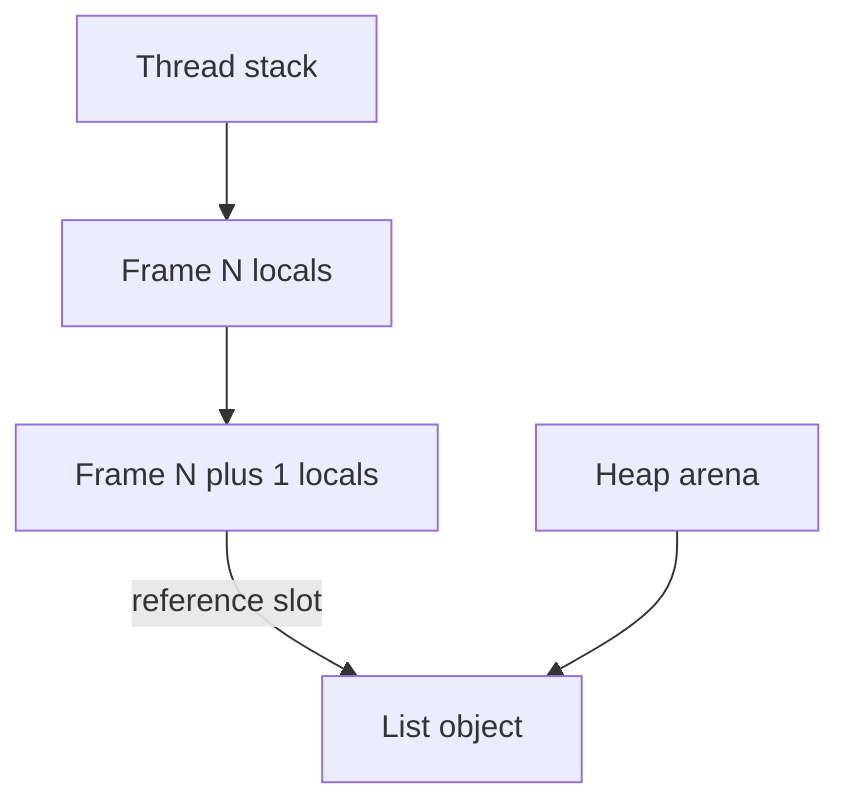

# D01-T004 — Stack vs heap memory

Topic ID: `D01-T004`
Domain: Programming Language Fundamentals
Subdomain: Stack vs heap memory
Importance: core
Complexity: fundamentals
Dependencies: `D01-T001`, `D01-T003`
Execution status of the code in section F: not executed in this authoring session (run locally to verify)

## A. Topic Overview

The stack is a region of memory used for call frames: parameters, return addresses, and local variables with automatic lifetime tied to function entry and exit. The heap is a region for objects whose lifetime is not tied to a single call; they are allocated dynamically and freed by the programmer or a garbage collector.

The split exists because function calls nest predictably (LIFO), which suits a fast bump stack, while object graphs have unpredictable lifetimes and sizes. Putting large or long-lived data on the stack would overflow it quickly.

Backend engineers care when profiling shows stack overflow, when allocating huge buffers per request on the stack in C, when GC pauses correlate with heap churn, and when goroutine stacks grow versus heap objects in Go. Interviewers ask where locals live and what happens when recursion goes too deep.

Prerequisites: types and pointers (`D01-T001`, `D01-T003`). Value versus reference semantics (`D01-T005`) explains what is copied when assigning locals versus sharing heap objects.

## B. First-Principles Explanation

Each thread typically has its own stack growing downward from a high address. A call pushes a frame: saved registers, return PC, locals. Return pops the frame; those bytes are logically dead immediately, though the memory may be reused without zeroing.

The heap is managed by an allocator (malloc, tcmalloc, jemalloc, or GC-managed arenas). Allocation searches free lists or bumps a pointer; freeing coalesces blocks or marks objects unreachable. Fragmentation and contention on the allocator lock matter at scale.

Small primitives in Java may live entirely in registers or stack slots inside a frame. Object headers live on the heap; the local variable is a reference on the stack or in a register.

Stack overflow happens when recursion or large stack arrays exceed the limit (often a few MB per thread). Heap exhaustion is OOM killer or `OutOfMemoryError`.

Why it works: stack allocation is pointer bump on frame enter, O(1) and cache-friendly. Heap allocation is more expensive and must track lifetimes. Limitations: stack size is capped; heap pressure triggers GC or swapping.

## C. Internal Working and Architecture

Components:

- Stack pointer register points to the current frame top.
- Frame pointer (optional) references the base for locals.
- Heap allocator metadata (size classes, free bitmaps).
- GC roots include stack slots and globals pointing into the heap.

Execution for `heap_list_demo()` in Python:

1. Frame created for the function; name `values` is a local reference slot.
2. `[]` allocates a list object on the heap; the slot holds a reference to it.
3. Each `append` may reallocate the list's underlying array on the heap if capacity grows.
4. Return passes the reference to the caller; the list object survives after the frame pops.

Execution for `stack_locals_demo()`:

1. `counter` is a local int object in CPython (actually heap-allocated int) bound in the frame.
2. Loop increments; when the function returns, the frame is discarded.
3. If no other references exist, the int becomes collectable (CPython may intern small ints).

Data flow: request enters handler frame; builds response DTO on heap; returns JSON; frame pops; response object may be collected after serialization unless cached.

State: stack depth equals active call depth. Heap size equals sum of live objects plus fragmentation.

Memory: `sys.getsizeof(list)` measures heap object header plus array, not the stack slot holding the reference.

## D. Diagrams and Visual Models



Read top to bottom: nested calls add frames on the stack. A local reference in the inner frame points to a list object stored in the heap arena. When the inner call returns, the slot disappears but the list remains if the caller kept the reference.

## E. Examples and Analogies

Analogy: the stack is a stack of trays in a cafeteria; you only touch the top tray (current function). The heap is the pantry where ingredients sit until someone throws them out.

Backend example: per-request `byte[] buffer` on heap in Java, reused from a pool across requests, versus a `char tmp[4096]` on the stack in C for one transformation.

Go: goroutine stacks start small and grow on the heap when deep; still "stack" logically but not a fixed OS thread stack only.

Do not allocate megabyte arrays on the stack in C. Do not assume locals zero-initialize in all languages without checking. Do not confuse OS thread stack with Python's C stack limit for recursion.

## F. Code Examples

File: `examples/d01_t004_stack_heap.py`

Dependencies: Python 3 standard library only.

```python
import sys


def stack_locals_demo() -> int:
    counter = 0
    for _ in range(3):
        counter += 1
    return counter


def heap_list_demo():
    values = []
    for n in range(4):
        values.append(n * n)
    return values


if __name__ == "__main__":
    assert stack_locals_demo() == 3
    lst = heap_list_demo()
    assert lst == [0, 1, 4, 9]
    print("ok", len(lst), sys.getsizeof(lst))
```

How to run: `python backend-engineering-knowledge-base/EXERCISES/examples/d01_t004_stack_heap.py`

Expected output: `ok 4` followed by a size integer at least 56 on typical 64-bit CPython.

Important lines: `values = []` creates a heap list; the name is in the frame. `sys.getsizeof` reports heap object size, not including referenced integers (which are separate objects in CPython).

Edge cases: returning a large list keeps heap memory until GC; deep recursion hits `RecursionError` before heap is exhausted. Small integers may be cached singletons on the heap.

This example was not executed during authoring. Run locally and update the header execution status after verification.

## G. Practical Backend Application

Thread pools: each worker has a stack; deep stacks reduce how many threads fit in memory. Object pools reuse heap buffers to cut allocation rate and GC.

Large request bodies stream to heap buffers or disk spill files, not stack. JNI stack versus Java heap: native stack overflow is separate from Java OOM.

Error handling: `StackOverflowError` in Java from infinite recursion; `fatal error: stack overflow` in native code. Observability: allocate profiling, GC logs, and `ulimit -s` on containers. Scaling: reduce per-request heap churn; prefer stack depth limits on parsers.

## H. Advantages, Limitations and Trade-offs

| Choice | Benefit | Cost | Choose when | Avoid when |
| --- | --- | --- | --- | --- |
| Stack locals | Fast allocate/free | Small fixed limit | Scalar temps, small structs | Large arrays, long lifetime |
| Heap objects | Flexible size and lifetime | Allocator cost, GC | DTOs, buffers, graphs | Tiny scalars only |
| Object pools | Less GC churn | Complexity, leaks if mis-pooled | High QPS byte buffers | Rare large allocations |
| Value types on stack (Go struct) | Cache locality | Copy cost if large | Small hot structs | Large payloads |
| Arena per request | Bulk free at end | Peak memory per request | Parsing pipelines | Shared cross-request state |

Failure modes: stack overflow, heap OOM, allocator lock contention, and retaining accidental references preventing collection.

## I. Common Mistakes and Misconceptions

- Believing returned locals copy large structs automatically in C (they do not if you return pointer to stack).
- Thinking stack memory is zeroed after return (it is merely unreferenced).
- Allocating unbounded per-request objects on heap without pools.
- Confusing goroutine stack growth with heap leaks.
- Measuring only JVM heap and missing direct memory on stack's logical sibling off-heap.

Weak answer: "stack is fast, heap is slow" with no lifetime rule. Strong answer: ties lifetime and size to the choice.

## J. Debugging and Troubleshooting

Symptoms: sudden process death with stack trace depth thousands; RSS climbs; GC time dominates latency.

Diagnosis:

1. Thread dump for deep stacks; increase logging on recursive parsers.
2. Heap histogram for dominant classes; allocation profiling on hot endpoints.
3. Container `ulimit -s` and `-Xss` JVM flag review.
4. Reproduce with smallest input that blows stack or heap.

Mitigation: iteration, depth limits, streaming parsers, pool reuse, and right-sized container memory limits.

## K. Interview Preparation

### Beginner

#### Q1. What is the stack used for?

**Answer:** It stores activation records for function calls: parameters, locals, and where to return. Push on call, pop on return. It is LIFO and thread-local. Overflow means too much live stack data, usually deep recursion or huge stack arrays.

#### Q2. What is the heap used for?

**Answer:** It holds objects with dynamic lifetime and size. Allocation and release are explicit in C or automatic via GC in Java and Python. Multiple frames and globals can reference the same heap object. OOM means live data plus fragmentation exceeded available memory.

#### Q3. Where does a local variable live?

**Answer:** In C, scalars and structs declared inside a function typically live in the stack frame unless marked `static` or `malloc`'d. In Java, primitives may be on stack or registers; object references are in the frame pointing to heap objects. In Python, names are in the frame but most values are heap objects.

#### Q4. What happens when a function returns?

**Answer:** Its stack frame is popped; locals are destroyed as bindings. Heap objects referenced only from that frame become unreachable unless returned or stored elsewhere. Returning a pointer to a stack local in C leaves a dangling pointer.

#### Q5. Why is stack allocation faster?

**Answer:** It is usually a pointer decrement and later increment on return, with hot cache lines already touched by the thread. No global allocator lock or free-list search. The trade-off is tiny capacity and automatic deallocation at return.

### Intermediate

#### Q1. How does recursion depth relate to stack size?

**Answer:** Each recursive call consumes another frame. Depth times frame size must fit under the stack limit. Iteration uses one frame. Tail-call optimization can collapse depth in some compilers but not CPython. Production parsers enforce max depth before stack blows.

#### Q2. What is stack overflow versus heap OOM?

**Answer:** Stack overflow is exceeding thread stack limit, often instant crash with deep recursion. Heap OOM is failing to allocate a new object after GC or malloc retry. Fixes differ: rewrite recursion versus reduce retention or increase heap. Metrics and error types distinguish them.

#### Q3. How do goroutine stacks differ from OS thread stacks?

**Answer:** Goroutines start with a small stack that grows by allocating new stack segments on the heap when needed. Many goroutines fit in memory compared to fixed 1–8 MB thread stacks. You still must avoid unbounded recursion inside a goroutine.

#### Q4. What is allocator fragmentation?

**Answer:** Free holes between live blocks prevent using all theoretical free bytes for one large allocation. Long-running servers with varied allocation sizes suffer external fragmentation. Arena allocators and pools mitigate it. GC compacting collectors move objects to reduce holes in managed heaps.

#### Q5. Why pool byte buffers in a server?

**Answer:** Allocating a new buffer per request increases allocator traffic and GC pressure. Pools reuse fixed-size arrays from the heap across requests, amortizing cost. You must clear sensitive data and reset limits before reuse to avoid data leaks between tenants.

### Advanced

#### Q1. What is escape analysis in the JVM?

**Answer:** If an object does not escape the method, the JIT may allocate it on the stack or eliminate it. It changes performance without changing semantics. Hot loops creating short-lived iterators benefit. Misunderstanding escape leads to surprise allocations when references are stored in fields.

#### Q2. How does a compacting GC interact with references?

**Answer:** It moves live objects and updates all references. Mutator threads may need read barriers or stops-the-world pauses. Interior pointers complicate moving. This is why JNI must pin arrays during native access.

#### Q3. What is thread-local allocation buffer (TLAB)?

**Answer:** Each Java thread allocates small objects from a private heap chunk to avoid contending on the global allocator lock. When TLAB fills, it refreshes from the eden space. Tuning eden and TLAB sizes affects allocation rate under load.

#### Q4. Stack versus heap for security?

**Answer:** Stack buffers for secrets may linger in memory after return until overwritten; `memset` before pop matters in C. Heap secrets need zeroing before free. Stack canaries detect stack buffer overflows. Heap overflows corrupt metadata and are exploitable.

#### Q5. How do virtual memory and stack guard pages work?

**Answer:** The OS maps guard pages below the stack so overflow faults instead of corrupting heap. `ulimit` sets max stack size. Containers must set limits consistently with JVM `-Xss` and native thread counts.

### Scenarios

#### Q1. JSON parser crashes with stack overflow on a 2 MB document. Likely cause?

**Answer:** Recursive descent parsing without depth limit matches nesting depth to call depth. A malicious or accidental thousand-level nest blows the stack. Fix with iterative parser, depth counter, or streaming tokenizer. Document max nesting in API limits.

#### Q2. Service RSS grows; heap dump shows few objects. What non-heap cause?

**Answer:** Native allocations, thread stacks multiplying with thread pool growth, or metaspace/direct buffers. Check thread count, native memory metrics, and off-heap config. Stack overflow would crash, not grow RSS slowly.

#### Q3. You added a 4 MB `char buf[4*1024*1024]` local in C handler. Production segfaults. Why?

**Answer:** Default thread stack is often 8 MB total; one 4 MB buffer plus frames and other locals exceeds it. Move buffer to heap or static pool per thread. ASan and `ulimit -s` reproduce quickly.

#### Q4. After traffic spike, GC pause times jump but allocation rate normalized. Hypothesis?

**Answer:** Promotion to old generation filled tenured space; full GCs run to compact. Many short-lived objects survived spike due to accidental caching in a static map (heap retention), not stack issue. Profile survivors and old-gen occupancy.

#### Q5. Go service uses recursion for ACL tree; depth unknown. Risk?

**Answer:** Goroutine stack grows but unbounded depth still risks eventual failure and costs copies on growth. Enforce max depth, switch to iterative walk, or flatten ACLs in storage. Measure stack growth under adversarial input.

### Follow-ups

#### Q1. How does this relate to pointers?

**Answer:** Stack slots hold pointer values pointing into heap objects. Invalid pointers arise from stack locals escaping incorrectly. See `D01-T003`.

#### Q2. How does this relate to value versus reference semantics?

**Answer:** Small value types may live entirely in stack slots; assignment copies bits. Object references in slots copy the pointer word while sharing heap payload. See `D01-T005`.

#### Q3. How does stack/heap matter for concurrency?

**Answer:** Each thread has its own stack; heaps may be shared. Race is on heap objects, not stack locals of different threads. See `D01-T016`.

## L. Practical Exercises

Solutions are in `EXERCISES/solutions/D01-T004.md`. Try these before opening that file.

### Exercise 1 — implementation

Add `estimate_list_footprint(n: int) -> int` that builds a list of `n` distinct ints and returns `sys.getsizeof(lst) + sum(sys.getsizeof(x) for x in lst)` for `n <= 1000`. Acceptance: monotonic in `n`; documents that CPython ints are heap objects.

### Exercise 2 — debugging

A C HTTP server segfaults after adding a large stack buffer. Explain stack limit math and the heap-based fix. Acceptance: names default stack size and moving buffer to heap or pool.

### Exercise 3 — trade-off

Choose per-request heap allocation versus buffer pool for 64 KiB read buffers at 50k RPS. State GC, security (zeroing), and pool exhaustion behavior. Acceptance: numeric reasoning about allocation rate and tenant isolation.

## M. Revision Notes

- Stack: frames, fast, small, automatic on return.
- Heap: dynamic lifetime, allocator/GC, shared across calls.
- Locals are bindings; in Python most values are heap objects.
- Deep recursion risks stack overflow; cap depth in parsers.
- Pool heap buffers on hot paths; watch native and direct memory.
- Returning address of stack local in C is invalid.

Flashcards:

- Stack overflow? Too many nested frames or huge stack array.
- TLAB? Per-thread allocation chunk in JVM.
- Escape analysis? Object might stay on stack if no escape.

## N. Related Topics

Understand this before: `D01-T003` pointers and references.

This topic supports: `D01-T005` assignment semantics, `D01-T016` threading, performance tuning topics.

Often confused with: goroutine stack versus heap, and CPython int location.

Interviewers combine with profiling stories and parser depth limits.

## O. Completion Criteria

- Explain stack versus heap lifetime and size trade-offs.
- Draw frame with reference to heap list object.
- Diagnose stack overflow in recursive JSON parse versus heap OOM.
- Reason about buffer pools versus per-request allocation at RPS.
- Relate goroutine stack growth to design choices.
- Answer JVM escape analysis and TLAB at a high level.
