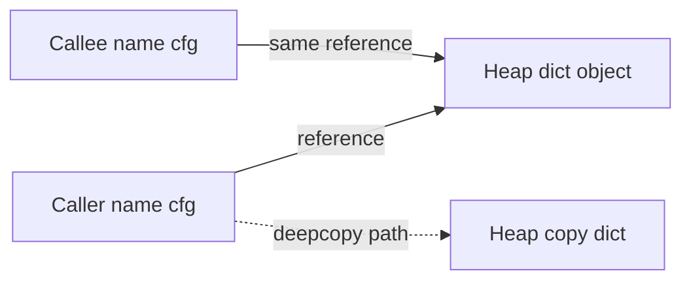

# D01-T005 — Value vs reference semantics

Topic ID: `D01-T005`
Domain: Programming Language Fundamentals
Subdomain: Value vs reference semantics
Importance: core
Complexity: fundamentals
Dependencies: `D01-T001`, `D01-T003`, `D01-T004`
Execution status of the code in section F: not executed in this authoring session (run locally to verify)

## A. Topic Overview

Value semantics mean assignment and parameter passing copy the data payload, so mutating the copy does not affect the original. Reference semantics mean assignment copies a handle to shared storage, so mutations through any alias are visible to all aliases unless you copy explicitly.

Languages mix both: Java primitives are value-like; Java objects are reference-like. Python is reference semantics for objects with optional copying. C++ lets you choose per type (`std::string` value, pointer reference). Go structs are value-copied unless you pass pointers.

The distinction matters in every API that returns collections, caches config objects, or passes DTOs between layers. Interviewers probe whether you know when `def` mutates caller state and when you need `copy.deepcopy`.

Prerequisites: types (`D01-T001`), pointers/references (`D01-T003`), stack/heap (`D01-T004`). Concurrency (`D01-T016`) builds on shared mutable reference semantics.

## B. First-Principles Explanation

Assignment is defined by the language as either copying bits of the value representation or copying a pointer word. For value types, the representation includes the payload (for example a 64-bit integer). For reference types, the representation is a pointer; the payload lives elsewhere.

Parameter passing is usually pass-by-value of the representation: copy the pointer word (alias the object) or copy the struct bits (independent struct). Some languages offer pass-by-reference parameters (C++ `int&`) that alias the caller's slot directly.

Mutability is orthogonal: a `final` reference to a mutable `List` still allows list mutation. Immutability contracts (immutable objects, persistent data structures) restore value-like reasoning at the API level.

Copy-on-write (COW) optimizes value semantics by sharing until one side mutates, then splitting the buffer. Strings in some implementations use this.

Why it works: copying small values is cheap; sharing large graphs is cheap until someone mutates. Limitations: hidden coupling via shared mutation, stale reads in concurrent code, and expensive defensive copies at boundaries.

## C. Internal Working and Architecture

Components:

- Type system marks value versus reference kinds.
- Assignment operator copies representation per language rules.
- Mutator methods (`list.append`) change shared heap object.
- Copy constructors / `copy.copy` / `clone()` produce new graphs.

Execution for `bump_cents(m: Money, delta)`:

1. Parameter `m` binds to the same object reference as `wallet` in caller.
2. `m.cents += delta` mutates the object on the heap.
3. Caller sees updated cents without reassignment.

Execution for `isolated = duplicate_config(shared)`:

1. `deepcopy` walks the graph and allocates new containers and nested lists.
2. Mutating `isolated["features"]` does not affect `shared`.
3. Cost is proportional to graph size.

Data flow: controller passes service a config dict by reference; service mutates timeout; controller's dict changes unless service copied on entry.

State: value copies have independent state; aliases share one state vector on the heap.

Memory: unnecessary deep copies spike allocation; unnecessary sharing causes subtle cross-request bugs in servers.

## D. Diagrams and Visual Models



Read left to right: by default caller and callee reference one dict. The dotted path is an explicit deep copy that creates `copyDict` with no shared nested mutables. Assignment without copy keeps the solid edges only.

## E. Examples and Analogies

Analogy: value semantics is giving someone a photocopy of a form; they scribble on their copy. Reference semantics is two people editing the same Google Doc; every keystroke is shared.

Backend example: passing `request.context` map into middleware chain by reference; each middleware adds keys; all see updates. For isolation, pass an immutable snapshot or copy at the trust boundary.

Rust pushes value semantics by default with move; `&mut` is explicit shared mutation borrow.

Do not deep copy megabyte graphs per call without need. Do not mutate shared config singletons. Do not assume `==` means no sharing; it compares values, not identity.

## F. Code Examples

File: `examples/d01_t005_value_ref.py`

Dependencies: Python 3 standard library only.

```python
from copy import deepcopy
from dataclasses import dataclass


@dataclass
class Money:
    cents: int


def bump_cents(m: Money, delta: int) -> None:
    m.cents += delta


def duplicate_config(cfg: dict) -> dict:
    return deepcopy(cfg)


if __name__ == "__main__":
    wallet = Money(100)
    bump_cents(wallet, 50)
    shared = {"limit": 20, "features": ["a"]}
    view = shared
    view["limit"] = 99
    isolated = duplicate_config(shared)
    isolated["features"].append("b")
    assert wallet.cents == 150
    assert shared["limit"] == 99
    assert "b" not in shared["features"]
    print("ok", wallet.cents, shared["limit"])
```

How to run: `python backend-engineering-knowledge-base/EXERCISES/examples/d01_t005_value_ref.py`

Expected output: `ok 150 99`

Important lines: `@dataclass` `Money` is mutable by default; `bump_cents` mutates through shared reference. `view = shared` is reference assignment, not copy. `deepcopy` isolates nested `features` list.

Edge cases: reassigning `view = {}` does not clear `shared`; only rebinding the name. Immutable `Money` with `frozen=True` would require `return Money(wallet.cents + delta)` for value style.

This example was not executed during authoring. Run locally and update the header execution status after verification.

## G. Practical Backend Application

DTO mapping: decide whether service returns internal entity references or detached copies. ORM entities are reference-like and tied to session; detach or copy before caching.

Config: load once, treat as immutable tuple of settings, or copy per request if handlers mutate. Event payloads should be snapshots so async consumers do not see later mutations.

Error handling: accidental shared mutation causes flaky tests and cross-tenant leakage if a list default is reused. Security: defensive copy at multi-tenant boundaries. Observability: hard to trace who mutated shared state; prefer immutable logs.

Scaling: copy-on-write and structural sharing reduce copy costs for large read-mostly trees.

## H. Advantages, Limitations and Trade-offs

| Choice | Benefit | Cost | Choose when | Avoid when |
| --- | --- | --- | --- | --- |
| Value copy | Isolation, simpler reasoning | Copy cost | Small structs, cross-tenant handoff | Huge graphs every call |
| Reference share | Zero copy | Hidden coupling | Read-only shared caches | Untrusted mutating callees |
| Immutable objects | Safe sharing | New object on change | Config, money types | Hot mutable counters |
| Shallow copy | Fast partial isolation | Shared nested | Top-level swap only | Nested lists in parallel |
| Deep copy | Full isolation | CPU/memory | Snapshots, async handoff | Real-time hot paths |
| Defensive copy on write | Safety at boundary | Latency spike | Public API exports | Internal trusted calls |

Failure modes: mutable default args, singleton list mutation, cache returning live mutable object, and race on shared reference without lock.

## I. Common Mistakes and Misconceptions

- `a = b` for objects always copies in Python (it copies reference).
- Returning internal mutable collection from getter exposes reference semantics to callers.
- Believing `tuple` of lists is fully immutable (lists inside still mutate).
- Java `String` looks reference-like but behaves value-like because it is immutable.
- Copying top-level dict but not nested structures then wondering about cross-talk.

Weak answer: "primitives pass by value, objects by reference" without mentioning assignment copies the reference word in Java. Strong answer: describes representation copied and mutability.

## J. Debugging and Troubleshooting

Symptoms: request A sees request B's data; flaky unit tests order-dependent; unexpected in-place sort of shared list.

Diagnosis:

1. Log `id()` of suspect objects across layers.
2. Search for mutable defaults and static caches.
3. Break on mutation in debugger if supported.
4. Add immutability types (`frozen dataclass`, `tuple`) at boundaries.

Mitigation: copy at boundary, document aliasing contracts, use read-only views (`MappingProxyType`), and concurrency locks if sharing is required.

## K. Interview Preparation

### Beginner

#### Q1. What is value semantics?

**Answer:** Assignment and passing copy the actual data so the destination is independent. Changing the copy does not change the source. Small integers and structs in many languages behave this way. It simplifies reasoning because there is no hidden shared state.

#### Q2. What is reference semantics?

**Answer:** Assignment copies a handle to one shared object. Multiple names refer to the same storage. Mutations through any name are visible everywhere unless you copy. Most heap objects in Java and Python use this model for assignment.

#### Q3. Does Python copy on assignment?

**Answer:** For objects, assignment binds another name to the same object; it does not clone. For immutable values like ints and strings, rebinding looks like copying because you cannot mutate in place. To copy, use `copy.copy` or `copy.deepcopy` explicitly.

#### Q4. What is the difference between `is` and `==` in Python?

**Answer:** `is` compares object identity (same reference). `==` compares values via `__eq__`. Two equal lists can be different objects, so `==` true and `is` false. Use `is` only for singletons like `None`, not for value equality.

#### Q5. Why immutability helps with reference semantics?

**Answer:** If the shared object cannot change, aliases behave like values for readers. No lock is needed for concurrent reads of immutable data. Updates create new objects instead of mutating, which is the functional pattern for safer sharing.

### Intermediate

#### Q1. How does Java treat primitives versus objects in assignment?

**Answer:** Primitives copy bit patterns; `int a = b` is independent. Object assignment copies the reference; both variables point to the same heap object. `String` is immutable, so reference sharing is safe for read-only use. Wrapper types are objects and share reference semantics.

#### Q2. When should a service method copy its input collection?

**Answer:** Copy when the method stores the collection beyond the call, mutates it, or cannot trust the caller not to mutate concurrently. Do not copy on every call if the contract is read-only and the collection is immutable or unmodifiable wrapper. Document whether the parameter is a snapshot or a live view.

#### Q3. What is a defensive copy?

**Answer:** Copy incoming mutable data at the API boundary so internal state cannot be mutated from outside and outsiders cannot see internal mutations. Getter defensive copy prevents exposing internal list references. Cost is paid at boundary for safety.

#### Q4. How do dataclasses relate to value versus reference?

**Answer:** A mutable dataclass instance is a heap object; passing it shares reference semantics. `frozen=True` makes fields immutable after construction, value-like for updates (you replace instances). For true value types, use tuples or frozen dataclasses and return new instances on change.

#### Q5. What goes wrong with in-place sort on a shared list?

**Answer:** `list.sort()` mutates the original list object. If two components hold references to the same list, sorting in one reorders for the other, breaking assumptions and tests. Sort a copy with `sorted()` or `list.copy()` if isolation is needed.

### Advanced

#### Q1. What is copy-on-write?

**Answer:** Multiple references share one buffer until one writer mutates, then the buffer is duplicated and the write proceeds on the copy. It gives value semantics lazily with better average performance. File systems and some string implementations use COW. Readers must handle snapshot consistency rules.

#### Q2. How does Go struct assignment differ from pointer to struct?

**Answer:** Assigning structs copies all fields (value semantics) unless the struct contains slices or maps, which are reference-like headers to shared backing storage. Passing `*T` shares one struct value on the heap. Choose pointer when mutating in place or avoiding large copies.

#### Q3. What is persistent data structure value semantics?

**Answer:** Updates return new versions sharing unchanged nodes with the old tree. Old readers keep their snapshot; new readers see updates. Used in functional languages and some concurrency structures. Amortized cheap copies compared to full deep copy each time.

#### Q4. Why are unmodifiable collections not enough if you leak inner mutability?

**Answer:** `Collections.unmodifiableList` wraps a list but the backing list may still be mutable elsewhere if another reference exists. True isolation requires copying at construction or guaranteeing no other aliases. Defense in depth copies at the boundary.

#### Q5. How does reference semantics interact with ORM lazy loading?

**Answer:** The entity reference is tied to a session; fields may load on access through the same reference. Detached entities behave differently; passing references across threads without copy risks lazy init races. DTO copy breaks session coupling.

### Scenarios

#### Q1. Tenant A sees tenant B's cart items intermittently. Reference bug?

**Answer:** Likely a shared mutable cart list or cache entry reused across requests without deep copy or tenant key. Check singleton services storing lists on the instance. Fix by scoping cart per request or immutable snapshot keyed by tenant id.

#### Q2. API returns internal `settings` map; client adds keys and server state changes. Why?

**Answer:** Serializer exposed the live map reference in JSON framework hooks or returned the same dict object to multiple serializers. Return a copy or build a new dict for response. Treat outbound DTOs as snapshots.

#### Q3. Parallel workers corrupt a shared `defaultdict`. Mechanism?

**Answer:** Reference semantics plus unsynchronized mutation on the same defaultdict object. Each worker should have its own accumulator or use a concurrent map. The defaultdict is not thread-safe for concurrent writes.

#### Q4. Developer uses `list(set(items))` to dedupe but order-sensitive UI breaks. Value issue?

**Answer:** Not reference semantics directly; set loses order in older Python versions and changes identity of elements. If `items` elements are mutable objects deduped by identity versus value, surprises occur. Copy items before dedupe if callers still hold references to original list order.

#### Q5. Microservice passes protobuf message object into async task; fields change before task runs. Fix?

**Answer:** The async task holds a reference to the mutable builder or message reused in the request loop. Snapshot with `copy` or serialize to bytes before enqueue. Value semantics at the handoff point prevents time-of-check-time-of-use bugs.

### Follow-ups

#### Q1. How does this connect to concurrency?

**Answer:** Shared mutable references require synchronization; independent value copies do not. Immutability gives lock-free reads. See `D01-T016`.

#### Q2. How does this connect to API versioning?

**Answer:** Changing a field from scalar to object changes reference exposure in clients. Immutable contract snapshots help backward compatibility. See `D06-T005`.

#### Q3. How does this connect to functional programming?

**Answer:** FP favors immutable values and new instances instead of mutation, making reference sharing safe. Reducers and pipelines copy less with structural sharing.

## L. Practical Exercises

Solutions are in `EXERCISES/solutions/D01-T005.md`. Try these before opening that file.

### Exercise 1 — implementation

Add `freeze_config(cfg: dict) -> dict` returning a structure where top-level keys cannot be added/removed via returned object (use `types.MappingProxyType` for mapping) but document whether nested lists remain mutable. Acceptance: top-level assignment raises; nested list mutation policy is stated in docstring.

### Exercise 2 — debugging

Two tests pass alone but fail when run together; both use a module-level `CACHE = {}` mutated in tests. Explain reference semantics fix. Acceptance: isolate cache per test with fixture or copy-on-read.

### Exercise 3 — trade-off

Public API returns live view of internal metrics map versus copy per request at 10k RPS. Choose and justify latency, consistency, and caller mutation risk. Acceptance: numbers or order-of-magnitude for copy cost and consistency window.

## M. Revision Notes

- Assignment copies representation: bits for values, pointer word for objects.
- Mutability + sharing = aliasing bugs; immutability restores safe sharing.
- Shallow versus deep copy at boundaries; document snapshot versus live view.
- Java primitives value-like; objects reference-like; strings immutable.
- Go struct copy copies fields; slices/maps still alias backing store.
- Defensive copy on getter/setter when exposing internal collections.

Flashcards:

- Value semantics? Copy payload; independent mutation.
- `is` versus `==`? Identity versus equality.
- Defensive copy? Clone at API boundary.

## N. Related Topics

Understand this before: `D01-T001`, `D01-T003`, `D01-T004`.

This topic supports: `D01-T012` collections, `D01-T016` concurrency, `D12-T024` validation boundaries.

Often confused with: pass-by-value of reference versus pass-by-reference parameters.

Interviewers combine with caching, DTO design, and flaky test stories.

## O. Completion Criteria

- Explain value versus reference semantics with assignment examples.
- Predict mutation through shared references in Python and Java.
- Choose shallow, deep, or no copy at a service boundary.
- Debug mutable default and shared cache cross-tenant bugs.
- Describe immutability and defensive copy trade-offs.
- Answer COW and Go struct versus pointer at interview depth.
