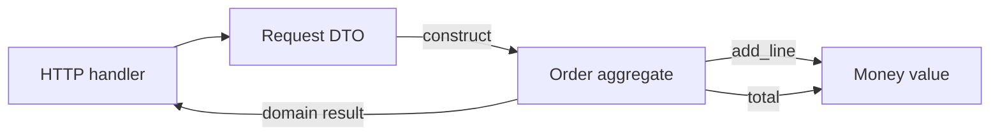

# D01-T006 — Object-oriented programming (OOP)

Topic ID: `D01-T006`
Domain: Programming Language Fundamentals
Subdomain: Object-oriented programming (OOP)
Importance: core
Complexity: fundamentals
Dependencies: `D01-T005`, `D01-T001`
Execution status of the code in section F: executed (CPython, local)

## A. Topic Overview

Object-oriented programming groups data and the operations on that data into units called objects. Each object has identity, state (fields), and behavior (methods). Other code sends messages by calling methods instead of reaching into raw memory.

The idea exists because large programs need boundaries. Procedural code with global structs scatters invariants. Objects localize rules: an `Order` knows how to compute its total; callers should not reimplement that logic in every handler.

In production, OOP shows up in domain models, service classes, ORM entities, and SDK clients. Interviewers use it to see whether you model nouns from the business, protect invariants, and avoid anemic data holders with all logic in god services.

Prerequisites: value versus reference semantics (`D01-T005`) and types (`D01-T001`). Later topics build encapsulation and polymorphism on top of this one.

## B. First-Principles Explanation

A program is state plus transitions. Without objects, state is often a flat record and transitions are free functions that must remember which fields belong together. An object is a capsule: the runtime allocates a block (or a dict of attributes) and binds methods that receive `self` as the implicit first argument.

What happens internally when you call `order.add_line(sku, price)`:

1. The runtime looks up the class of `order` (via its type or vtable pointer).
2. It resolves `add_line` on the class (or a parent), possibly through a method resolution order.
3. It passes `order` as the receiver plus the arguments.
4. The method body mutates `order`'s fields or returns a new value.

Why it works: the class is a template; each instance has its own field storage. References (`D01-T005`) mean two variables can point at the same object, so mutation is visible through both names.

Limitations: OOP does not remove complexity. It moves it behind interfaces. Deep inheritance trees, mutable shared objects, and ORM entities that leak persistence concerns are common failure modes. Alternatives include functional cores with immutable data, procedural modules with opaque types (Go), and data-oriented design for hot paths.

Terms: **class** is the blueprint; **instance** is one live object; **method** is a function bound to instances; **message** is a method call from the caller's view.

## C. Internal Working and Architecture

Components in a typical OO runtime:

- **Object header**: type pointer, GC metadata, maybe a lock word (Java, Python).
- **Instance fields**: slots in a fixed layout (Java) or a hash table (Python `__dict__`).
- **Method table**: per-class map from name to callable; subclasses override entries.
- **Constructor**: `__init__` or `<init>` runs after allocation to establish invariants.

Execution for `total = order.total()`:

1. Load `order` reference from a local or field.
2. Dynamic dispatch finds `total` on the class.
3. Method reads `_lines` (often name-mangled or convention-private).
4. Returns a `Money` value object or raises if invariants fail.

Backend flow: HTTP handler parses JSON, builds value objects (`Money`, `OrderId`), calls an application service method on a domain object or aggregate root, then maps the result to a response DTO. The domain object should not know about HTTP status codes.

State: an object is created (fields default or set in constructor), mutated through methods, and eventually collected when unreachable. Shared mutable aggregates need transactional boundaries at the service layer, not inside random getters.

Memory: each instance pays header plus fields. Small value objects (`Money` as two fields) are cheap; graphs of ORM-loaded entities can be large. Identity equality (`is`) differs from value equality (`==`), which matters for caches and deduplication.

## D. Diagrams and Visual Models



Read left to right. The handler converts wire format to domain types once. Business rules stay inside `Order`; the handler only maps outcomes to HTTP.

## E. Examples and Analogies

Analogy: a bank account object is a teller window. You deposit and withdraw through defined operations. You do not reach into the vault and rearrange bills because you know the layout. Encapsulation (next topic) formalizes that window.

Technical example: exposing `order._lines` as a public list lets any caller append lines without currency checks. The total becomes wrong when someone adds a EUR line to a USD order. The fix is methods that enforce rules, not documentation.

Backend example: a `Subscription` object exposes `renew()` and `cancel()` instead of letting billing code flip an `is_active` boolean from anywhere. Audit logs attach to those methods.

Do not model every database row as a rich object if the read path is a report. Do not put SQL in entity methods unless you accept tight coupling. Do not use inheritance just to reuse a helper function; use a module or composition (`D01-T008`).

## F. Code Examples

File: `examples/d01_t006_oop.py`

Dependencies: Python 3 standard library only.

```python
@dataclass(frozen=True)
class Money:
    amount_cents: int
    currency: str

    def __post_init__(self) -> None:
        if self.amount_cents < 0:
            raise ValueError("amount must be non-negative")
        if len(self.currency) != 3:
            raise ValueError("currency must be ISO 4217 code")


class Order:
    def __init__(self, order_id: str) -> None:
        if not order_id:
            raise ValueError("order_id required")
        self._id = order_id
        self._lines: list[tuple[str, Money]] = []

    def add_line(self, sku: str, price: Money) -> None:
        self._lines.append((sku, price))

    def total(self) -> Money:
        if not self._lines:
            raise ValueError("empty order")
        currency = self._lines[0][1].currency
        total_cents = 0
        for _, price in self._lines:
            if price.currency != currency:
                raise ValueError("mixed currency")
            total_cents += price.amount_cents
        return Money(total_cents, currency)
```

How to run: `python examples/d01_t006_oop.py` from this topic's folder, or run `backend-engineering-knowledge-base/EXERCISES/examples/d01_t006_oop.py`.

Expected output: `ok Money(amount_cents=350, currency='USD')`

Important lines: `Money` is immutable (`frozen=True`), so totals are new values, not accidental shared mutation. `Order` keeps `_lines` private by convention; callers use `add_line` and `total`. Mixed-currency and empty-order cases fail fast with `ValueError`, which the API layer maps to 400.

Edge cases: zero-cent lines are allowed if product rules say so; floating-point money is avoided by using integer cents (`D01-T001`). Concurrent mutation of one `Order` from two threads without locking is a race; the object does not magically synchronize.

This example was executed with the system Python. Output was `ok Money(amount_cents=350, currency='USD')` and asserts passed.

## G. Practical Backend Application

A checkout service constructs an `Order` per request (or loads one from a repository), adds line items from validated input, calls `total()`, and persists a snapshot. Controllers stay thin: parse, call service, map exceptions to status codes (`D01-T010`). Logs include `order_id`, not the entire internal list, unless debug requires it.

Concurrent requests each own their instance graph until commit. Shared caches of domain objects by id must treat stored objects as immutable or copy on read.

Error handling: invariant violations are client or domain errors, not 500s, when the input caused them. Observability: count `mixed currency` and `empty order` separately from infrastructure failures. Scaling: OO per request is fine; bottlenecks are I/O and locking on shared rows, not method dispatch cost.

## H. Advantages, Limitations and Trade-offs

| Choice | Benefit | Cost | Choose when | Avoid when |
| --- | --- | --- | --- | --- |
| Rich domain objects | Invariants in one place | More classes to navigate | Core business rules | Simple CRUD with no rules |
| Anemic models + service layer | Fast scaffolding | Rules drift and duplicate | Prototypes | Money, billing, compliance |
| Mutable aggregates | Matches ORM ergonomics | Harder reasoning | Single-threaded unit of work | Shared mutable caches |
| Immutable value objects | Safer sharing | More allocation | Money, ids, measurements | Huge in-memory graphs you must patch |
| ORM entities as domain | Less mapping code | Persistence leaks into rules | Internal admin tools | Strict domain purity |

Under load, creating many short-lived objects increases GC churn in managed runtimes. That is usually acceptable compared with database latency. The real cost is accidental sharing of mutable entities across requests without clearing state.

Failure modes: **leaky encapsulation** (public collections mutated elsewhere), **identity confusion** (two `Order` instances for the same id), and **god objects** that know HTTP, SQL, and email.

## I. Common Mistakes and Misconceptions

- Treating every database table as a class with dozens of methods. Tables are storage; aggregates are behavioral boundaries.
- Using getters and setters for every field without behavior. That is structs with extra steps, not OOP.
- Comparing objects with `==` when identity matters for caches, or `is` when value equality matters for money.
- Putting static helpers on a class that never gets instantiated. A module function is clearer.
- Assuming `private` in Java or `_name` in Python stops malicious code. It stops accidental misuse; trust boundaries are still at the process edge.

Weak interview answer: "OOP models real world entities" with no mention of invariants. Strong answer: objects enforce rules and hide representation.

## J. Debugging and Troubleshooting

Symptoms: order total wrong in production but unit tests pass. Memory grows when reusing a request-scoped bean that accumulates lines. Two requests see each other's cart.

Root causes: shared mutable singleton service holding `Order`, leaked reference to `_lines`, or duplicate `Order` instances for one id.

Diagnosis:

1. Log object identity (`id(order)` in Python, `System.identityHashCode` in Java) at entry and exit of the request.
2. Break on `add_line` and inspect caller stack for code outside the service layer.
3. Search for direct field access bypassing methods.
4. Reproduce with two parallel requests against a suspected singleton.

Example message: `ValueError: mixed currency` from `total()`.

Mitigation: request-scoped aggregates, return copies of collections from getters, or expose read-only views. Long-term: aggregate repository that reloads by id inside a transaction.

Metrics: invariant violation rate by type; count of requests hitting the same mutable bean instance (should be zero).

## K. Interview Preparation

### Beginner

#### Q1. What is an object?

**Answer:** An object is a runtime value with identity, state, and behavior. State lives in fields; behavior is methods that operate on that state. Callers interact through the public methods instead of editing fields directly. Interviewers want identity versus value, not only "instance of a class".

#### Q2. What is the difference between a class and an instance?

**Answer:** The class describes layout and behavior shared by all instances. The instance is one concrete object with its own field values. Creating an instance allocates storage and runs the constructor. Many instances share one class definition and one method table.

#### Q3. What is a method?

**Answer:** A function bound to an object type that receives the instance as the first parameter (`self`, `this`). Dispatch uses the object's class to find the implementation. Subclasses can override the same method name with different behavior.

#### Q4. Why use objects instead of plain dictionaries?

**Answer:** Dictionaries store data but do not enforce rules. An object can reject invalid state in the constructor and in mutators. That localizes invariants and makes misuse a compile-time or immediate runtime error instead of silent corruption.

#### Q5. Where do objects appear in a typical REST service?

**Answer:** Request parsing builds DTOs or commands. Application services call domain objects or aggregates. Repositories map between domain objects and database rows. The HTTP layer should not embed SQL or business rules.

### Intermediate

#### Q1. What is an aggregate root?

**Answer:** In domain-driven design, one entity controls access to a cluster of related objects. External code loads and saves through the root (`Order`, not every `LineItem` row). That keeps consistency rules in one place and matches transaction boundaries.

#### Q2. What is the difference between an entity and a value object?

**Answer:** An entity has identity that persists when attributes change (`Order` id stays the same when lines change). A value object is defined by its attributes (`Money` of 10 USD equals another 10 USD). Value objects are often immutable; entities are often mutable within a unit of work.

#### Q3. How does dynamic dispatch work?

**Answer:** At call time the runtime looks up the method on the object's actual class, walking the inheritance chain if needed. That enables polymorphism: a `PaymentGateway` reference can point at different implementations. Static languages may devirtualize hot calls when the target is provably unique.

#### Q4. What is wrong with an anemic domain model?

**Answer:** Entities are data bags; services contain all logic. Rules duplicate across services, and invariants are easy to skip when a new endpoint bypasses the service. The fix is to move behavior onto objects where the data lives, keeping services as orchestration.

#### Q5. How do ORM entities relate to domain objects?

**Answer:** ORM entities mirror tables and lazy-load relations. Domain objects may be persistence-ignorant. Mapping layers translate between them. Using the ORM entity everywhere couples business rules to schema and session lifecycle.

### Advanced

#### Q1. When does OOP hurt performance?

**Answer:** When indirection and allocation dominate a hot loop: millions of tiny wrapper objects, virtual calls the compiler cannot inline, or pointer-chasing graphs. Data-oriented layouts (arrays of structs) beat deep object graphs for SIMD-friendly math. Most backend services are I/O bound; clarity wins until profiling says otherwise.

#### Q2. How do you prevent shared mutable request state in a DI container?

**Answer:** Register domain services as transient or request-scoped, not singleton, when they hold per-request aggregates. Document which beans are stateless. Add tests that two parallel calls do not mutate the same list. Spring `@RequestScope` and similar scopes exist for this reason.

#### Q3. What is the law of Demeter in backend code?

**Answer:** A method should only talk to its immediate collaborators, not reach through chains like `order.getCustomer().getAddress().getZip()`. Each hop couples callers to internal structure. Prefer `order.shippingZip()` on the aggregate.

#### Q4. How do value objects help concurrency?

**Answer:** Immutable values can be shared without locks. Threads pass `Money` snapshots instead of mutating a shared balance field. Mutable entities still need transactions or locking at the store. Immutability does not replace database consistency.

#### Q5. How would you model a multi-step checkout as objects?

**Answer:** Separate stages: `Cart` (mutable, session-scoped), `Order` (committed intent), `Payment` (external id). Transitions are explicit methods (`cart.checkout()` returns `Order`), not boolean flags scattered on one mega-object. Each stage has its own invariants and failure modes.

### Scenarios

#### Q1. Totals differ between the API and the warehouse export for the same order id. What do you check?

**Answer:** Check whether both paths use the same aggregate logic or one recomputes from raw rows with a different rounding rule. Compare currency handling and tax line inclusion. Ensure one path is not mutating a shared cached `Order`. Add a golden test that loads the id and asserts both exporters call `order.total()`.

#### Q2. A Spring `@Service` singleton accumulates orders in a list field. Under load, users see wrong carts. Explain.

**Answer:** Singleton scope means one instance serves all threads. The list field is shared mutable state. Each request must use its own aggregate or a thread-local/session store. Change scope to request or stop storing per-request data on the bean.

#### Q3. Junior dev made every field public for "simplicity". What breaks first?

**Answer:** Invariants break first: negative amounts, mixed currencies, duplicate ids. Then coupling: handlers start reaching into internals and bypass the service layer. Refactor to private fields with narrow methods; add tests that only public API can change state.

#### Q4. Product wants "free-form" line metadata as arbitrary JSON on the order. How do objects help?

**Answer:** Model known fields as typed value objects and tuck extension data behind a `LineMetadata` type that validates JSON size and keys. Do not dump a raw dict on `Order` that every caller mutates. Provide `add_line(sku, price, metadata)` that validates once.

#### Q5. You must audit who changed an order total. Where do you hook logging?

**Answer:** Log inside mutating methods (`add_line`, `apply_discount`) and at persistence commit, not in every getter. Include actor id, before/after totals, and correlation id. Getters should not emit audit events on every read.

### Follow-ups

#### Q1. How does this connect to encapsulation and polymorphism?

**Answer:** Encapsulation hides representation; polymorphism swaps implementations behind a stable interface. Both assume objects as the unit of design. See `D01-T007` and `D01-T009`.

#### Q2. When should you prefer composition over subclassing?

**Answer:** When behavior varies by combination of capabilities, not by taxonomy. Subclassing fixes an `is-a` relationship; composition wires pluggable parts. See `D01-T008`.

#### Q3. How do exceptions fit domain objects?

**Answer:** Methods raise domain-specific errors when invariants fail; the API boundary translates them to HTTP. Objects should not catch infrastructure exceptions unless they are adapting a port. See `D01-T010`.

## L. Practical Exercises

Solutions are in `EXERCISES/solutions/D01-T006.md`. Try these before opening that file.

### Exercise 1 — implementation

Implement `Order` and `Money` as in section F, plus `line_count()` and rejection of duplicate SKU on the same order. Acceptance: empty `total()` raises, mixed currency raises, duplicate SKU raises, and `line_count()` matches added lines.

### Exercise 2 — debugging

A singleton `CheckoutService` stores the current `Order` in a field. Two users' totals swap under concurrent traffic. Identify the pattern bug and the scope fix. Acceptance: you name shared mutable singleton state and request-scoped aggregates.

### Exercise 3 — trade-off

Team debates anemic JPA entities versus a separate domain `Order` class. List two costs of each approach and which you pick for a regulated billing service. Acceptance: you mention mapping overhead versus invariant enforcement, not only "DDD is better".

## M. Revision Notes

- Objects bundle state, behavior, and identity.
- Enforce invariants in constructors and mutators, not in controllers.
- Value objects are immutable; entities have persistent identity.
- Do not share mutable per-request state on singleton services.
- ORM entities are not always your domain model.
- Dynamic dispatch enables polymorphism; it has a small CPU cost.
- Law of Demeter: avoid long chains through another object's graph.

Flashcards:

- What is an aggregate root? The single entry point for a consistency cluster.
- Entity vs value object? Identity persists vs defined by attributes.
- Why immutable money? Safe sharing and fewer rounding surprises.

## N. Related Topics

Understand this before: `D01-T005` references, `D01-T001` types.

This topic supports: `D01-T007` pillars, `D01-T008` composition, `D01-T011` immutability.

Often confused with: classes for organization only (no invariants), and ORM entities as full domain models.

Interviewers combine this with `D06-T003` layering, `D07-T004` transactions, and `D12-T024` validation.

## O. Completion Criteria

- Explain object identity, state, and behavior without reading this note.
- Draw handler → domain object → value object flow for a checkout total.
- Implement an aggregate that rejects mixed currency and empty totals.
- Debug shared mutable state on a singleton service.
- Choose rich domain versus anemic model for a named scenario.
- Answer entity versus value object with a money example.
