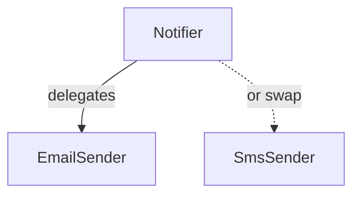

# D01-T008 — Composition vs inheritance

Topic ID: `D01-T008`
Domain: Programming Language Fundamentals
Subdomain: Composition vs inheritance
Importance: core
Complexity: fundamentals
Dependencies: `D01-T007`, `D01-T001`
Execution status of the code in section F: executed (CPython, local)

## A. Topic Overview

Composition builds a class by holding references to other objects and delegating work. Inheritance derives a class from a parent and acquires its implementation. Both reuse code; composition favors flexibility, inheritance favors a strict is-a relationship.

The debate exists because misuse of inheritance created deep, rigid trees (`class AdminUser extends User extends Person extends Entity`). Composition wires behaviors like LEGO: a `Notifier` has a `Sender`, not a subclass of SMTP.

Backend examples: wrapping a cache around a repository, injecting a clock for time, delegating to strategy objects instead of subclassing `BaseController` for every endpoint flavor.

Prerequisites: pillars (`D01-T007`). Leads to interfaces and generics (`D01-T009`).

## B. First-Principles Explanation

**Inheritance** copies structure. Child IS-A parent. Method overrides specialize. Parent changes can break children.

**Composition** aggregates parts. Whole HAS-A part. Whole forwards calls: `notifier.notify()` calls `self.sender.send()`.

Internal view: composed object stores pointers to collaborators in its fields. Inheritance embeds superclass subobject at fixed offset in memory layout.

When to choose:

- Taxonomy with substitutability → inheritance sparingly.
- Mix-and-match capabilities → composition.
- Reuse a utility → module function, not extends.

Delegation is composition at runtime: inner object does the work; outer adds logging or metrics.

## C. Internal Working and Architecture

A composed `Notifier` field holds `Sender`. On `notify_user`, stack frame is `Notifier.notify_user` → `EmailSender.send`. No vtable walk unless `Sender` is an interface.

Inheritance stack: `EmailNotifier extends SmtpClient` means `EmailNotifier` IS `SmtpClient`; Liskov requires every `SmtpClient` method makes sense on a notifier.

Backend layering:

```
Handler → Service → Notifier(sender=EmailSender())
```

Swap `SmsSender` without new subclass of handler. DI container binds interface to implementation.

State: composed objects own or borrow collaborators. Lifetime matches outer object unless injected singleton sender (must be thread-safe).

## D. Diagrams and Visual Models



`Notifier` does not subclass transport. Configuration picks which `Sender` instance is injected.

## E. Examples and Analogies

Inheritance analogy: a square is-a rectangle only if rectangle API allows square semantics; otherwise modeling square as rectangle breaks Liskov.

Composition analogy: a car has-an engine; you swap diesel for electric without calling the vehicle a subclass of engine.

Anti-pattern: `class LoggingRepository extends PostgresRepository` — logging is cross-cutting, not a kind of Postgres. Compose `LoggingRepository(repo: PostgresRepository)` or use AOP.

Prefer composition when behaviors combine (`Audited + Cached + Encrypted` storage). Inheritance forces linear chains.

## F. Code Examples

File: `examples/d01_t008_composition.py`

```python
@dataclass
class Notifier:
    sender: Sender

    def notify_user(self, user_id: str, message: str) -> None:
        self.sender.send(to=user_id, body=message)
```

How to run: `python examples/d01_t008_composition.py` or `backend-engineering-knowledge-base/EXERCISES/examples/d01_t008_composition.py`.

Expected output: `ok ('user-42', 'hello')`

Important lines: `Notifier` only knows `Sender` protocol, not SMTP details. Swapping `SmsSender` needs no new notifier subclass.

Edge cases: if `Sender` is mutable shared state, concurrent `send` must be safe. Null sender is a wiring error caught at startup in typed DI.

This example was executed with the system Python. Output was `ok ('user-42', 'hello')`.

## G. Practical Backend Application

Decorators in Python (`@cache` on repository functions) are composition-like wrappers. Java `DataSource` wrapped by connection pool is composition. Kubernetes sidecars are composition at pod level.

Choose inheritance for exception types and framework hooks where the framework expects `extends`. Choose composition for business capabilities.

Migration path from deep trees: extract interfaces from parent, move shared code to helper or delegate field, flatten subclasses to configured strategies.

## H. Advantages, Limitations and Trade-offs

| Choice | Benefit | Cost | Choose when | Avoid when |
| --- | --- | --- | --- | --- |
| Composition | Flexible wiring, smaller hierarchies | More boilerplate wiring | Multiple behaviors mix | Framework mandates extends |
| Inheritance | Compact syntax for is-a | Tight coupling to parent | True substitutable taxonomy | Code reuse only |
| Delegation | Add behavior without subclass | Indirection depth | Cross-cutting wrappers | Hot path needs zero overhead |
| Mixin inheritance | Shared snippets | MRO complexity | Languages with mixins | Java single inheritance |

Signals to refactor to composition: empty overrides, `UnsupportedOperationException` in subclass, diamond-shaped hierarchies, subclass only used to call `super` with one different argument.

## I. Common Mistakes and Misconceptions

- "Composition over inheritance" interpreted as never inherit. Exception hierarchies and UI frameworks still use inheritance.
- Subclassing to test production class instead of injecting interface.
- God base class with 40 protected methods.
- Confusing composition with aggregation lifetime (who owns the child).

Interview strength: name Liskov or unsupported override as smell.

## J. Debugging and Troubleshooting

Symptoms: new channel needs another subclass layer. `super` call order bugs after parent refactor.

Steps:

1. List subclasses; mark those that only change constructor args.
2. Extract interface from parent public methods.
3. Replace subclass with composed strategy map.
4. Run contract tests per strategy.

Metric: depth of inheritance tree; goal is shallow for domain code.

## K. Interview Preparation

### Beginner

#### Q1. What is composition?

**Answer:** Building an object from other objects by storing them as fields and delegating. The outer object exposes a simpler API. Parts can be replaced without changing the outer class name.

#### Q2. What is inheritance?

**Answer:** Defining a class as an extension of another, inheriting fields and methods. Implies is-a. Child can override behavior.

#### Q3. What does "favor composition over inheritance" mean?

**Answer:** Default to wiring collaborators when reuse is the goal. Use inheritance when the subtype is truly substitutable for the base everywhere.

#### Q4. Give a HAS-A example in backend code.

**Answer:** `OrderService` has-a `OrderRepository`. Service delegates persistence; it is not a subclass of repository.

#### Q5. Give an IS-A example that is reasonable.

**Answer:** `PaymentDeclinedException extends DomainException`. Catch `DomainException` at boundary; specific type carries detail.

### Intermediate

#### Q1. Why is `class Notifier extends SmtpClient` a smell?

**Answer:** A notifier is not an SMTP client; it uses one. Inheritance exposes all client methods on notifier and couples lifecycle. Composition keeps `Notifier` small with a `Sender` field.

#### Q2. What is the decorator pattern?

**Answer:** Composition that wraps an interface with identical API adding behavior (cache, retry, metrics). Callers still see the inner interface.

#### Q3. How does composition help testing?

**Answer:** Pass fake `Sender` into `Notifier` constructor. No need to subclass production notifier to override `send`.

#### Q4. When is inheritance still the right tool?

**Answer:** Framework templates (`extends AbstractController`), exception trees, or when language lacks good delegation (rare). Domain taxonomies with stable is-a.

#### Q5. What is a strategy object?

**Answer:** Pluggable algorithm behind one interface, selected at runtime. Implemented via composition, not subclass switch.

### Advanced

#### Q1. Compare mixin inheritance to composition in Python.

**Answer:** Mixins add methods via MRO; order matters and name clashes hurt. Explicit composition fields are easier to trace. Mixins suit small shared hooks in frameworks.

#### Q2. How do you migrate a three-level `User` hierarchy to composition?

**Answer:** Extract `Role`, `Profile`, `Permissions` as fields or value objects. Flatten `AdminUser` to `User` with `Role.ADMIN`. Delete middle classes after moving behavior to composed types.

#### Q3. Composition and microservices?

**Answer:** Service composition is network-level: checkout composes payment and inventory APIs. Same design principle: stable contracts, replaceable parts, avoid monolithic inheritance of "base service".

#### Q4. Performance of composition versus inheritance?

**Answer:** One extra field and call is negligible. Inheritance virtual calls cost similarly. Avoid deep wrapper stacks in nanosecond loops only after profiling.

#### Q5. Entity inheritance with JPA (`@MappedSuperclass`)?

**Answer:** Table layout reuse is inheritance for schema, not behavior. Keep behavior in services or composed helpers; do not stack business rules in entity superclass.

### Scenarios

#### Q1. Ten notification channels, ten subclasses of `BaseNotifier`. Refactor?

**Answer:** One `Notifier` with `Sender` strategy per channel; register in map by channel id. Add channel by new adapter class, not new notifier hierarchy.

#### Q2. `CachedRepository extends JpaRepository` breaks when cache invalidation differs per entity.

**Answer:** Compose `CachingRepository(delegate: JpaRepository, cache: Cache)` per aggregate. Policy varies by configuration, not subclass count.

#### Q3. Subclass overrides `connect` to no-op in tests only.

**Answer:** Smell. Inject `DataSource` fake instead of subclassing production pool.

#### Q4. Parent adds `validate()` call in `save`; half of subclasses break.

**Answer:** Fragile base. Make `save` final, delegate to `doSave` in composed strategy, or use composition wrapper that always validates.

#### Q5. Product asks for "is-a" VIP user with extra discount rules.

**Answer:** Prefer `User` with `PricingPolicy` composition over `VipUser extends User` unless VIP truly substitutes everywhere with same contract.

### Follow-ups

#### Q1. Link to interfaces?

**Answer:** Composition usually depends on interfaces (`Sender`), not concrete classes. See `D01-T009`.

#### Q2. Link to polymorphism?

**Answer:** Composed parts are polymorphic when typed as interface. Whole delegates without knowing concrete class.

#### Q3. Link to exceptions?

**Answer:** Wrapping infrastructure errors in domain exceptions is composition of error mapping, not subclassing `IOException` as business type.

## L. Practical Exercises

Solutions are in `EXERCISES/solutions/D01-T008.md`. Try these before opening that file.

### Exercise 1 — implementation

Refactor `class EmailNotifier(SmtpClient)` into `Notifier` + `EmailSender` implementing `Sender`. Acceptance: same behavior, no inheritance from transport.

### Exercise 2 — debugging

List three smells from a hierarchy where subclasses override half the parent methods with `raise NotImplementedError`. Acceptance: you name unsupported overrides, taxonomy mismatch, or fragile base.

### Exercise 3 — trade-off

Compare test setup for five subclasses versus one service with five injected strategies. Acceptance: mention fixture count, contract tests per strategy, and wiring in DI.

## M. Revision Notes

- Composition: HAS-A, delegation, flexible wiring.
- Inheritance: IS-A, substitutable, couples to parent.
- Default to composition for behavior mix.
- Decorator and strategy are composition patterns.
- Deep trees are a refactor signal.
- Exceptions and framework hooks are common valid inheritance.
- Test with injected collaborators, not production subclasses.

Flashcards:

- Favor composition when? Mix behaviors, avoid fragile base.
- Decorator? Wrapper with same interface.
- Strategy? Swappable algorithm object.

## N. Related Topics

Understand this before: `D01-T007` pillars.

This topic supports: `D01-T009` interfaces, `D06-T004` hexagonal architecture, `D12-T018` test doubles.

Often confused with: aggregation (weaker ownership) versus composition (strong ownership).

Interviewers combine this with refactoring questions and Liskov scenarios.

## O. Completion Criteria

- Contrast composition and inheritance with HAS-A and IS-A examples.
- Draw notifier delegating to sender.
- Refactor an inheritance smell to composition.
- Name three hierarchy refactor signals.
- Argue strategy map versus subclass tree for channels.
- Relate decorator pattern to composition.
