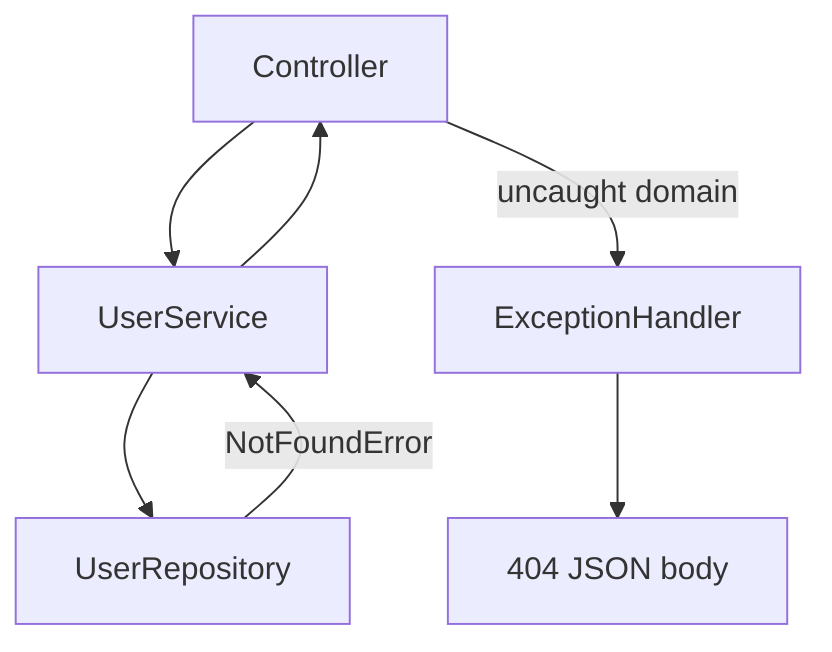

# D01-T010 — Exception handling and custom exceptions

Topic ID: `D01-T010`
Domain: Programming Language Fundamentals
Subdomain: Exception handling and custom exceptions
Importance: core
Complexity: fundamentals
Dependencies: `D01-T009`, `D01-T001`
Execution status of the code in section F: executed (CPython, local)

## A. Topic Overview

Exception handling transfers control from the point of failure to a handler that can recover, translate, or abort. Custom exceptions name domain failures so callers catch precisely and APIs map them to stable error codes.

The mechanism exists because checking every return code at every call site does not scale. Exceptions unwind the stack until a matching handler runs, carrying context (message, cause chain).

Backend services use them at layer boundaries: domain raises `NotFoundError`, web layer maps to HTTP 404, logs retain stack for 500 only.

Interviewers probe checked versus unchecked, when not to catch `Exception`, and idempotency after partial failure.

Prerequisites: types and OOP (`D01-T001`, `D01-T006`). Works with interfaces for error mapping (`D01-T009`).

## B. First-Principles Explanation

When code throws, the runtime walks stack frames looking for `catch` (Java, C#) or `except` (Python). Each frame is popped; `finally` or `defer` runs on the way. Uncaught exceptions terminate the thread or request.

Custom exception: subclass base (`Exception`, `RuntimeException`, `DomainError`). Add fields (`field`, `resource`) for structured responses.

**Checked** (Java): compiler forces handle or declare. **Unchecked**: runtime exceptions for programming bugs and many domain errors in modern Java/Spring style.

Cause chain: `raise NewError("...") from exc` preserves root JDBC error for logs while client sees safe message.

Alternatives: `Result` types (Rust, Go errors), error codes, monadic `Either`. Exceptions remain default in Java and Python web stacks.

## C. Internal Working and Architecture

Throw cost: creating exception object, capturing stack trace (expensive in Java on hot path). Do not use exceptions for normal control flow in tight loops.

Handler layers:

1. **Domain**: raises `ValidationError`, `NotFoundError`.
2. **Application**: catches infrastructure, wraps in domain.
3. **Web** `@ControllerAdvice`: maps to `ProblemDetail` JSON and status.

Thread pool: uncaught exception in worker may abort one request; container catches and returns 500. Async needs `CompletableFuture.exceptionally` or reactive `onErrorMap`.

Transactional rollback: Spring rolls back on unchecked by default; checked may not unless configured.

## D. Diagrams and Visual Models



Domain errors bubble to a single mapper. Infrastructure errors become domain or 500 at the boundary.

## E. Examples and Analogies

Analogy: fire alarm versus returning "smoke level 7". Alarm stops normal work and routes to trained handler. Returning codes means every room checks the meter.

Do not catch `Exception` and return null. Do not log and swallow. Do not expose SQL text to clients.

Use custom types for expected failures (not found, conflict). Use generic 500 for unexpected bugs with correlation id in logs.

## F. Code Examples

File: `examples/d01_t010_exceptions.py`

```python
def to_api_error(exc: BaseException) -> ApiError:
    if isinstance(exc, NotFoundError):
        return ApiError(404, "not_found", str(exc))
    if isinstance(exc, ValidationError):
        return ApiError(400, "validation_error", str(exc))
    if isinstance(exc, DomainError):
        return ApiError(409, "domain_error", str(exc))
    return ApiError(500, "internal_error", "unexpected failure")


def get_user(user_id: str, store: dict[str, str]) -> str:
    if not user_id:
        raise ValidationError("user_id", "required")
    email = store.get(user_id)
    if email is None:
        raise NotFoundError("user", user_id)
    return email
```

How to run: `python examples/d01_t010_exceptions.py` or `backend-engineering-knowledge-base/EXERCISES/examples/d01_t010_exceptions.py`.

Expected output: `ok not_found`

Important lines: hierarchy under `DomainError`; mapper is single place for HTTP semantics; validation before lookup.

Edge cases: chaining `from exc` when wrapping DB errors. Multiple validation errors may need aggregate type for 400 body. Idempotent retries must not treat conflict as retryable 500.

This example was executed with the system Python. Output was `ok not_found`.

## G. Practical Backend Application

Define `DomainError` base; subclass per HTTP mapping policy. Global handler logs 500 with stack, returns sanitized body. 4xx log at info/warn without full stack.

Retry: only on transient infrastructure (`IOException`, 503), not on `ValidationError`.

Observability: tag metrics `error_code=not_found`. Trace attributes include `exception.type` on 500.

Security: do not put PII in exception messages returned to clients.

## H. Advantages, Limitations and Trade-offs

| Choice | Benefit | Cost | Choose when | Avoid when |
| --- | --- | --- | --- | --- |
| Custom hierarchy | Precise catch, stable API codes | Many classes | Mature domain | Tiny script |
| Checked exceptions | Forces handling | Boilerplate, leaky signatures | JDBC-era APIs | Spring REST services |
| Result/Either | Explicit control flow | Verbose in Java | Libraries without throws | Existing Spring code |
| Global handler | Consistent JSON errors | Hide if over-broad catch | REST APIs | Multiple wire formats |
| Exception for flow | Fast to write | Slow, unclear | Rare edge cases | Hot loops |

Failure modes: swallowed exceptions, generic 500 for validation, double logging, rollback skipped on caught runtime exception inside transaction.

## I. Common Mistakes and Misconceptions

- Empty `except: pass`.
- Catching `Exception` around entire handler hiding bugs.
- Using exceptions for expected control flow (end of file).
- Subclassing wrong base (`Error` in Python for recoverable business cases).
- Returning 200 with error field instead of proper status.

## J. Debugging and Troubleshooting

Symptoms: client sees 500 for missing user. Logs lack stack. Duplicate error entries.

Diagnosis:

1. Find global handler order (most specific first).
2. Search `catch (Exception e)` in codebase.
3. Reproduce with integration test asserting status and body.
4. Verify exception not wrapped twice losing type.

Example log: `NotFoundError: user not found: u9` should map 404, not 500.

Fix: register handler for `NotFoundError`; stop wrapping in generic `RuntimeException`.

## K. Interview Preparation

### Beginner

#### Q1. What is an exception?

**Answer:** A signal that normal control flow cannot continue. The runtime unwinds the stack to a handler. It carries a message and optionally a cause chain for debugging.

#### Q2. Why define custom exceptions?

**Answer:** To name business failures distinctly so upper layers map them to HTTP codes and monitors without string matching. Callers can catch `NotFoundError` without catching all errors.

#### Q3. try/catch/finally purpose?

**Answer:** `try` runs risky code. `catch` handles matching exceptions. `finally` runs cleanup whether or not an exception occurred. Use try-with-resources in Java for auto-close.

#### Q4. What should clients see versus logs?

**Answer:** Clients see stable code, safe message, correlation id. Logs see full stack and internal causes for 500. Never return stack traces to browsers in production.

#### Q5. Exception versus error return code?

**Answer:** Return codes force every caller to check. Exceptions centralize handling at boundaries. Go uses explicit errors; Java and Python web stacks favor exceptions at the framework edge.

### Intermediate

#### Q1. Checked versus unchecked in Java?

**Answer:** Checked must be declared or caught (`IOException`). Unchecked extends `RuntimeException`. Spring and most REST code use unchecked domain exceptions; global handler maps them.

#### Q2. When should you not catch an exception?

**Answer:** When you cannot handle meaningfully. Let it reach the boundary handler. Do not catch `OutOfMemoryError` to continue. Do not catch low-level bugs to return null.

#### Q3. What is exception chaining?

**Answer:** Wrapping inner cause in outer exception (`initCause`, `from exc`). Preserves root failure for logs while outer type carries domain meaning.

#### Q4. How do transactions interact with exceptions?

**Answer:** Spring marks rollback on runtime exceptions by default. Catching exception inside transactional method without rethrow may commit unintentionally. Use `@Transactional(rollbackFor=...)`.

#### Q5. Validation errors: one exception or many?

**Answer:** For forms, aggregate `ValidationErrors` with field list in one 400 response. Single `ValidationError` per field is fine for simple APIs.

### Advanced

#### Q1. Exceptions in reactive streams (Project Reactor)?

**Answer:** Errors propagate on signal, not throw across stack. Use `onErrorMap` to domain type. Blocking throw inside `map` breaks reactor contract.

#### Q2. Suppressed exceptions (Java try-with-resources)?

**Answer:** Close failures attach as suppressed to primary exception. Read all when debugging resource leaks.

#### Q3. Performance of stack trace capture?

**Answer:** Creating exception is cheap; filling stack trace is not. JVM can override `fillInStackTrace` for hot control flow (rare). Prefer normal returns in inner loops.

#### Q4. Problem Details RFC 7807?

**Answer:** Standard JSON shape `type`, `title`, `status`, `detail`, `instance` for HTTP APIs. Maps cleanly from custom exceptions.

#### Q5. Idempotency and partial failure?

**Answer:** Payment charge may throw after provider succeeded. Store idempotency key and reconcile; do not retry blindly on unknown 500. Classify retryable versus business exceptions.

### Scenarios

#### Q1. Logs show `Exception` 500 for missing user.

**Answer:** Handler catches broad `Exception` or domain type not registered. Add `NotFoundError` handler returning 404. Stop wrapping as generic runtime.

#### Q2. Service catches JDBC exception, logs, returns empty optional.

**Answer:** Hides outage as "not found". Wrap or rethrow as infrastructure error 503/500 with retry. Distinguish `EmptyResult` from connection failure.

#### Q3. Client retries POST on any 500; duplicate orders appear.

**Answer:** 500 on validation should be 400 (non-retryable). Use idempotency keys. Document which errors retry.

#### Q4. Multi-field validation fails; client wants all errors at once.

**Answer:** Collect violations in interceptor or bean validation (`@Valid` BindingResult), return 400 array of `{field, message}`.

#### Q5. Python `except Exception` in middleware masks `KeyboardInterrupt`.

**Answer:** Catch narrower types (`DomainError`, `HTTPException`). Let base system exceptions propagate in dev.

### Follow-ups

#### Q1. Link to API design?

**Answer:** Error schema is part of the contract like success DTO. Version error codes carefully.

#### Q2. Link to observability?

**Answer:** Sentry groups by exception type; tag business `error_code` separately from Java class name.

#### Q3. Link to testing?

**Answer:** Assert thrown type and handler mapping with `assertRaises` / `MockMvc` status expectations.

## L. Practical Exercises

Solutions are in `EXERCISES/solutions/D01-T010.md`. Try these before opening that file.

### Exercise 1 — implementation

Extend section F with `ConflictError` mapped to 409 and multi-field `ValidationErrors` returning one 400 body. Acceptance: mapper tests for 404, 400, 409, 500 paths.

### Exercise 2 — debugging

Trace why missing user returns 500; propose handler ordering and one integration test. Acceptance: specific handler before generic `Exception`.

### Exercise 3 — trade-off

Argue checked exceptions for a public Java library versus unchecked in internal microservice. Acceptance: API stability versus Spring conventions.

## M. Revision Notes

- Custom exceptions name domain failures.
- Map at one boundary to HTTP/status codes.
- Do not swallow; do not catch Exception blindly.
- Chain causes for logs; sanitize client body.
- Transactions rollback on unchecked by default in Spring.
- Retry transient only; idempotency for writes.
- RFC 7807 for consistent API errors.

Flashcards:

- Checked? Must catch or declare in Java.
- Chaining? Outer domain, inner cause for logs.
- 404 versus 500? Expected missing versus bug/outage.

## N. Related Topics

Understand this before: `D01-T006` OOP for hierarchies, `D01-T009` typed boundaries.

This topic supports: `D06-T006` error responses, `D12-T024` validation, `D13-T004` resilience retries.

Often confused with: using exceptions for normal flow; 500 for validation.

Interviewers combine with transactional rollback and idempotent POST design.

## O. Completion Criteria

- Explain stack unwind and handler matching.
- Design small domain exception hierarchy with HTTP mapping.
- Implement central mapper function or ControllerAdvice.
- Debug broad catch causing wrong status.
- Choose checked versus unchecked for a named library API.
- Describe retry versus non-retry errors for payments.
