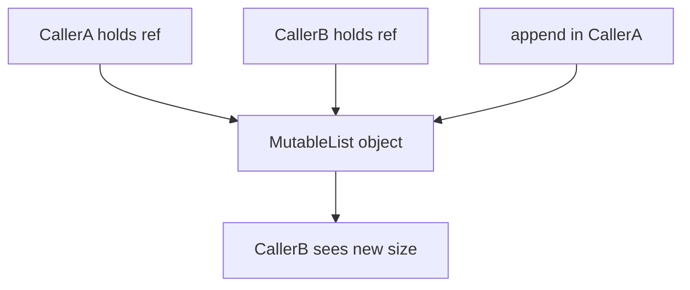
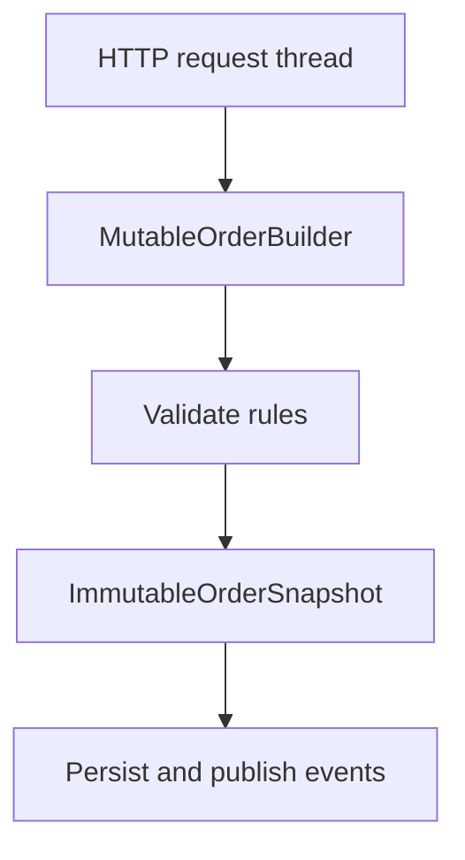

# D01-T011 — Immutability and mutability

Topic ID: `D01-T011`
Domain: Programming Language Fundamentals
Subdomain: Immutability and mutability
Importance: core
Complexity: fundamentals
Dependencies: `D01-T010`, `D01-T001`
Execution status of the code in section F: unexecuted

## A. Topic Overview

Immutability means a value cannot change after it is created. Mutability means the contents of a value can be updated in place. Variables can be rebound to new values; immutability is a property of the object or value they currently reference.

The distinction exists because shared state is the main source of bugs in concurrent and layered systems. When two callers hold a reference to the same mutable list, one caller’s append can surprise the other. Immutable values can be shared freely because no writer can change them.

In production backends this appears in configuration objects, DTOs passed through pipelines, cache keys, and defensive copies at API boundaries. Interviewers use it to test whether you understand reference semantics, thread safety shortcuts, and when copying is cheaper than coordinating locks.

Prerequisites: value versus reference semantics (`D01-T005` if present in your track) and basic types (`D01-T001`). Collections (`D01-T012`) build directly on which collection types are mutable.

## B. First-Principles Explanation

Memory holds bytes. A mutable object is a heap region whose bytes the program may rewrite through a reference. An immutable object’s bytes are not exposed for mutation after construction; “change” means allocate a new object and rebind the variable.

Languages enforce this differently. Java `String` is immutable: `concat` returns a new string. Python `str` is immutable; `+=` binds a new string. Java `ArrayList` is mutable: `add` changes the same object. Go slices are mutable views over an array; reassignment can share backing storage.

Why immutability helps: readers never see partial updates, hash codes can be cached (`String` in Java), and concurrent readers need no locks. Why mutability helps: in-place updates avoid allocation and copying, which matters for large buffers and hot paths.

Limitations: pretending immutability while leaking a mutable interior (a `List` field on a “immutable” config object) breaks guarantees. Deep immutability requires copying or persistent data structures. Alternatives: copy-on-write, defensive copies at construction, and immutable collections libraries.

Terms: **shallow immutability** — the reference cannot be swapped on a frozen object, but nested mutable objects can still change. **deep immutability** — the entire object graph cannot be mutated through any reachable reference. **defensive copy** — duplicate mutable input so the callee cannot mutate the caller’s data.

## C. Internal Working and Architecture

Components:

- Object header (type, hash, lock word in some JVM layouts).
- Field slots or array elements holding primitives or references.
- Visibility rules: `final` fields in Java, frozen dataclasses in Python 3.10+, `const` in Go for compile-time constants only (not heap immutability).

Execution for `list.append(x)` on a shared Python list:

1. Load the list object and the element reference.
2. If capacity allows, write the new pointer into the internal array and increment size.
3. All other references to that list object observe the new length on the next read.

Execution for `s = s + "x"` on a Java `String`:

1. Allocate a new char array sized for both parts.
2. Copy existing chars and append new ones.
3. Store a new `String` reference in `s`; other variables still point at the old string.

Backend flow: a service builds a `OrderSnapshot` as an immutable record after validation. Handlers pass it to audit logging and billing without locks. A mutable `OrderBuilder` is used only inside one thread during the request, then frozen into the snapshot before the transaction commits.

State: mutable objects have version-like behavior — each in-place change is a new logical state at the same identity. Immutable objects have stable identity and stable content for their lifetime.

Memory: in-place mutation reuses one object; immutable updates allocate. GC later collects abandoned versions. Large immutable chains (repeated `+` on strings in a loop) create many short-lived objects.

## D. Diagrams and Visual Models





Read the first diagram as the shared-mutation hazard. The second is the common backend pattern: mutate locally, then publish an immutable view.

## E. Examples and Analogies

Analogy: a mutable object is a shared whiteboard; anyone with the room key can erase and rewrite. An immutable object is a printed PDF — you publish a new edition instead of editing pages in place.

Technical example: `Collections.unmodifiableList` in Java wraps a list so `add` throws; if the backing list is still mutable elsewhere, the “unmodifiable” view is not deep immutability.

Backend example: a gRPC interceptor adds a trace id to a mutable `Map` in the request context. If that map is reused across requests, one request can leak ids into another. Use an immutable map per request or copy-on-enter.

Do not: return internal mutable collections from a domain object (`getItems()` that exposes the live list). Do not: use `String` concatenation in a tight loop when a `StringBuilder` is appropriate — that is an allocation pattern issue, not a reason to mutate strings. Do not: assume `final` on a reference makes the graph immutable.

## F. Code Examples

File: `examples/d01_t011_immutable_snapshot.py`

Dependencies: Python 3.9+ (`tuple`, `dataclass`).

```python
from dataclasses import dataclass
from typing import Tuple


@dataclass(frozen=True)
class LineItem:
    sku: str
    qty: int


@dataclass(frozen=True)
class OrderSnapshot:
    order_id: str
    items: Tuple[LineItem, ...]


def build_snapshot(order_id: str, raw_items: list[tuple[str, int]]) -> OrderSnapshot:
    items = tuple(LineItem(sku=s, qty=q) for s, q in raw_items)
    return OrderSnapshot(order_id=order_id, items=items)


if __name__ == "__main__":
    snap = build_snapshot("o-1", [("A", 2), ("B", 1)])
    assert snap.items[0].sku == "A"
    try:
        snap.order_id = "o-2"  # type: ignore
    except Exception:
        pass
    else:
        raise AssertionError("frozen dataclass must not assign")
    print("ok", len(snap.items))
```

How to run: `python examples/d01_t011_immutable_snapshot.py` from the topic folder.

Expected output: `ok 2`

Important lines: `frozen=True` prevents attribute assignment after construction. `tuple(...)` copies the sequence so callers cannot mutate `raw_items` later and change the snapshot. `LineItem` is also frozen so items inside the tuple are not silently mutable records.

Edge cases: a frozen dataclass with a `list` field is shallowly frozen — the list contents can still change unless you use `tuple`. Java equivalent is a `record` with `List.copyOf` in the compact constructor.

This example is labeled unexecuted in this documentation pass.

## G. Practical Backend Application

Request handling often uses a mutable builder (parse JSON, apply patches), then commits an immutable domain object to the unit of work. Event payloads should be immutable snapshots so consumers replay the same bytes. Cache keys should be built from immutable value types with stable `equals`/`hashCode` (Java) or hashable frozen tuples (Python).

Concurrency: immutable snapshots can be read across threads without synchronization. Mutable request-scoped beans must not be singletons. Error handling: if validation fails, discard the builder; do not partially publish a snapshot.

Security: mutable byte buffers reused across requests can leak prior request data unless zeroed. Observability: log immutable structs after redaction; avoid logging objects that mutate after the log line is formatted. Scaling: extra allocation from immutability is usually cheaper than lock contention on shared mutable graphs.

## H. Advantages, Limitations and Trade-offs

| Choice | Benefit | Cost | Choose when | Avoid when |
| --- | --- | --- | --- | --- |
| Immutable snapshots | Safe sharing, simpler reasoning | Allocations, copying | Events, audit, cross-thread handoff | Huge buffers you must stream |
| Mutable builders | Fewer copies in one thread | Easy to leak references | Single-threaded request assembly | Long-lived shared singletons |
| Defensive copy at API edge | Caller cannot corrupt internal state | CPU and memory | Public library boundaries | Hot inner loops |
| Persistent collections | Immutable updates without full copy | Complexity, less common in Java services | Functional pipelines | Simple CRUD services |
| Unmodifiable wrapper | Quick read-only view | Backing list still mutable | Return type shielding | True deep immutability |

Under load, accidental sharing of one mutable `ArrayList` across requests creates rare cross-tenant data bugs that are hard to reproduce. Immutable per-request objects trade memory for isolation.

Failure modes: shallow freeze, mutable static fields, caching a mutable object as a singleton “template”, and concurrent modification of a collection during iteration.

## I. Common Mistakes and Misconceptions

- “`final` means immutable.” In Java, `final` only prevents reassignment of the reference; the referenced list remains mutable.
- “Strings are slow because immutable.” Immutability enables sharing and safe interning; the cost is repeated concatenation without a builder.
- “Copy everything always.” Copying large payloads on every layer adds latency; copy at trust boundaries.
- “Immutable means thread-safe for all operations.” Lazy initialization of a supposedly immutable object can still race unless the factory is synchronized or the object is fully constructed before exposure.
- “Functional style forbids mutation.” Practical services mutate locally; they avoid shared mutable state across threads and requests.

Weak interview answer: “immutability is good.” Strong answer: names a shared-reference bug, a boundary copy, or an event snapshot.

## J. Debugging and Troubleshooting

Symptoms: intermittent wrong line items in responses, `ConcurrentModificationException`, cache hits for the wrong tenant, audit log rows that change after write.

Root causes differ: shared mutable singleton, escaped internal collection, iteration during mutation, or shallow immutability.

Diagnosis:

1. Identify whether two stack traces share the same object id (JVM heap dump, or `id()` in Python during repro).
2. Search for `static` mutable fields or beans with singleton scope holding request data.
3. Check whether APIs return live internal collections.
4. Reproduce under concurrent integration tests.

Immediate mitigation: stop sharing — clone per request, or freeze before publish. Long-term: code review checklist for returned collections, archunit-style tests forbidding mutable static state.

Metrics: rare 500s with `ConcurrentModificationException`, support tickets describing “random” wrong data.

## K. Interview Preparation

### Beginner

#### Q1. What is the difference between immutability and a `const` variable?

**Answer:** Immutability describes whether the value behind a reference can change after creation. A `const` or `final` variable cannot be rebound to a different reference, but in many languages it can still point at a mutable object whose contents change. Interviewers want you to separate binding immutability from object immutability. In backend code, freezing the variable name does not protect you if the list it references is still mutable.

#### Q2. Why are Java strings immutable?

**Answer:** Immutability lets the JVM share string literals and cache hash codes safely. It also prevents subtle security issues where a string used as a map key or file path could change after insertion. Concatenation creates new objects, which is a deliberate trade for safety and sharing. When you need many edits, `StringBuilder` mutates an internal buffer without changing existing `String` instances.

#### Q3. What happens when you pass a mutable list into a function?

**Answer:** The function receives a reference to the same list object, not a copy. If the function appends or clears, every other holder of that reference sees the change. That is efficient when the contract allows mutation, and dangerous when the caller did not expect aliasing. Defensive copying at module boundaries documents that the callee will not mutate caller-owned data.

#### Q4. Give an example of immutability helping concurrency.

**Answer:** After a request is validated, you can publish an immutable order snapshot to worker threads that compute tax, fraud checks, and emails. Readers do not need locks because no writer exists for that snapshot object. Mutable shared caches are the opposite pattern and require careful synchronization. Immutability does not remove all races — only races on that object’s contents.

#### Q5. What is a defensive copy?

**Answer:** It is duplicating a mutable structure when accepting or returning data across a trust boundary. The copy breaks aliasing so internal state cannot be changed by external code. It costs CPU and memory but simplifies invariants inside the service. Libraries like the JDK use `List.copyOf` in records to enforce this at construction time.

### Intermediate

#### Q1. What is shallow versus deep immutability?

**Answer:** Shallow immutability means you cannot replace fields on the object, but referenced mutable objects may still change. Deep immutability means no mutation is possible through any path in the object graph. Interviewers often describe a frozen dataclass that still holds a mutable `list`. The fix is to store an immutable tuple or copy on the way in. Event schemas should be deeply immutable before they cross process boundaries.

#### Q2. How does Python’s `+=` on strings relate to immutability?

**Answer:** `s += "x"` looks like mutation but binds `s` to a new string object because `str` is immutable. Old references to the previous string are unchanged. In a loop this creates many discarded objects and can increase GC work. For building large text, use `io.StringIO` or join a list of parts once.

#### Q3. When would you choose a mutable builder over immutable objects in a service?

**Answer:** During a single request on one thread, a builder avoids copying large structures on every small edit. You accumulate state, validate once, then freeze into an immutable snapshot for persistence and messaging. The builder must not escape the request scope or be stored on a singleton. This pattern appears in protobuf builders and Java `StringBuilder` before creating a `String`.

#### Q4. What is wrong with returning an internal mutable collection from a getter?

**Answer:** Callers can modify your object’s internals without going through your domain methods, breaking invariants like sorted order or uniqueness. Encapsulation is not only hiding fields; it is controlling mutation paths. Return `List.copyOf`, an unmodifiable view with clear documentation, or iterate via domain methods. If you must expose live data for performance, document that contract loudly and version carefully.

#### Q5. How do immutable objects interact with caching?

**Answer:** Cache keys must be stable: if a key object mutates after insertion, lookups fail or return wrong entries. Immutable keys with correct `equals` and `hashCode` are safe in `ConcurrentHashMap`. Mutable keys are a classic bug in local caches. Values can be mutable only if the cache owns exclusive access, which is rare in shared services.

### Advanced

#### Q1. Explain copy-on-write in the context of immutability.

**Answer:** Copy-on-write defers copying until a mutation is attempted, while presenting an immutable interface to readers. Readers share one version until a writer forks a private copy. This appears in some persistent data structures and in kernel memory pages. In application code, `List.copyOf` is not copy-on-write; it copies immediately. Understanding COW helps you reason about when “immutable” APIs still share backing storage, as with Go slices.

#### Q2. Can immutability eliminate all need for locks?

**Answer:** No. Immutability removes locks only for data that is truly immutable and safely published after construction. You still need synchronization for lazy initialization, counters, connection pools, and mutable caches. The Java memory model requires safe publication so other threads do not see partially constructed objects. Immutable snapshots still need a clear handoff point from the builder thread to worker threads.

#### Q3. How do records in Java relate to immutability?

**Answer:** Records are shallowly immutable carriers: components are `final`, and accessors are generated. If a component type is mutable, the record is not deeply immutable. Compact constructors should defensively copy mutable collections. Records are excellent for DTOs and command objects crossing layers. They are not a replacement for validation logic in the domain.

#### Q4. What is the relationship between immutability and hashing?

**Answer:** Hash-based collections require that if two objects are equal, their hash codes match, and keys must not change while in the map. Mutable keys violate the second requirement if their fields change after insertion. Immutable keys fix that. Strings in Java cache their hash code because they are immutable. If you design custom key types, make them immutable or do not use them as keys.

#### Q5. How would you audit a codebase for shared mutable state?

**Answer:** Search for static mutable fields, singleton beans holding request fields, and getters returning live collections. Use thread-stress tests that hammer endpoints concurrently with overlapping identifiers. Static analysis can flag `public static` non-final collections. Architecture tests can forbid certain packages from exposing mutable types in public APIs. The goal is to find aliases that survive across requests.

### Scenarios

#### Q1. Two tenants see each other’s cart lines intermittently. What immutability mistake fits?

**Answer:** A singleton service likely reuses one mutable cart list or map across requests without clearing between them. The fix is per-request cart instances or deep copies at request entry. Immutability of the cart snapshot at checkout prevents later mutation from changing billed amounts. Add an integration test that alternates tenant ids rapidly on one instance.

#### Q2. A `ConcurrentModificationException` appears during foreach over orders. What happened?

**Answer:** Another thread or the same thread through a callback modified the underlying collection during iteration. The iterator detects structural change and fails fast. Copy the collection before iteration, synchronize, or use concurrent collections designed for weakly consistent iteration. Immutable snapshots for read paths remove this class of bug.

#### Q3. Performance team says immutable events allocate too much. What do you propose?

**Answer:** Measure first: allocation rate versus GC pause versus lock contention on a mutable alternative. Often batching, struct-like arrays, or binary serialization (protobuf bytes as immutable blobs) reduces overhead without shared mutable graphs. Keep mutation inside one thread, then emit an immutable byte array event. Do not revert to shared mutable event objects without a locking story.

#### Q4. An API returns JSON built from internal domain lists that clients mutate in tests. Is that a server bug?

**Answer:** If the server serialized live objects that later changed before the response flushed, you could get inconsistent JSON. Normally serialization copies values at write time, but exposing mutable domain objects to other internal modules can still cause races before serialization completes. Treat the response DTO as an immutable snapshot at the handler boundary. Document that clients must not rely on server-side object identity.

#### Q5. You freeze configuration at startup but operators see stale feature flags. Is immutability the problem?

**Answer:** Immutable startup config is correct for safety; the gap is refresh mechanics, not immutability itself. You need a new immutable config object atomically swapped when flags change, not mutation of a shared map in place. Readers hold a reference to the current immutable snapshot. This pattern pairs immutability with atomic reference swap, not with never updating config.

### Follow-ups

#### Q1. How does this connect to collections?

**Answer:** Lists, maps, and sets differ in mutability contracts and thread-safety wrappers. Choosing `List` versus `ImmutableList` shapes your entire API. See `D01-T012` for complexity and iterator behavior on mutable structures.

#### Q2. How does immutability relate to functional programming?

**Answer:** FP discourages shared mutable state and favors pure functions on immutable data. It does not forbid local mutation inside a function body in most practical FP on the JVM or Python. See `D01-T014` for purity and side effects.

#### Q3. What about value types and immutability in modern Java?

**Answer:** Value types (Project Valhalla direction) aim to combine immutability with inline storage without heap allocation for small aggregates. Today, records plus primitives approximate that pattern for DTOs. This ties to performance and GC topics in `D01-T017`.

## L. Practical Exercises

Solutions are in `EXERCISES/solutions/D01-T011.md`. Try these before opening that file.

### Exercise 1 — implementation

Implement `freeze_items(raw: list[tuple[str, int]]) -> tuple[LineItem, ...]` using frozen dataclasses as in section F, and a function `assert_no_alias(a, b)` that raises if two lists share the same underlying mutable list (hint: compare `id` only when appropriate for the test). Acceptance: mutating `raw` after `freeze_items` does not change the returned tuple; frozen `LineItem` rejects attribute assignment.

### Exercise 2 — debugging

A Spring `@Service` singleton stores `currentUser` in a field set on each request. Users report wrong account data. Explain the immutability and scope bug and the fix. Acceptance: name singleton scope, per-request isolation, and immutable user snapshot after auth.

### Exercise 3 — trade-off

An event bus passes `Map<String, Object>` payloads. Product wants faster publishing. Argue for immutable event records versus reusing one mutable map. Acceptance: mention allocation, thread safety, and observability of partial updates.

## M. Revision Notes

- Immutability is about object contents; `final` is about rebinding.
- Shared mutable references cause cross-caller surprises.
- Freeze at commit boundaries; mutate only inside one request thread.
- Shallow freeze is not deep immutability.
- Defensive copy at trust boundaries.
- Immutable snapshots simplify concurrent readers.

Flashcards:

- What is aliasing? Two references, one mutable object.
- Why immutable keys? Hash tables assume stable key bits.
- Builder then snapshot? Local mutation, published immutable view.

## N. Related Topics

Understand this before: `D01-T001`, `D01-T010`.

This topic supports: `D01-T012` collections, `D01-T016` concurrency, `D01-T014` functional style.

Often confused with: `const`/`final` versus immutable objects.

Interviewers combine this with `D13-T006` thread safety and API design reviews.

## O. Completion Criteria

- Explain shallow versus deep immutability with an example.
- Draw shared mutable reference versus immutable snapshot handoff.
- Implement a frozen snapshot type that cannot be mutated via nested lists.
- Debug a singleton mutable field cross-request leak.
- Choose builder-plus-snapshot versus live mutable domain object for a new endpoint.
