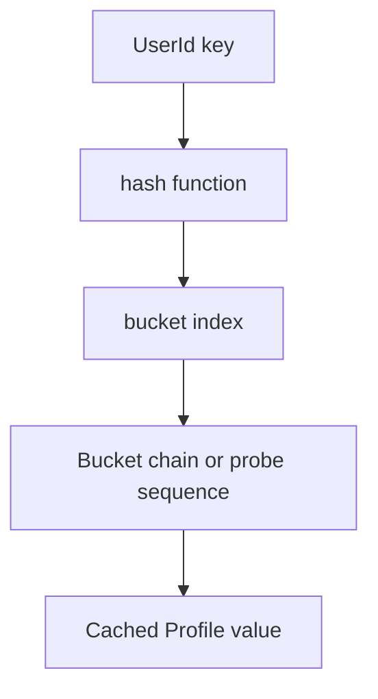
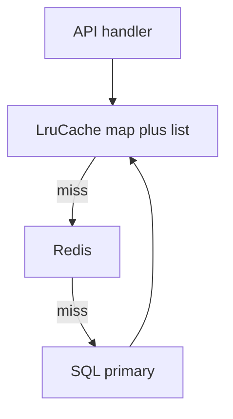

# D01-T012 — Collections and data structures

Topic ID: `D01-T012`
Domain: Programming Language Fundamentals
Subdomain: Collections and data structures
Importance: core
Complexity: fundamentals
Dependencies: `D01-T011`, `D01-T001`
Execution status of the code in section F: unexecuted

## A. Topic Overview

A collection is a container that groups values and supports operations such as insert, lookup, delete, and ordered traversal. Data structures are the concrete layouts (array, hash table, tree, heap) that implement those operations with specific time and space costs.

The topic exists because backend services constantly index users by id, queue jobs, deduplicate events, and paginate sorted results. Picking the wrong structure turns an O(1) lookup into O(n) scans under load.

Interviewers probe whether you know amortized costs, equality and hashing contracts, ordering guarantees, and when a database index replaces an in-memory structure.

Prerequisites: types and immutability (`D01-T001`, `D01-T011`). Iterators (`D01-T013`) depend on how these structures expose traversal.

## B. First-Principles Explanation

At the machine level, a dynamic array is a pointer, length, and capacity over a contiguous buffer. A hash table is an array of buckets pointing to chains or open-addressing slots keyed by `hash(key) mod capacity`. A tree orders keys so search is O(log n) with pointer chasing instead of scanning.

Language libraries wrap these: Java `HashMap`, Python `dict`, Go `map`, JavaScript `Map`. Each specifies average-case complexity, iteration order, and null-key rules. Python 3.7+ dicts preserve insertion order; Java `HashMap` does not guarantee order; `LinkedHashMap` does.

Why hash tables work: spread keys across buckets with a good hash function and resize when load factor grows. Limitations: worst-case collisions degrade to O(n); keys must implement consistent `equals`/`hashCode`; mutable keys are unsafe. Alternatives: trees for ordered ranges, heaps for top-k, tries for prefix keys.

Terms: **load factor** — entries divided by buckets before resize. **Amortized** — occasional expensive resize spread over many cheap inserts. **Structural modification** — any change that changes iteration state.

## C. Internal Working and Architecture

Components:

- Backing store (array, nodes, buckets).
- Size and capacity counters.
- Hash function and equality (user-defined or language-defined).
- Iterator cursor with fail-fast or weakly consistent rules.

Insert into `HashMap` (Java, simplified):

1. Compute `hash(key)` and bucket index.
2. Walk the bucket chain for an equal key; replace value if found.
3. Else append entry; increment size; resize if load factor exceeded.
4. Rehash all entries into a larger table on resize.

Lookup in Python `dict`:

1. Compute hash, find slot via open addressing.
2. Compare keys with rich comparison.
3. Return value reference or raise `KeyError`.

Backend pattern: an in-memory `ConcurrentHashMap` caches denormalized profile rows keyed by user id. On miss, load from Redis or SQL. The collection choice must match concurrency (`ConcurrentHashMap` versus synchronized `HashMap`).

State: collections have explicit size; iterators track a version or weak consistency. Memory: arrays pack well; linked nodes add pointer overhead per element.

## D. Diagrams and Visual Models





Read top to bottom: hash routing, then a typical three-tier read path where the in-memory map is the first collection layer.

## E. Examples and Analogies

Analogy: a hash map is a coat check — you get a ticket number (hash bucket) that narrows where to search. A sorted tree is a phone book — binary search by name, not by ticket hash.

Backend: deduplicating webhook deliveries with a `Set` of event ids for the last hour. Using a `List` would make membership O(n) and melt CPU under bursts.

Do not: use `float` as a hash key. Do not: mutate a key object after inserting into a `HashMap`. Do not: assume `hashCode` without `equals` contract symmetry.

## F. Code Examples

File: `examples/d01_t012_lru_cache.py`

Dependencies: Python 3.9+ standard library (`collections`).

```python
from collections import OrderedDict


class LruCache:
    def __init__(self, capacity: int) -> None:
        self._cap = capacity
        self._data: OrderedDict[str, str] = OrderedDict()

    def get(self, key: str) -> str | None:
        if key not in self._data:
            return None
        self._data.move_to_end(key)
        return self._data[key]

    def put(self, key: str, value: str) -> None:
        if key in self._data:
            self._data.move_to_end(key)
        self._data[key] = value
        if len(self._data) > self._cap:
            self._data.popitem(last=False)


if __name__ == "__main__":
    c = LruCache(2)
    c.put("a", "1")
    c.put("b", "2")
    assert c.get("a") == "1"
    c.put("c", "3")
    assert c.get("b") is None
    print("ok")
```

How to run: `python examples/d01_t012_lru_cache.py`

Expected output: `ok`

Important lines: `OrderedDict` gives O(1) move-to-end for LRU order. `popitem(last=False)` evicts the oldest. Production caches add TTL, metrics, and stampede protection.

This example is labeled unexecuted in this documentation pass.

## G. Practical Backend Application

Choose structures by access pattern: id lookup → hash map; sorted pagination → tree or database index; priority scheduling → heap; FIFO work → queue (`ArrayDeque`, channel). Many services push large sorted sets to Redis (`ZSET`) or the database instead of holding giant trees in heap.

Concurrency: `ConcurrentHashMap` segments or lock buckets; `Collections.synchronizedMap` serializes all operations. Python dict operations are atomic per bytecode but compound read-modify-write is not thread-safe without locks.

Error handling: `KeyError` versus `Optional` return is an API design choice. Observability: track cache hit ratio, map size, and eviction rate. Security: unbounded in-memory maps keyed by user input are memory exhaustion vectors — cap size and TTL.

## H. Advantages, Limitations and Trade-offs

| Structure | Typical lookup | Ordering | Choose when | Avoid when |
| --- | --- | --- | --- | --- |
| Hash map | O(1) average | None | Id lookups, caches | Need range scans in memory |
| Tree map | O(log n) | Sorted keys | In-memory ordered windows | Only point lookups |
| Array list | O(1) index | Insertion order | Stack-like buffers | Frequent middle inserts |
| Linked list | O(n) search | Node order | Rare in hot services | Random access heavy paths |
| Heap | O(log n) push/pop | Partial order | Top-k, schedulers | Full sorting |
| Deque | O(1) ends | Ends order | BFS queues, sliding window | Random access |

Resize events cause latency spikes on hash tables; pre-size when you know cardinality. Tree structures use more memory per entry than arrays.

Failure modes: hash collision attacks (JDK string hashing hardened), iterator invalidation, unbounded growth OOM, and wrong equality breaking maps.

## I. Common Mistakes and Misconceptions

- “`List.contains` is cheap.” It is O(n); use a `Set` for membership.
- “All maps iterate in insertion order.” Only some implementations guarantee that.
- “`ConcurrentHashMap` makes the whole service thread-safe.” Compound operations still need synchronization or `compute` methods.
- “Database solves collections.” You still choose indexes (B-tree, hash) — same concepts at storage layer.
- “Default `Object.hashCode` is fine for entities.” Identity hash breaks when entities are reconstructed; use business keys.

## J. Debugging and Troubleshooting

Symptoms: CPU spikes on “simple” lookups, memory growth, wrong cache hits, `ConcurrentModificationException`.

Diagnosis: profile hot `equals`/`hashCode`, dump map sizes, check for unbounded keys from clients, verify iterator usage during mutation.

Mitigation: switch structure, add caps, externalize to Redis with eviction policy, fix key equality. Metrics: p99 handler time versus cache hit ratio.

## K. Interview Preparation

### Beginner

#### Q1. What is the difference between a list and a set?

**Answer:** A list allows duplicates and preserves positional access by index. A set enforces uniqueness and is optimized for membership tests, usually via hashing. You pick a list when order and duplicates matter, such as a timeline of events. You pick a set when you only care whether an id was seen, such as deduplication of webhook ids.

#### Q2. What does O(1) average mean for a hash map?

**Answer:** It means lookup time is constant if the hash spreads keys evenly and the load factor stays bounded. Occasionally resizing the table costs O(n), but spread over many inserts that cost is amortized. Worst-case collision chains can degrade to O(n), which is why security-sensitive maps use hardened hashing or trees for long chains in Java 8+.

#### Q3. Why must `equals` and `hashCode` be consistent in Java?

**Answer:** Hash maps first use `hashCode` to choose a bucket, then `equals` to find the exact key. If two objects are equal but have different hash codes, lookups fail even though the key is present. If hash codes change while an object is in the map, the key becomes lost in the wrong bucket. Immutable keys with stable fields avoid that class of bug.

#### Q4. When would you use a queue in a backend service?

**Answer:** Queues decouple producers and consumers: HTTP handlers enqueue work, worker pools dequeue tasks. FIFO ordering is natural for fair processing and backpressure. `ArrayDeque` or bounded channels prevent unbounded memory growth when producers outpace consumers. Dead-letter queues collect poison messages for inspection.

#### Q5. What is iteration order for Python dicts?

**Answer:** Since Python 3.7, dicts preserve insertion order as part of the language specification. That order affects serialization and tests that compare key order. It does not make dicts sorted by key — you still need `sorted(d)` for key ordering. Relying on order for business logic is acceptable when documented, unlike older Python versions where order was implementation detail.

### Intermediate

#### Q1. How does `ArrayList` growth work in Java?

**Answer:** Appends use a backing array; when full, Java allocates a larger array (typically ~1.5x), copies elements, and replaces the reference. Amortized O(1) append, occasional O(n) copy. Pre-sizing the list when you know final size avoids repeated copies. Growth spikes matter in latency-sensitive batch jobs.

#### Q2. Compare `HashMap` and `TreeMap` for an in-memory index.

**Answer:** `HashMap` gives faster average lookups without ordering. `TreeMap` keeps keys sorted and supports range views like `subMap`, at O(log n) per operation. For purely id-based lookups, hash wins. For “last N keys in order” without hitting the database, a tree or skiplist can be appropriate if the dataset fits memory.

#### Q3. What is a concurrent collection and when do you need it?

**Answer:** It is a structure designed for parallel access, such as `ConcurrentHashMap` or `BlockingQueue`. You need it when multiple threads read and write the same cache or work queue without wrapping every call in one global lock. It does not make multi-step business transactions atomic — you still design operations or use transactions.

#### Q4. How do Go maps differ from Java `HashMap`?

**Answer:** Go maps are reference types with unspecified iteration order; you must not depend on order. They are not safe for concurrent writes without a mutex or `sync.Map`. Zero value is nil; reading a nil map panics on write. Java maps are objects with richer concurrent implementations and null-key rules depending on implementation.

#### Q5. When should data leave the JVM heap for Redis?

**Answer:** When the dataset is large, shared across instances, needs TTL eviction, or must survive process restarts. Redis provides hash, set, sorted set, and list structures with network latency traded for centralized memory. Local `ConcurrentHashMap` is faster for small hot sets but duplicates per pod and complicates invalidation.

### Advanced

#### Q1. What happens during hash table resize?

**Answer:** The table allocates a larger bucket array and rehashes every entry because bucket index depends on table length. During resize, latency can spike if done on the request thread. Some libraries use incremental resize; Java resizes synchronously on that map instance. Pre-sizing and load factor tuning reduce resize frequency.

#### Q2. Explain open addressing versus chaining.

**Answer:** Chaining stores colliding entries in linked lists or trees at each bucket. Open addressing probes alternative slots in the array when a collision occurs. Python dicts use open addressing with a perturbed probe sequence. Both need a low load factor for performance; open addressing clusters if hashing is poor. JDK 8+ promotes long chains to balanced trees per bucket.

#### Q3. How do weak references relate to caches?

**Answer:** `WeakHashMap` entries can be collected when keys are only weakly reachable, letting GC reclaim memory under pressure. Soft references linger until memory is needed, which can cause ambiguous retention. Caches in production more often use size bounds and TTL because reference types are harder to reason about than explicit eviction.

#### Q4. What is structural modification during iteration?

**Answer:** Adding or removing elements changes the collection’s structure while an iterator is active. Fail-fast iterators throw `ConcurrentModificationException` to signal probable bugs. Concurrent collections may offer weakly consistent iterators that reflect some updates. Copy-on-write collections snapshot for safe iteration at memory cost.

#### Q5. How do database indexes mirror in-memory structures?

**Answer:** B-tree indexes support range scans and ordering like tree maps. Hash indexes support equality lookups like hash maps. Query planners choose based on predicates. Misaligned indexes make the database do sequential scans — the same mistake as using a list instead of a set, but at disk scale.

### Scenarios

#### Q1. A endpoint slows linearly as traffic grows though DB QPS is flat. Suspect?

**Answer:** An in-memory `List` used for membership or deduplication turns every request into O(n) work. Profile for `contains` on growing collections. Replace with `HashSet` or push dedup to Redis with TTL. Cap the window of ids you retain.

#### Q2. Cache hit rate is high but wrong users see wrong profiles. Cause?

**Answer:** Key equality or hash is broken — perhaps a mutable key, or a key type that equates different users after a field mutation. Dump conflicting entries and audit `equals`/`hashCode`. Immutable string user ids as keys are the safe default.

#### Q3. Pod OOM after a marketing campaign. What collection mistake?

**Answer:** An unbounded map caching every distinct query string or user id without eviction grows until heap exhaustion. Add LRU cap, TTL, or move to Redis with `maxmemory` policy. Monitor map size metric.

#### Q4. You need top 10 products by score updating hourly. Structure?

**Answer:** A min-heap of size 10 over streaming updates gives O(log 10) per update if scores change frequently. For hourly batch, sorting in SQL or a `ZSET` in Redis may be simpler. Full sort of millions in memory each request is the wrong approach.

#### Q5. Two services disagree on whether an id was processed. Fix?

**Answer:** Align on a shared dedup store — database unique constraint, Redis set with TTL, or idempotent consumer offset. Local `HashSet` per instance only dedups within one process. The collection must be distributed and durable for cross-instance truth.

### Follow-ups

#### Q1. How do iterators expose these structures?

**Answer:** Each collection provides traversal protocol with defined failure modes. See `D01-T013` for generators and lazy pipelines over collections.

#### Q2. How does immutability interact with collections?

**Answer:** Immutable copies (`List.copyOf`, frozen tuples) prevent callers from breaking your invariants. Mutable interiors of “immutable” wrappers remain a risk. See `D01-T011`.

#### Q3. How does this connect to algorithmic complexity?

**Answer:** Big-O analysis of chosen structures predicts scaling. See `D02-T001` for formal complexity and profiling.

## L. Practical Exercises

Solutions are in `EXERCISES/solutions/D01-T012.md`.

### Exercise 1 — implementation

Implement `LruCache` with `get` and `put` as in section F, plus `size()` and a `max_capacity` that never stores more than N entries. Acceptance: evict least-recently-used on overflow; `get` refreshes recency.

### Exercise 2 — debugging

Logs show `ConcurrentModificationException` in a foreach over `ordersByUser.values()`. Another thread adds orders during iteration. Propose two fixes with trade-offs.

### Exercise 3 — trade-off

Choose in-process `ConcurrentHashMap` versus Redis hash for a 50k-entry product catalog shared by 20 pods. State latency, consistency, and memory trade-offs.

## M. Revision Notes

- Match structure to access pattern: set for membership, map for lookup, deque for FIFO.
- `equals`/`hashCode` contract is part of the map API.
- Iteration order is not universal — read the implementation docs.
- Unbounded collections are OOM vectors.
- Resize and collision matter at scale.
- Database indexes repeat these choices at persistence layer.

## N. Related Topics

`D01-T011` immutability, `D01-T013` iterators, `D02-T001` complexity, `D07-T002` storage indexes.

## O. Completion Criteria

- Pick map versus set versus heap for three stated backend scenarios.
- Explain amortized O(1) hash insert and when it fails.
- Implement LRU with ordered eviction.
- Debug broken `hashCode`/`equals` in a cache.
- Argue local versus Redis collection for a given size and fan-out.
