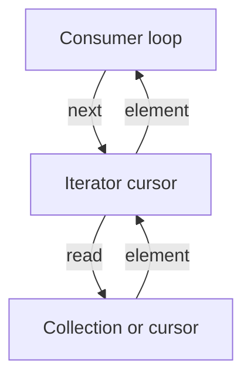
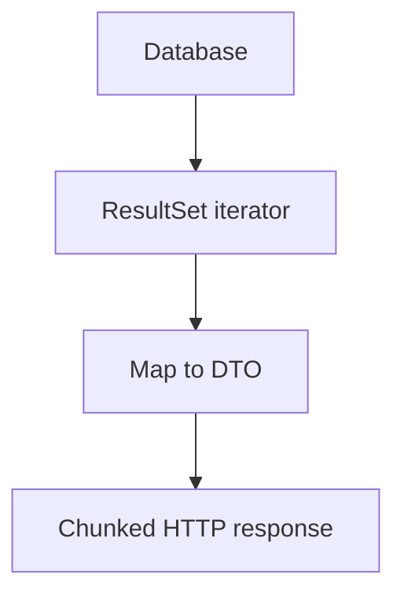

# D01-T013 — Iterators, generators, streams

Topic ID: `D01-T013`
Domain: Programming Language Fundamentals
Subdomain: Iterators, generators, streams
Importance: core
Complexity: fundamentals
Dependencies: `D01-T012`, `D01-T001`
Execution status of the code in section F: unexecuted

## A. Topic Overview

An iterator is an object that yields elements one at a time until exhausted. A generator is a language construct (Python `yield`, Java `Stream`, Go channels in spirit) that produces a sequence lazily without materializing the whole collection. Streams are composable pipelines over those sequences, often with optional parallelism.

The concept matters because backends process log files, database cursors, Kafka partitions, and HTTP chunked bodies that do not fit in memory. Pulling one element at a time bounds memory and lets you stop early.

Interviewers test lazy versus eager evaluation, resource cleanup, backpressure, and pitfalls like holding database connections open during slow consumers.

Prerequisites: collections (`D01-T012`). Functional pipelines (`D01-T014`) build on stream operations.

## B. First-Principles Explanation

Eager code builds a full list in memory then processes it. Lazy code requests the next item when needed. Internally an iterator keeps cursor state: index in an array, next pointer in a linked list, or prepared statement fetch size in JDBC.

Python iterators implement `__iter__` and `__next__`, raising `StopIteration` when done. Java `Iterator` has `hasNext`/`next`; `Stream` adds map/filter/reduce with spliterators for splitting. Go `range` over a slice is eager on the slice but reading from `io.Reader` is streaming.

Generators suspend execution at `yield`, saving stack frames, and resume on the next pull. That is cooperative multitasking at micro scale.

Limitations: lazy pipelines can hide work until late, making profiling harder. Holding iterators open ties up connections. Alternatives: pagination, keyset pagination, batch fetch with explicit page size.

Terms: **pull** — consumer drives pace. **push** — producer drives (reactive streams). **short-circuit** — stop when answer found (`anyMatch`).

## C. Internal Working and Architecture

ArrayList iterator (Java):

1. Store expected `modCount` from list at creation.
2. On `next`, return element and increment index; if `modCount` changed, throw CME.
3. On exhaustion, `hasNext` false.

Python generator:

1. Call creates generator object with frozen frame.
2. Each `next()` runs until `yield`, returns value, pauses.
3. `StopIteration` ends iteration; `for` loops swallow it.

JDBC streaming:

1. Set fetch size; driver requests batches from server.
2. `ResultSet.next()` may block on network for next batch.
3. Close `ResultSet` and statement to release server cursor.

Backend: export millions of rows — stream `COPY` or cursor with `fetchSize=1000`, write CSV lines to response `OutputStream` without loading all rows.

## D. Diagrams and Visual Models





## E. Examples and Analogies

Analogy: iterator is a bookmark in a book; you read one page at a time instead of photocopying the whole book.

Pitfall: `list(iterator)` on an infinite stream hangs. `Stream` on infinite sources needs `limit`.

Backend: Kafka consumer poll loop is iterator-like — process records batch, commit offset, repeat.

## F. Code Examples

File: `examples/d01_t013_batch_read.py`

```python
from typing import Iterable, Iterator, TypeVar

T = TypeVar("T")


def batched(it: Iterable[T], size: int) -> Iterator[list[T]]:
    if size < 1:
        raise ValueError("size must be positive")
    batch: list[T] = []
    for item in it:
        batch.append(item)
        if len(batch) >= size:
            yield batch
            batch = []
    if batch:
        yield batch


if __name__ == "__main__":
    data = range(7)
    chunks = list(batched(data, 3))
    assert chunks == [[0, 1, 2], [3, 4, 5], [6]]
    print("ok", len(chunks))
```

Expected output: `ok 3`

Labeled unexecuted in this documentation pass.

## G. Practical Backend Application

Use iterators for large exports, log tailing, and parsing newline-delimited JSON. Set fetch sizes on ORMs to avoid loading entire tables. For HTTP, flush chunks so memory stays flat.

Concurrency: parallel streams split spliterators but share ordering rules; I/O streams should not be parallelized blindly. Errors mid-stream should abort the response and close resources in `finally` or try-with-resources.

Observability: log rows processed, not only completion. Security: streaming user data still needs authz on the query, not only on the first row.

## H. Advantages, Limitations and Trade-offs

| Approach | Memory | Latency to first byte | Risk |
| --- | --- | --- | --- |
| Eager list | O(n) | High until fully built | OOM |
| Iterator | O(1) extra | Low | Long-held DB connections |
| Generator | O(1) extra | Low | Hidden per-item cost |
| Parallel stream | Split work | Overhead for small n | Thread safety on source |
| Pagination | Bounded pages | Multiple round trips | Consistent snapshot hard |

## I. Common Mistakes and Misconceptions

- Closing HTTP response but leaving DB cursor open leaks connections.
- Modifying collection while iterating without snapshot.
- Assuming `Stream` is always lazy — terminal operations trigger work.
- Using generators once — they are single-pass unless tee'd.

## J. Debugging and Troubleshooting

Symptoms: connection pool exhausted, slow first byte, duplicate rows in export. Check fetch size, transaction scope, iterator lifetime, and whether consumer is slower than producer (backpressure).

## K. Interview Preparation

### Beginner

#### Q1. What is an iterator?

**Answer:** It is a cursor that returns the next element of a sequence on demand until there are no more. It separates traversal from the underlying collection implementation. Languages expose it via `for` loops or explicit `next` calls. It enables uniform processing of lists, files, and database rows.

#### Q2. What does lazy evaluation mean?

**Answer:** Work runs only when a value is requested, not when the pipeline is defined. Mapping over a generator does not run until something pulls from it. That saves memory when the chain might stop early. It can defer errors until later stages, which surprises callers who expected fail-fast at build time.

#### Q3. How is a Python generator different from returning a list?

**Answer:** A generator yields items one at a time and keeps O(1) state besides the current stack frame. Returning a list allocates the entire sequence up front. Generators suit large or infinite sequences. Lists suit random access and multiple passes.

#### Q4. What is short-circuiting in streams?

**Answer:** Operations like `anyMatch`, `findFirst`, or `limit` stop processing once the result is determined. That can skip expensive downstream steps. It requires ordered encounter semantics in parallel streams to be defined carefully. Short-circuit does not automatically close underlying I/O unless you use try-with-resources.

#### Q5. Why close JDBC resources when streaming?

**Answer:** A open `ResultSet` holds a database connection and possibly server-side cursor memory. If the client disconnects mid-stream, the server may keep resources until timeout. Try-with-resources or explicit `close` in `finally` returns connections to the pool. Pool exhaustion often traces to leaked iterators.

### Intermediate

#### Q1. What is the difference between Iterator and Iterable?

**Answer:** `Iterable` can produce an `Iterator`; `Iterator` walks one pass. You can have multiple iterators over a concurrent collection with weak consistency. Enhanced for-loops call `iterator()` on Java collections. Python iterables implement `__iter__` returning a fresh or shared iterator depending on type.

#### Q2. How does `fetchSize` affect JDBC streaming?

**Answer:** It hints how many rows the driver retrieves per round trip. Too small increases network chatter; too large increases client memory per batch. Zero or driver-specific settings may mean fetch all rows eagerly. Tune with profiling on realistic row width.

#### Q3. Explain backpressure in streaming APIs.

**Answer:** Backpressure means the consumer signals how fast it can accept data so producers do not overwhelm memory. Iterator pull naturally backpressures because `next` blocks until ready. Push APIs need reactive streams `request(n)` semantics. HTTP without flow control still limits effective rate via TCP windows and server write blocking.

#### Q4. Can you iterate a Java Stream twice?

**Answer:** Streams are single-use; a second terminal operation throws `IllegalStateException`. Collections can create new streams each time. If you need multiple passes, collect to a list or use a replayable source. That trade is memory versus reusability.

#### Q5. How do generators compose with `yield from`?

**Answer:** `yield from` delegates iteration to a sub-iterator, flattening nested loops without manual inner `for`. It propagates `send` and `throw` in advanced coroutine use. For ETL pipelines, composing generators keeps stages small and testable. Each stage remains lazy until the outer consumer pulls.

### Advanced

#### Q1. What is a spliterator?

**Answer:** It is Java's splitable iterator used by parallel streams to partition work. It reports `ORDERED`, `SIZED`, and `SUBSIZED` characteristics that affect splitting correctness. Bad splits on ordered streams can violate encounter order if misconfigured. Custom sources must implement characteristics honestly.

#### Q2. How do async generators differ from threads?

**Answer:** Async generators (`async for` in Python) interleave I/O waits without blocking threads, driven by an event loop. Threads block on I/O but can use parallel CPU. Choose async generators for many concurrent I/O-bound streams; choose threads or processes for CPU-bound transformation of stream items.

#### Q3. What pitfalls exist with parallel streams?

**Answer:** Shared mutable state in map operations races. Non-thread-safe sources as spliterator backends corrupt data. Small collections spend more on fork-join than sequential work. I/O inside parallel streams can saturate pools and starve other tasks.

#### Q4. How does Go `range` over a channel work?

**Answer:** `for v := range ch` receives until the channel closes. Closing is the signal that no more values arrive. Buffered channels decouple producer and consumer rates up to buffer size. Range is pull-based backpressure with blocking semantics.

#### Q5. Compare cursor-based and offset pagination for streams.

**Answer:** Offset pagination (`LIMIT/OFFSET`) degrades as offset grows because the server skips rows. Keyset pagination uses last seen key and index seek, stable for streaming exports. Offset is simpler for UI page numbers. Exports and sync jobs should prefer keyset.

### Scenarios

#### Q1. Export endpoint OOMs at one million rows. Fix?

**Answer:** Replace `findAll()` loading a list with a streaming query and write rows incrementally. Set fetch size and transaction read-only. Monitor heap during export test. Add authz on the query itself, not only on the REST path.

#### Q2. Connection pool maxed during CSV download. Cause?

**Answer:** Each download holds a connection for the iterator lifetime while the client reads slowly. Limit concurrent exports, shorten timeouts, or spool to object storage then serve a link. Ensure `ResultSet` closes on client disconnect via servlet listener or reactive cancellation.

#### Q3. Duplicate rows appear in a streamed report. Why?

**Answer:** Data changed during scan without snapshot isolation, or offset pagination saw inserts. Use repeatable read snapshot, keyset on stable id, or materialized export job. Iterator consistency is a transaction design problem.

#### Q4. `Stream` pipeline is slow but each step looks O(1). Next step?

**Answer:** Measure with profiling; lazy stages fuse but terminal `collect` may dominate. Check accidental `sorted()` on large streams, repeated DB hits inside `map`, or boxing. Replace with batched DB `IN` queries or prefetch maps.

#### Q5. Kafka consumer lag grows while handler uses `parallelStream`. Issue?

**Answer:** Parallel per poll batch may overload CPU or downstream DB while poll thread thinks it is fast. Processing may be unordered relative to commit, hiding failures. Prefer controlled worker pool with backpressure and commit after successful batch processing.

### Follow-ups

#### Q1. Link to functional programming?

**Answer:** Map/filter/reduce on streams are FP patterns. See `D01-T014`.

#### Q2. Link to concurrency?

**Answer:** Parallel streams and async generators cross into threading models. See `D01-T016`.

#### Q3. Link to reactive systems?

**Answer:** Reactive streams standardize push backpressure at web scale. This topic's pull iterators are the simpler cousin.

## L. Practical Exercises

Solutions: `EXERCISES/solutions/D01-T013.md`.

### Exercise 1 — implementation

Implement `batched` as in section F plus `read_lines(path)` generator yielding stripped non-empty lines. Acceptance: empty file yields nothing; file with 10 lines batched by 4 yields three batches.

### Exercise 2 — debugging

ORM loads 2GB table into heap for `GET /export`. Identify pattern and sketch streaming fix with fetch size and response flushing.

### Exercise 3 — trade-off

Keyset versus offset pagination for admin UI page 500 of orders. State consistency and index requirements.

## M. Revision Notes

- Lazy pulls bound memory; eager lists do not.
- Close iterators and DB cursors.
- Streams are single-pass in Java.
- Short-circuit saves work when legal.
- Parallel streams need thread-safe sources.
- Keyset beats offset for deep pages.

## N. Related Topics

`D01-T012`, `D01-T014`, `D01-T016`, data export and messaging domains.

## O. Completion Criteria

- Explain iterator versus iterable.
- Sketch streaming export architecture.
- Implement batched generator.
- Diagnose connection pool leak from open cursors.
- Choose pagination strategy for UI versus batch job.
