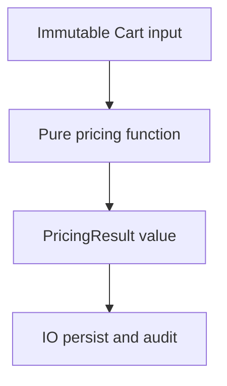

# D01-T014 — Functional programming concepts

Topic ID: `D01-T014`
Domain: Programming Language Fundamentals
Subdomain: Functional programming concepts
Importance: core
Complexity: fundamentals
Dependencies: `D01-T013`, `D01-T001`
Execution status of the code in section F: unexecuted

## A. Topic Overview

Functional programming (FP) treats computation as evaluation of expressions built from functions, emphasizing immutability, first-class functions, and avoiding observable side effects where practical. Pure functions return the same output for the same input and do not mutate external state.

FP exists because side effects make programs harder to test, parallelize, and reason about across time. Backend services still need I/O; FP discipline pushes effects to the edges and keeps domain logic referentially transparent.

Interviewers ask about purity, map/reduce, immutability, and how FP ideas appear in Java streams, Python comprehensions, and Go function values without adopting a full FP language.

Prerequisites: iterators and collections (`D01-T013`, `D01-T012`). Lambdas (`D01-T015`) implement FP style in OO languages.

## B. First-Principles Explanation

A function is a mapping from inputs to outputs. Referential transparency means you can replace a call with its result without changing program behavior. Mutation breaks that if other code observes the change.

FP uses higher-order functions (`map`, `filter`, `fold`) to express transformations as data flow instead of loops with index variables. Algebraic data types and pattern matching (in ML, Scala, Rust) model domain variants explicitly.

On the JVM, FP is a style: immutable DTOs, `Optional` chains, streams. Haskell enforces purity in types; Java does not.

Trade-offs: clarity and testability versus verbosity and performance tuning for hot loops. Alternatives: structured OO with disciplined services, or hybrid “functional core, imperative shell.”

Terms: **side effect** — I/O, mutation, logging, throwing that changes observable state. **pure function** — no side effects. **idempotent** — repeating has same effect as once (related but not identical to purity).

## C. Internal Working and Architecture

Map over a list (conceptual):

1. Allocate new collection or lazy stream.
2. For each element, apply function, append result.
3. No mutation of source if idiomatic.

Fold (reduce):

1. Start with accumulator seed.
2. Combine each element with accumulator via binary function.
3. Single result; can be parallel if associative and commutative.

Backend “functional core”: validate command → pure `PricingResult calculate(Cart cart, RateTable rates)` → persist in thin imperative layer.

State: pure functions have no internal mutable state across calls; closures may capture immutable bindings.

## D. Diagrams and Visual Models



## E. Examples and Analogies

Analogy: pure function is a spreadsheet formula — change inputs, output recalculates; the formula does not secretly edit another cell.

Anti-pattern: `calculateTotal` that also sends email — hidden side effect breaks testability.

## F. Code Examples

File: `examples/d01_t014_pure_pricing.py`

```python
from dataclasses import dataclass


@dataclass(frozen=True)
class Line:
    sku: str
    unit_cents: int
    qty: int


def line_total(line: Line) -> int:
    return line.unit_cents * line.qty


def cart_total(lines: tuple[Line, ...]) -> int:
    return sum(line_total(ln) for ln in lines)


if __name__ == "__main__":
    cart = (Line("A", 100, 2), Line("B", 50, 1))
    assert cart_total(cart) == 250
    print("ok", cart_total(cart))
```

Labeled unexecuted.

## G. Practical Backend Application

Use pure functions for tax, discount eligibility, and validation rules. Keep HTTP, DB, and message publish in outer layers. Property-based tests shine on pure code.

Concurrency: immutable inputs to pure functions parallelize without locks. Observability: log at boundaries, not inside every pure helper.

## H. Advantages, Limitations and Trade-offs

| Idea | Benefit | Cost |
| --- | --- | --- |
| Pure domain | Easy test, parallel | Must thread all deps as args |
| Immutable data | Safe sharing | Allocations |
| Streams | Composable | Debugging stack depth |
| Full FP language | Strong guarantees | Hiring, interop |

## I. Common Mistakes and Misconceptions

- “FP means no mutation anywhere.” Local mutation in one function is fine in pragmatic FP.
- “map is always faster than loops.” Not guaranteed; measure.
- “Pure means no exceptions.” Throwing is a side effect observers may see.

## J. Debugging and Troubleshooting

Symptoms: flaky tests, order-dependent failures — hunt hidden mutation and static mutable state. Refactor to pass state explicitly.

## K. Interview Preparation

### Beginner

#### Q1. What is a pure function?

**Answer:** It returns the same result for the same arguments and does not cause observable side effects such as I/O or mutating globals. Callers can reason locally without knowing hidden state. Unit tests need only inputs and outputs. Backend domain rules are ideal pure function candidates.

#### Q2. What is a side effect?

**Answer:** Any change to the world outside the function’s return value: writing a file, updating a database, incrementing a static counter, or printing. Side effects are necessary at system boundaries but complicate composition. FP pushes them outward so core logic stays testable.

#### Q3. What does map do?

**Answer:** It applies a function to each element of a collection, producing a new collection of results. It abstracts the index loop. Lazy map on streams defers work until consumption. It preserves length unless filter follows.

#### Q4. What is immutability’s role in FP?

**Answer:** Immutable data cannot change after creation, so functions cannot accidentally alter shared inputs. That supports referential transparency and safe concurrency among readers. It pairs with creating new values instead of patching old ones. Collections must be chosen or copied deliberately.

#### Q5. Is Java a functional language?

**Answer:** Java is primarily object-oriented but added lambdas and streams for functional style. It does not enforce purity in the type system. Developers adopt FP patterns selectively. Other JVM languages like Kotlin and Scala go further.

### Intermediate

#### Q1. What is referential transparency?

**Answer:** An expression can be replaced by its value without changing program behavior. It requires pure functions and immutable data where substitution happens. Refactoring and caching become safe. Breaking it with hidden I/O makes optimizations incorrect.

#### Q2. Explain fold (reduce).

**Answer:** Fold combines a collection into one value using a binary operator and initial accumulator. Order matters for non-associative ops like subtraction. Parallel fold requires associativity. Backend aggregations (sum, max) are folds.

#### Q3. Functional core, imperative shell?

**Answer:** Domain logic is pure in the center; the outer shell performs I/O and wires dependencies. Tests hit the core without databases. The shell is thin mapping between HTTP and commands. This is a common microservice layout.

#### Q4. How do Option types help?

**Answer:** They model absence without null pointer exceptions. Chaining `map`/`flatMap` avoids nested if-null checks. Java `Optional` should not be fields or API parameters in all styles, but is useful in streams. They make failure modes explicit in type signatures in languages that support it.

#### Q5. FP and error handling?

**Answer:** Either monads or `Result` types thread errors as values instead of exceptions in strict FP. Java often still throws from the shell; domain may return `Optional` or sealed result types. Consistency matters more than dogma.

### Advanced

#### Q1. Currying and partial application?

**Answer:** Currying transforms a multi-arg function into nested unary functions. Partial application fixes some arguments producing a new function. Useful for configuring handlers (`withAuth(handler)`). Java lacks native currying but manual closures achieve similar patterns.

#### Q2. What is function composition?

**Answer:** `compose(f, g)(x) = f(g(x))` builds pipelines without intermediate named variables. Stream operators are composition in disguise. Readability trades with debugging stack traces. Keep compositions short in production code.

#### Q3. Monoid in backend terms?

**Answer:** A type with associative combine and identity element. Counting events per key with sum is a monoid if you use 0 as identity. Associativity enables parallel aggregation then merge. Not every aggregation is a monoid if order matters.

#### Q4. Lazy vs strict FP?

**Answer:** Lazy languages evaluate expressions when needed; strict evaluate arguments before call. Java is strict; streams add laziness at pipeline level. Lazy can avoid work but delays errors. Choose based on data size and failure visibility needs.

#### Q5. When not to use FP style in hot paths?

**Answer:** When allocation rate from immutable updates dominates, or when SIMD/vectorized loops win. Numeric kernels may stay imperative. Measure before rewriting streams on small collections.

### Scenarios

#### Q1. Discount logic scattered in controllers. Refactor?

**Answer:** Extract pure `applyDiscounts(cart, rules)` with immutable inputs and unit tests per rule. Controllers only parse HTTP and call service. Side effects stay in repository layer. Regression tests cover edge combinations.

#### Q2. Parallel stream corrupts totals. Why?

**Answer:** Accumulator mutated shared state instead of associative reduction. Use `reduce` with immutable accumulator or `Collectors` designed for concurrency. Verify operator associativity.

#### Q3. Team avoids FP “too academic.” Compromise?

**Answer:** Adopt immutable DTOs and pure validators first without monads. Keep streams for readability on collections under size thresholds. Document where mutation is allowed (request builders). Gradual adoption beats mandate.

#### Q4. Idempotent HTTP PUT versus pure functions?

**Answer:** Idempotency is an HTTP property of repeated requests; purity is a code property. A handler can be impure yet idempotent if repeated PUT writes same state. Both reduce incident severity but solve different problems.

#### Q5. Testing time-dependent pure code?

**Answer:** Inject `Clock` or `Instant` as argument instead of calling `now()` inside pure logic. The function becomes pure relative to provided time. Shell provides clock from system. Same pattern for randomness with injected generator.

### Follow-ups

#### Q1. Lambdas and closures?

**Answer:** See `D01-T015` for implementation details in Java and Python.

#### Q2. Concurrency?

**Answer:** Immutability plus pure functions ease parallelization; see `D01-T016`.

#### Q3. Immutability depth?

**Answer:** See `D01-T011` for shallow versus deep freezing.

## L. Practical Exercises

Solutions: `EXERCISES/solutions/D01-T014.md`.

### Exercise 1 — implementation

Pure `cart_total` and `apply_percent_discount(total_cents, percent)` returning int cents with integer rounding half-up. No I/O.

### Exercise 2 — debugging

Find hidden side effect in a `validateUser` that logs and mutates a static `lastValidatedId`.

### Exercise 3 — trade-off

Stream pipeline versus for-loop for 50-element list in hot path — what do you measure?

## M. Revision Notes

- Pure functions: same in, same out, no observable side effects.
- Functional core, imperative shell for services.
- map/filter/reduce express data flow.
- Immutability supports FP reasoning.
- Parallel reduce needs associativity.
- Inject time and randomness for testability.

## N. Related Topics

`D01-T015`, `D01-T011`, `D01-T013`, `D01-T016`.

## O. Completion Criteria

- Define purity and side effect with backend example.
- Refactor impure discount logic to pure function.
- Explain fold and when parallel reduce is safe.
- Draw functional core / imperative shell diagram.
- Argue pragmatic FP adoption on JVM.
