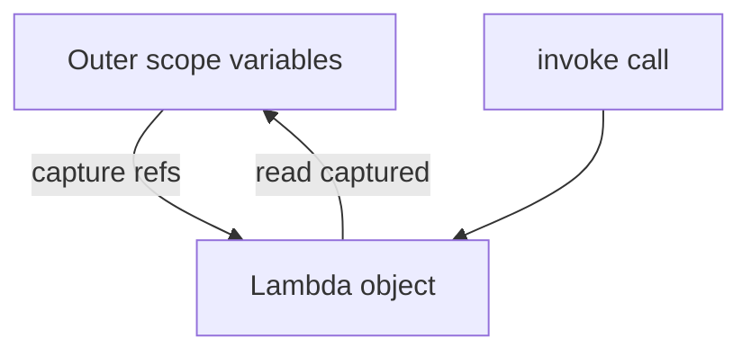

# D01-T015 — Lambdas, closures, higher-order functions

Topic ID: `D01-T015`
Domain: Programming Language Fundamentals
Subdomain: Lambdas, closures, higher-order functions
Importance: core
Complexity: fundamentals
Dependencies: `D01-T014`, `D01-T001`
Execution status of the code in section F: unexecuted

## A. Topic Overview

A lambda is an anonymous function literal, often concise syntax for short callbacks. A closure captures variables from the enclosing scope, keeping them alive for the lambda’s lifetime. A higher-order function takes functions as arguments or returns them.

These features exist so you can pass behavior as data: comparators, predicates, middleware, and retry policies without naming every variant as a class.

Backends use them in stream pipelines, HTTP filters, transaction callbacks, and test doubles. Interviewers probe capture semantics, effectively final variables, memory leaks from long-lived closures, and serialization pitfalls.

Prerequisites: FP concepts (`D01-T014`). Concurrency (`D01-T016`) interacts with closures capturing mutable state.

## B. First-Principles Explanation

A named function has a fixed identity in the symbol table. A lambda is an object implementing a functional interface (Java) or a function value (Python, Go). The compiler or runtime generates `invoke` that reads captured slots.

Closure capture binds outer variables into the lambda’s environment. Java captures effectively final locals by copying references. Python captures by reference — late binding can surprise in loops.

Higher-order functions abstract control flow: `retry(3, () -> call())`, `middleware(handler, auth)`.

Limitations: debugging stack traces through lambdas can be opaque; overuse creates unreadable one-liners; capturing large objects in scheduled tasks retains memory.

## C. Internal Working and Architecture

Java lambda (desugared conceptually):

1. Lambda metafactory generates a class or uses invokedynamic.
2. Captured vars become constructor fields.
3. `invoke` method runs body with those fields.

Python:

1. `lambda` or `def inner` creates function object with `__closure__` tuple of cell objects.
2. Cells point to live bindings in enclosing scope.

Event listener anti-pattern: register `() -> process(largeContext)` on a bus that outlives the request — closure keeps `largeContext` reachable.

## D. Diagrams and Visual Models



## E. Examples and Analogies

Analogy: closure is a backpack the function carries — it contains variables from home scope when it travels to another thread or callback.

## F. Code Examples

File: `examples/d01_t015_retry.py`

```python
import time
from typing import Callable, TypeVar

T = TypeVar("T")


def retry(attempts: int, fn: Callable[[], T], delay_s: float = 0.1) -> T:
    last: Exception | None = None
    for _ in range(attempts):
        try:
            return fn()
        except Exception as exc:
            last = exc
            time.sleep(delay_s)
    assert last is not None
    raise last


if __name__ == "__main__":
    n = 0

    def flaky() -> str:
        nonlocal n
        n += 1
        if n < 2:
            raise RuntimeError("fail")
        return "ok"

    assert retry(3, flaky) == "ok"
    print("done")
```

Labeled unexecuted.

## G. Practical Backend Application

Spring `filter` chains, JAX-RS filters, Express middleware, and Go handler wrappers are higher-order patterns. Prefer method references when clearer than lambdas (`String::valueOf`).

Concurrency: do not capture mutable request state in async tasks without copying immutable snapshot.

## H. Advantages, Limitations and Trade-offs

| Pattern | Benefit | Risk |
| --- | --- | --- |
| Lambda comparator | Less boilerplate | Harder stack traces |
| Closure config | Partial application | Memory retention |
| HOF middleware | Composable HTTP | Order bugs |
| Method reference | Readable | Less flexible |

## I. Common Mistakes and Misconceptions

- Python loop lambda capturing loop variable — all see final value unless default arg trick.
- Java lambda not serializable for Kafka unless designed.
- `this` capture in instance lambdas retains outer instance.

## J. Debugging and Troubleshooting

Heap dump shows anonymous classes holding request contexts. Fix: weak references not for business data — shorten listener lifetime or pass ids only.

## K. Interview Preparation

### Beginner

#### Q1. What is a lambda?

**Answer:** It is a concise way to write an anonymous function passed where a functional interface is expected. It reduces boilerplate compared to anonymous inner classes in Java. The body can be one expression or a block. It is still an object with a generated `invoke` method at runtime.

#### Q2. What is a closure?

**Answer:** A function together with captured bindings from its defining scope. When the function runs later, it still sees those variables. In Java, captured locals must be effectively final. Closures enable callbacks that remember configuration like retry count or tenant id.

#### Q3. What is a higher-order function?

**Answer:** A function that accepts or returns other functions. Examples include `map`, middleware that wraps handlers, and `Comparator.comparing`. It abstracts control flow and policy. Backend auth filters are higher-order: they take the next handler and return a wrapped handler.

#### Q4. Lambda versus anonymous class in Java?

**Answer:** Lambdas implement functional interfaces with one abstract method; the compiler desugars them efficiently. Anonymous classes can implement multiple methods and carry explicit state fields. Use lambdas for simple SAM interfaces; use classes when you need named fields or multiple methods.

#### Q5. Can lambdas access local variables?

**Answer:** Yes, if they are effectively final in Java — not reassigned after capture. Python captures by reference, so reassignment in outer scope changes what inner sees unless you use nonlocal carefully. Capturing large objects ties lambda lifetime to that data’s lifetime.

### Intermediate

#### Q1. What is effectively final?

**Answer:** A variable assigned once and never reassigned before the lambda executes. Java requires this so the captured value is stable without synchronizing every read. It is not the same as `final` keyword on the declaration, though final satisfies the rule. Reassigning a captured var is a compile error.

#### Q2. Method reference types in Java?

**Answer:** `Class::staticMethod`, `instance::method`, `Class::instanceMethod`, and `Type[]::new` for constructors. They are often clearer than `x -> Foo.bar(x)`. Pick readability over brevity in code review.

#### Q3. Python late binding in closures?

**Answer:** Lambdas in a loop capture the variable name, not the value at creation time. All lambdas may see the final loop value when called. Fix with default argument `lambda i=i: i` to bind now. This bites event handler registration in loops.

#### Q4. Serialization of lambdas?

**Answer:** Java lambdas capturing non-serializable objects break distributed jobs. Serializable functional interfaces and serializable captures are required for some frameworks. Prefer passing ids and resolving services in the worker instead of closing over heavy graphs.

#### Q5. Go function values as closures?

**Answer:** Inner functions close over variables; goroutines sharing closures need mutex if mutating. Function values are first-class but not generics until Go 1.18+ patterns. HTTP middleware wraps `http.Handler` functions — classic HOF.

### Advanced

#### Q1. invokedynamic and lambdas?

**Answer:** JVM uses invokedynamic to bind call sites to lambda factories at runtime, reducing class explosion versus one class per anonymous inner class. Bootstrap methods link functional interface targets. Performance is generally good; profiling still matters in tight loops.

#### Q2. Closure memory leaks in thread pools?

**Answer:** Submitting `() -> work(hugeRequest)` to a cached pool while the task queues retains the request graph until run completes. Slow pool backs up memory. Pass minimal ids; load data inside task from scoped store.

#### Q3. Currying in Java?

**Answer:** Manual: `Function<Integer, Function<Integer, Integer>> add = a -> b -> a + b`. Libraries like Vavr offer more FP utilities. Most Java code uses multi-arg methods instead.

#### Q4. Comparator chains?

**Answer:** `Comparator.comparing(User::getName).thenComparing(User::getId)` builds lexicographic order without writing explicit if comparisons. Stable sort preserves order for equal keys. Useful for in-memory pagination before streaming to UI.

#### Q5. Testing lambdas?

**Answer:** Extract lambda body to named method if tests need to target logic. Otherwise test via higher-order API outcomes. Avoid testing compiler-generated class names.

### Scenarios

#### Q1. All retry callbacks use same tenant id. Bug?

**Answer:** Classic Python late binding or capturing mutable loop variable in Java stream `for` registering listeners. Bind tenant id per iteration explicitly. Integration test with two tenants in one loop.

#### Q2. Metaspace growth after deploy with many lambdas?

**Answer:** Usually not lambdas alone — invokedynamic is efficient. Check anonymous classes, dynamic proxies, or class loaders leaking. Profile metaspace; correlate with hot redeploy paths.

#### Q3. Middleware order wrong after refactor to lambdas?

**Answer:** HOF composition order matters: `auth(log(handler))` versus `log(auth(handler))`. Document chain diagram. Spring `@Order` or explicit `FilterRegistrationBean` ordering fixes HTTP.

#### Q4. Kafka consumer passes lambda closing over consumer offset map?

**Answer:** If lambda escapes to another thread with shared mutable offset map, commits race. Pass partition-specific immutable command objects; commit in consumer thread only.

#### Q5. Readable code review rejects dense lambda chain?

**Answer:** Extract named private methods for stages; keep lambda only for trivial predicates. Readability is a team standard; measure complexity, not line count alone.

### Follow-ups

#### Q1. Concurrency with closures?

**Answer:** See `D01-T016` — captured mutable state races across threads.

#### Q2. Streams?

**Answer:** Stream operators take lambdas; see `D01-T013` and `D01-T014`.

#### Q3. FP theory?

**Answer:** See `D01-T014` for purity and composition.

## L. Practical Exercises

Solutions: `EXERCISES/solutions/D01-T015.md`.

### Exercise 1 — implementation

Implement `retry` as in section F with configurable exception types to catch.

### Exercise 2 — debugging

Fix tenant id closure bug in a loop registering ten callbacks.

### Exercise 3 — trade-off

Lambda chain versus private methods for three-step validation pipeline.

## M. Revision Notes

- Lambda = anonymous function value.
- Closure captures enclosing bindings.
- HOF takes or returns functions.
- Java: effectively final capture.
- Python: late binding in loops.
- Do not close over huge request graphs in pools.

## N. Related Topics

`D01-T014`, `D01-T016`, `D01-T013`.

## O. Completion Criteria

- Explain closure capture in Java and Python.
- Implement retry HOF.
- Diagnose late-binding tenant bug.
- Order HTTP middleware composed as HOFs.
- Choose lambda versus method reference versus named method.
