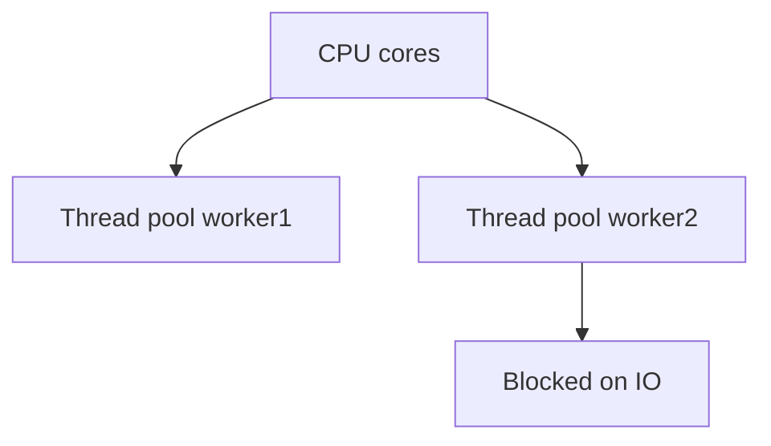
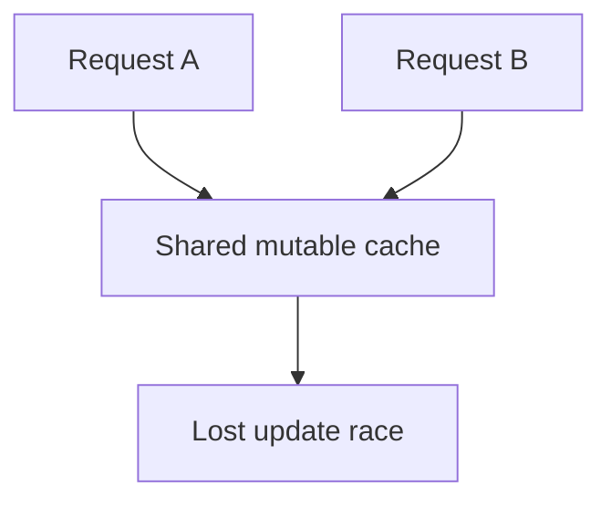

# D01-T016 — Concurrency and parallelism

Topic ID: `D01-T016`
Domain: Programming Language Fundamentals
Subdomain: Concurrency and parallelism
Importance: core
Complexity: fundamentals
Dependencies: `D01-T015`, `D01-T001`
Execution status of the code in section F: unexecuted

## A. Topic Overview

Concurrency is structuring a program so multiple tasks make progress overlapping in time — often on one CPU via switching. Parallelism is executing work simultaneously on multiple CPU cores. You can be concurrent without parallel (async I/O) or parallel without much concurrency structure (embarrassingly parallel batch).

Backends live here: thread pools serving HTTP, goroutines per connection, Node’s event loop with worker threads, database connection pools, and distributed workers across machines.

Interviewers distinguish the terms, ask about races, deadlocks, visibility, `synchronized` versus locks versus atomics, and when to scale out versus scale up.

Prerequisites: immutability and closures (`D01-T011`, `D01-T015`). GC pauses interact with threading (`D01-T017`).

## B. First-Principles Explanation

OS threads are schedulable units with stacks and kernel bookkeeping. User-space green threads (goroutines) multiplex onto fewer OS threads. The CPU executes one instruction stream per core at a time; concurrency interleaves many logical flows.

Shared mutable memory requires synchronization. The Java Memory Model defines happens-before edges: `volatile`, `synchronized`, `unlock`/`lock`. Data races are undefined behavior in C++; defined but wrong in Java without atomics.

Parallelism splits CPU-bound work: fork-join, parallel streams, multiprocessing for Python CPU work to escape GIL.

Limits: Amdahl’s law — serial fraction caps speedup. Lock contention serializes parallel sections. Too many threads cause context switch overhead.

Terms: **race** — unsynchronized conflicting access. **deadlock** — circular wait for locks. **livelock** — threads busy retrying. **starvation** — thread never scheduled.

## C. Internal Working and Architecture

HTTP request on thread pool (Java):

1. Acceptor receives socket, submits task to pool.
2. Worker thread runs filter chain, service, JDBC.
3. Thread blocked on I/O releases CPU for other workers.
4. Response written; thread returns to pool.

Go HTTP:

1. Goroutine per request on M:N scheduler.
2. Blocking syscall may spawn another thread (GOMAXPROCS).
3. Shared maps need mutex or channels for coordination.

Visibility: without happens-before, one thread may see stale cached field values. `volatile` flushes visibility for one field; `synchronized` establishes mutual exclusion and visibility.

## D. Diagrams and Visual Models





## E. Examples and Analogies

Analogy: concurrency is one barista taking orders while espresso brews; parallelism is two baristas each making drinks at the same time.

## F. Code Examples

File: `examples/d01_t016_counter.py`

```python
import threading

class SafeCounter:
    def __init__(self) -> None:
        self._lock = threading.Lock()
        self._n = 0

    def inc(self) -> None:
        with self._lock:
            self._n += 1

    def value(self) -> int:
        with self._lock:
            return self._n


if __name__ == "__main__":
    c = SafeCounter()
    threads = [threading.Thread(target=c.inc) for _ in range(100)]
    for t in threads:
        t.start()
    for t in threads:
        t.join()
    assert c.value() == 100
    print("ok", c.value())
```

Labeled unexecuted.

## G. Practical Backend Application

Size thread pools from I/O wait ratio; use bounded queues to apply backpressure. Prefer immutable messages between stages. Distributed locks (Redis, DB) for cross-node exclusivity — use sparingly.

Node: CPU work off main thread via worker_threads. Python: asyncio for I/O concurrency; `multiprocessing` for CPU parallelism.

Observability: thread dump, `jstack`, goroutine profiles, lock contention metrics.

## H. Advantages, Limitations and Trade-offs

| Model | Good for | Pitfalls |
| --- | --- | --- |
| Thread pool | Blocking I/O services | Pool exhaustion |
| Async event loop | Many idle connections | Blocking call stalls loop |
| Goroutines | Cheap tasks | Hidden blocking in libs |
| Parallel streams | CPU on large in-memory data | Shared mutation |
| Processes | CPU Python, isolation | IPC cost |

## I. Common Mistakes and Misconceptions

- “More threads always faster.” Contention and memory overhead cap gains.
- “volatile fixes all races.” It does not compose atomic read-modify-write.
- “Go is automatically race-free.” Run the race detector; shared maps need guards.

## J. Debugging and Troubleshooting

Symptoms: rare wrong counts, hung service, CPU spin. Tools: thread dumps, `pprof`, Java Flight Recorder lock profiling, Go `-race`.

## K. Interview Preparation

### Beginner

#### Q1. Concurrency versus parallelism?

**Answer:** Concurrency is about dealing with many things at once in structure; parallelism is about doing many things at once on hardware. A single-core machine can run concurrent async I/O but not true parallel CPU work. Backend services often mix both: concurrent requests with parallel batch jobs on multiple cores. Interviewers want you to use the words precisely.

#### Q2. What is a race condition?

**Answer:** Two threads access shared mutable state, at least one writes, and synchronization is missing, so outcome depends on scheduling order. Lost increments and torn reads are classic examples. Fixing requires locks, atomics, or removing shared mutation. Tests without stress may miss races.

#### Q3. What is a thread pool?

**Answer:** A fixed set of worker threads pulls tasks from a queue instead of creating unbounded threads per request. It caps resource usage and amortizes thread creation cost. Queue bounds provide backpressure when overloaded. Pool size should match workload I/O versus CPU profile.

#### Q4. What does synchronized do in Java?

**Answer:** It acquires the monitor on an object, allowing only one thread in the block at a time, and establishes happens-before with subsequent entrants. It protects invariants on shared structures. Holding locks during I/O reduces throughput. Prefer narrower lock scopes and higher-level concurrent utilities when appropriate.

#### Q5. Why is Node “single-threaded”?

**Answer:** JavaScript user code on the main thread runs one at a time on the event loop, avoiding locks in application code. I/O is delegated to libuv thread pool and kernel async mechanisms. CPU-heavy JS blocks the loop unless offloaded to worker threads. It is concurrent for I/O, not parallel for CPU on that thread.

### Intermediate

#### Q1. volatile versus AtomicInteger?

**Answer:** `volatile` ensures visibility of reads/writes to one field but not atomic increment. `AtomicInteger` provides CAS-based atomic operations for counters. Choose atomics for simple statistics; use locks for multi-field invariants. Do not compose multiple volatiles into a consistent snapshot without synchronization.

#### Q2. What is deadlock?

**Answer:** Threads wait on each other’s locks in a cycle, so none progress. Prevention: lock ordering, timeouts, try-lock with backoff, or avoiding nested locks. Detection: thread dumps show blocked-on chains. Design services to avoid holding two locks when possible.

#### Q3. Go channels versus mutex?

**Answer:** Channels pass ownership and coordinate goroutines; mutexes protect shared memory. “Share memory by communicating” suits pipelines; mutexes suit protecting a cache struct. Misusing buffered channels can still deadlock if no receiver.

#### Q4. Python GIL impact?

**Answer:** CPython GIL allows one thread to execute Python bytecode at a time per process, limiting CPU parallelism for pure Python. I/O releases GIL, so threaded I/O helps. CPU-bound Python uses multiprocessing or native extensions. Asyncio concurrency is single-threaded cooperative.

#### Q5. When use virtual threads (Java 21+)?

**Answer:** For massive blocking I/O concurrency with thread-per-request style code without millions of OS threads. They mount on carrier threads; blocking pins carrier briefly depending on implementation. Not a substitute for CPU parallelization or fixing synchronized contention inside hot paths.

### Advanced

#### Q1. happens-before examples?

**Answer:** Unlock on monitor happens-before subsequent lock on same monitor. `volatile` write happens-before read of that volatile. Thread start happens-before actions in started thread. Safe publication of immutable objects can use final fields semantics in Java without extra sync after construction completes.

#### Q2. Compare-and-swap loops?

**Answer:** Optimistic concurrency retries until CAS succeeds, good under low contention. Under high contention, spinning wastes CPU; locks may win. `AtomicReference` update functions encapsulate retry logic.

#### Q3. ForkJoinPool and work stealing?

**Answer:** Idle threads steal tasks from busy deque ends, balancing parallel stream and recursive divide-conquer. Task granularity must be large enough to amortize scheduling. Tiny tasks hurt parallel streams on small collections.

#### Q4. Distributed concurrency?

**Answer:** Multiple JVMs need external coordination: idempotent consumers, unique constraints, sagas, not just in-process locks. Clock skew breaks naive TTL locks. Redis Redlock is debated; understand failure modes.

#### Q5. Little’s Law intuition for pools?

**Answer:** Average concurrency in system equals arrival rate times average residence time. Growing queue without more capacity increases latency. Bounded queues force rejection or backpressure instead of unbounded latency growth.

### Scenarios

#### Q1. Counter metric undercounts by random amount?

**Answer:** Race on `count++` without atomic or lock. Fix with `LongAdder`, atomic, or synchronized increment. Validate with stress test of 100 threads.

#### Q2. Service hangs after traffic spike?

**Answer:** Thread pool saturated, all threads blocked on slow DB, accept queue grows until rejection or OOM. Increase pool cautiously, fix DB, add timeouts, async handoff, or bulkhead isolation.

#### Q3. Deadlock in transfer between two accounts?

**Answer:** Lock accounts in global order (lower id first) to prevent cyclic wait. Or use database transaction with row-level locks in consistent order.

#### Q4. parallelStream in shared singleton service?

**Answer:** If pipeline mutates shared fields, races ensue. Use stateless stages or per-request data. Parallelism belongs on private data, not singleton mutable state.

#### Q5. Goroutine leak?

**Answer:** Sender blocked on full channel without receiver, or forgotten `context` cancel. Profile goroutines; fix lifecycle with `context.WithCancel` on request end.

### Follow-ups

#### Q1. GC and threads?

**Answer:** Stop-the-world pauses affect all threads on some collectors; see `D01-T017`.

#### Q2. Immutability?

**Answer:** Immutable messages remove races among readers; see `D01-T011`.

#### Q3. Language internals?

**Answer:** Scheduler details per runtime in `D01-T019`.

## L. Practical Exercises

Solutions: `EXERCISES/solutions/D01-T016.md`.

### Exercise 1 — implementation

`SafeCounter` with lock as in F; add stress test function spawning N threads each incrementing M times.

### Exercise 2 — debugging

Diagnose thread pool exhaustion from blocking external HTTP inside all workers.

### Exercise 3 — trade-off

Thread-per-request versus async for 10k idle websocket connections.

## M. Revision Notes

- Concurrency ≠ parallelism.
- Protect shared mutable state or eliminate it.
- Size pools; bound queues.
- volatile ≠ atomic compound ops.
- Node event loop blocks on CPU JS.
- Python GIL limits CPU threads.

## N. Related Topics

`D01-T011`, `D01-T017`, `D01-T019`, distributed systems domain.

## O. Completion Criteria

- Define concurrency vs parallelism with examples.
- Fix lost-update race.
- Read thread dump for deadlock.
- Choose pool size reasoning qualitatively.
- Explain Node and Python concurrency models.
