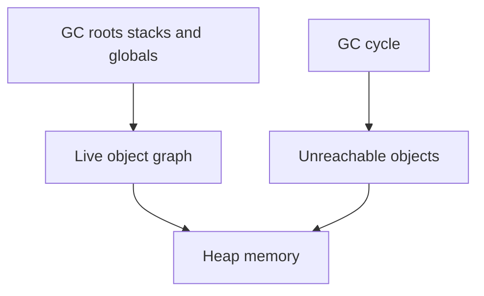

# D01-T017 — Memory leaks and garbage collection

Topic ID: `D01-T017`
Domain: Programming Language Fundamentals
Subdomain: Memory leaks and garbage collection
Importance: core
Complexity: fundamentals
Dependencies: `D01-T016`, `D01-T001`
Execution status of the code in section F: unexecuted

## A. Topic Overview

Garbage collection (GC) automatically reclaims heap objects that are no longer reachable from live roots (stacks, globals, JNI handles). A memory leak in managed languages usually means reachable garbage — objects still referenced unintentionally, so the collector never frees them.

Backends leak through caches without bounds, static collections, thread-local forgetfulness, class loader retention, and native memory outside the heap (direct buffers, metaspace).

Interviewers ask GC generations, stop-the-world pauses, weak references, heap dumps, and differences among JVM, Go, Python, and Node V8 collectors.

Prerequisites: concurrency (`D01-T016`) — leaks often involve long-lived threads holding references.

## B. First-Principles Explanation

Reachability: if a path exists from a root to an object, it survives. GC traces the object graph from roots, marks live objects, sweeps or compacts the rest.

Generational hypothesis: most objects die young. Young generation collects frequently with copying; survivors promote to old generation; full GC is rarer and costlier.

Go uses tri-color concurrent mark-sweep with write barriers. V8 uses generational GC in Node. Python uses reference counting plus cyclic GC.

Leaks are logical: listeners not removed, `ThreadLocal` without remove, interned strings growth, ORM session holding entities.

Native leaks: `malloc` in JNI, direct `ByteBuffer` not freed, file descriptors — not fixed by Java heap GC alone.

## C. Internal Working and Architecture

Minor GC (G1 example, simplified):

1. Stop-the-world or partial pause depending on collector.
2. Scan roots, trace young region.
3. Copy live objects to survivor space, age counters increment.
4. Promote long-lived objects to old gen.

Full GC when old gen fills or metaspace pressure triggers class unloading attempts.

Backend symptom path: traffic adds entries to `static Map<SessionId, UserContext>` without TTL → old gen grows → full GC pauses → latency SLO breach.

## D. Diagrams and Visual Models



## E. Examples and Analogies

Analogy: GC is janitor collecting trash only from rooms still on the building directory. If you leave a wrong name on the directory, the room never gets cleaned.

## F. Code Examples

File: `examples/d01_t017_ttl_cache.py`

```python
import time
from dataclasses import dataclass


@dataclass
class Entry:
    value: str
    expires_at: float


class TtlCache:
    def __init__(self, ttl_s: float) -> None:
        self._ttl = ttl_s
        self._store: dict[str, Entry] = {}

    def put(self, key: str, value: str) -> None:
        self._store[key] = Entry(value, time.monotonic() + self._ttl)

    def get(self, key: str) -> str | None:
        self._purge()
        ent = self._store.get(key)
        if ent is None:
            return None
        return ent.value

    def _purge(self) -> None:
        now = time.monotonic()
        dead = [k for k, v in self._store.items() if v.expires_at <= now]
        for k in dead:
            del self._store[k]


if __name__ == "__main__":
    c = TtlCache(0.01)
    c.put("a", "1")
    time.sleep(0.02)
    assert c.get("a") is None
    print("ok")
```

Labeled unexecuted.

## G. Practical Backend Application

Set max heap, choose collector (G1, ZGC, Shenandoah for low pause goals). Monitor heap after full GC, GC pause times, metaspace. Use object pools only when profiling proves benefit — pools can hide leaks.

Node: watch heap snapshots for closures retaining requests. Python: `tracemalloc`, cyclic gc for containers in cycles.

## H. Advantages, Limitations and Trade-offs

| Approach | Benefit | Cost |
| --- | --- | --- |
| GC languages | No manual free | Pause, tuning |
| Manual (C/Rust) | Predictable latency | Use-after-free bugs |
| Weak references | Break accidental retention | Complex API |
| Off-heap | Less GC pressure | Manual lifecycle |

## I. Common Mistakes and Misconceptions

- “GC means no leaks.” Reachable unused objects leak.
- “Calling System.gc() fixes production.” It causes pauses; find root cause.
- “More heap always helps.” It delays collection but can worsen pause times on some collectors.

## J. Debugging and Troubleshooting

Heap dump, compare dominators, MAT / VisualVM / `jcmd GC.heap_dump`. Look for largest retained sets, duplicate strings, class loaders.

## K. Interview Preparation

### Beginner

#### Q1. What is garbage collection?

**Answer:** Automatic reclamation of heap memory for objects no longer reachable from program roots. The runtime traces references instead of requiring explicit `free`. It prevents many use-after-free bugs at the cost of pause and tuning complexity. Different languages use different algorithms and generations.

#### Q2. What is a memory leak in Java?

**Answer:** Objects remain reachable though the program no longer needs them, so heap grows until OOM or constant full GC. Common causes are static maps, unclosed listeners, and thread pools holding task closures. Native memory and metaspace can leak separately from the object heap.

#### Q3. What are GC roots?

**Answer:** Starting points for reachability: thread stacks, static fields, JNI globals, and some VM internal references. Anything not reachable from roots is garbage. Local variables on stacks keep objects alive until the frame pops.

#### Q4. young versus old generation?

**Answer:** New objects allocate in young gen; minor collections reclaim short-lived garbage cheaply. Objects surviving several collections promote to old gen where full collections are heavier. Long-lived caches live in old gen and affect full GC frequency.

#### Q5. Does Python have GC?

**Answer:** Yes — reference counting frees objects immediately when count hits zero, plus a cyclic garbage collector for reference cycles containers can form. C extensions may manage memory manually. `__del__` and cycles interact subtly with collector timing.

### Intermediate

#### Q1. G1 versus ZGC (high level)?

**Answer:** G1 targets predictable pauses by collecting regions incrementally. ZGC and Shenandoah aim for sub-millisecond pauses on large heaps using concurrent compaction techniques with platform requirements. Choice depends on heap size, latency SLO, and JDK version. Always validate with workload-specific benchmarks you run, not generic claims.

#### Q2. What is metaspace?

**Answer:** JVM area for class metadata replacing PermGen. Leaks from redeploy without class loader release cause metaspace OOM. Frameworks generating many dynamic proxies worsen it. Monitor `Metaspace` usage separately from heap.

#### Q3. WeakReference use case?

**Answer:** `WeakHashMap` keys collected when only weakly reachable, useful for ancillary caches keyed by object identity without preventing key collection. Not a substitute for TTL/size bounds in production caches. Soft references can cause OOM before clearing under memory pressure — controversial for caches.

#### Q4. Go GC characteristics?

**Answer:** Concurrent mark-sweep with write barriers, low pause goals relative to heap size in recent versions. GOGC percent trades CPU for heap size. Leaks are still reachable pointers in maps or goroutine stacks.

#### Q5. Node/V8 heap?

**Answer:** `--max-old-space-size` caps heap. Leaks show as climbing heap between GC cycles in production metrics. Closures retaining request scope are frequent culprits. Worker threads have separate heaps.

### Advanced

#### Q1. Safe publication and final fields?

**Answer:** Java final fields assigned in constructor are visible to other threads without data races after construction completes if reference not leaked early. Immutable objects simplify safe sharing. Partially constructed objects escaping constructor are a bug.

#### Q2. Direct memory leak?

**Answer:** `ByteBuffer.allocateDirect` uses off-heap memory freed when buffer collected after cleaner runs — delayed if references linger. Netty direct buffer pools need explicit lifecycle in some configs. Monitor `MaxDirectMemorySize`.

#### Q3. Class loader leak on redeploy?

**Answer:** Old WAR class loaders retained by static singletons from old deployment prevent class unloading. Symptoms: metaspace growth on each deploy. Fix by isolating loaders, avoiding static refs to app classes in containers, or process restart.

#### Q4. GC tuning without guessing?

**Answer:** Enable GC logging, correlate pause times with SLA, inspect allocation rate and promotion failure. Tune heap size and collector flags based on evidence. Avoid blanket advice; workload dominates.

#### Q5. Finalization and cleaners?

**Answer:** `finalize` is deprecated/unreliable for resource cleanup. Use try-with-resources and `Cleaner` for native handles with clear ownership. Do not depend on GC timing to close files or DB connections.

### Scenarios

#### Q1. Heap grows linearly with uptime, flat traffic?

**Answer:** Leaking cache or session map. Heap dump dominator tree shows retaining collection. Add TTL, weak refs, or periodic purge; fix static holder.

#### Q2. Latency spikes every few minutes?

**Answer:** Full GC on growing old gen. Check promotion rate, humongous objects in G1, or allocation bursts. May need heap tuning or fix allocation churn (boxing, string concat in loops).

#### Q3. OOM but heap dump small?

**Answer:** Suspect metaspace, direct memory, or native thread stacks. Check non-heap metrics and `ulimit`, thread count.

#### Q4. ThreadLocal leak in pool?

**Answer:** Pooled threads reuse without `ThreadLocal.remove()` after request, retaining user context. Always remove in finally block in servlet filters.

#### Q5. ORM session holds entire table after query?

**Answer:** Open session in view or unclosed session keeps entities managed. Use DTO projection, `@Transactional` boundaries, `session.clear()` in batch jobs, or stateless sessions.

### Follow-ups

#### Q1. Concurrency interaction?

**Answer:** Long GC pauses stall all threads on stop-the-world phases; see `D01-T016`.

#### Q2. Compilation and JIT?

**Answer:** JIT code in code cache is separate from object heap; see `D01-T018`.

#### Q3. Language specifics?

**Answer:** Collector details per runtime in `D01-T019`.

## L. Practical Exercises

Solutions: `EXERCISES/solutions/D01-T017.md`.

### Exercise 1 — implementation

`TtlCache` as in F with `size()` after purge.

### Exercise 2 — debugging

ThreadLocal user context leak in Tomcat pool — describe fix.

### Exercise 3 — trade-off

Unbounded `ConcurrentHashMap` cache versus Caffeine with maximumSize and expireAfterWrite.

## M. Revision Notes

- GC frees unreachable, not forgotten references.
- Generations: young frequent, old costly.
- Leaks = unintended reachability.
- ThreadLocal.remove in pools.
- Watch metaspace and direct memory.
- Heap dumps find dominators.

## N. Related Topics

`D01-T016`, `D01-T018`, `D01-T019`.

## O. Completion Criteria

- Explain reachability roots.
- Diagnose cache leak versus needed retention.
- Describe young/old gen role.
- Fix ThreadLocal leak pattern.
- Choose cache eviction policy qualitatively.
