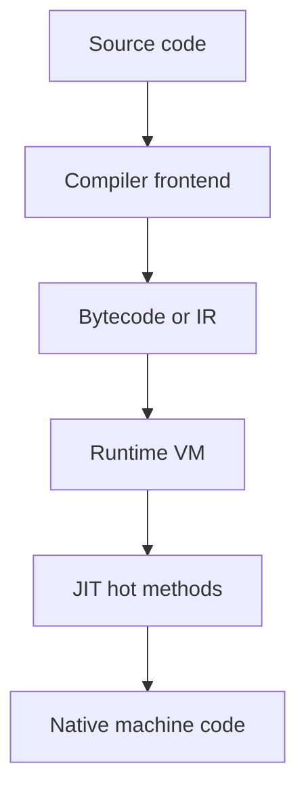

# D01-T018 — Runtime, compilation, interpretation

Topic ID: `D01-T018`
Domain: Programming Language Fundamentals
Subdomain: Runtime, compilation, interpretation
Importance: core
Complexity: fundamentals
Dependencies: `D01-T017`, `D01-T001`
Execution status of the code in section F: unexecuted

## A. Topic Overview

Compilation translates source to machine code or bytecode ahead of time (AOT). Interpretation executes source or bytecode with a loop in the runtime. Most production languages blend both: Java and C# compile to bytecode then JIT to native code; Python compiles to bytecode then interprets with optional optimizations; Go compiles AOT to native binaries; Node runs V8 which parses JavaScript, compiles to bytecode, then JITs hot functions.

Understanding this explains cold start, warmup, deployment artifacts, reflection cost, and why the first request is slow.

Interviewers compare JIT tiers, deoptimization, GraalVM native image trade-offs, and interpreted versus compiled error detection timing.

Prerequisites: GC (`D01-T017`) shares the runtime. Language internals (`D01-T019`) goes deeper per platform.

## B. First-Principles Explanation

Lexer/tokenizer breaks text into tokens. Parser builds AST. Semantic analysis checks types (static languages). Code generator emits instructions: x86 machine code, JVM bytecode, or LLVM IR.

Bytecode is a portable instruction set for a virtual machine. The JVM interpreter steps opcodes; the JIT watches hot methods and compiles them to native code with speculative optimizations (inlining, escape analysis).

Deoptimization occurs when assumptions break (wrong concrete type), reverting to interpreter or less optimized code.

Interpreted Python runs opcode dispatch in C loop; CPython 3.11+ has specialized quickening for common opcode patterns.

Go: compile at build time, static linking, no JIT in standard toolchain — fast startup, less adaptive optimization at runtime.

## C. Internal Working and Architecture

Java request cold path:

1. Load classes from JAR, verify bytecode.
2. Interpret `main` until invocation counter crosses threshold.
3. C2 compiler emits optimized machine code.
4. On uncommon trap, deopt and recompile.

Container cold start: JVM class loading + Spring scanning dominates before JIT helps.

Node module load: parse and compile each required file on first import; cache compiled code in V8 heap.

## D. Diagrams and Visual Models



## E. Examples and Analogies

Analogy: interpretation is cooking step-by-step from recipe each time; JIT is memorizing the recipe after you make the dish often enough to skip re-reading.

## F. Code Examples

File: `examples/d01_t018_warmup_note.java`

```java
// unexecuted — illustrative JVM warmup pattern
public final class WarmupDemo {
    static int hot(int n) {
        int s = 0;
        for (int i = 0; i < n; i++) {
            s += i;
        }
        return s;
    }

    public static void main(String[] args) {
        for (int i = 0; i < 20_000; i++) {
            hot(100);
        }
        long t0 = System.nanoTime();
        hot(100_000);
        long t1 = System.nanoTime();
        System.out.println("elapsed_ns=" + (t1 - t0));
    }
}
```

Do not treat timing as a benchmark; environment varies. Label unexecuted.

## G. Practical Backend Application

Warmup critical paths before taking traffic (JIT, connection pools, schema metadata). Native image trades dynamic features for startup. Choose interpreted scripts for ops glue; compiled services for latency SLO.

CI runs compilers; production runs VMs or binaries. Align JDK versions across build and deploy.

## H. Advantages, Limitations and Trade-offs

| Mode | Startup | Peak perf | Flexibility |
| --- | --- | --- | --- |
| AOT (Go, Rust) | Fast | High static | Less runtime reflection |
| JVM JIT | Slower warm | Very high hot | Dynamic class loading |
| CPython | Medium | Moderate | C extensions help |
| Node V8 | Module load cost | High hot JS | Single-threaded model |

## I. Common Mistakes and Misconceptions

- “Java is not compiled.” It compiles to bytecode then JITs.
- “First benchmark run represents production.” Warmup matters on JVM and V8.
- “Reflection is free.” It bypasses optimizations and costs CPU.

## J. Debugging and Troubleshooting

`-XX:+PrintCompilation`, async profiler for JIT code cache, Node `--trace-opt` for investigation (dev only). Slow cold starts: reduce classpath scan, AOT cache, CRaC on supported JDKs.

## K. Interview Preparation

### Beginner

#### Q1. Compiled versus interpreted?

**Answer:** Compiled code is translated before run to machine code or bytecode; interpreted code is executed step by step by another program. Many systems do both sequentially. The distinction is about when translation happens, not a single boolean per language. Backend deploy artifacts differ: JAR versus native binary versus interpreted script.

#### Q2. What is bytecode?

**Answer:** Portable instructions for a virtual machine like JVM or CLR. It is not human source and not usually native CPU instructions. The VM verifies and executes it, often JIT-compiling hot parts. It enables write-once run-anywhere at the cost of a runtime.

#### Q3. What is a JIT compiler?

**Answer:** It compiles frequently executed code to native instructions at runtime using profiling data. It can inline and eliminate allocations speculatively. Deoptimization recovers when assumptions fail. JIT improves peak performance after warmup.

#### Q4. When do type errors appear in Java versus Python?

**Answer:** Java reports most type errors at compile time before deployment. Python reports type errors at runtime when the offending line runs, unless you use static checkers like mypy separately. This affects CI gates and refactor safety.

#### Q5. What is an AOT binary?

**Answer:** Machine code produced at build time, as with `go build`. Startup is fast because no JIT warmup is required for generated code. Dynamic features like loading new code at runtime are limited compared to JVM. Good fit for CLI tools and containers sensitive to cold start.

### Intermediate

#### Q1. JVM warmup impact on autoscaling?

**Answer:** New pods serve traffic while C2 has not optimized hot paths, so latency is higher until counters trigger compilation. Warmup requests or readiness probes that exercise critical endpoints reduce surprise SLO breaches. Horizontal scale adds many cold JVMs simultaneously after deploys.

#### Q2. What is deoptimization?

**Answer:** JIT made an optimistic assumption such as monomorphic call site; new subclass invalidates it. VM transfers execution back to interpreter or recompiles with broader assumptions. Rare deopts are normal; frequent deops signal polymorphic hot paths to refactor.

#### Q3. GraalVM native image trade-off?

**Answer:** Builds standalone executable with faster startup and lower memory at cost of build time and reduced dynamic classpath features. Reflection and proxies need configuration at build time. Good for serverless cold start; less ideal for heavy dynamic Spring features without care.

#### Q4. Python .pyc files?

**Answer:** Bytecode cache on disk to skip reparse on import if source mtime matches. Not as fast as native code; still interpreted loop. `PYTHONDONTWRITEBYTECODE` disables writing in some environments.

#### Q5. Node ESM versus CJS load cost?

**Answer:** Both parse and compile on first load; ESM is asynchronous and stricter on static imports. Large dependency trees increase startup. Bundling for deploy reduces duplicate parsing in some setups.

### Advanced

#### Q1. Tiered compilation in HotSpot?

**Answer:** C1 compiles quickly with less optimization; C2 optimizes hot code deeply. Tiered mode balances startup and peak. Deprecated flags change across JDK versions; consult target JDK docs.

#### Q2. Escape analysis?

**Answer:** JIT proves object does not escape method scope and may allocate on stack or eliminate allocation entirely. Breaks if reference stored in field. Writing GC-heavy microbenchmarks without understanding this misleads.

#### Q3. LLVM role?

**Answer:** Clang/Rust compile to LLVM IR then optimize and emit machine code. JVM has its own IR pipelines. Shared theme: multiple optimization passes before hardware.

#### Q4. Cross-language FFI cost?

**Answer:** JNI, cgo, and Python ctypes cross boundary with marshalling and pinning costs. Hot loops should stay in one language. FFI per call is fine at I/O rates, not inner loops.

#### Q5. Ahead-of-time caching (CRaC / SnapStart)?

**Answer:** Snapshot JVM after warmup and restore quickly on scale-out. Platform-specific; reduces cold start without rewriting app to native image. Understand what state must not be snapshotted (open connections).

### Scenarios

#### Q1. P99 latency high only first five minutes after deploy?

**Answer:** JIT warmup and lazy initialization (Hibernate metadata, SSL contexts). Add warmup traffic, lazy-init tuning, or AOT/native where appropriate. Verify with compilation logs.

#### Q2. Serverless Java timeouts on cold start?

**Answer:** JVM + framework bootstrap exceeds limit. Native image, smaller runtime, or provisioned concurrency. Measure init duration, do not guess.

#### Q3. Python service CPU high at steady QPS?

**Answer:** Hot path in pure Python bytecode; profile and push to C extension, use PyPy, or redesign algorithm. Compilation to bytecode already happened; interpreter dispatch is the cost.

#### Q4. Go binary huge?

**Answer:** Static linking includes runtime and debug info; strip symbols with `-ldflags="-s -w"` for smaller deploy. Not a JIT issue — AOT includes dependencies.

#### Q5. ClassNotFound only in prod?

**Answer:** Classpath differs from dev, shading relocated packages, or module path restrictions. Compilation succeeded in CI artifact that omits dependency. Fix packaging, not interpreter.

### Follow-ups

#### Q1. Per-language internals?

**Answer:** See `D01-T019`.

#### Q2. GC interaction?

**Answer:** JIT code in code cache; allocations from compiled code still hit heap — `D01-T017`.

#### Q3. Concurrency model?

**Answer:** Runtime schedules threads or goroutines — `D01-T016`.

## L. Practical Exercises

Solutions: `EXERCISES/solutions/D01-T018.md`.

### Exercise 1 — analysis

List phases from `.java` source to executing native code on JVM (at least five steps).

### Exercise 2 — debugging

Cold start SLO miss after Kubernetes rollout — investigation checklist.

### Exercise 3 — trade-off

JVM microservice versus Go binary for latency-sensitive autoscale workload — factors without invented numbers.

## M. Revision Notes

- Most backends use compile + runtime + sometimes JIT.
- Warmup affects JVM and V8 latency.
- Bytecode ≠ source.
- AOT: fast start, less runtime flexibility.
- Deopt when JIT assumptions break.
- FFI and reflection have real costs.

## N. Related Topics

`D01-T019`, `D01-T017`, deployment and SRE topics.

## O. Completion Criteria

- Draw compile-to-run pipeline.
- Explain JIT warmup qualitatively.
- Compare Java, Go, Python execution models.
- Propose cold-start mitigation checklist.
- Separate compile-time versus runtime errors per language.
