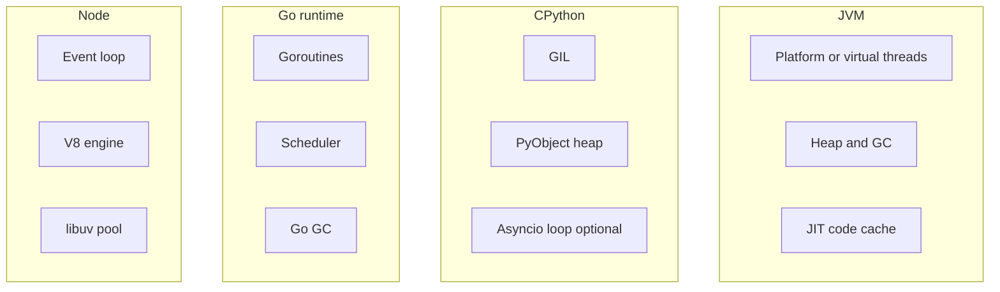

# D01-T019 — Language-specific internals (Java/Python/Go/Node.js)

Topic ID: `D01-T019`
Domain: Programming Language Fundamentals
Subdomain: Language-specific internals (Java/Python/Go/Node.js)
Importance: advanced
Complexity: advanced
Dependencies: `D01-T018`, `D01-T001`
Execution status of the code in section F: unexecuted

## A. Topic Overview

Each backend platform couples language semantics with a runtime: JVM threads and GC, CPython GIL and object model, Go scheduler and goroutines, Node V8 event loop and libuv. Knowing internals explains realistic bottlenecks, debugging tools, and why patterns from one stack do not port blindly.

Interviewers compare memory models, concurrency primitives, packaging, and observability hooks per ecosystem.

Prerequisites: compilation and GC topics (`D01-T018`, `D01-T017`). Concurrency (`D01-T016`) ties directly to each runtime.

## B. First-Principles Explanation

Java: class files, class loaders hierarchy, JIT, synchronized and `java.util.concurrent`, heap generations, virtual threads mounting on carriers.

Python: PyObject head with type pointer and refcount, dict implementation as hash table, GIL serializing bytecode, asyncio as single-threaded cooperative multitasking on selectors.

Go: goroutines (small stacks, growable), M:N scheduling on GOMAXPROCS OS threads, channels for CSP-style messaging, escape analysis at compile time, GC concurrent with mutator.

Node: V8 isolates, libuv thread pool for file/crypto, microtask queue vs macrotask queue, `process.nextTick` ordering, worker_threads for CPU.

## C. Internal Working and Architecture

Java HTTP thread:

1. Tomcat worker from pool.
2. Spring dispatches controller on same thread unless `@Async`.
3. JDBC blocking releases OS thread but virtual threads may unmount from carrier during block (platform dependent).

Python FastAPI with asyncio:

1. Uvicorn event loop handles many sockets.
2. `async def` routes await DB driver if async; sync ORM blocks loop unless thread pool.

Go service:

1. `ListenAndServe` spawns goroutine per connection.
2. Handler must not block with heavy CPU; use worker pool.

Node Express:

1. Request runs on event loop until `await` yields; sync fs read blocks all clients on that thread.

## D. Diagrams and Visual Models



## E. Examples and Analogies

Analogy: four kitchens — JVM is a large restaurant with many cooks and a central pantry (heap); Go is many small prep stations coordinated by a head chef (scheduler); Node is one very fast cook who must not chop vegetables during rush (no blocking).

## F. Code Examples

File: `examples/d01_t019_go_worker_pool.go`

```go
// unexecuted
package main

import "sync"

func process(jobs <-chan int, results chan<- int) {
	for j := range jobs {
		results <- j * 2
	}
}

func main() {
	jobs := make(chan int, 8)
	results := make(chan int, 8)
	var wg sync.WaitGroup
	workers := 4
	for w := 0; w < workers; w++ {
		wg.Add(1)
		go func() {
			defer wg.Done()
			process(jobs, results)
		}()
	}
	for i := 0; i < 10; i++ {
		jobs <- i
	}
	close(jobs)
	wg.Wait()
	close(results)
}
```

Labeled unexecuted.

## G. Practical Backend Application

Pick stack based on team, libraries, latency profile, and operability — not slogans. Java for large enterprise integrations; Go for network services and CLIs; Python for data/ML glue and fast APIs with careful async; Node for I/O JSON APIs and BFF layers.

Uniform observability: OpenTelemetry bridges JVM, Python, Go, and Node.

## H. Advantages, Limitations and Trade-offs

| Runtime | Strength | Watch out |
| --- | --- | --- |
| JVM | Mature GC, JIT, ecosystem | Cold start, memory |
| CPython | Dev speed, libraries | GIL CPU, async discipline |
| Go | Simple deploy, concurrency | Error handling style, generics learning |
| Node | JSON/I/O throughput | CPU on main thread |

## I. Common Mistakes and Misconceptions

- Running blocking JDBC in Node or asyncio without thread pool.
- Assuming Python threads parallelize CPU.
- Ignoring Go `context` cancellation on shutdown.
- Huge Spring classpath on edge microservices without need.

## J. Debugging and Troubleshooting

Java: `jcmd`, Flight Recorder, async-profiler. Python: `py-spy`, `tracemalloc`. Go: `pprof`, trace. Node: clinic.js, heap snapshots.

## K. Interview Preparation

### Beginner

#### Q1. What is the JVM?

**Answer:** A virtual machine that runs bytecode with GC, threads, and JIT compilation. It abstracts OS details for portable JAR deployment. You tune heap and choose garbage collector for workload. It is the runtime behind Java and other JVM languages.

#### Q2. What is the Python GIL?

**Answer:** A mutex allowing one thread to execute Python bytecode at a time in CPython. I/O operations release it, helping threaded network servers. CPU-bound parallel work needs multiprocessing or native code. Other Python implementations differ; CPython is the common server runtime.

#### Q3. What is a goroutine?

**Answer:** A lightweight concurrent function scheduled by the Go runtime on OS threads. Stacks start small and grow as needed. Thousands of goroutines are practical for I/O-bound servers. Blocking syscalls can tie up threads unless the runtime handles them.

#### Q4. What is the Node event loop?

**Answer:** A loop that processes timers, I/O completions, and callbacks on a single thread for JavaScript execution. libuv handles async I/O and uses a thread pool for some operations. Long synchronous work blocks all clients on that thread.

#### Q5. How does Java package deployment differ from Go?

**Answer:** Java ships JAR with bytecode plus JVM on the host or in container. Go ships a single statically linked binary per target OS/arch. Java enables dynamic class loading; Go expects compile-time dependency resolution. Operational models differ for patching and image size.

### Intermediate

#### Q1. Java virtual threads versus platform threads?

**Answer:** Virtual threads are cheap; blocking I/O unmounts from carrier OS thread in modern implementations, improving scalability for thread-per-request code. CPU work and some native locks pin carriers. They simplify migration from blocking APIs compared to full reactive rewrite.

#### Q2. asyncio versus threads in Python?

**Answer:** asyncio cooperatively schedules coroutines on one thread, ideal for many network waits with async drivers. Threads help blocking libraries without rewriting. Mixing blocking ORM in async routes without `to_thread` stalls the loop.

#### Q3. Go channel buffer size?

**Answer:** Unbuffered synchronizes sender and receiver; buffered allows limited decoupling until full, then blocks. Size is a design choice for backpressure, not a default magic number. Zero buffer enforces handoff.

#### Q4. V8 hidden classes?

**Answer:** Objects with same property layout share hidden class for fast access. Adding properties in different order creates different shapes, slowing optimizations. Stable object shapes in hot JS help; less relevant in typed backends using few plain objects.

#### Q5. Spring startup cost drivers?

**Answer:** Classpath scanning, bean creation, Hibernate metadata, actuator endpoints. Lazy init and spring-context-indexer reduce work. Native image requires explicit configuration for reflection.

### Advanced

#### Q1. JVM class loader hierarchy?

**Answer:** Bootstrap loads core classes, platform/extension, application loader for app JARs. Parent delegation prevents core class spoofing. Custom loaders enable plugins but cause metaspace leaks if misused.

#### Q2. Python dict insertion order and performance?

**Answer:** Ordered dict is language guarantee since 3.7; implementation combines compact array with index table. Iteration is O(n). Huge dicts dominate memory; consider DB or specialized stores.

#### Q3. Go race detector?

**Answer:** `-race` instruments memory accesses to find unsynchronized shared access at test time with overhead. Run in CI on integration tests. Production enablement is too expensive.

#### Q4. Node cluster module?

**Answer:** Forks workers per CPU to share port via OS scheduling, multiplying processes not threads within JS. Each worker has own event loop and heap. Prefer horizontal pod scaling in Kubernetes over in-process cluster for isolation.

#### Q5. JNI and Python C extensions?

**Answer:** Native code runs outside bytecode interpreter rules; crashes take down process. GIL interactions must be correct in extensions. Prefer bounded native boundaries for hot spots only.

### Scenarios

#### Q1. Choose Java versus Go for new internal API?

**Answer:** Consider existing libraries (auth, billing SDK), team skill, latency SLO on cold start, memory per pod, and observability standards. Java if heavy Spring integrations; Go if small binary and high connection count with simple domain. Measure prototype on target hardware.

#### Q2. Python API latency spikes under CPU load?

**Answer:** GIL-bound CPU work on same process as request handling; move CPU to worker process or rewrite hot function in native code. Check accidental sync code in async path.

#### Q3. Node service freezes all users during PDF generation?

**Answer:** CPU-bound sync library on main thread. Offload to worker thread or external microservice. Stream results asynchronously.

#### Q4. Go service high RSS but low live objects?

**Answer:** Go returns memory to OS slowly; may be runtime holding free spans. Tune GOGC, update Go version, profile `runtime.MemStats`. Not always a leak.

#### Q5. JVM metaspace OOM after weekly deploy without restart?

**Answer:** Class loader leak from hot redeploy in same process. Restart policy or fix retained references to old classes.

### Follow-ups

#### Q1. Compilation pipeline?

**Answer:** `D01-T018`.

#### Q2. GC details?

**Answer:** `D01-T017`.

#### Q3. Clean code across stacks?

**Answer:** `D01-T020`.

## L. Practical Exercises

Solutions: `EXERCISES/solutions/D01-T019.md`.

### Exercise 1 — analysis

Map one HTTP request through Python asyncio FastAPI versus sync Flask thread model (components only).

### Exercise 2 — debugging

Node event loop blocked — how to confirm and mitigate.

### Exercise 3 — trade-off

Pick runtime for event-driven webhook ingester with bursty traffic — justify without fake benchmarks.

## M. Revision Notes

- JVM: threads, JIT, GC, class loaders.
- CPython: GIL, refcount, asyncio discipline.
- Go: goroutines, channels, static binary.
- Node: single-threaded JS, libuv, workers for CPU.
- Blocking calls belong off asyncio and Node main thread.
- OpenTelemetry works across all four.

## N. Related Topics

`D01-T016`, `D01-T017`, `D01-T018`, `D01-T020`.

## O. Completion Criteria

- Contrast concurrency models of four runtimes.
- Identify blocking mistake in asyncio and Node.
- Explain GIL implication for CPU work.
- Name one profiling tool per platform.
- Justify stack choice with constraints, not hype.
