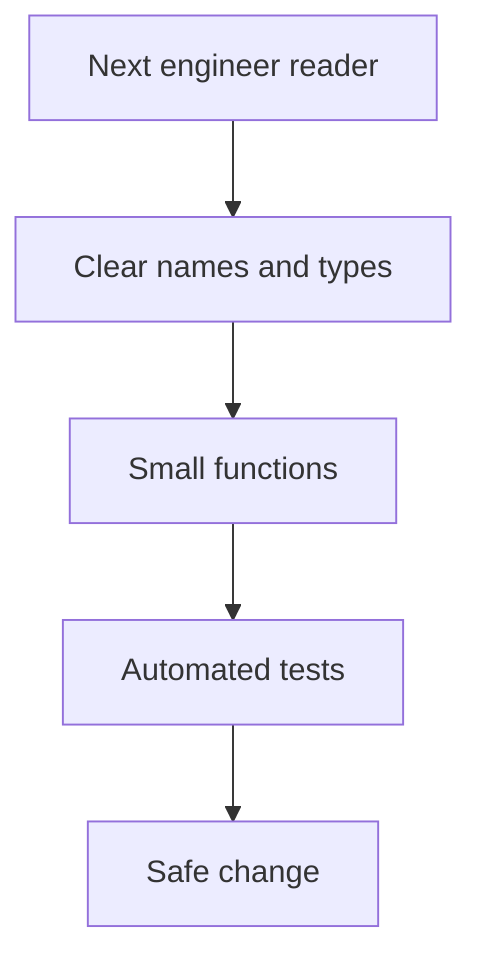

# D01-T020 — Clean code, naming, readability, maintainability

Topic ID: `D01-T020`
Domain: Programming Language Fundamentals
Subdomain: Clean code, naming, readability, maintainability
Importance: core
Complexity: fundamentals
Dependencies: `D01-T019`, `D01-T001`
Execution status of the code in section F: unexecuted

## A. Topic Overview

Clean code is code that the next engineer can change safely without relearning the entire system. Naming, small functions, clear boundaries, consistent formatting, and honest error handling reduce defect rates and review time more than micro-optimizations in most backend services.

Maintainability is a production concern: on-call engineers read logs and stack traces under stress. Readable modules shorten incident resolution and make hiring and onboarding cheaper.

Interviewers use this topic for code review exercises, refactoring scenarios, and judgment about when abstraction helps versus hurts.

Prerequisites: language fundamentals and runtime awareness (`D01-T001` through `D01-T019`) so naming reflects domain and platform constraints.

## B. First-Principles Explanation

Software is read far more than written. Names are compressed documentation: `retryAfterMs` beats `t`. Functions should do one thing at one level of abstraction so readers can skim call graphs.

Coupling and cohesion: modules should group related behavior (high cohesion) and expose narrow APIs (low coupling). Duplication is not always evil — wrong abstraction duplicates worse than two clear copies.

Comments explain why, not what the syntax already says. Tests document behavior and enable refactor confidence.

Trade-offs: DRY versus YAGNI; framework magic versus explicit wiring; verbose types versus brevity in dynamic languages.

## C. Internal Working and Architecture

Team workflow:

1. Requirements → domain language glossary.
2. Code structure mirrors bounded contexts (package by feature).
3. Linters and formatters enforce consistency in CI.
4. Reviews check names, error paths, and test gaps.

Refactor loop: characterize with tests → small steps → keep behavior → improve names.

Backend layers: handler → application service → domain → infrastructure. Names should not leak SQL column names into HTTP JSON without mapping.

## D. Diagrams and Visual Models



## E. Examples and Analogies

Analogy: code is a manual for operating a machine; if the labels on switches lie, operators trip breakers.

Bad: `process(d)` doing validation, pricing, persistence, and email. Good: orchestrator calling named steps.

## F. Code Examples

File: `examples/d01_t020_rename.py`

```python
# unexecuted — before/after naming sketch

def calc(x, y, z):
    return (x * y) - z


def compute_order_total_cents(unit_price_cents: int, quantity: int, discount_cents: int) -> int:
    subtotal_cents = unit_price_cents * quantity
    return subtotal_cents - discount_cents
```

The second name documents units and intent without reading implementation.

## G. Practical Backend Application

Public APIs: stable resource names, consistent error shape, idempotency keys documented. Internal: package-by-feature (`billing/`, `auth/`), not giant `util`. Logging: structured fields with stable keys (`order_id`, not `id1`).

Reviews block on security and correctness first, then maintainability smells: 400-line methods, mystery meat parameters, boolean flags proliferating.

Observability-friendly code logs decisions at boundaries with correlation ids.

## H. Advantages, Limitations and Trade-offs

| Practice | Benefit | Risk |
| --- | --- | --- |
| Descriptive names | Faster comprehension | Long identifiers |
| Small functions | Testable units | Indirection |
| Strict lint | Uniform style | Noise on legacy |
| Comments for why | Preserves intent | Stale comments |
| Feature packages | Localized change | Cross-import discipline |

Over-abstraction creates frameworks only authors understand. Under-naming forces debugger archaeology.

## I. Common Mistakes and Misconceptions

- “Clean code means no comments.” Complex business rules need why comments.
- “Single responsibility means one line.” It means one reason to change.
- Hungarian notation everywhere in modern typed code adds noise.
- Premature interface extraction for one implementation.

## J. Debugging and Troubleshooting

Unreadable code slows incidents: rename while fixing, extract function when reproducing bug, add characterization test before refactor. Boy Scout rule: leave file clearer than you found it within scope.

## K. Interview Preparation

### Beginner

#### Q1. Why do names matter in backend code?

**Answer:** Names are the first layer of documentation during incidents and code review. A misleading name hides bugs such as returning dollars when the field says `amount`. Consistent vocabulary across services prevents integration mistakes. Good names reduce need for comments that drift out of date.

#### Q2. What is a magic number?

**Answer:** A numeric literal in code without named meaning, like `86400` instead of `secondsPerDay`. Extract to named constant with unit in the name (`SESSION_TTL_SECONDS`). Magic numbers hide assumptions and encourage copy-paste errors across modules.

#### Q3. What does DRY mean?

**Answer:** Don't Repeat Yourself — share knowledge once to avoid divergent copies of the same rule. It does not mean never duplicate similar-looking code if abstractions would couple unrelated domains. Wrong DRY creates rigid frameworks. Balance with clarity.

#### Q4. What is code formatting's role?

**Answer:** Automatic formatters remove style debates and make diffs focus on behavior. Teams waste review cycles on whitespace without them. Formatting is not a substitute for structure but supports readability. Run formatters in CI for consistency.

#### Q5. What is a code smell?

**Answer:** A surface sign of deeper design problem, like long method or feature envy. Smells guide refactor; they are not bugs alone. Experienced engineers prioritize smells touching money, auth, and data integrity. Tests enable safe smell removal.

### Intermediate

#### Q1. Function length heuristics?

**Answer:** If you need scroll to hold the whole function in working memory, extract helpers. Keep orchestration at one abstraction level per function — do not mix HTTP parsing with SQL string building. Backend handlers should delegate quickly to services. Length is a signal, not a law.

#### Q2. How should errors be named and thrown?

**Answer:** Use domain-specific exceptions or result types with actionable messages for operators, not `"Error occurred"`. Map to HTTP status at boundary only once. Include correlation id in logs, not necessarily in client body. Never swallow exceptions without metric increment.

#### Q3. Package structure for microservice?

**Answer:** Prefer vertical slices (`order/create`, `order/cancel`) over technical layers only (`controllers`, `daos`) when team owns whole features. Shared kernel for cross-cutting types. Avoid circular packages with archunit tests. Names mirror ubiquitous language from product.

#### Q4. When is a comment justified?

**Answer:** When explaining invariant, regulatory rule, or non-obvious performance constraint. Link to ticket for temporary workarounds with expiry. Do not narrate `i++`. ADRs document architectural why outside code.

#### Q5. Boolean parameter smell?

**Answer:** `sendEmail(order, true)` hides meaning of flag at call sites. Prefer enums or two named methods (`placeOrder` vs `placeOrderAndNotify`). Flags multiply combinatorially and break tests. Explicit API beats configuration booleans.

### Advanced

#### Q1. Strangler fig refactor?

**Answer:** Gradually replace legacy module by routing new behavior through facade while old path shrinks. Maintain readability at boundaries with anti-corruption layer naming. Tests lock behavior during migration. Clean code applies at seams between old and new.

#### Q2. Readability versus performance?

**Answer:** Default to readable; optimize hot paths proven by profiler with comment citing evidence. Micro-optimized cryptic code without measurement is technical debt. Backend bottlenecks are usually I/O and queries, not loop style.

#### Q3. API backward compatibility and naming?

**Answer:** External JSON field names are contracts; rename with version bump or additive field plus deprecation period. Internal rename is cheap with mapper layer. Document breaking changes in changelog. Clean external names outlive internal refactors.

#### Q4. Code review checklist items?

**Answer:** Correctness, authz, input validation, tests, naming, error paths, observability, migration safety. Maintainability questions: can I change this without breaking three packages? Reviewers teach standards, not personal taste, referencing team guide.

#### Q5. Living style guide?

**Answer:** Document naming conventions (`*_cents`, `snake_case` JSON), max file length guidance, and forbidden patterns (`Optional` as field). Automate enforceable rules. Update guide when incident reveals gap.

### Scenarios

#### Q1. Review finds 300-line controller method. Response?

**Answer:** Ask for extraction to service methods named after use cases, keep controller as HTTP adapter. Require tests around extracted pricing logic before merge. Not a blanket reject if deadline critical — plan follow-up ticket with acceptance criteria.

#### Q2. Two services use different terms for same entity (`client` vs `customer`). Impact?

**Answer:** Integration bugs in events and support confusion. Align glossary, map at boundary with explicit DTO fields, deprecate legacy name in docs. Clean code spans organizational vocabulary.

#### Q3. Junior adds util class with 40 static methods. Concern?

**Answer:** God utility becomes dependency magnet and untestable static time. Split by domain or convert to injectable services. Review suggests home for each function near its feature package.

#### Q4. Logs print full credit card numbers. Clean code angle?

**Answer:** Naming and structure should include redaction helper used everywhere, not ad hoc `substring` in one handler. PCI violation is security first; maintainability failure is inconsistent logging utilities. Central `safeLog(order)` pattern.

#### Q5. Test names unclear (`test1`)? Fix?

**Answer:** Rename to `rejectsExpiredCoupon` describing behavior. Readable tests serve as spec for product and on-call. CI should not block on name alone but review should.

### Follow-ups

#### Q1. Relation to system design?

**Answer:** Clean boundaries at service level mirror clean modules in code. See architecture domain topics.

#### Q2. Relation to testing?

**Answer:** Readable tests enable refactor; see testing topics in curriculum.

#### Q3. Language-specific idioms?

**Answer:** Java records for DTOs, Go explicit error returns, Python type hints — `D01-T019`.

## L. Practical Exercises

Solutions: `EXERCISES/solutions/D01-T020.md`.

### Exercise 1 — refactor

Rewrite `calc(x,y,z)` into named function with typed parameters and cents units; add one unit test name as specification.

### Exercise 2 — review

List five issues in a fictional 200-line controller doing SQL, validation, and email (describe on paper).

### Exercise 3 — trade-off

DRY abstraction for two endpoints sharing 70% validation — extract how much?

## M. Revision Notes

- Names encode domain and units.
- Small functions, one abstraction level.
- Comments explain why.
- DRY versus wrong abstraction.
- Format and lint in CI.
- Public names are contracts.

## N. Related Topics

All `D01` fundamentals; API design and testing domains.

## O. Completion Criteria

- Refactor a smelly snippet with improved names.
- Give code review feedback with concrete renames.
- Explain DRY limits with example.
- Propose package layout for one feature slice.
- Map clean code practices to faster incident response.
