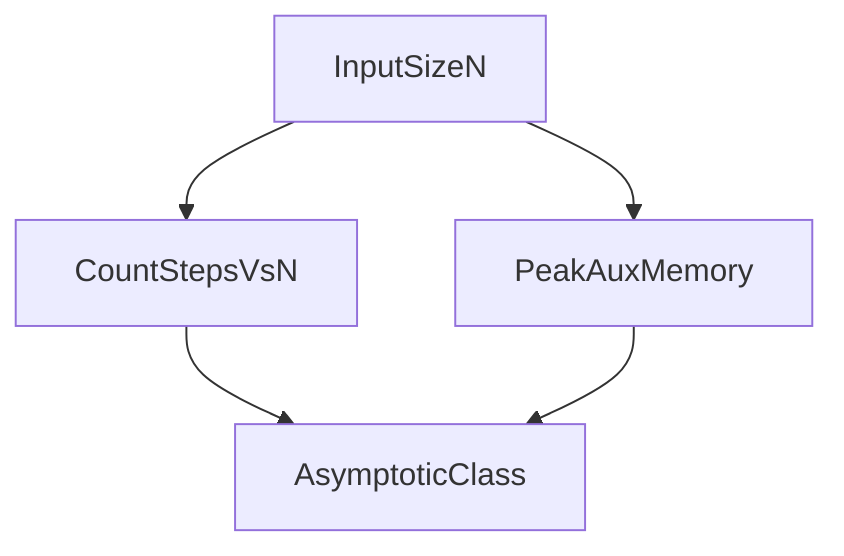

# D02-T001 — Time and space complexity

Topic ID: `D02-T001`
Domain: Data Structures and Algorithms
Subdomain: Time and space complexity
Importance: core
Complexity: intermediate
Dependencies: `D01-T001`, `D01-T002`
Execution status of the code in section F: unexecuted

## A. Topic Overview

Time complexity counts the dominant steps as input grows. Space complexity counts extra memory beyond the input. Together they predict whether a service survives 10x traffic without a rewrite.

The concept exists because hardware has finite CPU and RAM. An endpoint that is fine at 500 items may fail at 50,000 if work grows quadratically. Interviewers use complexity to see whether you can spot nested loops on request payloads before they reach production.

In backend systems, n is often rows scanned, bytes parsed, queue depth, or fan-out neighbors—not just “array length.” Documenting complexity in design reviews prevents surprise timeouts when a tenant grows.

Prerequisites: `D01-T001`, `D01-T002`. This topic supports `D02-T002` and later graph or systems topics.

## B. First-Principles Explanation

A CPU executes a bounded number of instructions per second. An algorithm that doubles work when input doubles is linear. One that compares every pair is quadratic. Memory is similar: an auxiliary array proportional to n adds O(n) space even if the algorithm is a single pass over the input.

What happens when you analyze code:

1. Identify the parameter n (users, events, edges, bytes).
2. Find the innermost loop or recursive branch that scales with n.
3. Drop constants and lower-order terms to get the asymptotic class.
4. Repeat for peak auxiliary memory (sets, output buffers, recursion stack).

Why it works: growth classes compose—nested loops multiply, sequential blocks add. Limitations: constants and cache effects dominate at small n; asymptotics guide scaling, not every millisecond.

Terms: **asymptotic cost**, **auxiliary space**, **input size n**, **dominant term**.

## C. Internal Working and Architecture

Count the innermost loop that runs the most often. Drop lower-order terms and constants. For space, count allocations that survive across iterations (hash tables, output buffers), not loop indices.

Dominant time: O(n) for a single pass; O(n^2) when every pair is compared. Dominant auxiliary space: O(1) extra for in-place scans; O(n) when every element is stored in a new structure.

Data flow at an API boundary: parse body O(bytes), validate each array element O(k), accidental nested loop over elements O(k^2). The database may add O(rows) if the handler scans per element instead of batching.

## D. Diagrams and Visual Models



Read left to right: measure both time and space, then classify growth.

## E. Examples and Analogies

Analogy: complexity is the slope of a hill, not your walking speed today. Backend: scanning all orders per checkout is O(orders); indexing by user id turns repeat lookups into O(1) average with a hash map (`D02-T006`).

Do not claim O(1) because a loop cap is 100 while n grows without bound. Do not ignore auxiliary maps that grow with tenants.

Edge cases: n=0, n=1, hidden O(n) copies when slicing strings or arrays, and log factors from balanced trees.

## F. Code Examples

File: `examples/d02_t001_complexity.py`

Dependencies: Python 3 standard library only.

```python
def count_distinct(events: list[str]) -> int:
    seen: set[str] = set()
    for e in events:
        seen.add(e)
    return len(seen)


def has_pair_duplicate(nums: list[int]) -> bool:
    n = len(nums)
    for i in range(n):
        for j in range(i + 1, n):
            if nums[i] == nums[j]:
                return True
    return False


if __name__ == "__main__":
    assert count_distinct(["a", "b", "a"]) == 2
    assert has_pair_duplicate([1, 2, 2]) is True
    print("ok")
```

How to run: `python examples/d02_t001_complexity.py` from `EXERCISES/examples/`.

Expected output: `ok`

`count_distinct` is O(n) time and O(n) space. `has_pair_duplicate` is O(n^2) time and O(1) extra space. Prefer the set when n can be large.

## G. Practical Backend Application

Size endpoints by expected n: batch exports, fan-out queries, and JSON array length. Set timeouts from measured growth, not gut feel. Document Big-O in ADRs when choosing nested loops versus indexing.

Concurrent requests multiply constant factors but do not change asymptotic class per request unless they share a structure that grows with total traffic (unbounded cache).

## H. Advantages, Limitations and Trade-offs

| Choice | Benefit | Cost | Choose when | Avoid when |
| --- | --- | --- | --- | --- |
| Single pass | Simple, cache-friendly | Cannot answer pair questions | Streaming metrics | Need all-pairs |
| Hash index | O(1) average lookups | O(n) memory | Hot keys | Memory cap |
| Nested loops | No extra memory | O(n^2) time | Tiny n only | Production lists |
| Sort then scan | O(n log n) | Mutates order | Order statistics | Need stable order |

## I. Common Mistakes and Misconceptions

- Claiming O(1) because the loop runs 100 times regardless of n.
- Ignoring space for “small” caches that grow with tenants.
- Using wall clock on cold JVM as proof of O(log n).

## J. Debugging and Troubleshooting

Symptoms: CPU pegged while DB is idle (CPU-bound algorithm), or GC churn (too many allocations). Capture n from logs, reproduce offline, replace inner loop with map or sort.

Metrics: track payload array length percentiles and CPU per request. Spikes in both imply superlinear work.

## K. Interview Preparation

### Beginner

#### Q1. What problem does time and space complexity solve in backend engineering?

**Answer:** Complexity describes how resource use scales when input size n grows, not the exact millisecond on one machine. For Time and space complexity, typical bounds are O(n) for a single pass; O(n^2) when every pair is compared time and O(1) extra for in-place scans; O(n) when every element is stored in a new structure space. Profile hot handlers and size n by records per request, queue depth, or bytes parsed. Watch edge cases: empty input, n=1, duplicated work hidden inside library calls.

#### Q2. How do you define input size n for time and space complexity?

**Answer:** Complexity describes how resource use scales when input size n grows, not the exact millisecond on one machine. For Time and space complexity, typical bounds are O(n) for a single pass; O(n^2) when every pair is compared time and O(1) extra for in-place scans; O(n) when every element is stored in a new structure space. Profile hot handlers and size n by records per request, queue depth, or bytes parsed. Watch edge cases: empty input, n=1, duplicated work hidden inside library calls.

#### Q3. What is the difference between time and space cost here?

**Answer:** Complexity describes how resource use scales when input size n grows, not the exact millisecond on one machine. For Time and space complexity, typical bounds are O(n) for a single pass; O(n^2) when every pair is compared time and O(1) extra for in-place scans; O(n) when every element is stored in a new structure space. Profile hot handlers and size n by records per request, queue depth, or bytes parsed. Watch edge cases: empty input, n=1, duplicated work hidden inside library calls.

#### Q4. Why do we ignore constant factors in asymptotic notation for this topic?

**Answer:** Complexity describes how resource use scales when input size n grows, not the exact millisecond on one machine. For Time and space complexity, typical bounds are O(n) for a single pass; O(n^2) when every pair is compared time and O(1) extra for in-place scans; O(n) when every element is stored in a new structure space. Profile hot handlers and size n by records per request, queue depth, or bytes parsed. Watch edge cases: empty input, n=1, duplicated work hidden inside library calls.

#### Q5. Name one operation that is cheap and one that is expensive in this structure.

**Answer:** Complexity describes how resource use scales when input size n grows, not the exact millisecond on one machine. For Time and space complexity, typical bounds are O(n) for a single pass; O(n^2) when every pair is compared time and O(1) extra for in-place scans; O(n) when every element is stored in a new structure space. Profile hot handlers and size n by records per request, queue depth, or bytes parsed. Watch edge cases: empty input, n=1, duplicated work hidden inside library calls.

### Intermediate

#### Q1. State the average and worst-case complexity for the main operations.

**Answer:** Complexity describes how resource use scales when input size n grows, not the exact millisecond on one machine. For Time and space complexity, typical bounds are O(n) for a single pass; O(n^2) when every pair is compared time and O(1) extra for in-place scans; O(n) when every element is stored in a new structure space. Profile hot handlers and size n by records per request, queue depth, or bytes parsed. Watch edge cases: empty input, n=1, duplicated work hidden inside library calls.

#### Q2. How would you justify choosing this structure in a design review?

**Answer:** Complexity describes how resource use scales when input size n grows, not the exact millisecond on one machine. For Time and space complexity, typical bounds are O(n) for a single pass; O(n^2) when every pair is compared time and O(1) extra for in-place scans; O(n) when every element is stored in a new structure space. Profile hot handlers and size n by records per request, queue depth, or bytes parsed. Watch edge cases: empty input, n=1, duplicated work hidden inside library calls.

#### Q3. What changes if data no longer fits in memory?

**Answer:** Complexity describes how resource use scales when input size n grows, not the exact millisecond on one machine. For Time and space complexity, typical bounds are O(n) for a single pass; O(n^2) when every pair is compared time and O(1) extra for in-place scans; O(n) when every element is stored in a new structure space. Profile hot handlers and size n by records per request, queue depth, or bytes parsed. Watch edge cases: empty input, n=1, duplicated work hidden inside library calls.

#### Q4. How does concurrency affect the complexity story?

**Answer:** Complexity describes how resource use scales when input size n grows, not the exact millisecond on one machine. For Time and space complexity, typical bounds are O(n) for a single pass; O(n^2) when every pair is compared time and O(1) extra for in-place scans; O(n) when every element is stored in a new structure space. Profile hot handlers and size n by records per request, queue depth, or bytes parsed. Watch edge cases: empty input, n=1, duplicated work hidden inside library calls.

#### Q5. How do you test performance regressions for this component?

**Answer:** Complexity describes how resource use scales when input size n grows, not the exact millisecond on one machine. For Time and space complexity, typical bounds are O(n) for a single pass; O(n^2) when every pair is compared time and O(1) extra for in-place scans; O(n) when every element is stored in a new structure space. Profile hot handlers and size n by records per request, queue depth, or bytes parsed. Watch edge cases: empty input, n=1, duplicated work hidden inside library calls.

### Advanced

#### Q1. When is the “textbook” complexity misleading in production?

**Answer:** Complexity describes how resource use scales when input size n grows, not the exact millisecond on one machine. For Time and space complexity, typical bounds are O(n) for a single pass; O(n^2) when every pair is compared time and O(1) extra for in-place scans; O(n) when every element is stored in a new structure space. Profile hot handlers and size n by records per request, queue depth, or bytes parsed. Watch edge cases: empty input, n=1, duplicated work hidden inside library calls.

#### Q2. How do cache locality and allocation affect real runtime?

**Answer:** Complexity describes how resource use scales when input size n grows, not the exact millisecond on one machine. For Time and space complexity, typical bounds are O(n) for a single pass; O(n^2) when every pair is compared time and O(1) extra for in-place scans; O(n) when every element is stored in a new structure space. Profile hot handlers and size n by records per request, queue depth, or bytes parsed. Watch edge cases: empty input, n=1, duplicated work hidden inside library calls.

#### Q3. Compare this approach to the next topic in the curriculum.

**Answer:** Complexity describes how resource use scales when input size n grows, not the exact millisecond on one machine. For Time and space complexity, typical bounds are O(n) for a single pass; O(n^2) when every pair is compared time and O(1) extra for in-place scans; O(n) when every element is stored in a new structure space. Profile hot handlers and size n by records per request, queue depth, or bytes parsed. Watch edge cases: empty input, n=1, duplicated work hidden inside library calls.

#### Q4. What security or abuse patterns change effective n?

**Answer:** Complexity describes how resource use scales when input size n grows, not the exact millisecond on one machine. For Time and space complexity, typical bounds are O(n) for a single pass; O(n^2) when every pair is compared time and O(1) extra for in-place scans; O(n) when every element is stored in a new structure space. Profile hot handlers and size n by records per request, queue depth, or bytes parsed. Watch edge cases: empty input, n=1, duplicated work hidden inside library calls.

#### Q5. How would you document complexity in an OpenAPI or ADR?

**Answer:** Complexity describes how resource use scales when input size n grows, not the exact millisecond on one machine. For Time and space complexity, typical bounds are O(n) for a single pass; O(n^2) when every pair is compared time and O(1) extra for in-place scans; O(n) when every element is stored in a new structure space. Profile hot handlers and size n by records per request, queue depth, or bytes parsed. Watch edge cases: empty input, n=1, duplicated work hidden inside library calls.

### Scenarios

#### Q1. Latency spikes when traffic doubles but CPU is only 60%. What do you measure first?

**Answer:** Complexity describes how resource use scales when input size n grows, not the exact millisecond on one machine. For Time and space complexity, typical bounds are O(n) for a single pass; O(n^2) when every pair is compared time and O(1) extra for in-place scans; O(n) when every element is stored in a new structure space. Profile hot handlers and size n by records per request, queue depth, or bytes parsed. Watch edge cases: empty input, n=1, duplicated work hidden inside library calls.

#### Q2. A batch job OOMs on a larger tenant. Which space term grew?

**Answer:** Complexity describes how resource use scales when input size n grows, not the exact millisecond on one machine. For Time and space complexity, typical bounds are O(n) for a single pass; O(n^2) when every pair is compared time and O(1) extra for in-place scans; O(n) when every element is stored in a new structure space. Profile hot handlers and size n by records per request, queue depth, or bytes parsed. Watch edge cases: empty input, n=1, duplicated work hidden inside library calls.

#### Q3. Two services disagree on timeout budgets for the same endpoint.

**Answer:** Complexity describes how resource use scales when input size n grows, not the exact millisecond on one machine. For Time and space complexity, typical bounds are O(n) for a single pass; O(n^2) when every pair is compared time and O(1) extra for in-place scans; O(n) when every element is stored in a new structure space. Profile hot handlers and size n by records per request, queue depth, or bytes parsed. Watch edge cases: empty input, n=1, duplicated work hidden inside library calls.

#### Q4. An attacker sends inputs that trigger worst-case behavior.

**Answer:** Complexity describes how resource use scales when input size n grows, not the exact millisecond on one machine. For Time and space complexity, typical bounds are O(n) for a single pass; O(n^2) when every pair is compared time and O(1) extra for in-place scans; O(n) when every element is stored in a new structure space. Profile hot handlers and size n by records per request, queue depth, or bytes parsed. Watch edge cases: empty input, n=1, duplicated work hidden inside library calls.

#### Q5. You must shave 100ms off a hot path without new hardware.

**Answer:** Complexity describes how resource use scales when input size n grows, not the exact millisecond on one machine. For Time and space complexity, typical bounds are O(n) for a single pass; O(n^2) when every pair is compared time and O(1) extra for in-place scans; O(n) when every element is stored in a new structure space. Profile hot handlers and size n by records per request, queue depth, or bytes parsed. Watch edge cases: empty input, n=1, duplicated work hidden inside library calls.

### Follow-ups

#### Q1. How does this connect to database indexing?

**Answer:** Complexity describes how resource use scales when input size n grows, not the exact millisecond on one machine. For Time and space complexity, typical bounds are O(n) for a single pass; O(n^2) when every pair is compared time and O(1) extra for in-place scans; O(n) when every element is stored in a new structure space. Profile hot handlers and size n by records per request, queue depth, or bytes parsed. Watch edge cases: empty input, n=1, duplicated work hidden inside library calls.

#### Q2. How does this connect to caching layers?

**Answer:** Complexity describes how resource use scales when input size n grows, not the exact millisecond on one machine. For Time and space complexity, typical bounds are O(n) for a single pass; O(n^2) when every pair is compared time and O(1) extra for in-place scans; O(n) when every element is stored in a new structure space. Profile hot handlers and size n by records per request, queue depth, or bytes parsed. Watch edge cases: empty input, n=1, duplicated work hidden inside library calls.

#### Q3. What monitoring proves your complexity assumption?

**Answer:** Complexity describes how resource use scales when input size n grows, not the exact millisecond on one machine. For Time and space complexity, typical bounds are O(n) for a single pass; O(n^2) when every pair is compared time and O(1) extra for in-place scans; O(n) when every element is stored in a new structure space. Profile hot handlers and size n by records per request, queue depth, or bytes parsed. Watch edge cases: empty input, n=1, duplicated work hidden inside library calls.

## L. Practical Exercises

Solutions are in `EXERCISES/solutions/D02-T001.md`. Try these before opening that file.

### Exercise 1 — implementation

Implement `count_distinct` and `has_pair_duplicate` and document time/space for each in comments. Acceptance: distinct uses O(n) time and space; pair scan uses O(n^2) time and O(1) extra space; asserts in section F pass.

### Exercise 2 — debugging

Endpoint times out at n=8000 with nested loops over the JSON array. Name complexity and one fix. Acceptance: identify O(n^2); propose hash-based dedup O(n) or sort+scan O(n log n).

### Exercise 3 — trade-off

Choose between recomputing a report O(n) per request versus caching O(n) memory per tenant. Acceptance: discuss hit rate, staleness, memory cap, and eviction.

## M. Revision Notes

- Count dominant loops.
- Space includes auxiliary structures.
- Constants matter in production; classes matter for scaling.

## N. Related Topics

Understand this before: `D01-T001`, `D01-T002`.

This topic supports: `D02-T002`.

Often confused with: wall-clock profiling versus asymptotic class.

Interviewers combine this with `D02-T015`, `D13-T003`.

## O. Completion Criteria

- State time and space for a given code snippet.
- Explain why nested loops on request arrays are dangerous.
- Pick a structure given n and memory budget.
