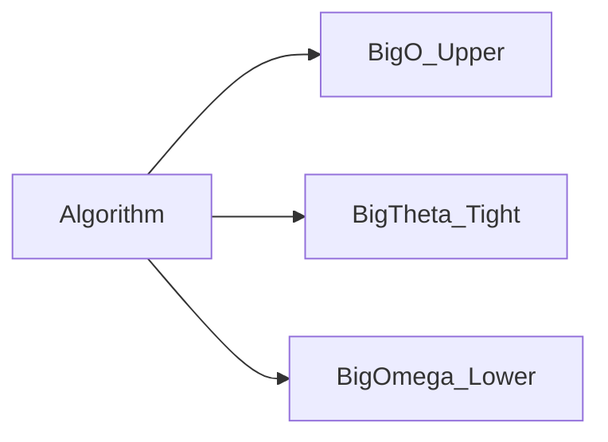

# D02-T002 — Big-O, Big-Theta, Big-Omega

Topic ID: `D02-T002`
Domain: Data Structures and Algorithms
Subdomain: Big-O, Big-Theta, Big-Omega
Importance: core
Complexity: intermediate
Dependencies: `D02-T001`, `D01-T001`, `D01-T002`
Execution status of the code in section F: unexecuted

## A. Topic Overview

Asymptotic notation describes growth without pinning constants. Big-O answers whether work can exceed a curve; Big-Theta gives a tight bound when upper and lower match; Big-Omega states a best-case floor. Interviewers test whether you quote the bound that matches the question (worst case, typical case, or amortized).

The concept exists because two algorithms with the same Big-O can differ by 100x in constants. SLAs and capacity plans still need notation so teams agree on scaling exponents before debating hardware.

In backend APIs, saying “O(n) per request” is meaningless without defining n (rows, bytes, neighbors). Pair notation with measured p50/p99 and the precondition (sorted data, hash load factor).

Prerequisites: `D02-T001`. Supports `D02-T003`.

## B. First-Principles Explanation

Functions f(n) and g(n) compare through limits and inequalities. O(g) hides constants and lower-order terms. Theta requires matching upper and lower polynomials. Omega captures best-case floors when inputs are friendly.

For linear search, worst case touches every element (O(n)) while best case checks the first slot (Omega(1)). Binary search on a sorted array halves the range each step (O(log n)) but still needs the sorted invariant.

Terms: **upper bound**, **lower bound**, **tight bound**, **amortized**.

## C. Internal Working and Architecture

When analyzing code, identify the loop whose iteration count scales with n. Recurrence T(n)=T(n/2)+O(1) yields Theta(log n). Nested loops often yield Theta(n^2). Amortized bounds average expensive rare steps (hash resize) across many cheap inserts.

Dominant time: O(log n) search on sorted data; Theta(n) when every element must be touched. Dominant auxiliary space: O(1) iterative binary search; O(log n) recursion stack.

## D. Diagrams and Visual Models



One algorithm can satisfy different bounds for different questions.

## E. Examples and Analogies

Saying “sort is O(n log n)” is an upper bound for comparison sorts. Saying “must read every byte of the upload” is Omega(n) for any correct virus scan. Hash insert is O(1) amortized but O(n) worst case when the table rehashes.

Edge cases: duplicate keys, already sorted input, empty graph, single vertex.

## F. Code Examples

File: `examples/d02_t002_bounds.py`

```python
def linear_find(a: list[int], x: int) -> int:
    for i, v in enumerate(a):
        if v == x:
            return i
    return -1


def binary_find(a: list[int], x: int) -> int:
    lo, hi = 0, len(a) - 1
    while lo <= hi:
        mid = (lo + hi) // 2
        if a[mid] == x:
            return mid
        if a[mid] < x:
            lo = mid + 1
        else:
            hi = mid - 1
    return -1
```

Linear: O(n) worst, Omega(1) best. Binary on sorted input: O(log n) worst.

## G. Practical Backend Application

Publish Big-O of batch endpoints in ADRs. Pair with p99 latency because O(n) with a tiny constant can beat O(log n) with huge constants for small n. Distinguish amortized hash inserts from worst-case rehash spikes in load tests.

## H. Advantages, Limitations and Trade-offs

| Choice | Benefit | Cost | Choose when | Avoid when |
| --- | --- | --- | --- | --- |
| Big-O only | Easy to communicate | Hides best case | Capacity upper bounds | Tight SLAs on best case |
| Big-Theta | Honest typical cost | Harder to prove | Must-touch-all-input | Cache hits dominate |
| Amortized | Models hash tables | Worst spike remains | Average-case planning | Hard real-time limits |

## I. Common Mistakes and Misconceptions

- Using O for both upper and exact cost.
- Forgetting amortized versus worst for hash maps.
- Claiming O(log n) search without sorted precondition.

## J. Debugging and Troubleshooting

If latency is flat while n grows, you are not on the Theta(n) path—cache, index, or early exit dominates. Log percentiles of n and note which code path executed.

## K. Interview Preparation

### Beginner

#### Q1. What is Big-O?

**Answer:** Big-O describes an upper bound on growth up to a constant factor as n increases. It is not the exact runtime on your laptop. For search problems, unsorted linear scan is O(n) while sorted binary search is O(log n). Interviewers want you to state the precondition (sorted array) when you claim logarithmic search.

#### Q2. What is Big-Omega?

**Answer:** Big-Omega is a lower bound: the algorithm cannot be asymptotically better than g(n). Linear search is Omega(1) because the target may be first. It is also Omega(n) in the comparison model if you must prove every element was considered in the worst case. Backend scans of an entire partition are Omega(rows) even if an index exists elsewhere.

#### Q3. What is Big-Theta?

**Answer:** Big-Theta means tight bound: O(g) and Omega(g) at once. Scanning every record in a table without an index is Theta(n) rows touched. Theta is the honest statement for batch jobs that always read the full shard. Do not say Theta(log n) for a full table scan.

#### Q4. Why ignore constants in interviews?

**Answer:** Constants hide hardware, JIT warmup, and network RTT. Asymptotics predict scaling when n increases 10x. A O(n) algorithm with a huge constant loses to O(n log n) for small n. In production you still benchmark constants after picking the right class.

#### Q5. Give an example of amortized complexity.

**Answer:** Dynamic array append is O(1) amortized because resizing is rare and spread across many appends. Hash table insert is O(1) amortized but O(n) worst case when rehashing all buckets. Document worst-case spikes separately for latency-sensitive APIs.

### Intermediate

#### Q1. Linear versus binary search bounds?

**Answer:** Linear search is O(n) worst and Omega(1) best. Binary search on sorted data is O(log n) worst and Omega(1) if the middle element matches. Space for iterative binary search is O(1). Misapplying binary search to unsorted data breaks correctness, not just bounds.

#### Q2. When is Theta more honest than O in an SLA?

**Answer:** When every request must touch all n items, Theta(n) sets expectations. O(n) alone allows the possibility of o(n) algorithms, which is false for full scans. For indexed point lookups, state O(log n) or O(1) average instead.

#### Q3. How does amortized analysis differ from average case?

**Answer:** Amortized bounds sum expensive operations over a sequence (resize, rehash). Average case assumes a distribution of inputs (random hash keys). Attackers can force worst case if hash is weak. Use both concepts in security-sensitive maps.

#### Q4. What is the comparison sort lower bound?

**Answer:** Comparison sorts require Omega(n log n) comparisons in the worst case because n! permutations must be distinguished. That is why general sorting is Theta(n log n) for comparison-based algorithms. Radix sort beats this only with structured keys.

#### Q5. How do you document bounds in an ADR?

**Answer:** Name n, state worst and typical bounds, list preconditions, and note measured p99. Example: “Export is Theta(rows) per shard; index on created_at reduces rows scanned to O(log n + k) for keyset pages.” Link to load test artifacts.

### Advanced

#### Q1. When is Big-O misleading with caches?

**Answer:** Repeated queries hit CPU or CDN cache, so effective work is Theta(1) per hit even if miss path is Theta(n). Asymptotics describe miss path scaling. Measure hit rate; attackers bypass cache with unique keys.

#### Q2. Explain potential method for amortized stack push.

**Answer:** Each element pays for its future pop when the stack doubles. Aggregate cost of n pushes is O(n), so amortized push is O(1). This differs from accounting for a single worst push during resize.

#### Q3. Can an algorithm be O(n) and Omega(n) but not Theta(n)?

**Answer:** No—if both upper and lower are tight to the same g(n), it is Theta(n). Sometimes people confuse worst-case O with Theta; clarify which input family each bound uses.

#### Q4. How do adversarial inputs affect hash maps?

**Answer:** Crafted keys can collide into one bucket, degrading to Theta(n) per operation. Mitigate with salted hashing, treeified buckets, or switching structures. Security review should treat user-controlled keys as adversarial.

#### Q5. Relate Big-O to database index access.

**Answer:** B-tree point lookup is O(log n) pages; sequential scan is Theta(rows). Query planner choice determines which bound applies. EXPLAIN ANALYZE proves which path ran.

### Scenarios

#### Q1. p99 flat while n grows—what happened?

**Answer:** Typical path is cache or index hit (constant time), while Big-O quoted worst-case scan. Instrument path flags and n on each request. Separate metrics for cold versus warm queries.

#### Q2. Team disagrees on timeout for export job.

**Answer:** Export is Theta(rows); timeout must scale with row count or shard work. Use chunked exports with cursor, not single statement expecting O(1). Document linear growth in the API contract.

#### Q3. Hash map latency spikes hourly.

**Answer:** Likely rehash or resize when load factor crosses threshold—amortized O(1) but periodic Theta(n) events. Smooth spikes with incremental resizing or pre-sized tables from traffic forecasts.

#### Q4. Client assumes O(1) pagination with offset 1e6.

**Answer:** Offset pagination is Theta(offset + limit) for many engines. Educate client on keyset pagination O(log n + k) with index. Big-O mismatch drives timeouts, not “slow DB.”

#### Q5. Choosing notation for nightly batch that always reads full table.

**Answer:** Use Theta(rows) and plan shard parallelism so wall clock is Theta(rows / parallelism). O(rows) alone understates that partial reads are impossible without schema change.

### Follow-ups

#### Q1. Connection to `D02-T001`?

**Answer:** D02-T001 teaches counting steps; this topic formalizes bounds language. Together they justify design choices in reviews and interviews.

#### Q2. Connection to sorting (`D02-T015`)?

**Answer:** Comparison sorts cluster at Theta(n log n). Knowing the lower bound prevents futile hunt for O(n) general comparison sort.

#### Q3. What metrics prove your bound?

**Answer:** Plot latency versus n on miss path, rehash counters, rows examined from DB stats. Without n on the x-axis, arguments stay theoretical.

## L. Practical Exercises

Solutions: `EXERCISES/solutions/D02-T002.md`.

### Exercise 1 — implementation

Argue bounds for `linear_find` and `binary_find` in comments. Acceptance: correct O/Omega statements and sorted precondition for binary search.

### Exercise 2 — debugging

Team says endpoint is O(n) but p99 flat. Explain notation mismatch. Acceptance: distinguish worst-case class from cached/indexed typical path.

### Exercise 3 — trade-off

Document Theta versus O for full-table scan versus indexed lookup. Acceptance: scan Theta(n); index O(log n) or O(1) hash in memory.

## M. Revision Notes

- O upper, Omega lower, Theta tight.
- State preconditions.
- Amortized is not worst case.

## N. Related Topics

Supports `D02-T003`. Often confused with average case versus amortized. See `D02-T001`, `D02-T015`.

## O. Completion Criteria

- Give O, Omega, and Theta examples on the same algorithm.
- Explain flat p99 with growing n.
- Write a bounds paragraph for an ADR.
