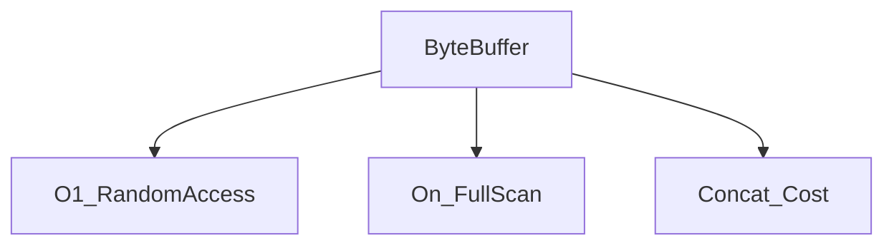

# D02-T003 — Arrays and strings

Topic ID: `D02-T003`
Domain: Data Structures and Algorithms
Subdomain: Arrays and strings
Importance: core
Complexity: intermediate
Dependencies: `D02-T002`, `D02-T001`, `D01-T001`, `D01-T002`
Execution status of the code in section F: unexecuted

## A. Topic Overview

Arrays and strings are the default carriers for request payloads, log lines, and columnar batches. Knowing when access is O(1) and when a 'small' string operation allocates O(n) prevents surprise latency in parsers and serializers.

Prerequisites: `D02-T002`, `D02-T001`, `D01-T001`, `D01-T002`. This topic supports `D02-T004` and later graph or systems topics.

## B. First-Principles Explanation

Contiguous memory lets address arithmetic implement index in O(1). Variable-length strings track length and encoding. Immutable strings mean each concat may allocate a new buffer of size sum of parts.

Terms: **asymptotic cost, auxiliary space, input size n**.

## C. Internal Working and Architecture

Dynamic arrays over-allocate capacity so append is amortized O(1). String builders batch writes. Slicing in Python creates views or copies depending on type; in Java `substring` historically copied.

Dominant time: O(1) index access; O(n) full scan; O(n) or O(n+m) concatenation depending on immutability. Dominant auxiliary space: O(1) in-place index; O(n) when copying for immutable strings.

## D. Diagrams and Visual Models



Random access is cheap; whole-buffer work is linear.

## E. Examples and Analogies

Checking JWT segment length is O(1) per segment but O(n) over the token. Building SQL with `+=` in a loop is O(n^2) total characters moved.

Edge cases: Surrogate pairs, null bytes in binary, out-of-range index, immutability causing hidden copies.

## F. Code Examples

File: `examples/d02_t003_strings.py`

Dependencies: Python 3 standard library only.

```python
def join_fields(fields: list[str]) -> str:
    return ",".join(fields)


def bad_join(fields: list[str]) -> str:
    out = ""
    for f in fields:
        out += f + ","
    return out.rstrip(",")
```

How to run: `python examples/d02_t003_strings.py` from `EXERCISES/examples/`.

Expected output: `ok`

`join` is O(total chars). `bad_join` is quadratic in field count for large lists. Use builders for hot paths.

## G. Practical Backend Application

Validate max body size before O(n) parse. Stream large uploads instead of `read()` entire file. Prefer views into buffers for metrics labels.

## H. Advantages, Limitations and Trade-offs

| Choice | Benefit | Cost | Choose when | Avoid when |
| --- | --- | --- | --- | --- |
| Contiguous array | Cache-friendly scans | Resize cost | Column batches | Sparse maps |
| Immutable string | Safe sharing | Concat cost | HTTP headers | Hot loop concat |
| StringBuilder | O(n) build | Mutable buffer | Log assembly | Concurrent sharing |

## I. Common Mistakes and Misconceptions

- O(n^2) string concat in tight loops.
- Treating UTF-8 byte length as char count.
- Assuming slice is always O(1) without allocation.

## J. Debugging and Troubleshooting

Profile allocations on parse path. Compare `join` versus `+=`. Log payload bytes, not char count, for limits.

## K. Interview Preparation

### Beginner

#### Q1. What problem does Arrays and strings solve in backend engineering?

**Answer:** Arrays offer contiguous O(1) random access; strings are sequences with encoding and immutability rules that affect copies. For Arrays and strings, typical bounds are O(1) index access; O(n) full scan; O(n) or O(n+m) concatenation depending on immutability time and O(1) in-place index; O(n) when copying for immutable strings space. Parsing HTTP bodies and CSV rows is linear in bytes; repeated concatenation in loops can become quadratic. Watch edge cases: UTF-8 multibyte chars, empty string, slicing sharing versus copy.

#### Q2. How do you define input size n for arrays and strings?

**Answer:** Arrays offer contiguous O(1) random access; strings are sequences with encoding and immutability rules that affect copies. For Arrays and strings, typical bounds are O(1) index access; O(n) full scan; O(n) or O(n+m) concatenation depending on immutability time and O(1) in-place index; O(n) when copying for immutable strings space. Parsing HTTP bodies and CSV rows is linear in bytes; repeated concatenation in loops can become quadratic. Watch edge cases: UTF-8 multibyte chars, empty string, slicing sharing versus copy.

#### Q3. What is the difference between time and space cost here?

**Answer:** Arrays offer contiguous O(1) random access; strings are sequences with encoding and immutability rules that affect copies. For Arrays and strings, typical bounds are O(1) index access; O(n) full scan; O(n) or O(n+m) concatenation depending on immutability time and O(1) in-place index; O(n) when copying for immutable strings space. Parsing HTTP bodies and CSV rows is linear in bytes; repeated concatenation in loops can become quadratic. Watch edge cases: UTF-8 multibyte chars, empty string, slicing sharing versus copy.

#### Q4. Why do we ignore constant factors in asymptotic notation for this topic?

**Answer:** Arrays offer contiguous O(1) random access; strings are sequences with encoding and immutability rules that affect copies. For Arrays and strings, typical bounds are O(1) index access; O(n) full scan; O(n) or O(n+m) concatenation depending on immutability time and O(1) in-place index; O(n) when copying for immutable strings space. Parsing HTTP bodies and CSV rows is linear in bytes; repeated concatenation in loops can become quadratic. Watch edge cases: UTF-8 multibyte chars, empty string, slicing sharing versus copy.

#### Q5. Name one operation that is cheap and one that is expensive in this structure.

**Answer:** Arrays offer contiguous O(1) random access; strings are sequences with encoding and immutability rules that affect copies. For Arrays and strings, typical bounds are O(1) index access; O(n) full scan; O(n) or O(n+m) concatenation depending on immutability time and O(1) in-place index; O(n) when copying for immutable strings space. Parsing HTTP bodies and CSV rows is linear in bytes; repeated concatenation in loops can become quadratic. Watch edge cases: UTF-8 multibyte chars, empty string, slicing sharing versus copy.

### Intermediate

#### Q1. State the average and worst-case complexity for the main operations.

**Answer:** Arrays offer contiguous O(1) random access; strings are sequences with encoding and immutability rules that affect copies. For Arrays and strings, typical bounds are O(1) index access; O(n) full scan; O(n) or O(n+m) concatenation depending on immutability time and O(1) in-place index; O(n) when copying for immutable strings space. Parsing HTTP bodies and CSV rows is linear in bytes; repeated concatenation in loops can become quadratic. Watch edge cases: UTF-8 multibyte chars, empty string, slicing sharing versus copy.

#### Q2. How would you justify choosing this structure in a design review?

**Answer:** Arrays offer contiguous O(1) random access; strings are sequences with encoding and immutability rules that affect copies. For Arrays and strings, typical bounds are O(1) index access; O(n) full scan; O(n) or O(n+m) concatenation depending on immutability time and O(1) in-place index; O(n) when copying for immutable strings space. Parsing HTTP bodies and CSV rows is linear in bytes; repeated concatenation in loops can become quadratic. Watch edge cases: UTF-8 multibyte chars, empty string, slicing sharing versus copy.

#### Q3. What changes if data no longer fits in memory?

**Answer:** Arrays offer contiguous O(1) random access; strings are sequences with encoding and immutability rules that affect copies. For Arrays and strings, typical bounds are O(1) index access; O(n) full scan; O(n) or O(n+m) concatenation depending on immutability time and O(1) in-place index; O(n) when copying for immutable strings space. Parsing HTTP bodies and CSV rows is linear in bytes; repeated concatenation in loops can become quadratic. Watch edge cases: UTF-8 multibyte chars, empty string, slicing sharing versus copy.

#### Q4. How does concurrency affect the complexity story?

**Answer:** Arrays offer contiguous O(1) random access; strings are sequences with encoding and immutability rules that affect copies. For Arrays and strings, typical bounds are O(1) index access; O(n) full scan; O(n) or O(n+m) concatenation depending on immutability time and O(1) in-place index; O(n) when copying for immutable strings space. Parsing HTTP bodies and CSV rows is linear in bytes; repeated concatenation in loops can become quadratic. Watch edge cases: UTF-8 multibyte chars, empty string, slicing sharing versus copy.

#### Q5. How do you test performance regressions for this component?

**Answer:** Arrays offer contiguous O(1) random access; strings are sequences with encoding and immutability rules that affect copies. For Arrays and strings, typical bounds are O(1) index access; O(n) full scan; O(n) or O(n+m) concatenation depending on immutability time and O(1) in-place index; O(n) when copying for immutable strings space. Parsing HTTP bodies and CSV rows is linear in bytes; repeated concatenation in loops can become quadratic. Watch edge cases: UTF-8 multibyte chars, empty string, slicing sharing versus copy.

### Advanced

#### Q1. When is the 'textbook' complexity misleading in production?

**Answer:** Arrays offer contiguous O(1) random access; strings are sequences with encoding and immutability rules that affect copies. For Arrays and strings, typical bounds are O(1) index access; O(n) full scan; O(n) or O(n+m) concatenation depending on immutability time and O(1) in-place index; O(n) when copying for immutable strings space. Parsing HTTP bodies and CSV rows is linear in bytes; repeated concatenation in loops can become quadratic. Watch edge cases: UTF-8 multibyte chars, empty string, slicing sharing versus copy.

#### Q2. How do cache locality and allocation affect real runtime?

**Answer:** Arrays offer contiguous O(1) random access; strings are sequences with encoding and immutability rules that affect copies. For Arrays and strings, typical bounds are O(1) index access; O(n) full scan; O(n) or O(n+m) concatenation depending on immutability time and O(1) in-place index; O(n) when copying for immutable strings space. Parsing HTTP bodies and CSV rows is linear in bytes; repeated concatenation in loops can become quadratic. Watch edge cases: UTF-8 multibyte chars, empty string, slicing sharing versus copy.

#### Q3. Compare this approach to the next topic in the curriculum.

**Answer:** Arrays offer contiguous O(1) random access; strings are sequences with encoding and immutability rules that affect copies. For Arrays and strings, typical bounds are O(1) index access; O(n) full scan; O(n) or O(n+m) concatenation depending on immutability time and O(1) in-place index; O(n) when copying for immutable strings space. Parsing HTTP bodies and CSV rows is linear in bytes; repeated concatenation in loops can become quadratic. Watch edge cases: UTF-8 multibyte chars, empty string, slicing sharing versus copy.

#### Q4. What security or abuse patterns change effective n?

**Answer:** Arrays offer contiguous O(1) random access; strings are sequences with encoding and immutability rules that affect copies. For Arrays and strings, typical bounds are O(1) index access; O(n) full scan; O(n) or O(n+m) concatenation depending on immutability time and O(1) in-place index; O(n) when copying for immutable strings space. Parsing HTTP bodies and CSV rows is linear in bytes; repeated concatenation in loops can become quadratic. Watch edge cases: UTF-8 multibyte chars, empty string, slicing sharing versus copy.

#### Q5. How would you document complexity in an OpenAPI or ADR?

**Answer:** Arrays offer contiguous O(1) random access; strings are sequences with encoding and immutability rules that affect copies. For Arrays and strings, typical bounds are O(1) index access; O(n) full scan; O(n) or O(n+m) concatenation depending on immutability time and O(1) in-place index; O(n) when copying for immutable strings space. Parsing HTTP bodies and CSV rows is linear in bytes; repeated concatenation in loops can become quadratic. Watch edge cases: UTF-8 multibyte chars, empty string, slicing sharing versus copy.

### Scenarios

#### Q1. Latency spikes when traffic doubles but CPU is only 60%. What do you measure first?

**Answer:** Arrays offer contiguous O(1) random access; strings are sequences with encoding and immutability rules that affect copies. For Arrays and strings, typical bounds are O(1) index access; O(n) full scan; O(n) or O(n+m) concatenation depending on immutability time and O(1) in-place index; O(n) when copying for immutable strings space. Parsing HTTP bodies and CSV rows is linear in bytes; repeated concatenation in loops can become quadratic. Watch edge cases: UTF-8 multibyte chars, empty string, slicing sharing versus copy.

#### Q2. A batch job OOMs on a larger tenant. Which space term grew?

**Answer:** Arrays offer contiguous O(1) random access; strings are sequences with encoding and immutability rules that affect copies. For Arrays and strings, typical bounds are O(1) index access; O(n) full scan; O(n) or O(n+m) concatenation depending on immutability time and O(1) in-place index; O(n) when copying for immutable strings space. Parsing HTTP bodies and CSV rows is linear in bytes; repeated concatenation in loops can become quadratic. Watch edge cases: UTF-8 multibyte chars, empty string, slicing sharing versus copy.

#### Q3. Two services disagree on timeout budgets for the same endpoint.

**Answer:** Arrays offer contiguous O(1) random access; strings are sequences with encoding and immutability rules that affect copies. For Arrays and strings, typical bounds are O(1) index access; O(n) full scan; O(n) or O(n+m) concatenation depending on immutability time and O(1) in-place index; O(n) when copying for immutable strings space. Parsing HTTP bodies and CSV rows is linear in bytes; repeated concatenation in loops can become quadratic. Watch edge cases: UTF-8 multibyte chars, empty string, slicing sharing versus copy.

#### Q4. An attacker sends inputs that trigger worst-case behavior.

**Answer:** Arrays offer contiguous O(1) random access; strings are sequences with encoding and immutability rules that affect copies. For Arrays and strings, typical bounds are O(1) index access; O(n) full scan; O(n) or O(n+m) concatenation depending on immutability time and O(1) in-place index; O(n) when copying for immutable strings space. Parsing HTTP bodies and CSV rows is linear in bytes; repeated concatenation in loops can become quadratic. Watch edge cases: UTF-8 multibyte chars, empty string, slicing sharing versus copy.

#### Q5. You must shave 100ms off a hot path without new hardware.

**Answer:** Arrays offer contiguous O(1) random access; strings are sequences with encoding and immutability rules that affect copies. For Arrays and strings, typical bounds are O(1) index access; O(n) full scan; O(n) or O(n+m) concatenation depending on immutability time and O(1) in-place index; O(n) when copying for immutable strings space. Parsing HTTP bodies and CSV rows is linear in bytes; repeated concatenation in loops can become quadratic. Watch edge cases: UTF-8 multibyte chars, empty string, slicing sharing versus copy.

### Follow-ups

#### Q1. How does this connect to database indexing?

**Answer:** Arrays offer contiguous O(1) random access; strings are sequences with encoding and immutability rules that affect copies. For Arrays and strings, typical bounds are O(1) index access; O(n) full scan; O(n) or O(n+m) concatenation depending on immutability time and O(1) in-place index; O(n) when copying for immutable strings space. Parsing HTTP bodies and CSV rows is linear in bytes; repeated concatenation in loops can become quadratic. Watch edge cases: UTF-8 multibyte chars, empty string, slicing sharing versus copy.

#### Q2. How does this connect to caching layers?

**Answer:** Arrays offer contiguous O(1) random access; strings are sequences with encoding and immutability rules that affect copies. For Arrays and strings, typical bounds are O(1) index access; O(n) full scan; O(n) or O(n+m) concatenation depending on immutability time and O(1) in-place index; O(n) when copying for immutable strings space. Parsing HTTP bodies and CSV rows is linear in bytes; repeated concatenation in loops can become quadratic. Watch edge cases: UTF-8 multibyte chars, empty string, slicing sharing versus copy.

#### Q3. What monitoring proves your complexity assumption?

**Answer:** Arrays offer contiguous O(1) random access; strings are sequences with encoding and immutability rules that affect copies. For Arrays and strings, typical bounds are O(1) index access; O(n) full scan; O(n) or O(n+m) concatenation depending on immutability time and O(1) in-place index; O(n) when copying for immutable strings space. Parsing HTTP bodies and CSV rows is linear in bytes; repeated concatenation in loops can become quadratic. Watch edge cases: UTF-8 multibyte chars, empty string, slicing sharing versus copy.

## L. Practical Exercises

Solutions are in `EXERCISES/solutions/D02-T003.md`. Try these before opening that file.

### Exercise 1 — implementation

Rewrite `bad_join` to O(n) total using `join` or `io.StringIO`. Acceptance: final output matches `bad_join` on sample inputs; total work is O(total characters), not O(k^2) in field count k.

### Exercise 2 — debugging

API CPU rises with log line length even for constant QPS—find the quadratic pattern. Acceptance: identify repeated concat or regex recompile per line.

### Exercise 3 — trade-off

Choose streaming parser versus load-all for 500MB CSV upload. Acceptance: stream O(1) memory per row window versus O(file) RAM.

## M. Revision Notes

- Index O(1); scan O(n).
- Immutable concat may copy.
- Bound input bytes early.

## N. Related Topics

Understand this before: `D02-T002`, `D02-T001`, `D01-T001`, `D01-T002`.

This topic supports: `D02-T004`.

Often confused with: character versus byte length.

Interviewers combine this with `D02-T006`, `D06-T005`.

## O. Completion Criteria

- Analyze concat loop cost.
- State bounds for scan and index.
- Pick streaming versus buffer.
