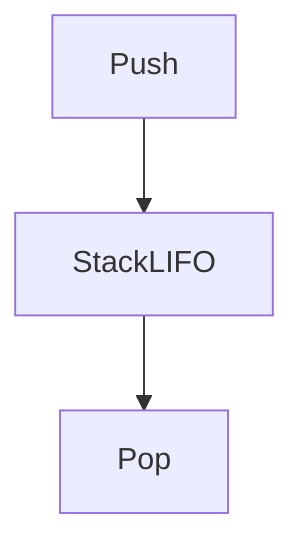

# D02-T005 — Stacks and queues

Topic ID: `D02-T005`
Domain: Data Structures and Algorithms
Subdomain: Stacks and queues
Importance: core
Complexity: intermediate
Dependencies: `D02-T004`, `D02-T001`, `D01-T001`, `D01-T002`
Execution status of the code in section F: unexecuted

## A. Topic Overview

Stacks model nested calls and backtracking. Queues model fair waiting lines and BFS frontiers. Backend services use both for rate limiting windows, task dispatch, and parsing.

Prerequisites: `D02-T004`, `D02-T001`, `D01-T001`, `D01-T002`. This topic supports `D02-T006` and later graph or systems topics.

## B. First-Principles Explanation

Restricting operations to one or two ends lets implementations use arrays with pointers without shifting middle elements.

Terms: **asymptotic cost, auxiliary space, input size n**.

## C. Internal Working and Architecture

Array-backed deque doubles capacity on growth. Linked implementation avoids resize spikes but allocates per node. BFS queue order determines level-by-level graph expansion.

Dominant time: O(1) amortized push/pop for stack; O(1) enqueue/dequeue with proper ring buffer. Dominant auxiliary space: O(n) stored elements.

## D. Diagrams and Visual Models



Last in is first out.

## E. Examples and Analogies

Matching parentheses uses a stack O(n). Printer job queue is FIFO. Call stack depth limits recursion depth in languages.

Edge cases: Empty pop, queue size unbounded under spike, concurrent queue needs locks or MPMC structure.

## F. Code Examples

File: `examples/d02_t005_stack.py`

Dependencies: Python 3 standard library only.

```python
class Stack:
    def __init__(self):
        self._a: list[int] = []

    def push(self, x: int) -> None:
        self._a.append(x)

    def pop(self) -> int:
        if not self._a:
            raise IndexError("empty")
        return self._a.pop()


def balanced_parens(s: str) -> bool:
    st: list[str] = []
    pairs = {")": "(", "]": "[", "}": "{"}
    for ch in s:
        if ch in "([{":
            st.append(ch)
        elif ch in ")]}":
            if not st or st.pop() != pairs[ch]:
                return False
    return not st
```

How to run: `python examples/d02_t005_stack.py` from `EXERCISES/examples/`.

Expected output: `ok`

Stack ops amortized O(1). `balanced_parens` O(n) time O(n) space worst case.

## G. Practical Backend Application

Bound queue depth; drop or shed load when full. Use stack depth limits to prevent parser blow-up on nested JSON.

## H. Advantages, Limitations and Trade-offs

| Choice | Benefit | Cost | Choose when | Avoid when |
| --- | --- | --- | --- | --- |
| Array stack | Fast, simple | Growth copies | DFS, parsing | Thread-safe without sync |
| Ring buffer queue | O(1) FIFO | Fixed capacity | Metrics windows | Unbounded backlog |
| Linked queue | No resize spike | Pointer overhead | Rare | Hot path FIFO |

## I. Common Mistakes and Misconceptions

- Using recursion without depth guard.
- Unbounded in-memory queue on traffic spike.
- Popping empty without error handling.

## J. Debugging and Troubleshooting

OOM with stable QPS—queue never drains. Check consumer lag and depth metric.

## K. Interview Preparation

### Beginner

#### Q1. What problem does Stacks and queues solve in backend engineering?

**Answer:** Stacks are LIFO; queues are FIFO. Both restrict access to ends, enabling O(1) structural operations. For Stacks and queues, typical bounds are O(1) amortized push/pop for stack; O(1) enqueue/dequeue with proper ring buffer time and O(n) stored elements space. Request middleware stacks, undo buffers, and worker pools use these disciplines. Watch edge cases: pop from empty, unbounded queue memory, priority inversion not handled by basic queue.

#### Q2. How do you define input size n for stacks and queues?

**Answer:** Stacks are LIFO; queues are FIFO. Both restrict access to ends, enabling O(1) structural operations. For Stacks and queues, typical bounds are O(1) amortized push/pop for stack; O(1) enqueue/dequeue with proper ring buffer time and O(n) stored elements space. Request middleware stacks, undo buffers, and worker pools use these disciplines. Watch edge cases: pop from empty, unbounded queue memory, priority inversion not handled by basic queue.

#### Q3. What is the difference between time and space cost here?

**Answer:** Stacks are LIFO; queues are FIFO. Both restrict access to ends, enabling O(1) structural operations. For Stacks and queues, typical bounds are O(1) amortized push/pop for stack; O(1) enqueue/dequeue with proper ring buffer time and O(n) stored elements space. Request middleware stacks, undo buffers, and worker pools use these disciplines. Watch edge cases: pop from empty, unbounded queue memory, priority inversion not handled by basic queue.

#### Q4. Why do we ignore constant factors in asymptotic notation for this topic?

**Answer:** Stacks are LIFO; queues are FIFO. Both restrict access to ends, enabling O(1) structural operations. For Stacks and queues, typical bounds are O(1) amortized push/pop for stack; O(1) enqueue/dequeue with proper ring buffer time and O(n) stored elements space. Request middleware stacks, undo buffers, and worker pools use these disciplines. Watch edge cases: pop from empty, unbounded queue memory, priority inversion not handled by basic queue.

#### Q5. Name one operation that is cheap and one that is expensive in this structure.

**Answer:** Stacks are LIFO; queues are FIFO. Both restrict access to ends, enabling O(1) structural operations. For Stacks and queues, typical bounds are O(1) amortized push/pop for stack; O(1) enqueue/dequeue with proper ring buffer time and O(n) stored elements space. Request middleware stacks, undo buffers, and worker pools use these disciplines. Watch edge cases: pop from empty, unbounded queue memory, priority inversion not handled by basic queue.

### Intermediate

#### Q1. State the average and worst-case complexity for the main operations.

**Answer:** Stacks are LIFO; queues are FIFO. Both restrict access to ends, enabling O(1) structural operations. For Stacks and queues, typical bounds are O(1) amortized push/pop for stack; O(1) enqueue/dequeue with proper ring buffer time and O(n) stored elements space. Request middleware stacks, undo buffers, and worker pools use these disciplines. Watch edge cases: pop from empty, unbounded queue memory, priority inversion not handled by basic queue.

#### Q2. How would you justify choosing this structure in a design review?

**Answer:** Stacks are LIFO; queues are FIFO. Both restrict access to ends, enabling O(1) structural operations. For Stacks and queues, typical bounds are O(1) amortized push/pop for stack; O(1) enqueue/dequeue with proper ring buffer time and O(n) stored elements space. Request middleware stacks, undo buffers, and worker pools use these disciplines. Watch edge cases: pop from empty, unbounded queue memory, priority inversion not handled by basic queue.

#### Q3. What changes if data no longer fits in memory?

**Answer:** Stacks are LIFO; queues are FIFO. Both restrict access to ends, enabling O(1) structural operations. For Stacks and queues, typical bounds are O(1) amortized push/pop for stack; O(1) enqueue/dequeue with proper ring buffer time and O(n) stored elements space. Request middleware stacks, undo buffers, and worker pools use these disciplines. Watch edge cases: pop from empty, unbounded queue memory, priority inversion not handled by basic queue.

#### Q4. How does concurrency affect the complexity story?

**Answer:** Stacks are LIFO; queues are FIFO. Both restrict access to ends, enabling O(1) structural operations. For Stacks and queues, typical bounds are O(1) amortized push/pop for stack; O(1) enqueue/dequeue with proper ring buffer time and O(n) stored elements space. Request middleware stacks, undo buffers, and worker pools use these disciplines. Watch edge cases: pop from empty, unbounded queue memory, priority inversion not handled by basic queue.

#### Q5. How do you test performance regressions for this component?

**Answer:** Stacks are LIFO; queues are FIFO. Both restrict access to ends, enabling O(1) structural operations. For Stacks and queues, typical bounds are O(1) amortized push/pop for stack; O(1) enqueue/dequeue with proper ring buffer time and O(n) stored elements space. Request middleware stacks, undo buffers, and worker pools use these disciplines. Watch edge cases: pop from empty, unbounded queue memory, priority inversion not handled by basic queue.

### Advanced

#### Q1. When is the 'textbook' complexity misleading in production?

**Answer:** Stacks are LIFO; queues are FIFO. Both restrict access to ends, enabling O(1) structural operations. For Stacks and queues, typical bounds are O(1) amortized push/pop for stack; O(1) enqueue/dequeue with proper ring buffer time and O(n) stored elements space. Request middleware stacks, undo buffers, and worker pools use these disciplines. Watch edge cases: pop from empty, unbounded queue memory, priority inversion not handled by basic queue.

#### Q2. How do cache locality and allocation affect real runtime?

**Answer:** Stacks are LIFO; queues are FIFO. Both restrict access to ends, enabling O(1) structural operations. For Stacks and queues, typical bounds are O(1) amortized push/pop for stack; O(1) enqueue/dequeue with proper ring buffer time and O(n) stored elements space. Request middleware stacks, undo buffers, and worker pools use these disciplines. Watch edge cases: pop from empty, unbounded queue memory, priority inversion not handled by basic queue.

#### Q3. Compare this approach to the next topic in the curriculum.

**Answer:** Stacks are LIFO; queues are FIFO. Both restrict access to ends, enabling O(1) structural operations. For Stacks and queues, typical bounds are O(1) amortized push/pop for stack; O(1) enqueue/dequeue with proper ring buffer time and O(n) stored elements space. Request middleware stacks, undo buffers, and worker pools use these disciplines. Watch edge cases: pop from empty, unbounded queue memory, priority inversion not handled by basic queue.

#### Q4. What security or abuse patterns change effective n?

**Answer:** Stacks are LIFO; queues are FIFO. Both restrict access to ends, enabling O(1) structural operations. For Stacks and queues, typical bounds are O(1) amortized push/pop for stack; O(1) enqueue/dequeue with proper ring buffer time and O(n) stored elements space. Request middleware stacks, undo buffers, and worker pools use these disciplines. Watch edge cases: pop from empty, unbounded queue memory, priority inversion not handled by basic queue.

#### Q5. How would you document complexity in an OpenAPI or ADR?

**Answer:** Stacks are LIFO; queues are FIFO. Both restrict access to ends, enabling O(1) structural operations. For Stacks and queues, typical bounds are O(1) amortized push/pop for stack; O(1) enqueue/dequeue with proper ring buffer time and O(n) stored elements space. Request middleware stacks, undo buffers, and worker pools use these disciplines. Watch edge cases: pop from empty, unbounded queue memory, priority inversion not handled by basic queue.

### Scenarios

#### Q1. Latency spikes when traffic doubles but CPU is only 60%. What do you measure first?

**Answer:** Stacks are LIFO; queues are FIFO. Both restrict access to ends, enabling O(1) structural operations. For Stacks and queues, typical bounds are O(1) amortized push/pop for stack; O(1) enqueue/dequeue with proper ring buffer time and O(n) stored elements space. Request middleware stacks, undo buffers, and worker pools use these disciplines. Watch edge cases: pop from empty, unbounded queue memory, priority inversion not handled by basic queue.

#### Q2. A batch job OOMs on a larger tenant. Which space term grew?

**Answer:** Stacks are LIFO; queues are FIFO. Both restrict access to ends, enabling O(1) structural operations. For Stacks and queues, typical bounds are O(1) amortized push/pop for stack; O(1) enqueue/dequeue with proper ring buffer time and O(n) stored elements space. Request middleware stacks, undo buffers, and worker pools use these disciplines. Watch edge cases: pop from empty, unbounded queue memory, priority inversion not handled by basic queue.

#### Q3. Two services disagree on timeout budgets for the same endpoint.

**Answer:** Stacks are LIFO; queues are FIFO. Both restrict access to ends, enabling O(1) structural operations. For Stacks and queues, typical bounds are O(1) amortized push/pop for stack; O(1) enqueue/dequeue with proper ring buffer time and O(n) stored elements space. Request middleware stacks, undo buffers, and worker pools use these disciplines. Watch edge cases: pop from empty, unbounded queue memory, priority inversion not handled by basic queue.

#### Q4. An attacker sends inputs that trigger worst-case behavior.

**Answer:** Stacks are LIFO; queues are FIFO. Both restrict access to ends, enabling O(1) structural operations. For Stacks and queues, typical bounds are O(1) amortized push/pop for stack; O(1) enqueue/dequeue with proper ring buffer time and O(n) stored elements space. Request middleware stacks, undo buffers, and worker pools use these disciplines. Watch edge cases: pop from empty, unbounded queue memory, priority inversion not handled by basic queue.

#### Q5. You must shave 100ms off a hot path without new hardware.

**Answer:** Stacks are LIFO; queues are FIFO. Both restrict access to ends, enabling O(1) structural operations. For Stacks and queues, typical bounds are O(1) amortized push/pop for stack; O(1) enqueue/dequeue with proper ring buffer time and O(n) stored elements space. Request middleware stacks, undo buffers, and worker pools use these disciplines. Watch edge cases: pop from empty, unbounded queue memory, priority inversion not handled by basic queue.

### Follow-ups

#### Q1. How does this connect to database indexing?

**Answer:** Stacks are LIFO; queues are FIFO. Both restrict access to ends, enabling O(1) structural operations. For Stacks and queues, typical bounds are O(1) amortized push/pop for stack; O(1) enqueue/dequeue with proper ring buffer time and O(n) stored elements space. Request middleware stacks, undo buffers, and worker pools use these disciplines. Watch edge cases: pop from empty, unbounded queue memory, priority inversion not handled by basic queue.

#### Q2. How does this connect to caching layers?

**Answer:** Stacks are LIFO; queues are FIFO. Both restrict access to ends, enabling O(1) structural operations. For Stacks and queues, typical bounds are O(1) amortized push/pop for stack; O(1) enqueue/dequeue with proper ring buffer time and O(n) stored elements space. Request middleware stacks, undo buffers, and worker pools use these disciplines. Watch edge cases: pop from empty, unbounded queue memory, priority inversion not handled by basic queue.

#### Q3. What monitoring proves your complexity assumption?

**Answer:** Stacks are LIFO; queues are FIFO. Both restrict access to ends, enabling O(1) structural operations. For Stacks and queues, typical bounds are O(1) amortized push/pop for stack; O(1) enqueue/dequeue with proper ring buffer time and O(n) stored elements space. Request middleware stacks, undo buffers, and worker pools use these disciplines. Watch edge cases: pop from empty, unbounded queue memory, priority inversion not handled by basic queue.

## L. Practical Exercises

Solutions are in `EXERCISES/solutions/D02-T005.md`. Try these before opening that file.

### Exercise 1 — implementation

Implement `balanced_parens` and stack with empty-pop error. Acceptance: stack raises on empty pop; paren checker O(n) time.

### Exercise 2 — debugging

Worker queue grows unbounded during outage—mitigations? Acceptance: bounded queue, drop policy, backpressure, dead-letter.

### Exercise 3 — trade-off

Stack versus queue for retry ordering (LIFO vs FIFO). Acceptance: FIFO fairness vs LIFO stack depth for nested retries.

## M. Revision Notes

- LIFO vs FIFO.
- O(1) ends.
- Bound depth in prod.

## N. Related Topics

Understand this before: `D02-T004`, `D02-T001`, `D01-T001`, `D01-T002`.

This topic supports: `D02-T006`.

Often confused with: deque versus queue interface.

Interviewers combine this with `D02-T011`, `D13-T006`.

## O. Completion Criteria

- Implement paren check.
- Explain BFS queue role.
- Design bounded worker queue.
