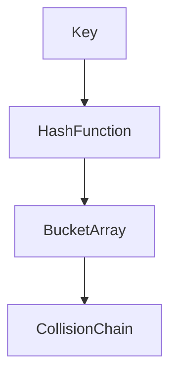

# D02-T006 — Hash maps and hash sets

Topic ID: `D02-T006`
Domain: Data Structures and Algorithms
Subdomain: Hash maps and hash sets
Importance: core
Complexity: intermediate
Dependencies: `D02-T005`, `D02-T001`, `D01-T001`, `D01-T002`
Execution status of the code in section F: unexecuted

## A. Topic Overview

Hash maps give expected constant-time membership and update, which is why they back most in-memory indexes. Interviews probe average versus worst case and what makes a key hashable.

Prerequisites: `D02-T005`, `D02-T001`, `D01-T001`, `D01-T002`. This topic supports `D02-T007` and later graph or systems topics.

## B. First-Principles Explanation

Hash compresses key to integer; modulo bucket count picks slot. Collisions chain or open-address. Load factor triggers grow and rehash.

Terms: **asymptotic cost, auxiliary space, input size n**.

## C. Internal Working and Architecture

Python dicts are highly optimized open addressing. Java HashMap resizes at load threshold. Concurrent maps use striping or lock-free bins.

Dominant time: O(1) average insert/lookup; O(n) worst case under heavy collisions or rehash. Dominant auxiliary space: O(n) buckets and entries.

## D. Diagrams and Visual Models



Collisions keep correctness; they hurt worst-case time.

## E. Examples and Analogies

Dedup event ids in a request batch with a set O(n) expected. Count API keys per minute with a map.

Edge cases: All keys collide adversarially, non-hashable list as key, iteration order change on resize.

## F. Code Examples

File: `examples/d02_t006_hashmap.py`

```python
def two_sum(nums: list[int], target: int) -> tuple[int, int] | None:
    seen: dict[int, int] = {}
    for i, v in enumerate(nums):
        need = target - v
        if need in seen:
            return seen[need], i
        seen[v] = i
    return None
```

How to run: `python examples/d02_t006_hashmap.py` from `EXERCISES/examples/`.

Expected output: `ok`

Single pass O(n) time, O(n) space. Lookup/insert average O(1).

## G. Practical Backend Application

Choose stable hash keys (ids as strings/int). Shard maps by tenant for memory. Watch rehash GC pauses on large maps.

## H. Advantages, Limitations and Trade-offs

| Choice | Benefit | Cost | Choose when | Avoid when |
| --- | --- | --- | --- | --- |
| Hash map | Fast lookups | Memory, worst collisions | Id indexes | Ordered traversal need |
| Tree map | O(log n) guaranteed | Slower | Ordered ranges | Pure speed |
| DB index | Persistent | Disk latency | Large data | Tiny hot set |

## I. Common Mistakes and Misconceptions

- Mutating a key after insert.
- Assuming O(1) without hash quality.
- Storing unbounded keys from clients.

## J. Debugging and Troubleshooting

Spiky latency on map grow—log size and resize events. Collision attacks—use random seed per process.

## K. Interview Preparation

### Beginner

#### Q1. What problem does Hash maps and hash sets solve in backend engineering?

**Answer:** Hash functions map keys to buckets; equality resolves collisions. Sets are maps without values. For Hash maps and hash sets, typical bounds are O(1) average insert/lookup; O(n) worst case under heavy collisions or rehash time and O(n) buckets and entries space. Indexes for id lookups, deduplication, rate-limit counters, and session tables rely on hash tables. Watch edge cases: mutable keys, poor hash on user strings, rehash pause, concurrent resize.

#### Q2. How do you define input size n for hash maps and hash sets?

**Answer:** Hash functions map keys to buckets; equality resolves collisions. Sets are maps without values. For Hash maps and hash sets, typical bounds are O(1) average insert/lookup; O(n) worst case under heavy collisions or rehash time and O(n) buckets and entries space. Indexes for id lookups, deduplication, rate-limit counters, and session tables rely on hash tables. Watch edge cases: mutable keys, poor hash on user strings, rehash pause, concurrent resize.

#### Q3. What is the difference between time and space cost here?

**Answer:** Hash functions map keys to buckets; equality resolves collisions. Sets are maps without values. For Hash maps and hash sets, typical bounds are O(1) average insert/lookup; O(n) worst case under heavy collisions or rehash time and O(n) buckets and entries space. Indexes for id lookups, deduplication, rate-limit counters, and session tables rely on hash tables. Watch edge cases: mutable keys, poor hash on user strings, rehash pause, concurrent resize.

#### Q4. Why do we ignore constant factors in asymptotic notation for this topic?

**Answer:** Hash functions map keys to buckets; equality resolves collisions. Sets are maps without values. For Hash maps and hash sets, typical bounds are O(1) average insert/lookup; O(n) worst case under heavy collisions or rehash time and O(n) buckets and entries space. Indexes for id lookups, deduplication, rate-limit counters, and session tables rely on hash tables. Watch edge cases: mutable keys, poor hash on user strings, rehash pause, concurrent resize.

#### Q5. Name one operation that is cheap and one that is expensive in this structure.

**Answer:** Hash functions map keys to buckets; equality resolves collisions. Sets are maps without values. For Hash maps and hash sets, typical bounds are O(1) average insert/lookup; O(n) worst case under heavy collisions or rehash time and O(n) buckets and entries space. Indexes for id lookups, deduplication, rate-limit counters, and session tables rely on hash tables. Watch edge cases: mutable keys, poor hash on user strings, rehash pause, concurrent resize.

### Intermediate

#### Q1. State the average and worst-case complexity for the main operations.

**Answer:** Hash functions map keys to buckets; equality resolves collisions. Sets are maps without values. For Hash maps and hash sets, typical bounds are O(1) average insert/lookup; O(n) worst case under heavy collisions or rehash time and O(n) buckets and entries space. Indexes for id lookups, deduplication, rate-limit counters, and session tables rely on hash tables. Watch edge cases: mutable keys, poor hash on user strings, rehash pause, concurrent resize.

#### Q2. How would you justify choosing this structure in a design review?

**Answer:** Hash functions map keys to buckets; equality resolves collisions. Sets are maps without values. For Hash maps and hash sets, typical bounds are O(1) average insert/lookup; O(n) worst case under heavy collisions or rehash time and O(n) buckets and entries space. Indexes for id lookups, deduplication, rate-limit counters, and session tables rely on hash tables. Watch edge cases: mutable keys, poor hash on user strings, rehash pause, concurrent resize.

#### Q3. What changes if data no longer fits in memory?

**Answer:** Hash functions map keys to buckets; equality resolves collisions. Sets are maps without values. For Hash maps and hash sets, typical bounds are O(1) average insert/lookup; O(n) worst case under heavy collisions or rehash time and O(n) buckets and entries space. Indexes for id lookups, deduplication, rate-limit counters, and session tables rely on hash tables. Watch edge cases: mutable keys, poor hash on user strings, rehash pause, concurrent resize.

#### Q4. How does concurrency affect the complexity story?

**Answer:** Hash functions map keys to buckets; equality resolves collisions. Sets are maps without values. For Hash maps and hash sets, typical bounds are O(1) average insert/lookup; O(n) worst case under heavy collisions or rehash time and O(n) buckets and entries space. Indexes for id lookups, deduplication, rate-limit counters, and session tables rely on hash tables. Watch edge cases: mutable keys, poor hash on user strings, rehash pause, concurrent resize.

#### Q5. How do you test performance regressions for this component?

**Answer:** Hash functions map keys to buckets; equality resolves collisions. Sets are maps without values. For Hash maps and hash sets, typical bounds are O(1) average insert/lookup; O(n) worst case under heavy collisions or rehash time and O(n) buckets and entries space. Indexes for id lookups, deduplication, rate-limit counters, and session tables rely on hash tables. Watch edge cases: mutable keys, poor hash on user strings, rehash pause, concurrent resize.

### Advanced

#### Q1. When is the 'textbook' complexity misleading in production?

**Answer:** Hash functions map keys to buckets; equality resolves collisions. Sets are maps without values. For Hash maps and hash sets, typical bounds are O(1) average insert/lookup; O(n) worst case under heavy collisions or rehash time and O(n) buckets and entries space. Indexes for id lookups, deduplication, rate-limit counters, and session tables rely on hash tables. Watch edge cases: mutable keys, poor hash on user strings, rehash pause, concurrent resize.

#### Q2. How do cache locality and allocation affect real runtime?

**Answer:** Hash functions map keys to buckets; equality resolves collisions. Sets are maps without values. For Hash maps and hash sets, typical bounds are O(1) average insert/lookup; O(n) worst case under heavy collisions or rehash time and O(n) buckets and entries space. Indexes for id lookups, deduplication, rate-limit counters, and session tables rely on hash tables. Watch edge cases: mutable keys, poor hash on user strings, rehash pause, concurrent resize.

#### Q3. Compare this approach to the next topic in the curriculum.

**Answer:** Hash functions map keys to buckets; equality resolves collisions. Sets are maps without values. For Hash maps and hash sets, typical bounds are O(1) average insert/lookup; O(n) worst case under heavy collisions or rehash time and O(n) buckets and entries space. Indexes for id lookups, deduplication, rate-limit counters, and session tables rely on hash tables. Watch edge cases: mutable keys, poor hash on user strings, rehash pause, concurrent resize.

#### Q4. What security or abuse patterns change effective n?

**Answer:** Hash functions map keys to buckets; equality resolves collisions. Sets are maps without values. For Hash maps and hash sets, typical bounds are O(1) average insert/lookup; O(n) worst case under heavy collisions or rehash time and O(n) buckets and entries space. Indexes for id lookups, deduplication, rate-limit counters, and session tables rely on hash tables. Watch edge cases: mutable keys, poor hash on user strings, rehash pause, concurrent resize.

#### Q5. How would you document complexity in an OpenAPI or ADR?

**Answer:** Hash functions map keys to buckets; equality resolves collisions. Sets are maps without values. For Hash maps and hash sets, typical bounds are O(1) average insert/lookup; O(n) worst case under heavy collisions or rehash time and O(n) buckets and entries space. Indexes for id lookups, deduplication, rate-limit counters, and session tables rely on hash tables. Watch edge cases: mutable keys, poor hash on user strings, rehash pause, concurrent resize.

### Scenarios

#### Q1. Latency spikes when traffic doubles but CPU is only 60%. What do you measure first?

**Answer:** Hash functions map keys to buckets; equality resolves collisions. Sets are maps without values. For Hash maps and hash sets, typical bounds are O(1) average insert/lookup; O(n) worst case under heavy collisions or rehash time and O(n) buckets and entries space. Indexes for id lookups, deduplication, rate-limit counters, and session tables rely on hash tables. Watch edge cases: mutable keys, poor hash on user strings, rehash pause, concurrent resize.

#### Q2. A batch job OOMs on a larger tenant. Which space term grew?

**Answer:** Hash functions map keys to buckets; equality resolves collisions. Sets are maps without values. For Hash maps and hash sets, typical bounds are O(1) average insert/lookup; O(n) worst case under heavy collisions or rehash time and O(n) buckets and entries space. Indexes for id lookups, deduplication, rate-limit counters, and session tables rely on hash tables. Watch edge cases: mutable keys, poor hash on user strings, rehash pause, concurrent resize.

#### Q3. Two services disagree on timeout budgets for the same endpoint.

**Answer:** Hash functions map keys to buckets; equality resolves collisions. Sets are maps without values. For Hash maps and hash sets, typical bounds are O(1) average insert/lookup; O(n) worst case under heavy collisions or rehash time and O(n) buckets and entries space. Indexes for id lookups, deduplication, rate-limit counters, and session tables rely on hash tables. Watch edge cases: mutable keys, poor hash on user strings, rehash pause, concurrent resize.

#### Q4. An attacker sends inputs that trigger worst-case behavior.

**Answer:** Hash functions map keys to buckets; equality resolves collisions. Sets are maps without values. For Hash maps and hash sets, typical bounds are O(1) average insert/lookup; O(n) worst case under heavy collisions or rehash time and O(n) buckets and entries space. Indexes for id lookups, deduplication, rate-limit counters, and session tables rely on hash tables. Watch edge cases: mutable keys, poor hash on user strings, rehash pause, concurrent resize.

#### Q5. You must shave 100ms off a hot path without new hardware.

**Answer:** Hash functions map keys to buckets; equality resolves collisions. Sets are maps without values. For Hash maps and hash sets, typical bounds are O(1) average insert/lookup; O(n) worst case under heavy collisions or rehash time and O(n) buckets and entries space. Indexes for id lookups, deduplication, rate-limit counters, and session tables rely on hash tables. Watch edge cases: mutable keys, poor hash on user strings, rehash pause, concurrent resize.

### Follow-ups

#### Q1. How does this connect to database indexing?

**Answer:** Hash functions map keys to buckets; equality resolves collisions. Sets are maps without values. For Hash maps and hash sets, typical bounds are O(1) average insert/lookup; O(n) worst case under heavy collisions or rehash time and O(n) buckets and entries space. Indexes for id lookups, deduplication, rate-limit counters, and session tables rely on hash tables. Watch edge cases: mutable keys, poor hash on user strings, rehash pause, concurrent resize.

#### Q2. How does this connect to caching layers?

**Answer:** Hash functions map keys to buckets; equality resolves collisions. Sets are maps without values. For Hash maps and hash sets, typical bounds are O(1) average insert/lookup; O(n) worst case under heavy collisions or rehash time and O(n) buckets and entries space. Indexes for id lookups, deduplication, rate-limit counters, and session tables rely on hash tables. Watch edge cases: mutable keys, poor hash on user strings, rehash pause, concurrent resize.

#### Q3. What monitoring proves your complexity assumption?

**Answer:** Hash functions map keys to buckets; equality resolves collisions. Sets are maps without values. For Hash maps and hash sets, typical bounds are O(1) average insert/lookup; O(n) worst case under heavy collisions or rehash time and O(n) buckets and entries space. Indexes for id lookups, deduplication, rate-limit counters, and session tables rely on hash tables. Watch edge cases: mutable keys, poor hash on user strings, rehash pause, concurrent resize.

## L. Practical Exercises

Solutions are in `EXERCISES/solutions/D02-T006.md`.

### Exercise 1 — implementation

Implement `two_sum` and explain average-case bounds. Acceptance: O(n) time, O(n) space; average O(1) map ops.

### Exercise 2 — debugging

CPU spike when inserting attacker-controlled strings—cause? Acceptance: hash flooding/collision degradation; mitigation salted hash or tree fallback.

### Exercise 3 — trade-off

In-memory map versus Redis for session store at 1M users. Acceptance: memory per node, eviction, persistence, network hop.

## M. Revision Notes

- Average O(1), worst O(n).
- Keys must be hashable/stable.
- Rehash cost.

## N. Related Topics

Understand this before: `D02-T005`, `D02-T001`, `D01-T001`, `D01-T002`.

This topic supports: `D02-T007`.

Often confused with: hash map versus B-tree index.

Interviewers combine this with `D02-T003`, `D07-T002`.

## O. Completion Criteria

- Implement two-sum.
- Explain collision impact.
- Size session map memory.
