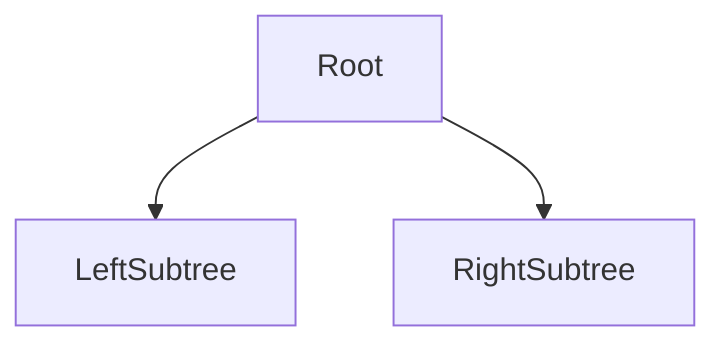

# D02-T007 — Trees and binary search trees

Topic ID: `D02-T007`
Domain: Data Structures and Algorithms
Subdomain: Trees and binary search trees
Importance: core
Complexity: intermediate
Dependencies: `D02-T006`, `D02-T001`, `D01-T001`, `D01-T002`
Execution status of the code in section F: unexecuted

## A. Topic Overview

Trees represent hierarchical and ordered data. BSTs support search, insert, and delete in time proportional to height. Balance (AVL, red-black) keeps height O(log n).

Prerequisites: `D02-T006`, `D02-T001`, `D01-T001`, `D01-T002`. This topic supports `D02-T008`.

## B. First-Principles Explanation

Each node branches; recursion or stack walks subtrees. BST invariant lets you discard half the tree per comparison when balanced.

Terms: **asymptotic cost, auxiliary space, input size n**.

## C. Internal Working and Architecture

Rotations restore balance after insert/delete. B-trees widen nodes for disk pages. Trie is not a BST but shares pointer structure.

Dominant time: O(log n) balanced BST ops; O(n) skewed height. Dominant auxiliary space: O(n) nodes; O(log n) stack for recursive traversal.

## D. Diagrams and Visual Models



Height determines search cost.

## E. Examples and Analogies

Filesystem paths are trees. Priority scheduling sometimes uses tree maps for ordered keys.

Edge cases: Sorted ascending insert into plain BST becomes linked list height n.

## F. Code Examples

File: `examples/d02_t007_bst.py`

```python
class BSTNode:
    def __init__(self, key: int):
        self.key = key
        self.left = None
        self.right = None


def insert(root: BSTNode | None, key: int) -> BSTNode:
    if root is None:
        return BSTNode(key)
    if key < root.key:
        root.left = insert(root.left, key)
    elif key > root.key:
        root.right = insert(root.right, key)
    return root


def search(root: BSTNode | None, key: int) -> bool:
    cur = root
    while cur:
        if key == cur.key:
            return True
        cur = cur.left if key < cur.key else cur.right
    return False
```

Insert/search O(h); O(log n) if balanced, O(n) if skewed.

## G. Practical Backend Application

Prefer library balanced trees or DB indexes instead of hand-rolled BST in services.

## H. Advantages, Limitations and Trade-offs

| Choice | Benefit | Cost | Choose when | Avoid when |
| --- | --- | --- | --- | --- |
| Plain BST | Simple | Skew risk | Teaching | Adversarial insert |
| Balanced BST | O(log n) ops | Rotation cost | Ordered map | O(1) needs |
| B-tree | Disk-friendly | Complex | Databases | Pure RAM tiny n |

## I. Common Mistakes and Misconceptions

- Assuming BST is always log n.
- Ignoring duplicate key rules.
- Deep recursion without stack guard.

## J. Debugging and Troubleshooting

Latency grows with table size though RAM fits—check index balance stats in DB.

## K. Interview Preparation

### Beginner

#### Q1. What problem does Trees and binary search trees solve in backend engineering?

**Answer:** BST property: left < node < right enables ordered search if height stays logarithmic. For Trees and binary search trees, typical bounds are O(log n) balanced BST ops; O(n) skewed height time and O(n) nodes; O(log n) stack for recursive traversal space. In-memory ordered indexes, interval trees for scheduling, and database B-trees are production tree variants. Watch edge cases: duplicate keys policy, unbalanced insert order, null children.

#### Q2. How do you define input size n for trees and binary search trees?

**Answer:** BST property: left < node < right enables ordered search if height stays logarithmic. For Trees and binary search trees, typical bounds are O(log n) balanced BST ops; O(n) skewed height time and O(n) nodes; O(log n) stack for recursive traversal space. In-memory ordered indexes, interval trees for scheduling, and database B-trees are production tree variants. Watch edge cases: duplicate keys policy, unbalanced insert order, null children.

#### Q3. What is the difference between time and space cost here?

**Answer:** BST property: left < node < right enables ordered search if height stays logarithmic. For Trees and binary search trees, typical bounds are O(log n) balanced BST ops; O(n) skewed height time and O(n) nodes; O(log n) stack for recursive traversal space. In-memory ordered indexes, interval trees for scheduling, and database B-trees are production tree variants. Watch edge cases: duplicate keys policy, unbalanced insert order, null children.

#### Q4. Why do we ignore constant factors in asymptotic notation for this topic?

**Answer:** BST property: left < node < right enables ordered search if height stays logarithmic. For Trees and binary search trees, typical bounds are O(log n) balanced BST ops; O(n) skewed height time and O(n) nodes; O(log n) stack for recursive traversal space. In-memory ordered indexes, interval trees for scheduling, and database B-trees are production tree variants. Watch edge cases: duplicate keys policy, unbalanced insert order, null children.

#### Q5. Name one operation that is cheap and one that is expensive in this structure.

**Answer:** BST property: left < node < right enables ordered search if height stays logarithmic. For Trees and binary search trees, typical bounds are O(log n) balanced BST ops; O(n) skewed height time and O(n) nodes; O(log n) stack for recursive traversal space. In-memory ordered indexes, interval trees for scheduling, and database B-trees are production tree variants. Watch edge cases: duplicate keys policy, unbalanced insert order, null children.

### Intermediate

#### Q1. State the average and worst-case complexity for the main operations.

**Answer:** BST property: left < node < right enables ordered search if height stays logarithmic. For Trees and binary search trees, typical bounds are O(log n) balanced BST ops; O(n) skewed height time and O(n) nodes; O(log n) stack for recursive traversal space. In-memory ordered indexes, interval trees for scheduling, and database B-trees are production tree variants. Watch edge cases: duplicate keys policy, unbalanced insert order, null children.

#### Q2. How would you justify choosing this structure in a design review?

**Answer:** BST property: left < node < right enables ordered search if height stays logarithmic. For Trees and binary search trees, typical bounds are O(log n) balanced BST ops; O(n) skewed height time and O(n) nodes; O(log n) stack for recursive traversal space. In-memory ordered indexes, interval trees for scheduling, and database B-trees are production tree variants. Watch edge cases: duplicate keys policy, unbalanced insert order, null children.

#### Q3. What changes if data no longer fits in memory?

**Answer:** BST property: left < node < right enables ordered search if height stays logarithmic. For Trees and binary search trees, typical bounds are O(log n) balanced BST ops; O(n) skewed height time and O(n) nodes; O(log n) stack for recursive traversal space. In-memory ordered indexes, interval trees for scheduling, and database B-trees are production tree variants. Watch edge cases: duplicate keys policy, unbalanced insert order, null children.

#### Q4. How does concurrency affect the complexity story?

**Answer:** BST property: left < node < right enables ordered search if height stays logarithmic. For Trees and binary search trees, typical bounds are O(log n) balanced BST ops; O(n) skewed height time and O(n) nodes; O(log n) stack for recursive traversal space. In-memory ordered indexes, interval trees for scheduling, and database B-trees are production tree variants. Watch edge cases: duplicate keys policy, unbalanced insert order, null children.

#### Q5. How do you test performance regressions for this component?

**Answer:** BST property: left < node < right enables ordered search if height stays logarithmic. For Trees and binary search trees, typical bounds are O(log n) balanced BST ops; O(n) skewed height time and O(n) nodes; O(log n) stack for recursive traversal space. In-memory ordered indexes, interval trees for scheduling, and database B-trees are production tree variants. Watch edge cases: duplicate keys policy, unbalanced insert order, null children.

### Advanced

#### Q1. When is the 'textbook' complexity misleading in production?

**Answer:** BST property: left < node < right enables ordered search if height stays logarithmic. For Trees and binary search trees, typical bounds are O(log n) balanced BST ops; O(n) skewed height time and O(n) nodes; O(log n) stack for recursive traversal space. In-memory ordered indexes, interval trees for scheduling, and database B-trees are production tree variants. Watch edge cases: duplicate keys policy, unbalanced insert order, null children.

#### Q2. How do cache locality and allocation affect real runtime?

**Answer:** BST property: left < node < right enables ordered search if height stays logarithmic. For Trees and binary search trees, typical bounds are O(log n) balanced BST ops; O(n) skewed height time and O(n) nodes; O(log n) stack for recursive traversal space. In-memory ordered indexes, interval trees for scheduling, and database B-trees are production tree variants. Watch edge cases: duplicate keys policy, unbalanced insert order, null children.

#### Q3. Compare this approach to the next topic in the curriculum.

**Answer:** BST property: left < node < right enables ordered search if height stays logarithmic. For Trees and binary search trees, typical bounds are O(log n) balanced BST ops; O(n) skewed height time and O(n) nodes; O(log n) stack for recursive traversal space. In-memory ordered indexes, interval trees for scheduling, and database B-trees are production tree variants. Watch edge cases: duplicate keys policy, unbalanced insert order, null children.

#### Q4. What security or abuse patterns change effective n?

**Answer:** BST property: left < node < right enables ordered search if height stays logarithmic. For Trees and binary search trees, typical bounds are O(log n) balanced BST ops; O(n) skewed height time and O(n) nodes; O(log n) stack for recursive traversal space. In-memory ordered indexes, interval trees for scheduling, and database B-trees are production tree variants. Watch edge cases: duplicate keys policy, unbalanced insert order, null children.

#### Q5. How would you document complexity in an OpenAPI or ADR?

**Answer:** BST property: left < node < right enables ordered search if height stays logarithmic. For Trees and binary search trees, typical bounds are O(log n) balanced BST ops; O(n) skewed height time and O(n) nodes; O(log n) stack for recursive traversal space. In-memory ordered indexes, interval trees for scheduling, and database B-trees are production tree variants. Watch edge cases: duplicate keys policy, unbalanced insert order, null children.

### Scenarios

#### Q1. Latency spikes when traffic doubles but CPU is only 60%. What do you measure first?

**Answer:** BST property: left < node < right enables ordered search if height stays logarithmic. For Trees and binary search trees, typical bounds are O(log n) balanced BST ops; O(n) skewed height time and O(n) nodes; O(log n) stack for recursive traversal space. In-memory ordered indexes, interval trees for scheduling, and database B-trees are production tree variants. Watch edge cases: duplicate keys policy, unbalanced insert order, null children.

#### Q2. A batch job OOMs on a larger tenant. Which space term grew?

**Answer:** BST property: left < node < right enables ordered search if height stays logarithmic. For Trees and binary search trees, typical bounds are O(log n) balanced BST ops; O(n) skewed height time and O(n) nodes; O(log n) stack for recursive traversal space. In-memory ordered indexes, interval trees for scheduling, and database B-trees are production tree variants. Watch edge cases: duplicate keys policy, unbalanced insert order, null children.

#### Q3. Two services disagree on timeout budgets for the same endpoint.

**Answer:** BST property: left < node < right enables ordered search if height stays logarithmic. For Trees and binary search trees, typical bounds are O(log n) balanced BST ops; O(n) skewed height time and O(n) nodes; O(log n) stack for recursive traversal space. In-memory ordered indexes, interval trees for scheduling, and database B-trees are production tree variants. Watch edge cases: duplicate keys policy, unbalanced insert order, null children.

#### Q4. An attacker sends inputs that trigger worst-case behavior.

**Answer:** BST property: left < node < right enables ordered search if height stays logarithmic. For Trees and binary search trees, typical bounds are O(log n) balanced BST ops; O(n) skewed height time and O(n) nodes; O(log n) stack for recursive traversal space. In-memory ordered indexes, interval trees for scheduling, and database B-trees are production tree variants. Watch edge cases: duplicate keys policy, unbalanced insert order, null children.

#### Q5. You must shave 100ms off a hot path without new hardware.

**Answer:** BST property: left < node < right enables ordered search if height stays logarithmic. For Trees and binary search trees, typical bounds are O(log n) balanced BST ops; O(n) skewed height time and O(n) nodes; O(log n) stack for recursive traversal space. In-memory ordered indexes, interval trees for scheduling, and database B-trees are production tree variants. Watch edge cases: duplicate keys policy, unbalanced insert order, null children.

### Follow-ups

#### Q1. How does this connect to database indexing?

**Answer:** BST property: left < node < right enables ordered search if height stays logarithmic. For Trees and binary search trees, typical bounds are O(log n) balanced BST ops; O(n) skewed height time and O(n) nodes; O(log n) stack for recursive traversal space. In-memory ordered indexes, interval trees for scheduling, and database B-trees are production tree variants. Watch edge cases: duplicate keys policy, unbalanced insert order, null children.

#### Q2. How does this connect to caching layers?

**Answer:** BST property: left < node < right enables ordered search if height stays logarithmic. For Trees and binary search trees, typical bounds are O(log n) balanced BST ops; O(n) skewed height time and O(n) nodes; O(log n) stack for recursive traversal space. In-memory ordered indexes, interval trees for scheduling, and database B-trees are production tree variants. Watch edge cases: duplicate keys policy, unbalanced insert order, null children.

#### Q3. What monitoring proves your complexity assumption?

**Answer:** BST property: left < node < right enables ordered search if height stays logarithmic. For Trees and binary search trees, typical bounds are O(log n) balanced BST ops; O(n) skewed height time and O(n) nodes; O(log n) stack for recursive traversal space. In-memory ordered indexes, interval trees for scheduling, and database B-trees are production tree variants. Watch edge cases: duplicate keys policy, unbalanced insert order, null children.

## L. Practical Exercises

Solutions: `EXERCISES/solutions/D02-T007.md`.

### Exercise 1 — implementation

Implement insert and search; state height dependence. Acceptance: O(h) documented; balanced vs skewed discussed.

### Exercise 2 — debugging

Sorted inserts kill performance—fix? Acceptance: shuffle, red-black/AVL, or use tree map library.

### Exercise 3 — trade-off

BST versus hash for range queries. Acceptance: tree in-order O(k+log n); hash cannot range cheaply.

## M. Revision Notes

- Height drives cost.
- Balance matters.
- DB B-tree is on disk.

## N. Related Topics

Supports `D02-T008`. Often confused with BST versus binary heap. See `D02-T008`, `D07-T002`.

## O. Completion Criteria

- Write BST search bounds.
- Explain skew.
- Pick structure for ranges.
