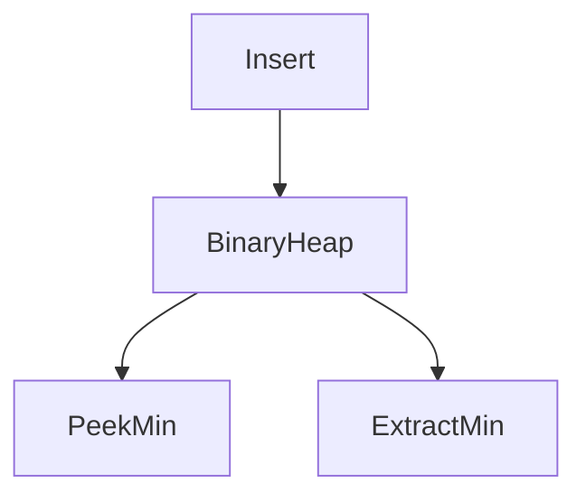

# D02-T008 — Heaps and priority queues

Topic ID: `D02-T008`
Domain: Data Structures and Algorithms
Subdomain: Heaps and priority queues
Importance: core
Complexity: intermediate
Dependencies: `D02-T007`, `D02-T001`, `D01-T001`, `D01-T002`
Execution status of the code in section F: unexecuted

## A. Topic Overview

Heaps retrieve the extreme element quickly while supporting dynamic insert. They underpin schedulers and many graph algorithms.

Prerequisites: `D02-T007`, `D02-T001`, `D01-T001`, `D01-T002`. This topic supports `D02-T009`.

## B. First-Principles Explanation

Parent compares with children; sift up on insert, sift down on extract. Index arithmetic maps tree to array without pointers.

## C. Internal Working and Architecture

`heapq` in Python is min-heap. Fibonacci heap improves theoretical decrease-key but rarely beats binary heap in practice.

Dominant time: O(log n) insert and extract-min/max; O(1) peek at root. Dominant auxiliary space: O(n) array-backed heap.

## D. Diagrams and Visual Models



Root holds the minimum in a min-heap.

## E. Examples and Analogies

Process retries with earliest deadline first. Merge k sorted log streams with a heap of size k.

Edge cases: Equal priorities arbitrary order, large k in k-way merge memory O(k).

## F. Code Examples

File: `examples/d02_t008_heap.py`

```python
import heapq


def k_smallest(nums: list[int], k: int) -> list[int]:
    h = nums[:k]
    heapq.heapify(h)
    for v in nums[k:]:
        if v > h[0]:
            heapq.heapreplace(h, v)
    return sorted(h)
```

Time O(n log k), space O(k). Each heap op O(log k).

## G. Practical Backend Application

Cap heap size for top-K metrics. Combine with TTL map to drop stale tasks.

## H. Advantages, Limitations and Trade-offs

| Choice | Benefit | Cost | Choose when | Avoid when |
| --- | --- | --- | --- | --- |
| Binary heap | Simple, fast | Not stable | Schedulers | Need stable sort |
| Sorted list | O(1) min if sorted | O(n) insert | Tiny sets | Dynamic n |
| Timing wheel | O(1) amortized timeouts | Approximate | Network timeouts | Exact ms ordering |

## I. Common Mistakes and Misconceptions

- Using sort O(n log n) when only top-k needed.
- Forgetting heap is not fully sorted.
- Unbounded priority queue.

## J. Debugging and Troubleshooting

Scheduler lag—compare heap size to worker throughput. Stale tasks—missing cancel.

## K. Interview Preparation

### Beginner

#### Q1. What problem does Heaps and priority queues solve in backend engineering?

**Answer:** A binary heap is a complete tree with heap order stored in an array; it implements priority queues. For Heaps and priority queues, typical bounds are O(log n) insert and extract-min/max; O(1) peek at root time and O(n) array-backed heap space. Task schedulers, timeout wheels, and Dijkstra frontier use heaps for 'best next' retrieval. Watch edge cases: tie-breaking stability, decrease-key optional, empty extract.

#### Q2. How do you define input size n for heaps and priority queues?

**Answer:** A binary heap is a complete tree with heap order stored in an array; it implements priority queues. For Heaps and priority queues, typical bounds are O(log n) insert and extract-min/max; O(1) peek at root time and O(n) array-backed heap space. Task schedulers, timeout wheels, and Dijkstra frontier use heaps for 'best next' retrieval. Watch edge cases: tie-breaking stability, decrease-key optional, empty extract.

#### Q3. What is the difference between time and space cost here?

**Answer:** A binary heap is a complete tree with heap order stored in an array; it implements priority queues. For Heaps and priority queues, typical bounds are O(log n) insert and extract-min/max; O(1) peek at root time and O(n) array-backed heap space. Task schedulers, timeout wheels, and Dijkstra frontier use heaps for 'best next' retrieval. Watch edge cases: tie-breaking stability, decrease-key optional, empty extract.

#### Q4. Why do we ignore constant factors in asymptotic notation for this topic?

**Answer:** A binary heap is a complete tree with heap order stored in an array; it implements priority queues. For Heaps and priority queues, typical bounds are O(log n) insert and extract-min/max; O(1) peek at root time and O(n) array-backed heap space. Task schedulers, timeout wheels, and Dijkstra frontier use heaps for 'best next' retrieval. Watch edge cases: tie-breaking stability, decrease-key optional, empty extract.

#### Q5. Name one operation that is cheap and one that is expensive in this structure.

**Answer:** A binary heap is a complete tree with heap order stored in an array; it implements priority queues. For Heaps and priority queues, typical bounds are O(log n) insert and extract-min/max; O(1) peek at root time and O(n) array-backed heap space. Task schedulers, timeout wheels, and Dijkstra frontier use heaps for 'best next' retrieval. Watch edge cases: tie-breaking stability, decrease-key optional, empty extract.

### Intermediate

#### Q1. State the average and worst-case complexity for the main operations.

**Answer:** A binary heap is a complete tree with heap order stored in an array; it implements priority queues. For Heaps and priority queues, typical bounds are O(log n) insert and extract-min/max; O(1) peek at root time and O(n) array-backed heap space. Task schedulers, timeout wheels, and Dijkstra frontier use heaps for 'best next' retrieval. Watch edge cases: tie-breaking stability, decrease-key optional, empty extract.

#### Q2. How would you justify choosing this structure in a design review?

**Answer:** A binary heap is a complete tree with heap order stored in an array; it implements priority queues. For Heaps and priority queues, typical bounds are O(log n) insert and extract-min/max; O(1) peek at root time and O(n) array-backed heap space. Task schedulers, timeout wheels, and Dijkstra frontier use heaps for 'best next' retrieval. Watch edge cases: tie-breaking stability, decrease-key optional, empty extract.

#### Q3. What changes if data no longer fits in memory?

**Answer:** A binary heap is a complete tree with heap order stored in an array; it implements priority queues. For Heaps and priority queues, typical bounds are O(log n) insert and extract-min/max; O(1) peek at root time and O(n) array-backed heap space. Task schedulers, timeout wheels, and Dijkstra frontier use heaps for 'best next' retrieval. Watch edge cases: tie-breaking stability, decrease-key optional, empty extract.

#### Q4. How does concurrency affect the complexity story?

**Answer:** A binary heap is a complete tree with heap order stored in an array; it implements priority queues. For Heaps and priority queues, typical bounds are O(log n) insert and extract-min/max; O(1) peek at root time and O(n) array-backed heap space. Task schedulers, timeout wheels, and Dijkstra frontier use heaps for 'best next' retrieval. Watch edge cases: tie-breaking stability, decrease-key optional, empty extract.

#### Q5. How do you test performance regressions for this component?

**Answer:** A binary heap is a complete tree with heap order stored in an array; it implements priority queues. For Heaps and priority queues, typical bounds are O(log n) insert and extract-min/max; O(1) peek at root time and O(n) array-backed heap space. Task schedulers, timeout wheels, and Dijkstra frontier use heaps for 'best next' retrieval. Watch edge cases: tie-breaking stability, decrease-key optional, empty extract.

### Advanced

#### Q1. When is the 'textbook' complexity misleading in production?

**Answer:** A binary heap is a complete tree with heap order stored in an array; it implements priority queues. For Heaps and priority queues, typical bounds are O(log n) insert and extract-min/max; O(1) peek at root time and O(n) array-backed heap space. Task schedulers, timeout wheels, and Dijkstra frontier use heaps for 'best next' retrieval. Watch edge cases: tie-breaking stability, decrease-key optional, empty extract.

#### Q2. How do cache locality and allocation affect real runtime?

**Answer:** A binary heap is a complete tree with heap order stored in an array; it implements priority queues. For Heaps and priority queues, typical bounds are O(log n) insert and extract-min/max; O(1) peek at root time and O(n) array-backed heap space. Task schedulers, timeout wheels, and Dijkstra frontier use heaps for 'best next' retrieval. Watch edge cases: tie-breaking stability, decrease-key optional, empty extract.

#### Q3. Compare this approach to the next topic in the curriculum.

**Answer:** A binary heap is a complete tree with heap order stored in an array; it implements priority queues. For Heaps and priority queues, typical bounds are O(log n) insert and extract-min/max; O(1) peek at root time and O(n) array-backed heap space. Task schedulers, timeout wheels, and Dijkstra frontier use heaps for 'best next' retrieval. Watch edge cases: tie-breaking stability, decrease-key optional, empty extract.

#### Q4. What security or abuse patterns change effective n?

**Answer:** A binary heap is a complete tree with heap order stored in an array; it implements priority queues. For Heaps and priority queues, typical bounds are O(log n) insert and extract-min/max; O(1) peek at root time and O(n) array-backed heap space. Task schedulers, timeout wheels, and Dijkstra frontier use heaps for 'best next' retrieval. Watch edge cases: tie-breaking stability, decrease-key optional, empty extract.

#### Q5. How would you document complexity in an OpenAPI or ADR?

**Answer:** A binary heap is a complete tree with heap order stored in an array; it implements priority queues. For Heaps and priority queues, typical bounds are O(log n) insert and extract-min/max; O(1) peek at root time and O(n) array-backed heap space. Task schedulers, timeout wheels, and Dijkstra frontier use heaps for 'best next' retrieval. Watch edge cases: tie-breaking stability, decrease-key optional, empty extract.

### Scenarios

#### Q1. Latency spikes when traffic doubles but CPU is only 60%. What do you measure first?

**Answer:** A binary heap is a complete tree with heap order stored in an array; it implements priority queues. For Heaps and priority queues, typical bounds are O(log n) insert and extract-min/max; O(1) peek at root time and O(n) array-backed heap space. Task schedulers, timeout wheels, and Dijkstra frontier use heaps for 'best next' retrieval. Watch edge cases: tie-breaking stability, decrease-key optional, empty extract.

#### Q2. A batch job OOMs on a larger tenant. Which space term grew?

**Answer:** A binary heap is a complete tree with heap order stored in an array; it implements priority queues. For Heaps and priority queues, typical bounds are O(log n) insert and extract-min/max; O(1) peek at root time and O(n) array-backed heap space. Task schedulers, timeout wheels, and Dijkstra frontier use heaps for 'best next' retrieval. Watch edge cases: tie-breaking stability, decrease-key optional, empty extract.

#### Q3. Two services disagree on timeout budgets for the same endpoint.

**Answer:** A binary heap is a complete tree with heap order stored in an array; it implements priority queues. For Heaps and priority queues, typical bounds are O(log n) insert and extract-min/max; O(1) peek at root time and O(n) array-backed heap space. Task schedulers, timeout wheels, and Dijkstra frontier use heaps for 'best next' retrieval. Watch edge cases: tie-breaking stability, decrease-key optional, empty extract.

#### Q4. An attacker sends inputs that trigger worst-case behavior.

**Answer:** A binary heap is a complete tree with heap order stored in an array; it implements priority queues. For Heaps and priority queues, typical bounds are O(log n) insert and extract-min/max; O(1) peek at root time and O(n) array-backed heap space. Task schedulers, timeout wheels, and Dijkstra frontier use heaps for 'best next' retrieval. Watch edge cases: tie-breaking stability, decrease-key optional, empty extract.

#### Q5. You must shave 100ms off a hot path without new hardware.

**Answer:** A binary heap is a complete tree with heap order stored in an array; it implements priority queues. For Heaps and priority queues, typical bounds are O(log n) insert and extract-min/max; O(1) peek at root time and O(n) array-backed heap space. Task schedulers, timeout wheels, and Dijkstra frontier use heaps for 'best next' retrieval. Watch edge cases: tie-breaking stability, decrease-key optional, empty extract.

### Follow-ups

#### Q1. How does this connect to database indexing?

**Answer:** A binary heap is a complete tree with heap order stored in an array; it implements priority queues. For Heaps and priority queues, typical bounds are O(log n) insert and extract-min/max; O(1) peek at root time and O(n) array-backed heap space. Task schedulers, timeout wheels, and Dijkstra frontier use heaps for 'best next' retrieval. Watch edge cases: tie-breaking stability, decrease-key optional, empty extract.

#### Q2. How does this connect to caching layers?

**Answer:** A binary heap is a complete tree with heap order stored in an array; it implements priority queues. For Heaps and priority queues, typical bounds are O(log n) insert and extract-min/max; O(1) peek at root time and O(n) array-backed heap space. Task schedulers, timeout wheels, and Dijkstra frontier use heaps for 'best next' retrieval. Watch edge cases: tie-breaking stability, decrease-key optional, empty extract.

#### Q3. What monitoring proves your complexity assumption?

**Answer:** A binary heap is a complete tree with heap order stored in an array; it implements priority queues. For Heaps and priority queues, typical bounds are O(log n) insert and extract-min/max; O(1) peek at root time and O(n) array-backed heap space. Task schedulers, timeout wheels, and Dijkstra frontier use heaps for 'best next' retrieval. Watch edge cases: tie-breaking stability, decrease-key optional, empty extract.

## L. Practical Exercises

Solutions: `EXERCISES/solutions/D02-T008.md`.

### Exercise 1 — implementation

Implement `k_smallest` and state O(n log k). Acceptance: heap size k; complexity stated.

### Exercise 2 — debugging

Top-100 latency samples memory too high—optimize? Acceptance: maintain size-k heap not full sort.

### Exercise 3 — trade-off

Heap versus sorted array for 10-element priority buffer. Acceptance: heap for dynamic; array sort if static small.

## M. Revision Notes

- log n per push/pop.
- Array storage.
- Top-k trick.

## N. Related Topics

Supports `D02-T009`. Often confused with heap versus BST. See `D02-T013`, `D13-T006`.

## O. Completion Criteria

- Explain heapify and extract.
- Analyze k-smallest.
- Design deadline scheduler.
