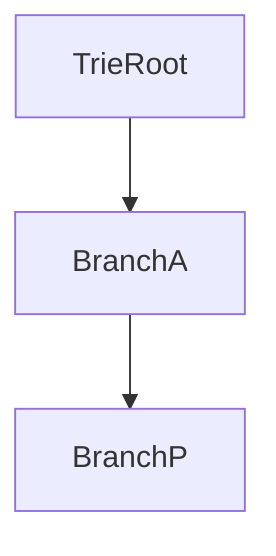

# D02-T009 — Tries

Topic ID: `D02-T009`
Domain: Data Structures and Algorithms
Subdomain: Tries
Importance: core
Complexity: intermediate
Dependencies: `D02-T008`, `D02-T001`, `D01-T001`, `D01-T002`
Execution status of the code in section F: unexecuted

## A. Topic Overview

Unlike hash maps, tries expose prefix structure. Search time depends on key length, not number of keys, which helps autocomplete and longest-prefix match.

Prerequisites: `D02-T008`, `D02-T001`, `D01-T001`, `D01-T002`. This topic supports `D02-T010`.

## B. First-Principles Explanation

Each edge labels a character; paths spell keys. Terminal flag marks complete words. Radix trees compress single-child chains.

## C. Internal Working and Architecture

Array of 26 children is fast for ASCII letters but sparse. Map children save space for general alphabets.

Dominant time: O(L) insert/search where L is key length; prefix queries O(L + matches). Dominant auxiliary space: O(total characters stored) with sharing prefixes.

## D. Diagrams and Visual Models



Shared prefixes reuse nodes.

## E. Examples and Analogies

Suggest DNS labels, filter profanity streams, match URL path prefixes in routers.

Edge cases: Key `a` is prefix of `ab`; memory for 26-wide nodes, case folding changes structure.

## F. Code Examples

File: `examples/d02_t009_trie.py`

```python
class TrieNode:
    def __init__(self):
        self.children: dict[str, TrieNode] = {}
        self.end = False


def insert(root: TrieNode, word: str) -> None:
    cur = root
    for ch in word:
        cur = cur.children.setdefault(ch, TrieNode())
    cur.end = True


def starts_with(root: TrieNode, prefix: str) -> bool:
    cur = root
    for ch in prefix:
        if ch not in cur.children:
            return False
        cur = cur.children[ch]
    return True
```

Insert and prefix check O(L) time; space O(nodes) proportional to stored text.

## G. Practical Backend Application

Normalize case and Unicode before trie insert. Bound autocomplete results to prevent enumeration attacks.

## H. Advantages, Limitations and Trade-offs

| Choice | Benefit | Cost | Choose when | Avoid when |
| --- | --- | --- | --- | --- |
| Trie | Prefix queries | Memory | Autocomplete | Exact-only lookups |
| Hash set | O(1) exact | No prefix | Membership | Prefix search |
| DB LIKE | Persistent | Slow scan | Ad hoc | Hot path prefix |

## I. Common Mistakes and Misconceptions

- Assuming O(1) because 'hash fast'.
- 26-array for Unicode.
- Returning unbounded autocomplete.

## J. Debugging and Troubleshooting

Memory high on random keys—prefix sharing fails; consider hash if no prefix need.

## K. Interview Preparation

### Beginner

#### Q1. What problem does Tries solve in backend engineering?

**Answer:** Tries branch on characters or bits; shared prefixes compress storage for dictionary-like keys. For Tries, typical bounds are O(L) insert/search where L is key length; prefix queries O(L + matches) time and O(total characters stored) with sharing prefixes space. Routing tables, autocomplete, IP lookups, and banned-word filters use trie or radix variants. Watch edge cases: dense alphabet blow-up, Unicode code points vs bytes, empty prefix matches all.

#### Q2. How do you define input size n for tries?

**Answer:** Tries branch on characters or bits; shared prefixes compress storage for dictionary-like keys. For Tries, typical bounds are O(L) insert/search where L is key length; prefix queries O(L + matches) time and O(total characters stored) with sharing prefixes space. Routing tables, autocomplete, IP lookups, and banned-word filters use trie or radix variants. Watch edge cases: dense alphabet blow-up, Unicode code points vs bytes, empty prefix matches all.

#### Q3. What is the difference between time and space cost here?

**Answer:** Tries branch on characters or bits; shared prefixes compress storage for dictionary-like keys. For Tries, typical bounds are O(L) insert/search where L is key length; prefix queries O(L + matches) time and O(total characters stored) with sharing prefixes space. Routing tables, autocomplete, IP lookups, and banned-word filters use trie or radix variants. Watch edge cases: dense alphabet blow-up, Unicode code points vs bytes, empty prefix matches all.

#### Q4. Why do we ignore constant factors in asymptotic notation for this topic?

**Answer:** Tries branch on characters or bits; shared prefixes compress storage for dictionary-like keys. For Tries, typical bounds are O(L) insert/search where L is key length; prefix queries O(L + matches) time and O(total characters stored) with sharing prefixes space. Routing tables, autocomplete, IP lookups, and banned-word filters use trie or radix variants. Watch edge cases: dense alphabet blow-up, Unicode code points vs bytes, empty prefix matches all.

#### Q5. Name one operation that is cheap and one that is expensive in this structure.

**Answer:** Tries branch on characters or bits; shared prefixes compress storage for dictionary-like keys. For Tries, typical bounds are O(L) insert/search where L is key length; prefix queries O(L + matches) time and O(total characters stored) with sharing prefixes space. Routing tables, autocomplete, IP lookups, and banned-word filters use trie or radix variants. Watch edge cases: dense alphabet blow-up, Unicode code points vs bytes, empty prefix matches all.

### Intermediate

#### Q1. State the average and worst-case complexity for the main operations.

**Answer:** Tries branch on characters or bits; shared prefixes compress storage for dictionary-like keys. For Tries, typical bounds are O(L) insert/search where L is key length; prefix queries O(L + matches) time and O(total characters stored) with sharing prefixes space. Routing tables, autocomplete, IP lookups, and banned-word filters use trie or radix variants. Watch edge cases: dense alphabet blow-up, Unicode code points vs bytes, empty prefix matches all.

#### Q2. How would you justify choosing this structure in a design review?

**Answer:** Tries branch on characters or bits; shared prefixes compress storage for dictionary-like keys. For Tries, typical bounds are O(L) insert/search where L is key length; prefix queries O(L + matches) time and O(total characters stored) with sharing prefixes space. Routing tables, autocomplete, IP lookups, and banned-word filters use trie or radix variants. Watch edge cases: dense alphabet blow-up, Unicode code points vs bytes, empty prefix matches all.

#### Q3. What changes if data no longer fits in memory?

**Answer:** Tries branch on characters or bits; shared prefixes compress storage for dictionary-like keys. For Tries, typical bounds are O(L) insert/search where L is key length; prefix queries O(L + matches) time and O(total characters stored) with sharing prefixes space. Routing tables, autocomplete, IP lookups, and banned-word filters use trie or radix variants. Watch edge cases: dense alphabet blow-up, Unicode code points vs bytes, empty prefix matches all.

#### Q4. How does concurrency affect the complexity story?

**Answer:** Tries branch on characters or bits; shared prefixes compress storage for dictionary-like keys. For Tries, typical bounds are O(L) insert/search where L is key length; prefix queries O(L + matches) time and O(total characters stored) with sharing prefixes space. Routing tables, autocomplete, IP lookups, and banned-word filters use trie or radix variants. Watch edge cases: dense alphabet blow-up, Unicode code points vs bytes, empty prefix matches all.

#### Q5. How do you test performance regressions for this component?

**Answer:** Tries branch on characters or bits; shared prefixes compress storage for dictionary-like keys. For Tries, typical bounds are O(L) insert/search where L is key length; prefix queries O(L + matches) time and O(total characters stored) with sharing prefixes space. Routing tables, autocomplete, IP lookups, and banned-word filters use trie or radix variants. Watch edge cases: dense alphabet blow-up, Unicode code points vs bytes, empty prefix matches all.

### Advanced

#### Q1. When is the 'textbook' complexity misleading in production?

**Answer:** Tries branch on characters or bits; shared prefixes compress storage for dictionary-like keys. For Tries, typical bounds are O(L) insert/search where L is key length; prefix queries O(L + matches) time and O(total characters stored) with sharing prefixes space. Routing tables, autocomplete, IP lookups, and banned-word filters use trie or radix variants. Watch edge cases: dense alphabet blow-up, Unicode code points vs bytes, empty prefix matches all.

#### Q2. How do cache locality and allocation affect real runtime?

**Answer:** Tries branch on characters or bits; shared prefixes compress storage for dictionary-like keys. For Tries, typical bounds are O(L) insert/search where L is key length; prefix queries O(L + matches) time and O(total characters stored) with sharing prefixes space. Routing tables, autocomplete, IP lookups, and banned-word filters use trie or radix variants. Watch edge cases: dense alphabet blow-up, Unicode code points vs bytes, empty prefix matches all.

#### Q3. Compare this approach to the next topic in the curriculum.

**Answer:** Tries branch on characters or bits; shared prefixes compress storage for dictionary-like keys. For Tries, typical bounds are O(L) insert/search where L is key length; prefix queries O(L + matches) time and O(total characters stored) with sharing prefixes space. Routing tables, autocomplete, IP lookups, and banned-word filters use trie or radix variants. Watch edge cases: dense alphabet blow-up, Unicode code points vs bytes, empty prefix matches all.

#### Q4. What security or abuse patterns change effective n?

**Answer:** Tries branch on characters or bits; shared prefixes compress storage for dictionary-like keys. For Tries, typical bounds are O(L) insert/search where L is key length; prefix queries O(L + matches) time and O(total characters stored) with sharing prefixes space. Routing tables, autocomplete, IP lookups, and banned-word filters use trie or radix variants. Watch edge cases: dense alphabet blow-up, Unicode code points vs bytes, empty prefix matches all.

#### Q5. How would you document complexity in an OpenAPI or ADR?

**Answer:** Tries branch on characters or bits; shared prefixes compress storage for dictionary-like keys. For Tries, typical bounds are O(L) insert/search where L is key length; prefix queries O(L + matches) time and O(total characters stored) with sharing prefixes space. Routing tables, autocomplete, IP lookups, and banned-word filters use trie or radix variants. Watch edge cases: dense alphabet blow-up, Unicode code points vs bytes, empty prefix matches all.

### Scenarios

#### Q1. Latency spikes when traffic doubles but CPU is only 60%. What do you measure first?

**Answer:** Tries branch on characters or bits; shared prefixes compress storage for dictionary-like keys. For Tries, typical bounds are O(L) insert/search where L is key length; prefix queries O(L + matches) time and O(total characters stored) with sharing prefixes space. Routing tables, autocomplete, IP lookups, and banned-word filters use trie or radix variants. Watch edge cases: dense alphabet blow-up, Unicode code points vs bytes, empty prefix matches all.

#### Q2. A batch job OOMs on a larger tenant. Which space term grew?

**Answer:** Tries branch on characters or bits; shared prefixes compress storage for dictionary-like keys. For Tries, typical bounds are O(L) insert/search where L is key length; prefix queries O(L + matches) time and O(total characters stored) with sharing prefixes space. Routing tables, autocomplete, IP lookups, and banned-word filters use trie or radix variants. Watch edge cases: dense alphabet blow-up, Unicode code points vs bytes, empty prefix matches all.

#### Q3. Two services disagree on timeout budgets for the same endpoint.

**Answer:** Tries branch on characters or bits; shared prefixes compress storage for dictionary-like keys. For Tries, typical bounds are O(L) insert/search where L is key length; prefix queries O(L + matches) time and O(total characters stored) with sharing prefixes space. Routing tables, autocomplete, IP lookups, and banned-word filters use trie or radix variants. Watch edge cases: dense alphabet blow-up, Unicode code points vs bytes, empty prefix matches all.

#### Q4. An attacker sends inputs that trigger worst-case behavior.

**Answer:** Tries branch on characters or bits; shared prefixes compress storage for dictionary-like keys. For Tries, typical bounds are O(L) insert/search where L is key length; prefix queries O(L + matches) time and O(total characters stored) with sharing prefixes space. Routing tables, autocomplete, IP lookups, and banned-word filters use trie or radix variants. Watch edge cases: dense alphabet blow-up, Unicode code points vs bytes, empty prefix matches all.

#### Q5. You must shave 100ms off a hot path without new hardware.

**Answer:** Tries branch on characters or bits; shared prefixes compress storage for dictionary-like keys. For Tries, typical bounds are O(L) insert/search where L is key length; prefix queries O(L + matches) time and O(total characters stored) with sharing prefixes space. Routing tables, autocomplete, IP lookups, and banned-word filters use trie or radix variants. Watch edge cases: dense alphabet blow-up, Unicode code points vs bytes, empty prefix matches all.

### Follow-ups

#### Q1. How does this connect to database indexing?

**Answer:** Tries branch on characters or bits; shared prefixes compress storage for dictionary-like keys. For Tries, typical bounds are O(L) insert/search where L is key length; prefix queries O(L + matches) time and O(total characters stored) with sharing prefixes space. Routing tables, autocomplete, IP lookups, and banned-word filters use trie or radix variants. Watch edge cases: dense alphabet blow-up, Unicode code points vs bytes, empty prefix matches all.

#### Q2. How does this connect to caching layers?

**Answer:** Tries branch on characters or bits; shared prefixes compress storage for dictionary-like keys. For Tries, typical bounds are O(L) insert/search where L is key length; prefix queries O(L + matches) time and O(total characters stored) with sharing prefixes space. Routing tables, autocomplete, IP lookups, and banned-word filters use trie or radix variants. Watch edge cases: dense alphabet blow-up, Unicode code points vs bytes, empty prefix matches all.

#### Q3. What monitoring proves your complexity assumption?

**Answer:** Tries branch on characters or bits; shared prefixes compress storage for dictionary-like keys. For Tries, typical bounds are O(L) insert/search where L is key length; prefix queries O(L + matches) time and O(total characters stored) with sharing prefixes space. Routing tables, autocomplete, IP lookups, and banned-word filters use trie or radix variants. Watch edge cases: dense alphabet blow-up, Unicode code points vs bytes, empty prefix matches all.

## L. Practical Exercises

Solutions: `EXERCISES/solutions/D02-T009.md`.

### Exercise 1 — implementation

Implement insert and `starts_with`. Acceptance: O(L) time stated.

### Exercise 2 — debugging

Autocomplete endpoint enumerates all users—risk and fix? Acceptance: rate limit, min prefix length, cap results, auth.

### Exercise 3 — trade-off

Trie versus bloom filter for banned token list. Acceptance: trie exact/prefix; bloom false positives unacceptable for blocklist.

## M. Revision Notes

- O(L) not O(n keys).
- Prefix sharing.
- Abuse caps.

## N. Related Topics

Supports `D02-T010`. Often confused with trie versus hash map. See `D02-T003`, `D06-T005`.

## O. Completion Criteria

- Write trie ops bounds.
- Design autocomplete limits.
- Pick trie vs hash.
