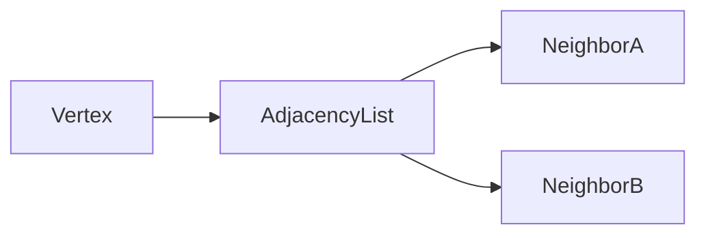

# D02-T010 — Graphs and graph representations

Topic ID: `D02-T010`
Domain: Data Structures and Algorithms
Subdomain: Graphs and graph representations
Importance: core
Complexity: intermediate
Dependencies: `D02-T009`, `D02-T001`, `D01-T001`, `D01-T002`
Execution status of the code in section F: unexecuted

## A. Topic Overview

Choosing adjacency list, matrix, or edge list determines whether algorithms like BFS and Dijkstra are practical at your scale.

Prerequisites: `D02-T009`, `D02-T001`, `D01-T001`, `D01-T002`. This topic supports `D02-T011`.

## B. First-Principles Explanation

List stores neighbors per vertex—sparse graphs use O(V+E). Matrix stores all pairs—fast edge test O(1) but heavy when sparse.

## C. Internal Working and Architecture

Compress with integer vertex ids. Store weights on edges for shortest path. Bidirectional edges may be stored once or twice.

Dominant time: O(V+E) to traverse adjacency list; O(V^2) space for adjacency matrix dense. Dominant auxiliary space: O(V+E) list; O(V^2) matrix.

## D. Diagrams and Visual Models



Lists favor sparse graphs.

## E. Examples and Analogies

Microservice mesh: vertices services, edges RPC calls. Shard graph by tenant if V is huge.

Edge cases: Isolated nodes, parallel edges, memory if V^2 matrix with millions of vertices.

## F. Code Examples

File: `examples/d02_t010_graph.py`

```python
def build_adj(n: int, edges: list[tuple[int, int]]) -> list[list[int]]:
    adj: list[list[int]] = [[] for _ in range(n)]
    for u, v in edges:
        adj[u].append(v)
        adj[v].append(u)
    return adj


def degree(adj: list[list[int]], u: int) -> int:
    return len(adj[u])
```

Build O(E), space O(V+E). Undirected edges stored twice.

## G. Practical Backend Application

Persist edges in join table; load adjacency in memory only for analytics jobs with bounded V.

## H. Advantages, Limitations and Trade-offs

| Choice | Benefit | Cost | Choose when | Avoid when |
| --- | --- | --- | --- | --- |
| Adjacency list | Sparse efficient | Slow edge test | Social, mesh | Dense clique |
| Adjacency matrix | O(1) edge query | O(V^2) memory | Tiny V | Large sparse |
| Edge list | Compact stream | Slow neighbors | ETL | Frequent neighbor scan |

## I. Common Mistakes and Misconceptions

- Matrix for million-node sparse graph.
- Forgetting directed orientation.
- Rebuilding adjacency per request O(E).

## J. Debugging and Troubleshooting

OOM building graph—check representation and duplicate edge load.

## K. Interview Preparation

### Beginner

#### Q1. What problem does Graphs and graph representations solve in backend engineering?

**Answer:** Graphs model entities (vertices) and relationships (edges). Representation choice drives memory and neighbor iteration cost. For Graphs and graph representations, typical bounds are O(V+E) to traverse adjacency list; O(V^2) space for adjacency matrix dense time and O(V+E) list; O(V^2) matrix space. Service dependency graphs, permission graphs, and network topologies are graphs; storage shape affects traversal budgets. Watch edge cases: self-loops, multi-edges, disconnected components, directed vs undirected.

#### Q2. How do you define input size n for graphs and graph representations?

**Answer:** Graphs model entities (vertices) and relationships (edges). Representation choice drives memory and neighbor iteration cost. For Graphs and graph representations, typical bounds are O(V+E) to traverse adjacency list; O(V^2) space for adjacency matrix dense time and O(V+E) list; O(V^2) matrix space. Service dependency graphs, permission graphs, and network topologies are graphs; storage shape affects traversal budgets. Watch edge cases: self-loops, multi-edges, disconnected components, directed vs undirected.

#### Q3. What is the difference between time and space cost here?

**Answer:** Graphs model entities (vertices) and relationships (edges). Representation choice drives memory and neighbor iteration cost. For Graphs and graph representations, typical bounds are O(V+E) to traverse adjacency list; O(V^2) space for adjacency matrix dense time and O(V+E) list; O(V^2) matrix space. Service dependency graphs, permission graphs, and network topologies are graphs; storage shape affects traversal budgets. Watch edge cases: self-loops, multi-edges, disconnected components, directed vs undirected.

#### Q4. Why do we ignore constant factors in asymptotic notation for this topic?

**Answer:** Graphs model entities (vertices) and relationships (edges). Representation choice drives memory and neighbor iteration cost. For Graphs and graph representations, typical bounds are O(V+E) to traverse adjacency list; O(V^2) space for adjacency matrix dense time and O(V+E) list; O(V^2) matrix space. Service dependency graphs, permission graphs, and network topologies are graphs; storage shape affects traversal budgets. Watch edge cases: self-loops, multi-edges, disconnected components, directed vs undirected.

#### Q5. Name one operation that is cheap and one that is expensive in this structure.

**Answer:** Graphs model entities (vertices) and relationships (edges). Representation choice drives memory and neighbor iteration cost. For Graphs and graph representations, typical bounds are O(V+E) to traverse adjacency list; O(V^2) space for adjacency matrix dense time and O(V+E) list; O(V^2) matrix space. Service dependency graphs, permission graphs, and network topologies are graphs; storage shape affects traversal budgets. Watch edge cases: self-loops, multi-edges, disconnected components, directed vs undirected.

### Intermediate

#### Q1. State the average and worst-case complexity for the main operations.

**Answer:** Graphs model entities (vertices) and relationships (edges). Representation choice drives memory and neighbor iteration cost. For Graphs and graph representations, typical bounds are O(V+E) to traverse adjacency list; O(V^2) space for adjacency matrix dense time and O(V+E) list; O(V^2) matrix space. Service dependency graphs, permission graphs, and network topologies are graphs; storage shape affects traversal budgets. Watch edge cases: self-loops, multi-edges, disconnected components, directed vs undirected.

#### Q2. How would you justify choosing this structure in a design review?

**Answer:** Graphs model entities (vertices) and relationships (edges). Representation choice drives memory and neighbor iteration cost. For Graphs and graph representations, typical bounds are O(V+E) to traverse adjacency list; O(V^2) space for adjacency matrix dense time and O(V+E) list; O(V^2) matrix space. Service dependency graphs, permission graphs, and network topologies are graphs; storage shape affects traversal budgets. Watch edge cases: self-loops, multi-edges, disconnected components, directed vs undirected.

#### Q3. What changes if data no longer fits in memory?

**Answer:** Graphs model entities (vertices) and relationships (edges). Representation choice drives memory and neighbor iteration cost. For Graphs and graph representations, typical bounds are O(V+E) to traverse adjacency list; O(V^2) space for adjacency matrix dense time and O(V+E) list; O(V^2) matrix space. Service dependency graphs, permission graphs, and network topologies are graphs; storage shape affects traversal budgets. Watch edge cases: self-loops, multi-edges, disconnected components, directed vs undirected.

#### Q4. How does concurrency affect the complexity story?

**Answer:** Graphs model entities (vertices) and relationships (edges). Representation choice drives memory and neighbor iteration cost. For Graphs and graph representations, typical bounds are O(V+E) to traverse adjacency list; O(V^2) space for adjacency matrix dense time and O(V+E) list; O(V^2) matrix space. Service dependency graphs, permission graphs, and network topologies are graphs; storage shape affects traversal budgets. Watch edge cases: self-loops, multi-edges, disconnected components, directed vs undirected.

#### Q5. How do you test performance regressions for this component?

**Answer:** Graphs model entities (vertices) and relationships (edges). Representation choice drives memory and neighbor iteration cost. For Graphs and graph representations, typical bounds are O(V+E) to traverse adjacency list; O(V^2) space for adjacency matrix dense time and O(V+E) list; O(V^2) matrix space. Service dependency graphs, permission graphs, and network topologies are graphs; storage shape affects traversal budgets. Watch edge cases: self-loops, multi-edges, disconnected components, directed vs undirected.

### Advanced

#### Q1. When is the 'textbook' complexity misleading in production?

**Answer:** Graphs model entities (vertices) and relationships (edges). Representation choice drives memory and neighbor iteration cost. For Graphs and graph representations, typical bounds are O(V+E) to traverse adjacency list; O(V^2) space for adjacency matrix dense time and O(V+E) list; O(V^2) matrix space. Service dependency graphs, permission graphs, and network topologies are graphs; storage shape affects traversal budgets. Watch edge cases: self-loops, multi-edges, disconnected components, directed vs undirected.

#### Q2. How do cache locality and allocation affect real runtime?

**Answer:** Graphs model entities (vertices) and relationships (edges). Representation choice drives memory and neighbor iteration cost. For Graphs and graph representations, typical bounds are O(V+E) to traverse adjacency list; O(V^2) space for adjacency matrix dense time and O(V+E) list; O(V^2) matrix space. Service dependency graphs, permission graphs, and network topologies are graphs; storage shape affects traversal budgets. Watch edge cases: self-loops, multi-edges, disconnected components, directed vs undirected.

#### Q3. Compare this approach to the next topic in the curriculum.

**Answer:** Graphs model entities (vertices) and relationships (edges). Representation choice drives memory and neighbor iteration cost. For Graphs and graph representations, typical bounds are O(V+E) to traverse adjacency list; O(V^2) space for adjacency matrix dense time and O(V+E) list; O(V^2) matrix space. Service dependency graphs, permission graphs, and network topologies are graphs; storage shape affects traversal budgets. Watch edge cases: self-loops, multi-edges, disconnected components, directed vs undirected.

#### Q4. What security or abuse patterns change effective n?

**Answer:** Graphs model entities (vertices) and relationships (edges). Representation choice drives memory and neighbor iteration cost. For Graphs and graph representations, typical bounds are O(V+E) to traverse adjacency list; O(V^2) space for adjacency matrix dense time and O(V+E) list; O(V^2) matrix space. Service dependency graphs, permission graphs, and network topologies are graphs; storage shape affects traversal budgets. Watch edge cases: self-loops, multi-edges, disconnected components, directed vs undirected.

#### Q5. How would you document complexity in an OpenAPI or ADR?

**Answer:** Graphs model entities (vertices) and relationships (edges). Representation choice drives memory and neighbor iteration cost. For Graphs and graph representations, typical bounds are O(V+E) to traverse adjacency list; O(V^2) space for adjacency matrix dense time and O(V+E) list; O(V^2) matrix space. Service dependency graphs, permission graphs, and network topologies are graphs; storage shape affects traversal budgets. Watch edge cases: self-loops, multi-edges, disconnected components, directed vs undirected.

### Scenarios

#### Q1. Latency spikes when traffic doubles but CPU is only 60%. What do you measure first?

**Answer:** Graphs model entities (vertices) and relationships (edges). Representation choice drives memory and neighbor iteration cost. For Graphs and graph representations, typical bounds are O(V+E) to traverse adjacency list; O(V^2) space for adjacency matrix dense time and O(V+E) list; O(V^2) matrix space. Service dependency graphs, permission graphs, and network topologies are graphs; storage shape affects traversal budgets. Watch edge cases: self-loops, multi-edges, disconnected components, directed vs undirected.

#### Q2. A batch job OOMs on a larger tenant. Which space term grew?

**Answer:** Graphs model entities (vertices) and relationships (edges). Representation choice drives memory and neighbor iteration cost. For Graphs and graph representations, typical bounds are O(V+E) to traverse adjacency list; O(V^2) space for adjacency matrix dense time and O(V+E) list; O(V^2) matrix space. Service dependency graphs, permission graphs, and network topologies are graphs; storage shape affects traversal budgets. Watch edge cases: self-loops, multi-edges, disconnected components, directed vs undirected.

#### Q3. Two services disagree on timeout budgets for the same endpoint.

**Answer:** Graphs model entities (vertices) and relationships (edges). Representation choice drives memory and neighbor iteration cost. For Graphs and graph representations, typical bounds are O(V+E) to traverse adjacency list; O(V^2) space for adjacency matrix dense time and O(V+E) list; O(V^2) matrix space. Service dependency graphs, permission graphs, and network topologies are graphs; storage shape affects traversal budgets. Watch edge cases: self-loops, multi-edges, disconnected components, directed vs undirected.

#### Q4. An attacker sends inputs that trigger worst-case behavior.

**Answer:** Graphs model entities (vertices) and relationships (edges). Representation choice drives memory and neighbor iteration cost. For Graphs and graph representations, typical bounds are O(V+E) to traverse adjacency list; O(V^2) space for adjacency matrix dense time and O(V+E) list; O(V^2) matrix space. Service dependency graphs, permission graphs, and network topologies are graphs; storage shape affects traversal budgets. Watch edge cases: self-loops, multi-edges, disconnected components, directed vs undirected.

#### Q5. You must shave 100ms off a hot path without new hardware.

**Answer:** Graphs model entities (vertices) and relationships (edges). Representation choice drives memory and neighbor iteration cost. For Graphs and graph representations, typical bounds are O(V+E) to traverse adjacency list; O(V^2) space for adjacency matrix dense time and O(V+E) list; O(V^2) matrix space. Service dependency graphs, permission graphs, and network topologies are graphs; storage shape affects traversal budgets. Watch edge cases: self-loops, multi-edges, disconnected components, directed vs undirected.

### Follow-ups

#### Q1. How does this connect to database indexing?

**Answer:** Graphs model entities (vertices) and relationships (edges). Representation choice drives memory and neighbor iteration cost. For Graphs and graph representations, typical bounds are O(V+E) to traverse adjacency list; O(V^2) space for adjacency matrix dense time and O(V+E) list; O(V^2) matrix space. Service dependency graphs, permission graphs, and network topologies are graphs; storage shape affects traversal budgets. Watch edge cases: self-loops, multi-edges, disconnected components, directed vs undirected.

#### Q2. How does this connect to caching layers?

**Answer:** Graphs model entities (vertices) and relationships (edges). Representation choice drives memory and neighbor iteration cost. For Graphs and graph representations, typical bounds are O(V+E) to traverse adjacency list; O(V^2) space for adjacency matrix dense time and O(V+E) list; O(V^2) matrix space. Service dependency graphs, permission graphs, and network topologies are graphs; storage shape affects traversal budgets. Watch edge cases: self-loops, multi-edges, disconnected components, directed vs undirected.

#### Q3. What monitoring proves your complexity assumption?

**Answer:** Graphs model entities (vertices) and relationships (edges). Representation choice drives memory and neighbor iteration cost. For Graphs and graph representations, typical bounds are O(V+E) to traverse adjacency list; O(V^2) space for adjacency matrix dense time and O(V+E) list; O(V^2) matrix space. Service dependency graphs, permission graphs, and network topologies are graphs; storage shape affects traversal budgets. Watch edge cases: self-loops, multi-edges, disconnected components, directed vs undirected.

## L. Practical Exercises

Solutions: `EXERCISES/solutions/D02-T010.md`.

### Exercise 1 — implementation

Build undirected adjacency list from edge list. Acceptance: O(V+E) build documented.

### Exercise 2 — debugging

Service map API loads full graph per call—optimize representation pipeline. Acceptance: cache adjacency, incremental updates, DB edge query.

### Exercise 3 — trade-off

List versus matrix for 200-node internal mesh. Acceptance: matrix 40k cells fine; list if sparser later.

## M. Revision Notes

- V and E notation.
- List for sparse.
- Matrix for dense small V.

## N. Related Topics

Supports `D02-T011`. Often confused with graph versus tree. See `D02-T011`, `D02-T013`.

## O. Completion Criteria

- Build adj list bounds.
- Compare representations.
- Size memory for V,E.
