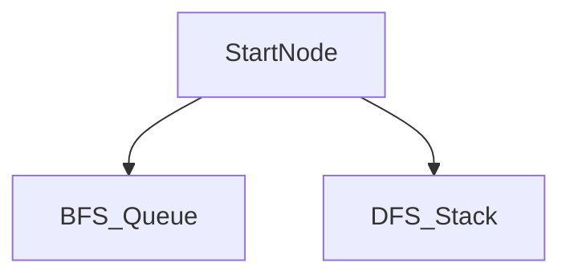

# D02-T011 — BFS and DFS

Topic ID: `D02-T011`
Domain: Data Structures and Algorithms
Subdomain: BFS and DFS
Importance: core
Complexity: intermediate
Dependencies: `D02-T010`, `D02-T001`, `D01-T001`, `D01-T002`
Execution status of the code in section F: unexecuted

## A. Topic Overview

Both visit each vertex and edge once in the list model. BFS gives shortest unweighted paths; DFS suits topological exploration and maze-like backtracking.

Prerequisites: `D02-T010`, `D02-T001`, `D01-T001`, `D01-T002`. This topic supports `D02-T012`.

## B. First-Principles Explanation

Mark visited to avoid exponential revisits. BFS queue FIFO processes increasing distance from source. DFS stack LIFO finishes subtrees before siblings.

## C. Internal Working and Architecture

Iterative DFS avoids recursion limit. Color marking (white/gray/black) detects cycles in directed graphs.

Dominant time: O(V+E) for adjacency list traversal. Dominant auxiliary space: O(V) visited set plus O(V) queue or stack.

## D. Diagrams and Visual Models



Same graph, different visit order.

## E. Examples and Analogies

Find if service A can reach service B in outage graph. Crawl internal links with depth cap (DFS).

Edge cases: Multiple components—run from each unvisited. Huge graphs—stream edges.

## F. Code Examples

File: `examples/d02_t011_bfs.py`

```python
from collections import deque


def bfs_dist(adj: list[list[int]], src: int) -> list[int]:
    n = len(adj)
    dist = [-1] * n
    q: deque[int] = deque([src])
    dist[src] = 0
    while q:
        u = q.popleft()
        for v in adj[u]:
            if dist[v] == -1:
                dist[v] = dist[u] + 1
                q.append(v)
    return dist
```

O(V+E) time, O(V) space for dist, queue, and visited implicit in dist.

## G. Practical Backend Application

Cap BFS depth in user-triggered graph walks. Timeout traversal in API handlers.

## H. Advantages, Limitations and Trade-offs

| Choice | Benefit | Cost | Choose when | Avoid when |
| --- | --- | --- | --- | --- |
| BFS | Shortest unweighted path | More memory queue | Dependency level | Deep narrow tree |
| DFS | Less memory stack | Not shortest | Cycle detect | Shortest path unweighted |
| Bidirectional BFS | Faster meet-in-middle | Setup cost | Social distance | General DAG |

## I. Common Mistakes and Misconceptions

- No visited set.
- Using DFS for shortest unweighted path.
- Unbounded recursion.

## J. Debugging and Troubleshooting

Traversal hangs—cycle without visited. Stack overflow—switch iterative.

## K. Interview Preparation

### Beginner

#### Q1. What problem does BFS and DFS solve in backend engineering?

**Answer:** BFS explores layer by layer with a queue; DFS goes deep first with a stack or recursion. For BFS and DFS, typical bounds are O(V+E) for adjacency list traversal time and O(V) visited set plus O(V) queue or stack space. Reachability in dependency graphs, cycle detection, and connected components use these traversals. Watch edge cases: revisiting without visited set, recursion depth, disconnected graph.

#### Q2. How do you define input size n for bfs and dfs?

**Answer:** BFS explores layer by layer with a queue; DFS goes deep first with a stack or recursion. For BFS and DFS, typical bounds are O(V+E) for adjacency list traversal time and O(V) visited set plus O(V) queue or stack space. Reachability in dependency graphs, cycle detection, and connected components use these traversals. Watch edge cases: revisiting without visited set, recursion depth, disconnected graph.

#### Q3. What is the difference between time and space cost here?

**Answer:** BFS explores layer by layer with a queue; DFS goes deep first with a stack or recursion. For BFS and DFS, typical bounds are O(V+E) for adjacency list traversal time and O(V) visited set plus O(V) queue or stack space. Reachability in dependency graphs, cycle detection, and connected components use these traversals. Watch edge cases: revisiting without visited set, recursion depth, disconnected graph.

#### Q4. Why do we ignore constant factors in asymptotic notation for this topic?

**Answer:** BFS explores layer by layer with a queue; DFS goes deep first with a stack or recursion. For BFS and DFS, typical bounds are O(V+E) for adjacency list traversal time and O(V) visited set plus O(V) queue or stack space. Reachability in dependency graphs, cycle detection, and connected components use these traversals. Watch edge cases: revisiting without visited set, recursion depth, disconnected graph.

#### Q5. Name one operation that is cheap and one that is expensive in this structure.

**Answer:** BFS explores layer by layer with a queue; DFS goes deep first with a stack or recursion. For BFS and DFS, typical bounds are O(V+E) for adjacency list traversal time and O(V) visited set plus O(V) queue or stack space. Reachability in dependency graphs, cycle detection, and connected components use these traversals. Watch edge cases: revisiting without visited set, recursion depth, disconnected graph.

### Intermediate

#### Q1. State the average and worst-case complexity for the main operations.

**Answer:** BFS explores layer by layer with a queue; DFS goes deep first with a stack or recursion. For BFS and DFS, typical bounds are O(V+E) for adjacency list traversal time and O(V) visited set plus O(V) queue or stack space. Reachability in dependency graphs, cycle detection, and connected components use these traversals. Watch edge cases: revisiting without visited set, recursion depth, disconnected graph.

#### Q2. How would you justify choosing this structure in a design review?

**Answer:** BFS explores layer by layer with a queue; DFS goes deep first with a stack or recursion. For BFS and DFS, typical bounds are O(V+E) for adjacency list traversal time and O(V) visited set plus O(V) queue or stack space. Reachability in dependency graphs, cycle detection, and connected components use these traversals. Watch edge cases: revisiting without visited set, recursion depth, disconnected graph.

#### Q3. What changes if data no longer fits in memory?

**Answer:** BFS explores layer by layer with a queue; DFS goes deep first with a stack or recursion. For BFS and DFS, typical bounds are O(V+E) for adjacency list traversal time and O(V) visited set plus O(V) queue or stack space. Reachability in dependency graphs, cycle detection, and connected components use these traversals. Watch edge cases: revisiting without visited set, recursion depth, disconnected graph.

#### Q4. How does concurrency affect the complexity story?

**Answer:** BFS explores layer by layer with a queue; DFS goes deep first with a stack or recursion. For BFS and DFS, typical bounds are O(V+E) for adjacency list traversal time and O(V) visited set plus O(V) queue or stack space. Reachability in dependency graphs, cycle detection, and connected components use these traversals. Watch edge cases: revisiting without visited set, recursion depth, disconnected graph.

#### Q5. How do you test performance regressions for this component?

**Answer:** BFS explores layer by layer with a queue; DFS goes deep first with a stack or recursion. For BFS and DFS, typical bounds are O(V+E) for adjacency list traversal time and O(V) visited set plus O(V) queue or stack space. Reachability in dependency graphs, cycle detection, and connected components use these traversals. Watch edge cases: revisiting without visited set, recursion depth, disconnected graph.

### Advanced

#### Q1. When is the 'textbook' complexity misleading in production?

**Answer:** BFS explores layer by layer with a queue; DFS goes deep first with a stack or recursion. For BFS and DFS, typical bounds are O(V+E) for adjacency list traversal time and O(V) visited set plus O(V) queue or stack space. Reachability in dependency graphs, cycle detection, and connected components use these traversals. Watch edge cases: revisiting without visited set, recursion depth, disconnected graph.

#### Q2. How do cache locality and allocation affect real runtime?

**Answer:** BFS explores layer by layer with a queue; DFS goes deep first with a stack or recursion. For BFS and DFS, typical bounds are O(V+E) for adjacency list traversal time and O(V) visited set plus O(V) queue or stack space. Reachability in dependency graphs, cycle detection, and connected components use these traversals. Watch edge cases: revisiting without visited set, recursion depth, disconnected graph.

#### Q3. Compare this approach to the next topic in the curriculum.

**Answer:** BFS explores layer by layer with a queue; DFS goes deep first with a stack or recursion. For BFS and DFS, typical bounds are O(V+E) for adjacency list traversal time and O(V) visited set plus O(V) queue or stack space. Reachability in dependency graphs, cycle detection, and connected components use these traversals. Watch edge cases: revisiting without visited set, recursion depth, disconnected graph.

#### Q4. What security or abuse patterns change effective n?

**Answer:** BFS explores layer by layer with a queue; DFS goes deep first with a stack or recursion. For BFS and DFS, typical bounds are O(V+E) for adjacency list traversal time and O(V) visited set plus O(V) queue or stack space. Reachability in dependency graphs, cycle detection, and connected components use these traversals. Watch edge cases: revisiting without visited set, recursion depth, disconnected graph.

#### Q5. How would you document complexity in an OpenAPI or ADR?

**Answer:** BFS explores layer by layer with a queue; DFS goes deep first with a stack or recursion. For BFS and DFS, typical bounds are O(V+E) for adjacency list traversal time and O(V) visited set plus O(V) queue or stack space. Reachability in dependency graphs, cycle detection, and connected components use these traversals. Watch edge cases: revisiting without visited set, recursion depth, disconnected graph.

### Scenarios

#### Q1. Latency spikes when traffic doubles but CPU is only 60%. What do you measure first?

**Answer:** BFS explores layer by layer with a queue; DFS goes deep first with a stack or recursion. For BFS and DFS, typical bounds are O(V+E) for adjacency list traversal time and O(V) visited set plus O(V) queue or stack space. Reachability in dependency graphs, cycle detection, and connected components use these traversals. Watch edge cases: revisiting without visited set, recursion depth, disconnected graph.

#### Q2. A batch job OOMs on a larger tenant. Which space term grew?

**Answer:** BFS explores layer by layer with a queue; DFS goes deep first with a stack or recursion. For BFS and DFS, typical bounds are O(V+E) for adjacency list traversal time and O(V) visited set plus O(V) queue or stack space. Reachability in dependency graphs, cycle detection, and connected components use these traversals. Watch edge cases: revisiting without visited set, recursion depth, disconnected graph.

#### Q3. Two services disagree on timeout budgets for the same endpoint.

**Answer:** BFS explores layer by layer with a queue; DFS goes deep first with a stack or recursion. For BFS and DFS, typical bounds are O(V+E) for adjacency list traversal time and O(V) visited set plus O(V) queue or stack space. Reachability in dependency graphs, cycle detection, and connected components use these traversals. Watch edge cases: revisiting without visited set, recursion depth, disconnected graph.

#### Q4. An attacker sends inputs that trigger worst-case behavior.

**Answer:** BFS explores layer by layer with a queue; DFS goes deep first with a stack or recursion. For BFS and DFS, typical bounds are O(V+E) for adjacency list traversal time and O(V) visited set plus O(V) queue or stack space. Reachability in dependency graphs, cycle detection, and connected components use these traversals. Watch edge cases: revisiting without visited set, recursion depth, disconnected graph.

#### Q5. You must shave 100ms off a hot path without new hardware.

**Answer:** BFS explores layer by layer with a queue; DFS goes deep first with a stack or recursion. For BFS and DFS, typical bounds are O(V+E) for adjacency list traversal time and O(V) visited set plus O(V) queue or stack space. Reachability in dependency graphs, cycle detection, and connected components use these traversals. Watch edge cases: revisiting without visited set, recursion depth, disconnected graph.

### Follow-ups

#### Q1. How does this connect to database indexing?

**Answer:** BFS explores layer by layer with a queue; DFS goes deep first with a stack or recursion. For BFS and DFS, typical bounds are O(V+E) for adjacency list traversal time and O(V) visited set plus O(V) queue or stack space. Reachability in dependency graphs, cycle detection, and connected components use these traversals. Watch edge cases: revisiting without visited set, recursion depth, disconnected graph.

#### Q2. How does this connect to caching layers?

**Answer:** BFS explores layer by layer with a queue; DFS goes deep first with a stack or recursion. For BFS and DFS, typical bounds are O(V+E) for adjacency list traversal time and O(V) visited set plus O(V) queue or stack space. Reachability in dependency graphs, cycle detection, and connected components use these traversals. Watch edge cases: revisiting without visited set, recursion depth, disconnected graph.

#### Q3. What monitoring proves your complexity assumption?

**Answer:** BFS explores layer by layer with a queue; DFS goes deep first with a stack or recursion. For BFS and DFS, typical bounds are O(V+E) for adjacency list traversal time and O(V) visited set plus O(V) queue or stack space. Reachability in dependency graphs, cycle detection, and connected components use these traversals. Watch edge cases: revisiting without visited set, recursion depth, disconnected graph.

## L. Practical Exercises

Solutions: `EXERCISES/solutions/D02-T011.md`.

### Exercise 1 — implementation

Implement `bfs_dist` for unweighted graph. Acceptance: O(V+E) time; distances correct on sample graph.

### Exercise 2 — debugging

Permission check DFS cycles wrongly grants access—debug approach. Acceptance: detect cycle, deny or break edge, visited coloring.

### Exercise 3 — trade-off

BFS versus DFS for nightly batch component labeling. Acceptance: either O(V+E); BFS if levels needed.

## M. Revision Notes

- O(V+E).
- visited required.
- BFS shortest unweighted.

## N. Related Topics

Supports `D02-T012`. Often confused with BFS versus Dijkstra. See `D02-T013`, `D02-T012`.

## O. Completion Criteria

- Write BFS bounds.
- Explain visited.
- Pick BFS vs DFS scenario.
