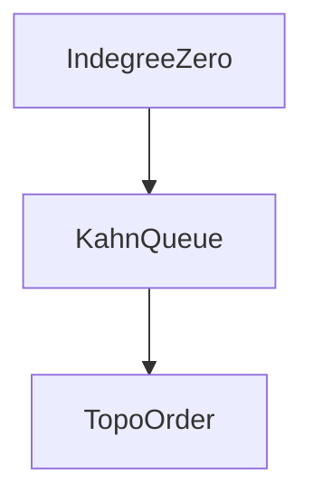

# D02-T012 — Topological sorting

Topic ID: `D02-T012`
Domain: Data Structures and Algorithms
Subdomain: Topological sorting
Importance: core
Complexity: intermediate
Dependencies: `D02-T011`, `D02-T001`, `D01-T001`, `D01-T002`
Execution status of the code in section F: unexecuted

## A. Topic Overview

Ordering tasks with prerequisites is topo sort. Detecting cycles prevents deadlocked deploy scripts.

Prerequisites: `D02-T011`, `D02-T001`, `D01-T001`, `D01-T002`. This topic supports `D02-T013`.

## B. First-Principles Explanation

Kahn: peel vertices with indegree zero. DFS: finish times reverse postorder. Both linear in vertices and edges.

## C. Internal Working and Architecture

If cycle exists, Kahn leaves leftover vertices; DFS finds back edges.

Dominant time: O(V+E) Kahn or DFS-based algorithms. Dominant auxiliary space: O(V) indegree queue plus output list.

## D. Diagrams and Visual Models



Only DAGs yield full order.

## E. Examples and Analogies

Apply DB migrations in dependency order. Schedule ETL jobs with edges 'job B after A'.

Edge cases: Parallel tasks same level—any order among them valid.

## F. Code Examples

File: `examples/d02_t012_topo.py`

```python
from collections import deque


def topo_kahn(n: int, edges: list[tuple[int, int]]) -> list[int] | None:
    adj: list[list[int]] = [[] for _ in range(n)]
    indeg = [0] * n
    for u, v in edges:
        adj[u].append(v)
        indeg[v] += 1
    q: deque[int] = deque([i for i in range(n) if indeg[i] == 0])
    order: list[int] = []
    while q:
        u = q.popleft()
        order.append(u)
        for v in adj[u]:
            indeg[v] -= 1
            if indeg[v] == 0:
                q.append(v)
    return order if len(order) == n else None
```

Returns None if cycle. Time O(V+E), space O(V+E).

## G. Practical Backend Application

Fail deploy if cycle detected. Emit parallelizable layers for CI fan-out.

## H. Advantages, Limitations and Trade-offs

| Choice | Benefit | Cost | Choose when | Avoid when |
| --- | --- | --- | --- | --- |
| Kahn BFS | Intuitive layers | Extra indegree array | CI pipelines | Recursive depth fear |
| DFS postorder | Compact code | Cycle via colors | Scripts | Need explicit layers |
| Manual sort | None | Wrong | Never | DAG deps |

## I. Common Mistakes and Misconceptions

- Topo on cyclic graph silently wrong.
- Missing nodes with zero indegree handling.
- Confusing any DFS order with topo.

## J. Debugging and Troubleshooting

Deploy stuck—run cycle detection on dependency graph.

## K. Interview Preparation

### Beginner

#### Q1. What problem does Topological sorting solve in backend engineering?

**Answer:** Topological order exists only on DAGs; it aligns edges from earlier to later tasks. For Topological sorting, typical bounds are O(V+E) Kahn or DFS-based algorithms time and O(V) indegree queue plus output list space. Build pipelines, migration ordering, and task dependencies require topo sort or cycle detection. Watch edge cases: cycle makes sort impossible, multiple valid orders, disconnected DAG.

#### Q2. How do you define input size n for topological sorting?

**Answer:** Topological order exists only on DAGs; it aligns edges from earlier to later tasks. For Topological sorting, typical bounds are O(V+E) Kahn or DFS-based algorithms time and O(V) indegree queue plus output list space. Build pipelines, migration ordering, and task dependencies require topo sort or cycle detection. Watch edge cases: cycle makes sort impossible, multiple valid orders, disconnected DAG.

#### Q3. What is the difference between time and space cost here?

**Answer:** Topological order exists only on DAGs; it aligns edges from earlier to later tasks. For Topological sorting, typical bounds are O(V+E) Kahn or DFS-based algorithms time and O(V) indegree queue plus output list space. Build pipelines, migration ordering, and task dependencies require topo sort or cycle detection. Watch edge cases: cycle makes sort impossible, multiple valid orders, disconnected DAG.

#### Q4. Why do we ignore constant factors in asymptotic notation for this topic?

**Answer:** Topological order exists only on DAGs; it aligns edges from earlier to later tasks. For Topological sorting, typical bounds are O(V+E) Kahn or DFS-based algorithms time and O(V) indegree queue plus output list space. Build pipelines, migration ordering, and task dependencies require topo sort or cycle detection. Watch edge cases: cycle makes sort impossible, multiple valid orders, disconnected DAG.

#### Q5. Name one operation that is cheap and one that is expensive in this structure.

**Answer:** Topological order exists only on DAGs; it aligns edges from earlier to later tasks. For Topological sorting, typical bounds are O(V+E) Kahn or DFS-based algorithms time and O(V) indegree queue plus output list space. Build pipelines, migration ordering, and task dependencies require topo sort or cycle detection. Watch edge cases: cycle makes sort impossible, multiple valid orders, disconnected DAG.

### Intermediate

#### Q1. State the average and worst-case complexity for the main operations.

**Answer:** Topological order exists only on DAGs; it aligns edges from earlier to later tasks. For Topological sorting, typical bounds are O(V+E) Kahn or DFS-based algorithms time and O(V) indegree queue plus output list space. Build pipelines, migration ordering, and task dependencies require topo sort or cycle detection. Watch edge cases: cycle makes sort impossible, multiple valid orders, disconnected DAG.

#### Q2. How would you justify choosing this structure in a design review?

**Answer:** Topological order exists only on DAGs; it aligns edges from earlier to later tasks. For Topological sorting, typical bounds are O(V+E) Kahn or DFS-based algorithms time and O(V) indegree queue plus output list space. Build pipelines, migration ordering, and task dependencies require topo sort or cycle detection. Watch edge cases: cycle makes sort impossible, multiple valid orders, disconnected DAG.

#### Q3. What changes if data no longer fits in memory?

**Answer:** Topological order exists only on DAGs; it aligns edges from earlier to later tasks. For Topological sorting, typical bounds are O(V+E) Kahn or DFS-based algorithms time and O(V) indegree queue plus output list space. Build pipelines, migration ordering, and task dependencies require topo sort or cycle detection. Watch edge cases: cycle makes sort impossible, multiple valid orders, disconnected DAG.

#### Q4. How does concurrency affect the complexity story?

**Answer:** Topological order exists only on DAGs; it aligns edges from earlier to later tasks. For Topological sorting, typical bounds are O(V+E) Kahn or DFS-based algorithms time and O(V) indegree queue plus output list space. Build pipelines, migration ordering, and task dependencies require topo sort or cycle detection. Watch edge cases: cycle makes sort impossible, multiple valid orders, disconnected DAG.

#### Q5. How do you test performance regressions for this component?

**Answer:** Topological order exists only on DAGs; it aligns edges from earlier to later tasks. For Topological sorting, typical bounds are O(V+E) Kahn or DFS-based algorithms time and O(V) indegree queue plus output list space. Build pipelines, migration ordering, and task dependencies require topo sort or cycle detection. Watch edge cases: cycle makes sort impossible, multiple valid orders, disconnected DAG.

### Advanced

#### Q1. When is the 'textbook' complexity misleading in production?

**Answer:** Topological order exists only on DAGs; it aligns edges from earlier to later tasks. For Topological sorting, typical bounds are O(V+E) Kahn or DFS-based algorithms time and O(V) indegree queue plus output list space. Build pipelines, migration ordering, and task dependencies require topo sort or cycle detection. Watch edge cases: cycle makes sort impossible, multiple valid orders, disconnected DAG.

#### Q2. How do cache locality and allocation affect real runtime?

**Answer:** Topological order exists only on DAGs; it aligns edges from earlier to later tasks. For Topological sorting, typical bounds are O(V+E) Kahn or DFS-based algorithms time and O(V) indegree queue plus output list space. Build pipelines, migration ordering, and task dependencies require topo sort or cycle detection. Watch edge cases: cycle makes sort impossible, multiple valid orders, disconnected DAG.

#### Q3. Compare this approach to the next topic in the curriculum.

**Answer:** Topological order exists only on DAGs; it aligns edges from earlier to later tasks. For Topological sorting, typical bounds are O(V+E) Kahn or DFS-based algorithms time and O(V) indegree queue plus output list space. Build pipelines, migration ordering, and task dependencies require topo sort or cycle detection. Watch edge cases: cycle makes sort impossible, multiple valid orders, disconnected DAG.

#### Q4. What security or abuse patterns change effective n?

**Answer:** Topological order exists only on DAGs; it aligns edges from earlier to later tasks. For Topological sorting, typical bounds are O(V+E) Kahn or DFS-based algorithms time and O(V) indegree queue plus output list space. Build pipelines, migration ordering, and task dependencies require topo sort or cycle detection. Watch edge cases: cycle makes sort impossible, multiple valid orders, disconnected DAG.

#### Q5. How would you document complexity in an OpenAPI or ADR?

**Answer:** Topological order exists only on DAGs; it aligns edges from earlier to later tasks. For Topological sorting, typical bounds are O(V+E) Kahn or DFS-based algorithms time and O(V) indegree queue plus output list space. Build pipelines, migration ordering, and task dependencies require topo sort or cycle detection. Watch edge cases: cycle makes sort impossible, multiple valid orders, disconnected DAG.

### Scenarios

#### Q1. Latency spikes when traffic doubles but CPU is only 60%. What do you measure first?

**Answer:** Topological order exists only on DAGs; it aligns edges from earlier to later tasks. For Topological sorting, typical bounds are O(V+E) Kahn or DFS-based algorithms time and O(V) indegree queue plus output list space. Build pipelines, migration ordering, and task dependencies require topo sort or cycle detection. Watch edge cases: cycle makes sort impossible, multiple valid orders, disconnected DAG.

#### Q2. A batch job OOMs on a larger tenant. Which space term grew?

**Answer:** Topological order exists only on DAGs; it aligns edges from earlier to later tasks. For Topological sorting, typical bounds are O(V+E) Kahn or DFS-based algorithms time and O(V) indegree queue plus output list space. Build pipelines, migration ordering, and task dependencies require topo sort or cycle detection. Watch edge cases: cycle makes sort impossible, multiple valid orders, disconnected DAG.

#### Q3. Two services disagree on timeout budgets for the same endpoint.

**Answer:** Topological order exists only on DAGs; it aligns edges from earlier to later tasks. For Topological sorting, typical bounds are O(V+E) Kahn or DFS-based algorithms time and O(V) indegree queue plus output list space. Build pipelines, migration ordering, and task dependencies require topo sort or cycle detection. Watch edge cases: cycle makes sort impossible, multiple valid orders, disconnected DAG.

#### Q4. An attacker sends inputs that trigger worst-case behavior.

**Answer:** Topological order exists only on DAGs; it aligns edges from earlier to later tasks. For Topological sorting, typical bounds are O(V+E) Kahn or DFS-based algorithms time and O(V) indegree queue plus output list space. Build pipelines, migration ordering, and task dependencies require topo sort or cycle detection. Watch edge cases: cycle makes sort impossible, multiple valid orders, disconnected DAG.

#### Q5. You must shave 100ms off a hot path without new hardware.

**Answer:** Topological order exists only on DAGs; it aligns edges from earlier to later tasks. For Topological sorting, typical bounds are O(V+E) Kahn or DFS-based algorithms time and O(V) indegree queue plus output list space. Build pipelines, migration ordering, and task dependencies require topo sort or cycle detection. Watch edge cases: cycle makes sort impossible, multiple valid orders, disconnected DAG.

### Follow-ups

#### Q1. How does this connect to database indexing?

**Answer:** Topological order exists only on DAGs; it aligns edges from earlier to later tasks. For Topological sorting, typical bounds are O(V+E) Kahn or DFS-based algorithms time and O(V) indegree queue plus output list space. Build pipelines, migration ordering, and task dependencies require topo sort or cycle detection. Watch edge cases: cycle makes sort impossible, multiple valid orders, disconnected DAG.

#### Q2. How does this connect to caching layers?

**Answer:** Topological order exists only on DAGs; it aligns edges from earlier to later tasks. For Topological sorting, typical bounds are O(V+E) Kahn or DFS-based algorithms time and O(V) indegree queue plus output list space. Build pipelines, migration ordering, and task dependencies require topo sort or cycle detection. Watch edge cases: cycle makes sort impossible, multiple valid orders, disconnected DAG.

#### Q3. What monitoring proves your complexity assumption?

**Answer:** Topological order exists only on DAGs; it aligns edges from earlier to later tasks. For Topological sorting, typical bounds are O(V+E) Kahn or DFS-based algorithms time and O(V) indegree queue plus output list space. Build pipelines, migration ordering, and task dependencies require topo sort or cycle detection. Watch edge cases: cycle makes sort impossible, multiple valid orders, disconnected DAG.

## L. Practical Exercises

Solutions: `EXERCISES/solutions/D02-T012.md`.

### Exercise 1 — implementation

Implement Kahn topo with cycle detection via `None`. Acceptance: returns None on cycle; full order on DAG.

### Exercise 2 — debugging

Migration tool runs scripts in wrong order—fix graph model. Acceptance: build DAG from manifest, topo or fail.

### Exercise 3 — trade-off

Topo layers for parallel CI versus single total order. Acceptance: group by indegree waves.

## M. Revision Notes

- DAG only.
- O(V+E).
- Cycle => no topo.

## N. Related Topics

Supports `D02-T013`. Often confused with topo sort versus shortest path. See `D02-T011`, `D13-T006`.

## O. Completion Criteria

- Implement Kahn.
- Detect cycle.
- Explain deploy ordering.
