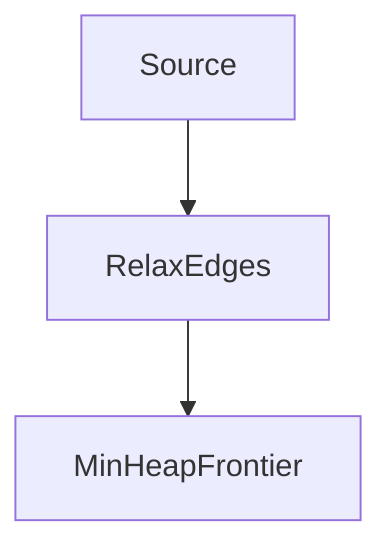

# D02-T013 — Shortest-path algorithms

Topic ID: `D02-T013`
Domain: Data Structures and Algorithms
Subdomain: Shortest-path algorithms
Importance: core
Complexity: intermediate
Dependencies: `D02-T012`, `D02-T001`, `D01-T001`, `D01-T002`
Execution status of the code in section F: unexecuted

## A. Topic Overview

Unweighted graphs use BFS. Non-negative weights use Dijkstra. Negative edges need Bellman-Ford. Wrong algorithm choice breaks correctness or performance.

Prerequisites: `D02-T012`, `D02-T001`, `D01-T001`, `D01-T002`. This topic supports `D02-T014`.

## B. First-Principles Explanation

Relax edges: if dist[u]+w < dist[v], improve dist[v]. Dijkstra greedily settles min vertex with non-negative weights.

## C. Internal Working and Architecture

Priority queue stores frontier. Early exit when target popped. A* adds heuristic for maps.

Dominant time: BFS O(V+E) unweighted; Dijkstra O((V+E) log V) with heap; Bellman-Ford O(VE) with negative edges. Dominant auxiliary space: O(V) distance map plus heap.

## D. Diagrams and Visual Models



Non-negative weights enable Dijkstra.

## E. Examples and Analogies

Pick lowest-latency path between services with measured edge weights. Cap hops with BFS level.

Edge cases: Unreachable node dist infinity, self-loop weight 0, overflow on large weights.

## F. Code Examples

File: `examples/d02_t013_dijkstra.py`

```python
import heapq


def dijkstra(adj: list[list[tuple[int, int]]], src: int) -> list[int]:
    n = len(adj)
    dist = [10**18] * n
    dist[src] = 0
    pq: list[tuple[int, int]] = [(0, src)]
    while pq:
        d, u = heapq.heappop(pq)
        if d != dist[u]:
            continue
        for v, w in adj[u]:
            nd = d + w
            if nd < dist[v]:
                dist[v] = nd
                heapq.heappush(pq, (nd, v))
    return dist
```

Weighted adjacency list of (neighbor, weight). O((V+E) log V) with binary heap.

## G. Practical Backend Application

Refresh edge weights from metrics; stale weights misroute. Bound graph size per query.

## H. Advantages, Limitations and Trade-offs

| Choice | Benefit | Cost | Choose when | Avoid when |
| --- | --- | --- | --- | --- |
| BFS | Unweighted shortest | Not for weights | Hop count | Latency weights |
| Dijkstra | Non-negative weights | No negative edges | Service mesh | Negative cost |
| Bellman-Ford | Negative edges | Slower | Finance nets | Non-negative only |

## I. Common Mistakes and Misconceptions

- Dijkstra with negative weight.
- Using BFS on weighted graph.
- Not handling unreachable nodes.

## J. Debugging and Troubleshooting

Routes absurd—check weight sign and units. Slow—dense graph without heap.

## K. Interview Preparation

### Beginner

#### Q1. What problem does Shortest-path algorithms solve in backend engineering?

**Answer:** Shortest path minimizes sum of edge weights subject to graph rules; algorithm choice depends on weights and negativity. For Shortest-path algorithms, typical bounds are BFS O(V+E) unweighted; Dijkstra O((V+E) log V) with heap; Bellman-Ford O(VE) with negative edges time and O(V) distance map plus heap space. Route planning, latency-aware routing, and cost minimization in workflows use shortest-path variants. Watch edge cases: negative cycles, disconnected targets, zero-weight edges, integer overflow on distance.

#### Q2. How do you define input size n for shortest-path algorithms?

**Answer:** Shortest path minimizes sum of edge weights subject to graph rules; algorithm choice depends on weights and negativity. For Shortest-path algorithms, typical bounds are BFS O(V+E) unweighted; Dijkstra O((V+E) log V) with heap; Bellman-Ford O(VE) with negative edges time and O(V) distance map plus heap space. Route planning, latency-aware routing, and cost minimization in workflows use shortest-path variants. Watch edge cases: negative cycles, disconnected targets, zero-weight edges, integer overflow on distance.

#### Q3. What is the difference between time and space cost here?

**Answer:** Shortest path minimizes sum of edge weights subject to graph rules; algorithm choice depends on weights and negativity. For Shortest-path algorithms, typical bounds are BFS O(V+E) unweighted; Dijkstra O((V+E) log V) with heap; Bellman-Ford O(VE) with negative edges time and O(V) distance map plus heap space. Route planning, latency-aware routing, and cost minimization in workflows use shortest-path variants. Watch edge cases: negative cycles, disconnected targets, zero-weight edges, integer overflow on distance.

#### Q4. Why do we ignore constant factors in asymptotic notation for this topic?

**Answer:** Shortest path minimizes sum of edge weights subject to graph rules; algorithm choice depends on weights and negativity. For Shortest-path algorithms, typical bounds are BFS O(V+E) unweighted; Dijkstra O((V+E) log V) with heap; Bellman-Ford O(VE) with negative edges time and O(V) distance map plus heap space. Route planning, latency-aware routing, and cost minimization in workflows use shortest-path variants. Watch edge cases: negative cycles, disconnected targets, zero-weight edges, integer overflow on distance.

#### Q5. Name one operation that is cheap and one that is expensive in this structure.

**Answer:** Shortest path minimizes sum of edge weights subject to graph rules; algorithm choice depends on weights and negativity. For Shortest-path algorithms, typical bounds are BFS O(V+E) unweighted; Dijkstra O((V+E) log V) with heap; Bellman-Ford O(VE) with negative edges time and O(V) distance map plus heap space. Route planning, latency-aware routing, and cost minimization in workflows use shortest-path variants. Watch edge cases: negative cycles, disconnected targets, zero-weight edges, integer overflow on distance.

### Intermediate

#### Q1. State the average and worst-case complexity for the main operations.

**Answer:** Shortest path minimizes sum of edge weights subject to graph rules; algorithm choice depends on weights and negativity. For Shortest-path algorithms, typical bounds are BFS O(V+E) unweighted; Dijkstra O((V+E) log V) with heap; Bellman-Ford O(VE) with negative edges time and O(V) distance map plus heap space. Route planning, latency-aware routing, and cost minimization in workflows use shortest-path variants. Watch edge cases: negative cycles, disconnected targets, zero-weight edges, integer overflow on distance.

#### Q2. How would you justify choosing this structure in a design review?

**Answer:** Shortest path minimizes sum of edge weights subject to graph rules; algorithm choice depends on weights and negativity. For Shortest-path algorithms, typical bounds are BFS O(V+E) unweighted; Dijkstra O((V+E) log V) with heap; Bellman-Ford O(VE) with negative edges time and O(V) distance map plus heap space. Route planning, latency-aware routing, and cost minimization in workflows use shortest-path variants. Watch edge cases: negative cycles, disconnected targets, zero-weight edges, integer overflow on distance.

#### Q3. What changes if data no longer fits in memory?

**Answer:** Shortest path minimizes sum of edge weights subject to graph rules; algorithm choice depends on weights and negativity. For Shortest-path algorithms, typical bounds are BFS O(V+E) unweighted; Dijkstra O((V+E) log V) with heap; Bellman-Ford O(VE) with negative edges time and O(V) distance map plus heap space. Route planning, latency-aware routing, and cost minimization in workflows use shortest-path variants. Watch edge cases: negative cycles, disconnected targets, zero-weight edges, integer overflow on distance.

#### Q4. How does concurrency affect the complexity story?

**Answer:** Shortest path minimizes sum of edge weights subject to graph rules; algorithm choice depends on weights and negativity. For Shortest-path algorithms, typical bounds are BFS O(V+E) unweighted; Dijkstra O((V+E) log V) with heap; Bellman-Ford O(VE) with negative edges time and O(V) distance map plus heap space. Route planning, latency-aware routing, and cost minimization in workflows use shortest-path variants. Watch edge cases: negative cycles, disconnected targets, zero-weight edges, integer overflow on distance.

#### Q5. How do you test performance regressions for this component?

**Answer:** Shortest path minimizes sum of edge weights subject to graph rules; algorithm choice depends on weights and negativity. For Shortest-path algorithms, typical bounds are BFS O(V+E) unweighted; Dijkstra O((V+E) log V) with heap; Bellman-Ford O(VE) with negative edges time and O(V) distance map plus heap space. Route planning, latency-aware routing, and cost minimization in workflows use shortest-path variants. Watch edge cases: negative cycles, disconnected targets, zero-weight edges, integer overflow on distance.

### Advanced

#### Q1. When is the 'textbook' complexity misleading in production?

**Answer:** Shortest path minimizes sum of edge weights subject to graph rules; algorithm choice depends on weights and negativity. For Shortest-path algorithms, typical bounds are BFS O(V+E) unweighted; Dijkstra O((V+E) log V) with heap; Bellman-Ford O(VE) with negative edges time and O(V) distance map plus heap space. Route planning, latency-aware routing, and cost minimization in workflows use shortest-path variants. Watch edge cases: negative cycles, disconnected targets, zero-weight edges, integer overflow on distance.

#### Q2. How do cache locality and allocation affect real runtime?

**Answer:** Shortest path minimizes sum of edge weights subject to graph rules; algorithm choice depends on weights and negativity. For Shortest-path algorithms, typical bounds are BFS O(V+E) unweighted; Dijkstra O((V+E) log V) with heap; Bellman-Ford O(VE) with negative edges time and O(V) distance map plus heap space. Route planning, latency-aware routing, and cost minimization in workflows use shortest-path variants. Watch edge cases: negative cycles, disconnected targets, zero-weight edges, integer overflow on distance.

#### Q3. Compare this approach to the next topic in the curriculum.

**Answer:** Shortest path minimizes sum of edge weights subject to graph rules; algorithm choice depends on weights and negativity. For Shortest-path algorithms, typical bounds are BFS O(V+E) unweighted; Dijkstra O((V+E) log V) with heap; Bellman-Ford O(VE) with negative edges time and O(V) distance map plus heap space. Route planning, latency-aware routing, and cost minimization in workflows use shortest-path variants. Watch edge cases: negative cycles, disconnected targets, zero-weight edges, integer overflow on distance.

#### Q4. What security or abuse patterns change effective n?

**Answer:** Shortest path minimizes sum of edge weights subject to graph rules; algorithm choice depends on weights and negativity. For Shortest-path algorithms, typical bounds are BFS O(V+E) unweighted; Dijkstra O((V+E) log V) with heap; Bellman-Ford O(VE) with negative edges time and O(V) distance map plus heap space. Route planning, latency-aware routing, and cost minimization in workflows use shortest-path variants. Watch edge cases: negative cycles, disconnected targets, zero-weight edges, integer overflow on distance.

#### Q5. How would you document complexity in an OpenAPI or ADR?

**Answer:** Shortest path minimizes sum of edge weights subject to graph rules; algorithm choice depends on weights and negativity. For Shortest-path algorithms, typical bounds are BFS O(V+E) unweighted; Dijkstra O((V+E) log V) with heap; Bellman-Ford O(VE) with negative edges time and O(V) distance map plus heap space. Route planning, latency-aware routing, and cost minimization in workflows use shortest-path variants. Watch edge cases: negative cycles, disconnected targets, zero-weight edges, integer overflow on distance.

### Scenarios

#### Q1. Latency spikes when traffic doubles but CPU is only 60%. What do you measure first?

**Answer:** Shortest path minimizes sum of edge weights subject to graph rules; algorithm choice depends on weights and negativity. For Shortest-path algorithms, typical bounds are BFS O(V+E) unweighted; Dijkstra O((V+E) log V) with heap; Bellman-Ford O(VE) with negative edges time and O(V) distance map plus heap space. Route planning, latency-aware routing, and cost minimization in workflows use shortest-path variants. Watch edge cases: negative cycles, disconnected targets, zero-weight edges, integer overflow on distance.

#### Q2. A batch job OOMs on a larger tenant. Which space term grew?

**Answer:** Shortest path minimizes sum of edge weights subject to graph rules; algorithm choice depends on weights and negativity. For Shortest-path algorithms, typical bounds are BFS O(V+E) unweighted; Dijkstra O((V+E) log V) with heap; Bellman-Ford O(VE) with negative edges time and O(V) distance map plus heap space. Route planning, latency-aware routing, and cost minimization in workflows use shortest-path variants. Watch edge cases: negative cycles, disconnected targets, zero-weight edges, integer overflow on distance.

#### Q3. Two services disagree on timeout budgets for the same endpoint.

**Answer:** Shortest path minimizes sum of edge weights subject to graph rules; algorithm choice depends on weights and negativity. For Shortest-path algorithms, typical bounds are BFS O(V+E) unweighted; Dijkstra O((V+E) log V) with heap; Bellman-Ford O(VE) with negative edges time and O(V) distance map plus heap space. Route planning, latency-aware routing, and cost minimization in workflows use shortest-path variants. Watch edge cases: negative cycles, disconnected targets, zero-weight edges, integer overflow on distance.

#### Q4. An attacker sends inputs that trigger worst-case behavior.

**Answer:** Shortest path minimizes sum of edge weights subject to graph rules; algorithm choice depends on weights and negativity. For Shortest-path algorithms, typical bounds are BFS O(V+E) unweighted; Dijkstra O((V+E) log V) with heap; Bellman-Ford O(VE) with negative edges time and O(V) distance map plus heap space. Route planning, latency-aware routing, and cost minimization in workflows use shortest-path variants. Watch edge cases: negative cycles, disconnected targets, zero-weight edges, integer overflow on distance.

#### Q5. You must shave 100ms off a hot path without new hardware.

**Answer:** Shortest path minimizes sum of edge weights subject to graph rules; algorithm choice depends on weights and negativity. For Shortest-path algorithms, typical bounds are BFS O(V+E) unweighted; Dijkstra O((V+E) log V) with heap; Bellman-Ford O(VE) with negative edges time and O(V) distance map plus heap space. Route planning, latency-aware routing, and cost minimization in workflows use shortest-path variants. Watch edge cases: negative cycles, disconnected targets, zero-weight edges, integer overflow on distance.

### Follow-ups

#### Q1. How does this connect to database indexing?

**Answer:** Shortest path minimizes sum of edge weights subject to graph rules; algorithm choice depends on weights and negativity. For Shortest-path algorithms, typical bounds are BFS O(V+E) unweighted; Dijkstra O((V+E) log V) with heap; Bellman-Ford O(VE) with negative edges time and O(V) distance map plus heap space. Route planning, latency-aware routing, and cost minimization in workflows use shortest-path variants. Watch edge cases: negative cycles, disconnected targets, zero-weight edges, integer overflow on distance.

#### Q2. How does this connect to caching layers?

**Answer:** Shortest path minimizes sum of edge weights subject to graph rules; algorithm choice depends on weights and negativity. For Shortest-path algorithms, typical bounds are BFS O(V+E) unweighted; Dijkstra O((V+E) log V) with heap; Bellman-Ford O(VE) with negative edges time and O(V) distance map plus heap space. Route planning, latency-aware routing, and cost minimization in workflows use shortest-path variants. Watch edge cases: negative cycles, disconnected targets, zero-weight edges, integer overflow on distance.

#### Q3. What monitoring proves your complexity assumption?

**Answer:** Shortest path minimizes sum of edge weights subject to graph rules; algorithm choice depends on weights and negativity. For Shortest-path algorithms, typical bounds are BFS O(V+E) unweighted; Dijkstra O((V+E) log V) with heap; Bellman-Ford O(VE) with negative edges time and O(V) distance map plus heap space. Route planning, latency-aware routing, and cost minimization in workflows use shortest-path variants. Watch edge cases: negative cycles, disconnected targets, zero-weight edges, integer overflow on distance.

## L. Practical Exercises

Solutions: `EXERCISES/solutions/D02-T013.md`.

### Exercise 1 — implementation

Implement Dijkstra with stale-entry skip (`d != dist[u]`). Acceptance: correct distances on sample graph; stale skip explained.

### Exercise 2 — debugging

Negative 'credit' edge breaks routing—which algorithm? Acceptance: Bellman-Ford or remove negative; Dijkstra invalid.

### Exercise 3 — trade-off

Precompute all-pairs versus per-query Dijkstra in API. Acceptance: Floyd-Warshall O(V^3) rare; cache for static graph.

## M. Revision Notes

- BFS unweighted.
- Dijkstra non-negative.
- Heap frontier.

## N. Related Topics

Supports `D02-T014`. Often confused with Dijkstra versus BFS. See `D02-T008`, `D02-T011`.

## O. Completion Criteria

- Implement Dijkstra.
- Choose algorithm by weights.
- State unreachable handling.
