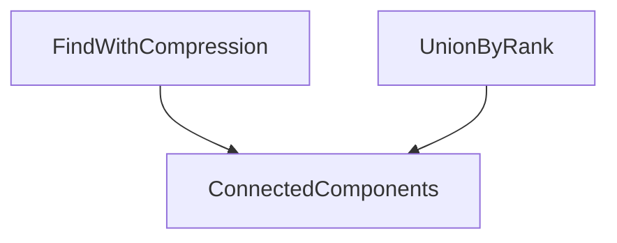

# D02-T014 — Union-Find / Disjoint Set Union

Topic ID: `D02-T014`
Domain: Data Structures and Algorithms
Subdomain: Union-Find / Disjoint Set Union
Importance: core
Complexity: intermediate
Dependencies: `D02-T013`, `D02-T001`, `D01-T001`, `D01-T002`
Execution status of the code in section F: unexecuted

## A. Topic Overview

Instead of explicit graphs per query, DSU tracks components dynamically as edges arrive. Path compression and union by rank keep operations almost constant.

Prerequisites: `D02-T013`, `D02-T001`, `D01-T001`, `D01-T002`. This topic supports `D02-T015`.

## B. First-Principles Explanation

Each element points to parent; root identifies set. Find walks to root; union attaches one root under another by rank.

## C. Internal Working and Architecture

Amortized analysis uses inverse Ackermann alpha(n), effectively constant for practical n.

Dominant time: O(alpha(n)) amortized per union/find with rank and path compression. Dominant auxiliary space: O(n) parent and rank arrays.

## D. Diagrams and Visual Models



Two operations maintain components.

## E. Examples and Analogies

Detect if adding network link creates single connected datacenter partition. Cluster user accounts by verified edges offline.

Edge cases: Union on last element only without find roots; counting components after unions.

## F. Code Examples

File: `examples/d02_t014_dsu.py`

```python
class DSU:
    def __init__(self, n: int):
        self.p = list(range(n))
        self.r = [0] * n

    def find(self, x: int) -> int:
        while self.p[x] != x:
            self.p[x] = self.p[self.p[x]]
            x = self.p[x]
        return x

    def union(self, a: int, b: int) -> bool:
        ra, rb = self.find(a), self.find(b)
        if ra == rb:
            return False
        if self.r[ra] < self.r[rb]:
            ra, rb = rb, ra
        self.p[rb] = ra
        if self.r[ra] == self.r[rb]:
            self.r[ra] += 1
        return True
```

Union returns False if already connected. Amortized O(alpha(n)) per op.

## G. Practical Backend Application

Batch union-find offline; online queries may need graph DB. Validate vertex ids before union.

## H. Advantages, Limitations and Trade-offs

| Choice | Benefit | Cost | Choose when | Avoid when |
| --- | --- | --- | --- | --- |
| DSU | Near O(1) connectivity | Offline dynamic | Kruskal, clustering | Need full path list |
| BFS each query | Finds paths | O(V+E) per query | Single query | Millions unions |
| Graph DB | Expressive | Ops cost | Persistent graph | Simple connectivity |

## I. Common Mistakes and Misconceptions

- Union without compressing paths.
- O(n) find each time in loops.
- Wrong index base.

## J. Debugging and Troubleshooting

Slow connectivity—missing path compression. Wrong component count—union on non-roots.

## K. Interview Preparation

### Beginner

#### Q1. What problem does Union-Find / Disjoint Set Union solve in backend engineering?

**Answer:** Union-Find maintains disjoint sets with near-constant merge and same-set queries. For Union-Find / Disjoint Set Union, typical bounds are O(alpha(n)) amortized per union/find with rank and path compression time and O(n) parent and rank arrays space. Connectivity, Kruskal MST, network merge, and duplicate account clustering use DSU. Watch edge cases: union before find on wrong elements, 1-indexed vs 0-indexed, need component sizes.

#### Q2. How do you define input size n for union-find / disjoint set union?

**Answer:** Union-Find maintains disjoint sets with near-constant merge and same-set queries. For Union-Find / Disjoint Set Union, typical bounds are O(alpha(n)) amortized per union/find with rank and path compression time and O(n) parent and rank arrays space. Connectivity, Kruskal MST, network merge, and duplicate account clustering use DSU. Watch edge cases: union before find on wrong elements, 1-indexed vs 0-indexed, need component sizes.

#### Q3. What is the difference between time and space cost here?

**Answer:** Union-Find maintains disjoint sets with near-constant merge and same-set queries. For Union-Find / Disjoint Set Union, typical bounds are O(alpha(n)) amortized per union/find with rank and path compression time and O(n) parent and rank arrays space. Connectivity, Kruskal MST, network merge, and duplicate account clustering use DSU. Watch edge cases: union before find on wrong elements, 1-indexed vs 0-indexed, need component sizes.

#### Q4. Why do we ignore constant factors in asymptotic notation for this topic?

**Answer:** Union-Find maintains disjoint sets with near-constant merge and same-set queries. For Union-Find / Disjoint Set Union, typical bounds are O(alpha(n)) amortized per union/find with rank and path compression time and O(n) parent and rank arrays space. Connectivity, Kruskal MST, network merge, and duplicate account clustering use DSU. Watch edge cases: union before find on wrong elements, 1-indexed vs 0-indexed, need component sizes.

#### Q5. Name one operation that is cheap and one that is expensive in this structure.

**Answer:** Union-Find maintains disjoint sets with near-constant merge and same-set queries. For Union-Find / Disjoint Set Union, typical bounds are O(alpha(n)) amortized per union/find with rank and path compression time and O(n) parent and rank arrays space. Connectivity, Kruskal MST, network merge, and duplicate account clustering use DSU. Watch edge cases: union before find on wrong elements, 1-indexed vs 0-indexed, need component sizes.

### Intermediate

#### Q1. State the average and worst-case complexity for the main operations.

**Answer:** Union-Find maintains disjoint sets with near-constant merge and same-set queries. For Union-Find / Disjoint Set Union, typical bounds are O(alpha(n)) amortized per union/find with rank and path compression time and O(n) parent and rank arrays space. Connectivity, Kruskal MST, network merge, and duplicate account clustering use DSU. Watch edge cases: union before find on wrong elements, 1-indexed vs 0-indexed, need component sizes.

#### Q2. How would you justify choosing this structure in a design review?

**Answer:** Union-Find maintains disjoint sets with near-constant merge and same-set queries. For Union-Find / Disjoint Set Union, typical bounds are O(alpha(n)) amortized per union/find with rank and path compression time and O(n) parent and rank arrays space. Connectivity, Kruskal MST, network merge, and duplicate account clustering use DSU. Watch edge cases: union before find on wrong elements, 1-indexed vs 0-indexed, need component sizes.

#### Q3. What changes if data no longer fits in memory?

**Answer:** Union-Find maintains disjoint sets with near-constant merge and same-set queries. For Union-Find / Disjoint Set Union, typical bounds are O(alpha(n)) amortized per union/find with rank and path compression time and O(n) parent and rank arrays space. Connectivity, Kruskal MST, network merge, and duplicate account clustering use DSU. Watch edge cases: union before find on wrong elements, 1-indexed vs 0-indexed, need component sizes.

#### Q4. How does concurrency affect the complexity story?

**Answer:** Union-Find maintains disjoint sets with near-constant merge and same-set queries. For Union-Find / Disjoint Set Union, typical bounds are O(alpha(n)) amortized per union/find with rank and path compression time and O(n) parent and rank arrays space. Connectivity, Kruskal MST, network merge, and duplicate account clustering use DSU. Watch edge cases: union before find on wrong elements, 1-indexed vs 0-indexed, need component sizes.

#### Q5. How do you test performance regressions for this component?

**Answer:** Union-Find maintains disjoint sets with near-constant merge and same-set queries. For Union-Find / Disjoint Set Union, typical bounds are O(alpha(n)) amortized per union/find with rank and path compression time and O(n) parent and rank arrays space. Connectivity, Kruskal MST, network merge, and duplicate account clustering use DSU. Watch edge cases: union before find on wrong elements, 1-indexed vs 0-indexed, need component sizes.

### Advanced

#### Q1. When is the 'textbook' complexity misleading in production?

**Answer:** Union-Find maintains disjoint sets with near-constant merge and same-set queries. For Union-Find / Disjoint Set Union, typical bounds are O(alpha(n)) amortized per union/find with rank and path compression time and O(n) parent and rank arrays space. Connectivity, Kruskal MST, network merge, and duplicate account clustering use DSU. Watch edge cases: union before find on wrong elements, 1-indexed vs 0-indexed, need component sizes.

#### Q2. How do cache locality and allocation affect real runtime?

**Answer:** Union-Find maintains disjoint sets with near-constant merge and same-set queries. For Union-Find / Disjoint Set Union, typical bounds are O(alpha(n)) amortized per union/find with rank and path compression time and O(n) parent and rank arrays space. Connectivity, Kruskal MST, network merge, and duplicate account clustering use DSU. Watch edge cases: union before find on wrong elements, 1-indexed vs 0-indexed, need component sizes.

#### Q3. Compare this approach to the next topic in the curriculum.

**Answer:** Union-Find maintains disjoint sets with near-constant merge and same-set queries. For Union-Find / Disjoint Set Union, typical bounds are O(alpha(n)) amortized per union/find with rank and path compression time and O(n) parent and rank arrays space. Connectivity, Kruskal MST, network merge, and duplicate account clustering use DSU. Watch edge cases: union before find on wrong elements, 1-indexed vs 0-indexed, need component sizes.

#### Q4. What security or abuse patterns change effective n?

**Answer:** Union-Find maintains disjoint sets with near-constant merge and same-set queries. For Union-Find / Disjoint Set Union, typical bounds are O(alpha(n)) amortized per union/find with rank and path compression time and O(n) parent and rank arrays space. Connectivity, Kruskal MST, network merge, and duplicate account clustering use DSU. Watch edge cases: union before find on wrong elements, 1-indexed vs 0-indexed, need component sizes.

#### Q5. How would you document complexity in an OpenAPI or ADR?

**Answer:** Union-Find maintains disjoint sets with near-constant merge and same-set queries. For Union-Find / Disjoint Set Union, typical bounds are O(alpha(n)) amortized per union/find with rank and path compression time and O(n) parent and rank arrays space. Connectivity, Kruskal MST, network merge, and duplicate account clustering use DSU. Watch edge cases: union before find on wrong elements, 1-indexed vs 0-indexed, need component sizes.

### Scenarios

#### Q1. Latency spikes when traffic doubles but CPU is only 60%. What do you measure first?

**Answer:** Union-Find maintains disjoint sets with near-constant merge and same-set queries. For Union-Find / Disjoint Set Union, typical bounds are O(alpha(n)) amortized per union/find with rank and path compression time and O(n) parent and rank arrays space. Connectivity, Kruskal MST, network merge, and duplicate account clustering use DSU. Watch edge cases: union before find on wrong elements, 1-indexed vs 0-indexed, need component sizes.

#### Q2. A batch job OOMs on a larger tenant. Which space term grew?

**Answer:** Union-Find maintains disjoint sets with near-constant merge and same-set queries. For Union-Find / Disjoint Set Union, typical bounds are O(alpha(n)) amortized per union/find with rank and path compression time and O(n) parent and rank arrays space. Connectivity, Kruskal MST, network merge, and duplicate account clustering use DSU. Watch edge cases: union before find on wrong elements, 1-indexed vs 0-indexed, need component sizes.

#### Q3. Two services disagree on timeout budgets for the same endpoint.

**Answer:** Union-Find maintains disjoint sets with near-constant merge and same-set queries. For Union-Find / Disjoint Set Union, typical bounds are O(alpha(n)) amortized per union/find with rank and path compression time and O(n) parent and rank arrays space. Connectivity, Kruskal MST, network merge, and duplicate account clustering use DSU. Watch edge cases: union before find on wrong elements, 1-indexed vs 0-indexed, need component sizes.

#### Q4. An attacker sends inputs that trigger worst-case behavior.

**Answer:** Union-Find maintains disjoint sets with near-constant merge and same-set queries. For Union-Find / Disjoint Set Union, typical bounds are O(alpha(n)) amortized per union/find with rank and path compression time and O(n) parent and rank arrays space. Connectivity, Kruskal MST, network merge, and duplicate account clustering use DSU. Watch edge cases: union before find on wrong elements, 1-indexed vs 0-indexed, need component sizes.

#### Q5. You must shave 100ms off a hot path without new hardware.

**Answer:** Union-Find maintains disjoint sets with near-constant merge and same-set queries. For Union-Find / Disjoint Set Union, typical bounds are O(alpha(n)) amortized per union/find with rank and path compression time and O(n) parent and rank arrays space. Connectivity, Kruskal MST, network merge, and duplicate account clustering use DSU. Watch edge cases: union before find on wrong elements, 1-indexed vs 0-indexed, need component sizes.

### Follow-ups

#### Q1. How does this connect to database indexing?

**Answer:** Union-Find maintains disjoint sets with near-constant merge and same-set queries. For Union-Find / Disjoint Set Union, typical bounds are O(alpha(n)) amortized per union/find with rank and path compression time and O(n) parent and rank arrays space. Connectivity, Kruskal MST, network merge, and duplicate account clustering use DSU. Watch edge cases: union before find on wrong elements, 1-indexed vs 0-indexed, need component sizes.

#### Q2. How does this connect to caching layers?

**Answer:** Union-Find maintains disjoint sets with near-constant merge and same-set queries. For Union-Find / Disjoint Set Union, typical bounds are O(alpha(n)) amortized per union/find with rank and path compression time and O(n) parent and rank arrays space. Connectivity, Kruskal MST, network merge, and duplicate account clustering use DSU. Watch edge cases: union before find on wrong elements, 1-indexed vs 0-indexed, need component sizes.

#### Q3. What monitoring proves your complexity assumption?

**Answer:** Union-Find maintains disjoint sets with near-constant merge and same-set queries. For Union-Find / Disjoint Set Union, typical bounds are O(alpha(n)) amortized per union/find with rank and path compression time and O(n) parent and rank arrays space. Connectivity, Kruskal MST, network merge, and duplicate account clustering use DSU. Watch edge cases: union before find on wrong elements, 1-indexed vs 0-indexed, need component sizes.

## L. Practical Exercises

Solutions: `EXERCISES/solutions/D02-T014.md`.

### Exercise 1 — implementation

Implement DSU with path compression and union by rank. Acceptance: `union` returns False when already connected; find compresses paths.

### Exercise 2 — debugging

Kruskal MST step needs DSU—explain why. Acceptance: reject cycle edge when endpoints same component.

### Exercise 3 — trade-off

DSU versus BFS for 1M union queries streaming. Acceptance: DSU O(m alpha(n)); BFS per edge too slow.

## M. Revision Notes

- find + union.
- compress + rank.
- alpha(n) amortized.

## N. Related Topics

Supports `D02-T015`. Often confused with DSU versus connected components BFS. See `D02-T010`, `D02-T011`.

## O. Completion Criteria

- Write DSU ops.
- Explain Kruskal use.
- Compare streaming unions.
