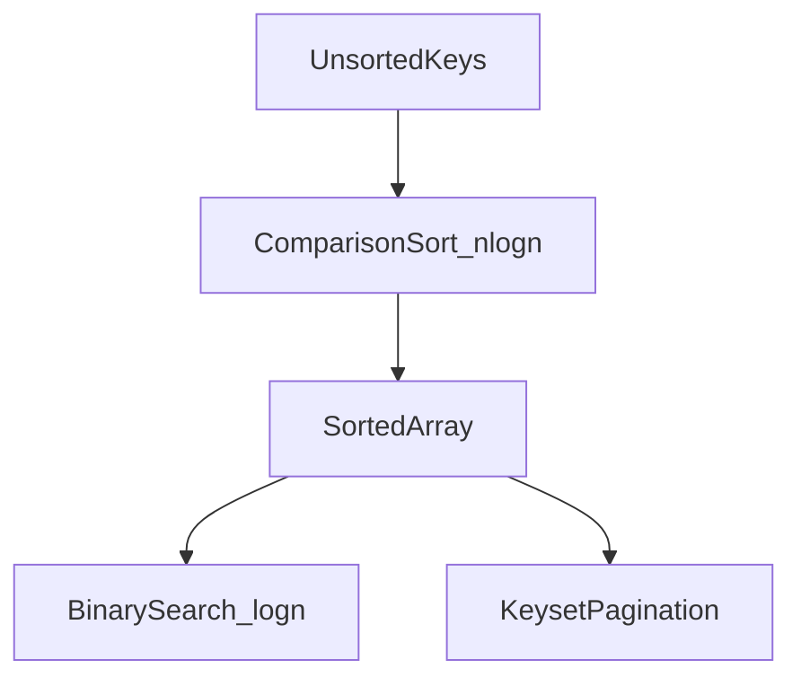

# D02-T015 — Sorting and searching

Topic ID: `D02-T015`
Domain: Data Structures and Algorithms
Subdomain: Sorting and searching
Importance: core
Complexity: intermediate
Dependencies: `D02-T014`, `D02-T001`, `D01-T001`, `D01-T002`
Execution status of the code in section F: unexecuted

## A. Topic Overview

Sorting arranges items in a total order so later algorithms can scan, merge, or binary-search efficiently. Searching finds a target in a collection, ideally without examining every element. Together they underpin indexes, ranking, deduplication, and “top K” APIs.

The concept exists because unsorted data forces linear scans. A sorted array or an index structure turns “find the next row after this key” into logarithmic or constant work. Interviewers use sorting and searching to test whether you know stability, comparator contracts, and when O(n log n) is unavoidable.

In production you rarely implement mergesort from scratch; you choose library sorts, database indexes, and external sort for spill-to-disk. You still must know complexity, stability, and when a partial sort (`nth_element`, `LIMIT` with index) beats full sort.

Prerequisites: arrays, comparators, and basic graph/union topics through `D02-T014`. Later topics (`D02-T016` binary search patterns) assume you can reason about sorted order.

## B. First-Principles Explanation

Comparison sort lower bound: any comparison-based sort that only uses `<` outcomes needs Ω(n log n) comparisons in the worst case (decision-tree argument with n! leaves). That is why general-purpose in-memory sorts cluster around O(n log n) time and O(n) extra space (mergesort) or O(1) extra space with worse constants (heapsort).

What happens internally for mergesort:

1. Split the range until subranges have length 1 (already sorted).
2. Merge pairs of sorted subranges with a linear scan, picking the smaller head each time.
3. Recursion depth is O(log n); each level touches all n elements → O(n log n) time.

Binary search on a sorted array:

1. Maintain `[lo, hi]` inclusive or half-open invariant.
2. Compare `mid` with the target; discard half the range.
3. Stop when found or range empty → O(log n) comparisons, O(1) space.

Non-comparison sorts (counting, radix) exploit key structure: integers in a bounded range sort in O(n + k) or O(n w) for w-bit keys. They fail when the comparator is arbitrary.

Terms: **stable** sort preserves relative order of equal keys; **in-place** uses O(1) auxiliary space beyond swaps; **adaptive** sort runs faster on nearly sorted input (timsort).

## C. Internal Working and Architecture

Components:

- **Comparator** defines strict weak ordering; violating transitivity breaks library sorts and `TreeMap`.
- **Sort algorithm** reorders indices or moves elements; Java `Arrays.sort` uses dual-pivot quicksort for primitives and timsort for objects.
- **Search structure** may be a sorted array, B-tree index page, or hash table (O(1) average, no order).

Backend flow for “list users by `created_at` desc, page 2”:

1. Planner checks index on `(created_at)` or composite `(tenant_id, created_at)`.
2. Index scan returns rows in order without sorting the whole table.
3. `OFFSET/LIMIT` or keyset pagination applies; offset pagination still costs O(offset) to skip.

Data flow: ORM issues `ORDER BY` → database may sort in memory (small) or use index order (large). Missing index → filesort + temp disk → latency spike under load.

Memory: sorting n records of size s needs Ω(n s) to touch all keys; mergesort needs another O(n s) for output buffer unless in-place merge is impractical.

## D. Diagrams and Visual Models



Read left to right: sort once (or maintain order via index), then logarithmic lookup or sequential scan in sort order for pagination.

## E. Examples and Analogies

Analogy: sorting a deck of cards by merging two sorted piles is mergesort—each merge step is one linear pass. Searching a phone book is binary search: open middle, discard half.

Technical example: duplicate detection in a stream of event ids—sort then scan adjacent pairs is O(n log n); hash set is O(n) average. Choose sort when memory is tight and ids fit in RAM for one pass, or when you need the duplicates grouped.

Backend example: nightly job ranks SKUs by revenue. SQL `ORDER BY revenue DESC LIMIT 100` with an index on `(revenue)` avoids sorting millions of rows. Without index, complexity is O(n log n) per run.

Do not sort when a hash map or heap of size k suffices (`top K`). Do not use binary search on unsorted data. Do not assume `sort()` is stable in every language (C++ `sort` is not; `stable_sort` is).

## F. Code Examples

File: `examples/d02_t015_sort_search.py`

Dependencies: Python 3 standard library only.

```python
from typing import List, Optional, TypeVar

T = TypeVar("T")


def merge_sort(arr: List[T], key=lambda x: x) -> List[T]:
    if len(arr) <= 1:
        return arr[:]
    mid = len(arr) // 2
    left = merge_sort(arr[:mid], key)
    right = merge_sort(arr[mid:], key)
    out: List[T] = []
    i = j = 0
    while i < len(left) and j < len(right):
        if key(left[i]) <= key(right[j]):
            out.append(left[i])
            i += 1
        else:
            out.append(right[j])
            j += 1
    out.extend(left[i:])
    out.extend(right[j:])
    return out


def binary_search_first(sorted_arr: List[int], target: int) -> Optional[int]:
    lo, hi = 0, len(sorted_arr)
    while lo < hi:
        mid = (lo + hi) // 2
        if sorted_arr[mid] < target:
            lo = mid + 1
        else:
            hi = mid
    if lo < len(sorted_arr) and sorted_arr[lo] == target:
        return lo
    return None


if __name__ == "__main__":
    data = [3, 1, 4, 1, 5]
    assert merge_sort(data) == [1, 1, 3, 4, 5]
    s = [1, 2, 2, 4, 5]
    assert binary_search_first(s, 2) == 1
    assert binary_search_first(s, 3) is None
```

How to run: `python examples/d02_t015_sort_search.py` from the topic folder.

Expected output: silent success (no output unless you add a print).

Complexity: merge sort O(n log n) time, O(n) auxiliary space; binary search O(log n) time, O(1) space. Stable merge uses `<=` on the left copy.

This example was not executed in the authoring environment.

## G. Practical Backend Application

Admin APIs expose sortable columns; enforce allow-listed `sort` fields to prevent SQL injection via `ORDER BY`. Default to indexed columns. For search, prefer database indexes or Elasticsearch inverted indexes over loading all ids into the app and sorting.

Concurrent requests each run their own sort; shared caches of sorted lists need invalidation on writes. Error handling: reject unknown sort keys with 400. Observability: track slow queries tagged `filesort`. Scaling: external merge sort for ETL; in OLTP, indexes move cost from CPU sort to write amplification on insert.

## H. Advantages, Limitations and Trade-offs

| Choice | Benefit | Cost | Choose when | Avoid when |
| --- | --- | --- | --- | --- |
| Full sort | Simple, exact order | O(n log n) | Small n, one-off reports | Top-k on huge n |
| Heap top-k | O(n log k) | Not full order | Leaderboards | Need stable full ranking |
| Hash search | O(1) average | No order | Point lookups | Range queries |
| Index order | Avoid sort at read | Write + storage | Hot `ORDER BY` | Rarely queried columns |
| Stable sort | Keeps tie order | Extra work | Multi-key UI | Only totals matter |

Failure modes: non-transitive comparators cause undefined order; sorting on float without epsilon breaks equality; locale-aware string sort surprises in indexes.

## I. Common Mistakes and Misconceptions

- Calling binary search on a rotated or unsorted array without restoring invariant.
- Using `==` on floats after sort instead of index-based dedup.
- Assuming quicksort is O(n log n) worst case—it is O(n²) with bad pivots; libraries mitigate.
- Sorting then binary searching each query when one hash map build suffices.
- `ORDER BY RANDOM()` for “fair” selection—O(n) full scan every time.

Weak interview answer: naming only “bubble sort O(n²)”. Strong answer: states comparison lower bound, picks algorithm by stability and memory, ties to index use.

## J. Debugging and Troubleshooting

Symptoms: pagination duplicates or skips rows; “correct” binary search returns -1; sort order differs between Java and DB.

Diagnosis:

1. Log comparator inputs for ties (stability).
2. Check half-open vs inclusive bounds in binary search.
3. Explain query plan: `Using filesort`?
4. Verify collation on string keys.

Mitigation: keyset pagination on `(created_at, id)`; unit tests for empty, one element, all equal, duplicates.

## K. Interview Preparation

### Beginner

#### Q1. What is the time complexity of merge sort?

**Answer:** Merge sort runs in O(n log n) time in all cases because it always splits the array in half and merges across log n levels, each level doing O(n) work. Its auxiliary space is O(n) for the typical top-down implementation that copies into temporary arrays during merge. It is stable if the merge step prefers the left element when keys compare equal. Interviewers expect you to contrast this with quicksort, which is O(n log n) average but O(n²) worst case without careful pivot selection.

#### Q2. When can you binary search an array?

**Answer:** You need a total order on the elements and a contiguous view where that order matches the physical layout, typically a sorted array or the sorted column of an index. The comparator used for sorting must be the same one implied by the search predicate. Binary search does not work on linked lists because random access to the middle is O(n). If the data is unsorted, you either sort once at O(n log n) or use a hash map for O(1) average lookups instead.

#### Q3. What does a stable sort guarantee?

**Answer:** A stable sort keeps the relative order of records that compare equal under the sort key. That matters when you sort twice by different keys, such as sorting users by department then by name within department. Unstable sorts can reorder equal keys arbitrarily, which breaks pagination if the secondary order was only implicit. Database indexes often behave as if the primary key breaks ties deterministically, but application-level sorts should document tie-breaking.

#### Q4. What is the difference between linear search and binary search?

**Answer:** Linear search checks every element until it finds a match or exhausts the list, costing O(n) time and O(1) space. Binary search halves the remaining range each step, costing O(log n) comparisons on a sorted array. Linear search works on any iterable; binary search requires order and O(1) indexing. In services, linear scan is acceptable for tiny in-memory lists; large datasets should use indexes or hash structures instead of repeated linear scans per request.

#### Q5. Why do libraries rarely use bubble sort?

**Answer:** Bubble sort is O(n²) even when optimized with a swapped flag, so it scales poorly beyond a few hundred elements. It is mainly a teaching tool for illustrating swaps and early exit on sorted input. Production libraries use quicksort, introspective sort, or timsort for better average and guaranteed bounds. Interviewers mention bubble sort to see if you dismiss it politely while naming a real default like timsort in Python or dual-pivot quicksort in Java for primitives.

### Intermediate

#### Q1. Explain the comparison sort lower bound.

**Answer:** A comparison sort only learns about the input through pairwise comparisons, each with two outcomes. Sorting n distinct items requires distinguishing among n! permutations, so any correct algorithm needs at least log₂(n!) = Ω(n log n) comparisons in the worst case. That is why no comparison-only algorithm beats O(n log n) for general keys. Radix or counting sorts beat this only when keys are integers or strings with bounded alphabet, not arbitrary objects with a black-box comparator.

#### Q2. How does quicksort achieve O(n log n) average time?

**Answer:** Quicksort picks a pivot, partitions elements into less and greater, then recurses on both sides. With a random or median pivot, partition sizes are roughly balanced, giving O(log n) recursion depth and O(n) work per level. Worst case arises when pivots are always min or max, producing O(n) depth and O(n²) total work. Production implementations switch to heapsort or insertion sort on small ranges to cap worst-case behavior (introsort).

#### Q3. When is sorting better than a hash table for lookups?

**Answer:** Hash tables give O(1) average single-key lookup but cannot answer order statistics or range queries without scanning buckets. A sorted array plus binary search answers predecessor, successor, and range in O(log n) per query after O(n log n) preprocessing. Sorting also groups duplicates adjacently for linear dedup scans. Choose sort when queries need order or when memory must stay compact and keys are compared often in batch.

#### Q4. What is keyset (seek) pagination versus offset pagination?

**Answer:** Offset pagination uses `LIMIT k OFFSET m`, which forces the engine to skip m rows even if an index exists, costing O(m) per page deep in the list. Keyset pagination passes the last seen sort key (`WHERE created_at < ? ORDER BY created_at DESC LIMIT k`), so each page is O(k) with a supporting index. Offset is simpler for page numbers; keyset is required for stable performance on large tables. Both require a deterministic sort order, usually including a unique id tie-breaker.

#### Q5. How do database indexes relate to sorting?

**Answer:** A B-tree index stores keys in sorted order on disk pages, so a range scan or `ORDER BY` on the indexed prefix can avoid an explicit sort step. The planner chooses between index scan, index-only scan, or filesort depending on selectivity and covering columns. Creating many indexes speeds reads but slows writes because each insert updates index pages. Interview answers should mention explain plans, not only “add an index.”

### Advanced

#### Q1. When would you use external merge sort?

**Answer:** External merge sort handles datasets larger than RAM by sorting chunks in memory, writing sorted runs to disk, then merging runs in passes. Complexity is O(n log n) with higher constant factors from I/O. ETL pipelines and MapReduce reducers use this pattern. The number of merge passes depends on memory budget and fan-in of the merge heap. OLTP queries should not rely on external sort per request; that signals missing indexes or analytic queries on the wrong store.

#### Q2. What is timsort and why is it adaptive?

**Answer:** Timsort is Python and Java’s stable sort for objects; it identifies already sorted runs in the input and merges them with a galloping merge. Nearly sorted data sorts in O(n) time because run detection avoids unnecessary comparisons. Worst case remains O(n log n). It needs O(n) temporary storage for merges in the general case. Adaptivity matters for logs and append-mostly tables where new data is mostly ordered by time.

#### Q3. How do you sort safely with a custom comparator in Java?

**Answer:** The comparator must define a strict weak ordering: antisymmetric, transitive, and consistent with equals when equality matters. Violations cause `IllegalArgumentException` in newer JDK sorts or subtle mis-ordering in older ones. Never compare unrelated types or use partial fields that do not reflect business equality. For nullable fields, document nulls-first or nulls-last explicitly. Unit-test ties and transitive chains, not only min and max elements.

#### Q4. Explain three-way partitioning in quicksort.

**Answer:** Dutch national flag partitioning splits elements into less than, equal to, and greater than the pivot in one linear pass. It helps when many duplicate keys exist, avoiding redundant recursion on equal elements. Complexity improves toward O(n) when all keys are equal, instead of degrading to O(n²) with naive two-way partition. Library sorts combine this idea with introspection and insertion sort for small ranges. Duplicate-heavy analytics on enum columns benefit from this understanding.

#### Q5. What is the cost of `ORDER BY` on a non-indexed JSON field?

**Answer:** The engine typically extracts the expression for each row, materializes sort keys, and runs O(n log n) sort, often spilling to disk (`filesort`). CPU and memory rise linearly with table size even if `LIMIT` is small, because many optimizers must sort before applying limit unless a top-N heap optimization applies. Fixing it means generated column plus index, or moving the field to a typed column. Interviewers want schema design, not “buy bigger RAM.”

### Scenarios

#### Q1. API returns page 50 with offset pagination and timeouts appear. What do you change?

**Answer:** Deep offsets force the database to walk and discard rows proportional to page depth, so latency grows with page number even with an index on the sort column. Switch to keyset pagination using the last row’s `(sort_key, id)` from the previous response. Ensure a composite index matches the `ORDER BY` direction and tie-breaker. Keep offset only for shallow pages or admin exports with cursors. Measure p95 before and after on page 50 to prove the fix.

#### Q2. Two services disagree on sort order for the same string ids. Why?

**Answer:** They likely use different collations or locale rules—one binary UTF-8, the other locale-aware Unicode collation. Case and accent sensitivity change ordering and break merge assumptions in distributed joins. Standardize on a documented collation at the database and in application comparators. For cross-service contracts, sort by a normalized key or opaque sortable token. Add contract tests with accented and uppercase variants.

#### Q3. Leaderboard needs top 100 scores among 10 million players. Full sort or not?

**Answer:** Full sort is O(n log n) over ten million rows per refresh, which is wasteful if only the top 100 matter. Maintain a min-heap of size 100 while streaming scores for O(n log 100) time, or use SQL `ORDER BY score DESC LIMIT 100` with an index on `score` so the engine can use a priority queue or index scan. For real-time updates, a Redis sorted set offers O(log n) insert and O(log n + k) range fetch. Pick based on refresh cadence and consistency needs.

#### Q4. Merge sort versus in-place heapsort for a memory-constrained embedded job?

**Answer:** Heapsort uses O(1) extra space besides the array, which fits tight RAM budgets, but it is not stable and has worse cache behavior than mergesort. Merge sort needs O(n) scratch space, which may exceed the device budget. If stability is required for tied sensor timestamps, mergesort or stable timsort variants win despite memory. If only extrema matter, a single pass min/max scan is O(n) and avoids sort entirely. State the constraint and the stability requirement before picking.

#### Q5. Duplicate user emails after case-insensitive signup. How does sorting help debugging?

**Answer:** Normalize emails to lowercase in a derived column, sort by that column, and scan adjacent duplicates in O(n log n) to list collision groups for cleanup. Sorting is not the long-term fix—unique index on `lower(email)` is—but it helps one-off audits. Hash sets find duplicates in O(n) average if memory holds all emails. Explain both for interview credit: sort for ordered reports, hash for scale. Follow with migration to enforce uniqueness at insert.

### Follow-ups

#### Q1. How does this connect to binary search patterns (`D02-T016`)?

**Answer:** Binary search generalizes beyond arrays to answer feasibility on monotonic functions and search on answer space. Sorted arrays from this topic are the simplest substrate. Many pattern problems reduce to finding the first index where a predicate flips from false to true. Mastering sort invariants prepares you for lower_bound and upper_bound semantics in C++ and Java APIs.

#### Q2. How does sorting interact with external search systems?

**Answer:** Search engines rank by score, not total order of ids; inverted indexes return posting lists merged by score. Sorting still appears in tie-breaking and in offline index builds. Understanding O(n log n) sort cost explains reindex duration during mapping changes. Align API sort fields with indexed sort keys in Elasticsearch `sort` clauses.

#### Q3. When does parallel sort help on a server?

**Answer:** Parallel merge sort or `Arrays.parallelSort` can use multiple cores when n is large enough to overcome fork overhead. Small arrays should stay single-threaded. Database sorts already parallelize in the engine; app-side parallel sort on fetched rows duplicates work. Profile before parallelizing; often the fix is pushing `ORDER BY` into SQL with the right index.

## L. Practical Exercises

Solutions are in `EXERCISES/solutions/D02-T015.md`. Try these before opening that file.

### Exercise 1 — implementation

Implement stable merge sort and `lower_bound` (first index `>= target`) for integers. Acceptance: empty array, all equal, duplicates, and target absent return correct indices; merge sort stable on `(key, id)` pairs when sorting by key only.

### Exercise 2 — debugging

A service binary-searches a rotated sorted array as if it were sorted, returning wrong indices for half the queries. Describe the invariant bug and the O(log n) fix or preprocessing step. Acceptance: name rotated-array search or sort-first trade-off with complexities.

### Exercise 3 — trade-off

Design pagination for a `transactions` table sorted by `created_at DESC`. Compare offset versus keyset for page 1 and page 10,000. Acceptance: state asymptotic cost per page and required index columns.

## M. Revision Notes

- Comparison sort lower bound: Ω(n log n) for general comparators.
- Merge sort: O(n log n) time, O(n) space, stable.
- Binary search: O(log n) on sorted indexable data; mind half-open bounds.
- Stable sort preserves tie order; important for multi-pass sorts and UX.
- Top-k often beats full sort: heap O(n log k) or indexed `LIMIT`.
- DB: match `ORDER BY` to indexes; avoid deep offset.
- Hash lookup O(1) average but no order; sort enables range.

Flashcards:

- What is stability? Equal keys keep input relative order.
- When is radix sort O(n)? Bounded integer or digit alphabet.

## N. Related Topics

Understand before: `D02-T001` complexity basics, arrays, `D02-T014` union-find for connected components often paired with Kruskal’s sort of edges.

This topic supports: `D02-T016` binary search patterns, `D02-T020` greedy (sort by deadline), `D02-T024` interval sweep after sorting endpoints.

Often confused with: partial sort versus full sort; collation versus byte order.

Interviewers combine with index design (`D07-T002`), slow query triage, and API pagination design.

## O. Completion Criteria

- State comparison sort lower bound and one non-comparison exception.
- Implement merge sort and binary search with correct bounds.
- Choose heap top-k versus full sort for a stated n and k.
- Read a query plan for filesort and propose an index fix.
- Explain stable sort with a two-key sorting example.
- Contrast offset and keyset pagination with complexity.
