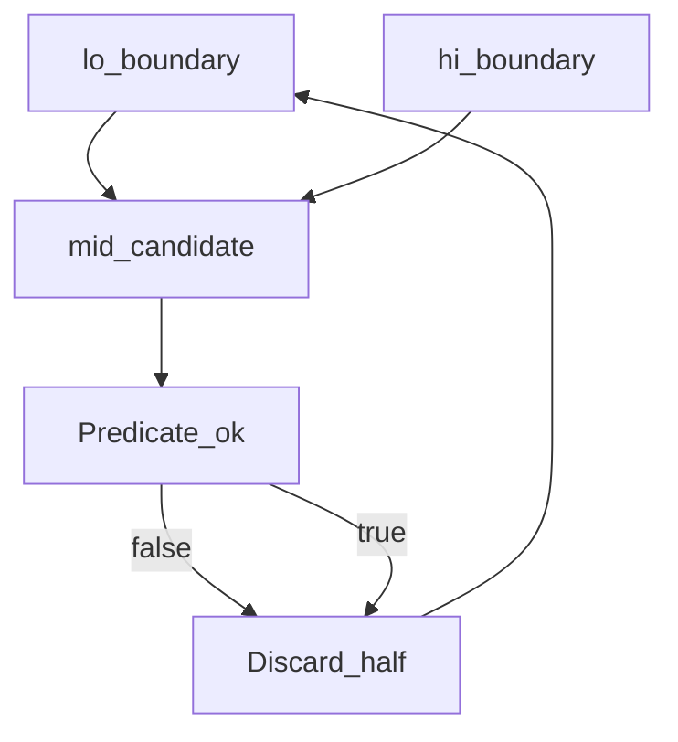

# D02-T016 — Binary search patterns

Topic ID: `D02-T016`
Domain: Data Structures and Algorithms
Subdomain: Binary search patterns
Importance: core
Complexity: intermediate
Dependencies: `D02-T015`, `D02-T001`, `D01-T001`, `D01-T002`
Execution status of the code in section F: unexecuted

## A. Topic Overview

Binary search finds a position in O(log n) time by halving a monotone search space. Beyond arrays, the same pattern applies whenever a predicate over an integer or real parameter is monotone: false…false, true…true. Interviewers use it for lower bound, upper bound, first true in feasibility, and search on the answer.

## B. First-Principles Explanation

Classic binary search maintains an invariant on indices: all positions before `lo` fail the predicate, all at or after `hi` succeed (half-open variant). Each step compares `mid` and discards half the range. **Search on answer**: if `feasible(x)` is monotone in x, binary search the smallest x that works. Complexity is O(log(range) × cost(feasible)). Floating boundaries need careful eps or integer scaling.

## C. Internal Working and Architecture

Components: sorted view or implicit order, predicate `ok(i)`, loop with `lo`/`hi`. Backend: choose shard by hash range via binary search on sorted shard boundaries; pick rate-limit bucket by timestamp binary search in a ring buffer of counters. Memory O(1); predicate may call DB—then each step is O(query) and dominates.

## D. Diagrams and Visual Models



Each iteration evaluates the predicate at `mid` and shrinks `[lo,hi)` while preserving the invariant that the answer lies inside.

## E. Examples and Analogies

Analogy: tuning server thread pool size—too few threads underuse CPU, too many thrash; binary search the minimum threads that keep queue latency under SLO if throughput is monotone. Backend: find earliest log index at or after a timestamp in a sorted commit log segment.

## F. Code Examples

File: `examples/d02_t016_binary_search.py`

Dependencies: Python 3 standard library only.

```python
def first_true(lo: int, hi: int, ok) -> int:
    """Smallest x in [lo, hi] with ok(x), or hi+1 if none. ok monotone: false then true."""
    while lo < hi:
        mid = (lo + hi) // 2
        if ok(mid):
            hi = mid
        else:
            lo = mid + 1
    return lo if ok(lo) else hi + 1


def lower_bound(arr, target: int) -> int:
    lo, hi = 0, len(arr)
    while lo < hi:
        mid = (lo + hi) // 2
        if arr[mid] < target:
            lo = mid + 1
        else:
            hi = mid
    return lo
```

Complexity: O(log n) iterations; each O(1) if `ok` is O(1). Off-by-one bugs come from inclusive vs half-open bounds. This example was not executed.

## G. Practical Backend Application

Use binary search on sorted id lists for merge joins in application memory, on version arrays for rollout flags, and on answer space for capacity planning (minimum replicas to pass load test). Guard predicates with timeouts; log when feasible checks hit external services.

## H. Advantages, Limitations and Trade-offs

| Pattern | Time | Space | Use |
| --- | --- | --- | --- |
| Index BS | O(log n) | O(1) | Sorted array |
| Answer BS | O(log R × f) | O(1) | Monotone feasibility |
| B-tree | O(log n) | O(1) | DB index |

## I. Common Mistakes and Misconceptions

- Using `mid = (lo+hi)/2` without guarding overflow (use `lo + (hi-lo)//2`).
- Binary search on non-monotone predicate.
- Confusing `lower_bound` with `upper_bound`.
- Infinite loop when `lo` and `hi` never move.

## J. Debugging and Troubleshooting

Symptoms: wrong first index, infinite loop, or off-by-one at boundaries. Reproduce with empty, single element, all false, all true. Print `lo,hi,mid` each iteration.

## K. Interview Preparation

### Beginner

#### Q1. What is lower_bound?

**Answer:** It returns the first index where the array element is not less than the target. On a sorted array this is O(log n) comparisons. If all elements are smaller, it returns n. It is the C++ `std::lower_bound` semantics many libraries copy.

#### Q2. Why half-open [lo, hi)?

**Answer:** Half-open ranges make empty range `lo == hi` easy to detect. The invariant 'answer in [lo,hi)' is simpler when hi is exclusive. Many standard libraries document this convention. Mixing inclusive hi causes off-by-one bugs in production pagination helpers.

#### Q3. When is binary search O(log n)?

**Answer:** When each step halves the search space and predicate evaluation is O(1). If the predicate runs a SQL query, complexity is O(log n × query cost). The number of iterations is at most floor(log2(n))+1. Interviewers want you to state both iteration count and predicate cost.

#### Q4. Can you binary search on doubles?

**Answer:** Yes, with care: use integer scaling or a fixed iteration count with epsilon. Monotonicity must hold on the chosen grid. Floating rounding can break strict monotonicity near boundaries. Prefer integer micros for timestamps instead of raw floats.

#### Q5. What is search on the answer?

**Answer:** You binary search the value of a parameter, not an index. Feasibility must be monotone: if x works, x+1 works (or the reverse). Typical in 'minimum capacity' or 'maximum throughput' problems. Each check may be a simulation or load test in backend scenarios.

### Intermediate

#### Q1. Difference between lower and upper bound?

**Answer:** Lower bound: first index with value >= target. Upper bound: first index with value > target. Together they define a range of equal keys. Database range queries mirror this pair on B-tree keys.

#### Q2. How to avoid overflow in mid?

**Answer:** Compute `mid = lo + (hi - lo) // 2`. In Java, `(lo+hi)/2` overflows when lo and hi are large positive ints. This matters in index math on big arrays. Interviewers treat it as a detail that separates careful candidates.

#### Q3. Binary search on rotated array?

**Answer:** Find pivot with modified BS comparing mid to right end. Or locate rotation index then two normal searches. Still O(log n) time, O(1) space. Do not sort first if you only need few queries.

#### Q4. Monotone stack vs binary search?

**Answer:** Monotone stack answers next greater in O(n) amortized. Binary search on sorted values answers predecessor queries. Pick stack for streaming nearest greater; pick BS on static sorted data. Both appear in scheduling and rate-limit window problems.

#### Q5. Predicate false on entire range?

**Answer:** Loop ends with lo == hi at failure boundary. Return sentinel or hi+1 per API contract. Document behavior for 'not found'. Clients should not assume zero is always valid index.

### Advanced

#### Q1. Binary search on real capacities?

**Answer:** Discretize to integer Mbps or pod counts. Prove feasibility is monotone after discretization. Binary search at most log2(range) steps. Validate final choice with one full simulation.

#### Q2. Parallel binary search?

**Answer:** Rare in request path; batch offline queries can partition array. Each query remains O(log n). GPU sorts use different patterns. Backend interviews focus on single-thread correctness first.

#### Q3. BS on implicit graph weights?

**Answer:** Sometimes edge weights allow binary lifting not BS. If edge list sorted by weight, BS finds threshold for connectivity with DSU check. Each feasibility check may be union-find O(m α(n)). Total O(m α(n) log W) for weight range W.

#### Q4. Interactive binary search pitfalls?

**Answer:** Predicate must not depend on mutable external state mid-search. Cache feasibility results if expensive. Use consistent read snapshot in DB checks. Otherwise monotonicity breaks across iterations.

#### Q5. Prove O(log n) iterations?

**Answer:** Invariant: range size halves each step in worst case. Initial size n, after k steps size ≤ n/2^k. Stop when size 1, k = O(log n). Tie to decision tree height intuition.

### Scenarios

#### Q1. Latency SLO: find min replicas passing load test?

**Answer:** Define feasible(r) = p95 latency under SLO at r replicas. Assume feasible is false at r=0 and true at max. Binary search smallest r with feasible true. Each test is expensive—cache results per r.

#### Q2. Find insert position in sorted audit log?

**Answer:** Use lower_bound on timestamp index in memory. O(log n) per insert point for batch replay tools. For DB, use index seek not in-app BS on full table. Mention pushing work to B-tree.

#### Q3. Bug: BS returns index 0 always?

**Answer:** Likely `hi = mid` branch inverted. Or predicate always true at mid. Log predicate at boundaries. Unit test all-false and all-true arrays.

#### Q4. Shard routing by sorted ranges?

**Answer:** Binary search which range contains user id. O(log S) for S shards. Updates to ranges need sorted order maintenance. Consistent hashing is alternative with O(1) average.

#### Q5. Maximum minutes before timeout?

**Answer:** Binary search largest t where job completes. Monotone if larger t never fails earlier. Watch for race if job status changes live. Use workflow snapshot for predicate.

### Follow-ups

#### Q1. Link to two pointers?

**Answer:** Both exploit ordering. BS is logarithmic on index; two pointers linear on array. Sometimes BS on answer replaces nested loops. See D02-T017.

#### Q2. Link to sorting?

**Answer:** BS requires order from sort or index. Sort once O(n log n) then many O(log n) queries. Trade batch queries vs hash map. D02-T015.

#### Q3. Link to DP?

**Answer:** Sometimes DP replaces BS when feasibility is not monotone. Do not force BS on non-monotone state. D02-T022.

## L. Practical Exercises

Solutions are in `EXERCISES/solutions/D02-T016.md`. Try these before opening that file.

### Exercise 1 — implementation

Implement `first_true` on integers and `lower_bound` for a sorted list. Acceptance: empty array, all less than target, all greater, duplicates.

### Exercise 2 — debugging

A service uses inclusive `hi` with `while lo <= hi` but returns `hi+1` on success—explain duplicate results on `[1,2,2,2,3]` searching for 2.

### Exercise 3 — trade-off

Choose between sorting ids once vs hash set for 1M lookups × 10 queries. State complexities.

## M. Revision Notes

- Half-open bounds; `mid = lo + (hi-lo)//2`.
- Monotone predicate for answer search.
- lower vs upper bound.
- O(log n) only if predicate O(1).

## N. Related Topics

After `D02-T015`. Leads to `D02-T017`, `D02-T020` (greedy feasibility).

## O. Completion Criteria

- Implement lower_bound and first_true with tests at boundaries.
- Explain search-on-answer with monotone feasibility.
- Debug inclusive vs half-open off-by-one.
- Choose sort+BS vs hash for stated query counts.
