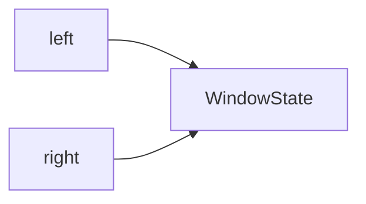

# D02-T017 — Two pointers and sliding window

Topic ID: `D02-T017`
Domain: Data Structures and Algorithms
Subdomain: Two pointers and sliding window
Importance: core
Complexity: intermediate
Dependencies: `D02-T016`, `D02-T001`, `D01-T001`, `D01-T002`
Execution status of the code in section F: unexecuted

## A. Topic Overview

Two pointers scan sequences in O(n) by moving left and right under a sum, count, or distinct-character constraint. Sliding windows either fix width or expand until invalid then shrink. The pattern replaces O(n²) nested loops when each index enters and leaves the window at most once.

## B. First-Principles Explanation

Invariant: the window always satisfies the predicate. Expand `right` to include new elements; while invalid, advance `left` and update auxiliary counts. Each index is visited a constant number of times, so time is O(n) and extra space is O(k) for a frequency map over alphabet size k. Fixed-width windows move both pointers each step without a shrink loop.

## C. Internal Working and Architecture

State typically holds running sum, character frequencies, or distinct count. Backend uses include rolling error-rate windows, per-minute rate limits, and validating bounded CSV rows before insert. Cap window input size per request to bound memory.

## D. Diagrams and Visual Models



Both pointers update shared window state; shrink loop restores validity after expansion.

## E. Examples and Analogies

Longest substring with at most k distinct characters: expand until distinct > k, then shrink from the left until valid again. Track best length whenever the window is valid.

## F. Code Examples

File: `examples/d02_t017_sliding_window.py`

```python
def longest_k_distinct(s: str, k: int) -> int:
    from collections import defaultdict
    freq = defaultdict(int)
    left = best = 0
    for right, ch in enumerate(s):
        freq[ch] += 1
        while len(freq) > k:
            freq[s[left]] -= 1
            if freq[s[left]] == 0:
                del freq[s[left]]
            left += 1
        best = max(best, right - left + 1)
    return best
```

Time O(n), space O(k). Not executed.

## G. Practical Backend Application

Streaming anomaly detection, sliding-minute rate limits, and payload validators use this scan. Prefer database window functions when data already lives in SQL.

## H. Advantages, Limitations and Trade-offs

| Approach | Time | Space | When |
| --- | --- | --- | --- |
| Nested loops | O(n²) | O(1) | Tiny n |
| Two pointers | O(n) | O(k) | Monotone shrink |

## I. Common Mistakes and Misconceptions

- Forgetting to shrink when the window becomes invalid.
- Off-by-one on inclusive length.
- Re-scanning the window instead of moving `left`.

## J. Debugging and Troubleshooting

Log `left`, `right`, and predicate values; compare to brute force for |s| ≤ 20.

## K. Interview Preparation

### Beginner

#### Q1. What problem does Two pointers and sliding window solve?

**Answer:** It replaces naive quadratic scans when input order or window structure gives monotone pointer movement. Typical complexity drops toward O(n) with O(k) extra space for counts. Interviewers expect you to state the invariant before writing loops. Backend analogs include streaming metrics and bounded in-memory buffers.

#### Q2. What inputs does Two pointers and sliding window require?

**Answer:** You need a defined order, window rule, or recurrence over a sequence. Without prerequisites the same code silently returns wrong answers on edge cases. Clarify inclusive versus exclusive bounds in interviews and APIs. Cap n per request in services to bound memory and CPU.

#### Q3. What is the usual time complexity for Two pointers and sliding window?

**Answer:** One linear pass with each index entering and leaving at most once yields O(n) time. Auxiliary hash maps add O(k) space for alphabet size k. Compare explicitly to the O(n²) brute-force baseline. State both time and space in interviews.

#### Q4. Give a tiny example for Two pointers and sliding window.

**Answer:** On `eceba` with k=2, expand until distinct exceeds two, then shrink left until valid. Narrate pointer moves on five to eight elements. Name the longest valid length found. Tie each move to the window invariant in one sentence.

#### Q5. Where does Two pointers and sliding window show up in backend systems?

**Answer:** Rate limiting, session windows, log sampling, and batch validation pipelines use these scans. Database window functions can replace in-app loops on large data. The pattern still guides complexity budgets and payload limits. Emit metrics when scans exceed expected linear cost.

### Intermediate

#### Q1. When should you avoid Two pointers and sliding window?

**Answer:** Avoid it when data is unordered and sorting is too expensive for one query. Point lookups with a hash index do not need two pointers. Nested structures may need DP instead of a single window. Pick the structure that matches query types, not the flashiest pattern.

#### Q2. How do you test Two pointers and sliding window implementations?

**Answer:** Cover empty input, single element, all equal, and maximum n. Cross-check random small cases against brute force in unit tests. Regression-test production incidents with saved payloads. Property tests catch off-by-one window errors well.

#### Q3. What off-by-one bugs appear in Two pointers and sliding window?

**Answer:** Left and right indices confuse inclusive length with exclusive end. Draw the interval on paper before coding. Half-open conventions match many standard libraries. Unit-test window size zero and full-array window.

#### Q4. What space-time trade appears in Two pointers and sliding window?

**Answer:** Hash maps inside windows buy O(1) character counts at O(k) space. Deques support monotonic queue variants for window minima. Choose extra memory when query volume dominates. Document per-tenant memory caps in multi-tenant services.

#### Q5. How does sorting interact with Two pointers and sliding window?

**Answer:** Some variants sort endpoints first at O(n log n). Amortize sort cost over many queries on the same static data. If data is already time-ordered, skip sort. See D02-T015 for when sort is the bottleneck.

### Advanced

#### Q1. How do you justify correctness for Two pointers and sliding window?

**Answer:** State a loop invariant relating pointers to the predicate. Show each index enters and leaves the window at most once for linear time. For greedy steps inside the pattern, give an exchange or cut argument. Interviewers accept concise proofs tied to the invariant.

#### Q2. What is the worst case for Two pointers and sliding window?

**Answer:** A correct implementation remains O(n) even if many shrinks occur because each index moves left only forward. Wrong implementations degrade to O(n²) by not advancing `left`. Name that bug pattern when complexity explodes. Profile before micro-optimizing constants.

#### Q3. Does Two pointers and sliding window parallelize safely?

**Answer:** Single-window algorithms assume one thread mutates pointers. Partition the array only after defining how to merge partial answers. Concurrent windows need per-shard state. Interview solutions stay single-threaded unless asked.

#### Q4. What numeric edges affect Two pointers and sliding window?

**Answer:** Running sums need 64-bit integers to avoid overflow. Time windows should use integer epoch microseconds. Reject NaN metrics in predicates. Timezone mistakes break day-boundary windows in billing jobs.

#### Q5. How does Two pointers and sliding window compose with other D02 patterns?

**Answer:** Combine with hash maps for distinct-character substring problems. Binary search on answer replaces inner loops in some variants. DP handles cases when greedy window expansion fails. Name the composition you used in a worked example.

### Scenarios

#### Q1. Latency spike on a Two pointers and sliding window code path—what first?

**Answer:** Check whether input n grew with a new tenant or feature flag. Profile to see if `left` fails to advance causing quadratic behavior. Compare pushing aggregation to SQL window functions. Roll back if memory grew from unbounded maps.

#### Q2. Reporting totals wrong after a Two pointers and sliding window batch job?

**Answer:** Reproduce on ten-row CSV with the same code path. Verify sort order and timezone on timestamps. Diff against brute force on small data. Fix data ordering before optimizing loops.

#### Q3. Frozen during interview Two pointers and sliding window question?

**Answer:** Write brute force complexity, then state the invariant aloud. Sketch a five-element example before coding. Ask for constraints on n, memory, and mutability. Narrate complexity while coding.

#### Q4. Library versus hand-rolled Two pointers and sliding window?

**Answer:** Use stdlib `deque` and `Counter` unless profiling shows a hotspot. Document invariants on custom structures. Avoid unbounded recursion depth in hybrids with backtracking. Fuzz critical paths in CI.

#### Q5. Multi-tenant fairness issue with Two pointers and sliding window?

**Answer:** Global windows can let one tenant dominate shared buffers. Shard state by tenant id or use per-tenant caps. Measure p99 latency per tenant after changes. Fairness is an operational requirement, not only correctness.

### Follow-ups

#### Q1. What topic follows Two pointers and sliding window in D02?

**Answer:** Follow inventory dependencies to prefix sums (`D02-T018`). Each pattern assumes you can state complexity clearly. Revisit weak areas via exercises before interviews. Capstone checklist lives in D02-T027.

#### Q2. What is the database equivalent of Two pointers and sliding window?

**Answer:** SQL window functions and indexed range scans implement similar semantics. Pushing work down reduces application CPU. Explain plans still matter for OFFSET misuse. ORMs may hide O(n) loops that look like one call.

#### Q3. What complexity follow-up do interviewers ask after Two pointers and sliding window?

**Answer:** Separate build, query, and space costs. Mention amortized bounds when operations batch. Compare explicitly to brute force. Relate n to production payload limits.

## L. Practical Exercises

Solutions are in `EXERCISES/solutions/D02-T017.md`.

### Exercise 1 — implementation

Implement longest substring with at most k distinct chars. Acceptance: k=0 → 0, empty string, all identical chars.

### Exercise 2 — debugging

Answer too large because shrink loop missing when distinct count exceeds k.

### Exercise 3 — trade-off

Fixed window size w versus variable window for metric streams; state complexities.

## M. Revision Notes

- O(n) two pointers; each index enters/leaves once.
- Hash map O(k) space.
- Shrink while invalid.

## N. Related Topics

After `D02-T016`; pairs with `D02-T018` on static arrays.

## O. Completion Criteria

- State window invariant.
- Implement k-distinct substring.
- Fix missing shrink bug.
- Pick fixed vs variable window.
