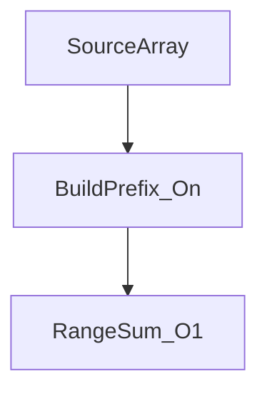

# D02-T018 — Prefix sums and difference arrays

Topic ID: `D02-T018`
Domain: Data Structures and Algorithms
Subdomain: Prefix sums and difference arrays
Importance: core
Complexity: intermediate
Dependencies: `D02-T017`, `D02-T001`, `D01-T001`, `D01-T002`
Execution status of the code in section F: unexecuted

## A. Topic Overview

Prefix sums answer range-sum queries in O(1) after O(n) preprocessing. Difference arrays apply range updates in O(1) before a final prefix reconstruction pass. Together they replace repeated O(n) scans in dashboards and batch jobs.

## B. First-Principles Explanation

With sentinel `prefix[0]=0`, inclusive range sum `sum(l..r)=prefix[r+1]-prefix[l]`. A difference array records lazy range adds: increment `diff[l]` by v and decrement `diff[r+1]` by v for +v on `[l,r]`; reconstruct with prefix scan. Build time O(n), query O(1), space O(n); use 64-bit integers for monetary totals.

## C. Internal Working and Architecture

Partitions build one prefix table per chunk; APIs answer queries from memory or rollup columns. Difference arrays suit bulk segment updates before materialization.

## D. Diagrams and Visual Models



## E. Examples and Analogies

Daily revenue array: after one O(n) prefix build, any week total is one subtraction of two prefix entries.

## F. Code Examples

File: `examples/d02_t018_prefix.py`

```python
def build_prefix(arr):
    pre = [0]
    for x in arr:
        pre.append(pre[-1] + x)
    return pre

def range_sum(pre, l, r):
    return pre[r + 1] - pre[l]
```

Build O(n), query O(1), space O(n). Not executed.

## G. Practical Backend Application

Materialized rollups in OLAP; in-memory prefixes for bounded per-request analytics.

## H. Advantages, Limitations and Trade-offs

| Approach | Time | Space |
| --- | --- | --- |
| Scan each query | O(n) per query | O(1) |
| Prefix table | O(n) build, O(1) query | O(n) |

## I. Common Mistakes and Misconceptions

- Missing prefix sentinel at index 0.
- 32-bit overflow on large sums.
- Off-by-one on inclusive `r`.

## J. Debugging and Troubleshooting

Cross-check random ranges against brute-force sum on small arrays.

## K. Interview Preparation

### Beginner

#### Q1. What problem does Prefix sums and difference arrays solve?

**Answer:** It replaces repeated O(n) range scans with O(1) queries after linear preprocessing. Difference arrays batch range updates cheaply before one reconstruction pass. Interviewers expect you to state build, query, and space costs separately. Backend analogs include rollups and in-memory analytics on bounded arrays.

#### Q2. What inputs does Prefix sums and difference arrays require?

**Answer:** You need a static or batch-updated sequence and defined inclusive index ranges. Without a sentinel prefix, l=0 queries become error-prone. Clarify empty-array policy in APIs. Cap array length per request to bound memory.

#### Q3. What is the usual time complexity for Prefix sums and difference arrays?

**Answer:** Prefix build is O(n); each range sum is O(1). A sequence of q queries costs O(n+q). Difference-array bulk updates are O(1) per update plus O(n) final scan. State whether you amortize build over many queries.

#### Q4. Give a tiny example for Prefix sums and difference arrays.

**Answer:** On `[2,1,3]`, prefix becomes `[0,2,3,6]`. Sum(0..2)=6-0=6. Narrate indices on five elements or fewer. Tie each step to prefix recurrence.

#### Q5. Where does Prefix sums and difference arrays show up in backend systems?

**Answer:** Dashboard range totals, billing period sums, and validation of cumulative quotas use prefixes. Warehouses store rollups instead of recomputing per click. The pattern guides when to materialize versus compute on the fly. Emit metrics if rebuild time grows with tenants.

### Intermediate

#### Q1. When should you avoid Prefix sums and difference arrays?

**Answer:** Avoid rebuilding prefixes on every request for huge streaming series. Point updates between queries may need a Fenwick tree or database rollup. Hash maps beat prefixes for single-key lookups. Pick structure by update/query mix.

#### Q2. How do you test Prefix sums and difference arrays implementations?

**Answer:** Test l=0, l=r, full range, and empty input policy. Random small arrays against brute force. Regression-test overflow on large ints. Property-test diff-then-prefix reconstruction equals direct updates.

#### Q3. What off-by-one bugs appear in Prefix sums and difference arrays?

**Answer:** Confusing inclusive r with exclusive end in prefix subtraction. Missing diff decrement at r+1 smears updates. Draw index lines before coding. Unit-test length-1 arrays.

#### Q4. What space-time trade appears in Prefix sums and difference arrays?

**Answer:** O(n) extra memory buys O(1) queries. Rollup tables trade storage for read speed. Choose int64 over int32 for money. Document per-tenant memory for in-memory prefixes.

#### Q5. How does sorting interact with Prefix sums and difference arrays?

**Answer:** Prefix sums do not require sorting on indices. Sorting helps when combining with sweep-line event processing. Interval endpoints sorted enable O(n log n) coverage algorithms. See D02-T024 after mastering static prefixes.

### Advanced

#### Q1. How do you justify correctness for Prefix sums and difference arrays?

**Answer:** Prove prefix recurrence: prefix[i+1]-prefix[i]=arr[i]. Difference updates telescope when reconstructed. Induction on array length suffices. Interviewers accept this level for range queries.

#### Q2. What is the worst case for Prefix sums and difference arrays?

**Answer:** A single build is O(n); no worse asymptotic for standard static prefixes. Many point updates between queries force rebuild O(n) each time unless using advanced structures. Name that limitation when data is volatile.

#### Q3. Does Prefix sums and difference arrays parallelize safely?

**Answer:** Prefix build parallelizes with parallel scan algorithms in advanced settings. Simple loops are single-threaded in interviews. Shard by partition and build per shard. Merge carefully for cross-shard range queries.

#### Q4. What numeric edges affect Prefix sums and difference arrays?

**Answer:** Cumulative sums overflow 32-bit integers. Use int64 or decimal for money. Empty arrays need documented sentinel behavior. NaN inputs break totals—validate upstream.

#### Q5. How does Prefix sums and difference arrays compose with other D02 patterns?

**Answer:** Difference arrays plus prefix reconstruct range updates. Sweep-line algorithms sort events then track depth. Two pointers solve sliding window sums without full prefix when only extrema matter. Name the combo you pick.

### Scenarios

#### Q1. Latency spike on a Prefix sums and difference arrays code path—what first?

**Answer:** Check whether n per request jumped or rebuild runs per click. Profile rebuild versus query ratio. Move to materialized rollups if rebuild dominates. Roll back if memory doubled from duplicate prefix tables.

#### Q2. Reporting totals wrong after a Prefix sums and difference arrays batch job?

**Answer:** Reproduce on ten-row CSV. Compare brute sums to prefix queries. Check int overflow and timezone boundaries on daily buckets. Fix data before micro-optimizing.

#### Q3. Frozen during interview Prefix sums and difference arrays question?

**Answer:** Write brute O(n) per query, then show prefix build. Sketch prefix array on five elements. Ask q and n limits. Narrate O(n+q) total.

#### Q4. Library versus hand-rolled Prefix sums and difference arrays?

**Answer:** NumPy cumsum is fine for analytics batches. Hand-roll for interview clarity. SQL window functions replace in-app prefixes at scale. Document when you push down to the database.

#### Q5. Multi-tenant fairness issue with Prefix sums and difference arrays?

**Answer:** Per-tenant prefix tables isolate memory. Global arrays let one tenant blow RAM. Shard by tenant id. Measure rebuild time per tenant.

### Follow-ups

#### Q1. What topic follows Prefix sums and difference arrays in D02?

**Answer:** Inventory points to monotonic stacks (`D02-T019`). Continue the dependency chain through D02-T027. Revisit exercises on overflow. Capstone checklist is D02-T027.

#### Q2. What is the database equivalent of Prefix sums and difference arrays?

**Answer:** Materialized views and windowed sum columns store cumulative totals. Indexed time-series DBs optimize range aggregates. Explain plans for SUM over ranges. ORMs may still loop rows—avoid that.

#### Q3. What complexity follow-up do interviewers ask after Prefix sums and difference arrays?

**Answer:** State O(n) build, O(1) query, O(n) space. For q queries: O(n+q). Contrast with O(nq) naive. Relate n to retention window in production.

## L. Practical Exercises

Solutions in `EXERCISES/solutions/D02-T018.md`.

### Exercise 1 — implementation

Build prefix and answer q range sums. Acceptance: l=0, l=r, empty policy documented.

### Exercise 2 — debugging

Negative totals from 32-bit overflow—migrate to int64.

### Exercise 3 — trade-off

Rollup column vs per-request prefix for 1M-point series.

## M. Revision Notes

- Sentinel prefix[0]=0.
- diff + prefix for range updates.
- int64 for money.

## N. Related Topics

Leads to `D02-T019`, `D02-T024`.

## O. Completion Criteria

- Build prefix with sentinel.
- Answer range sum in O(1).
- Fix overflow.
- Choose rollup vs on-the-fly.
