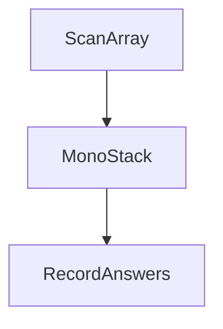

# D02-T019 — Monotonic stacks and queues

Topic ID: `D02-T019`
Domain: Data Structures and Algorithms
Subdomain: Monotonic stacks and queues
Importance: core
Complexity: intermediate
Dependencies: `D02-T018`, `D02-T001`, `D01-T001`, `D01-T002`
Execution status of the code in section F: unexecuted

## A. Topic Overview

Monotonic stacks answer next-greater/smaller queries in O(n) amortized time; monotonic deques support sliding-window minima/maxima in O(n). Each index is pushed and popped at most once.

## B. First-Principles Explanation

Maintain a stack or deque in increasing or decreasing order. When a new element violates monotonicity, pop and record answers for popped indices. Total pushes and pops are O(n). Space O(n) for the structure.

## C. Internal Working and Architecture

Store indices on the stack to handle duplicates. Deque stores index windows for min/max. Backend rolling p99 uses deque instead of resorting each window.

## D. Diagrams and Visual Models



## E. Examples and Analogies

Next greater element to the right: pop smaller indices when a larger value arrives.

## F. Code Examples

File: `examples/d02_t019_mono_stack.py`

```python
def next_greater(nums):
    ans = [-1] * len(nums)
    st = []
    for i, x in enumerate(nums):
        while st and nums[st[-1]] < x:
            ans[st.pop()] = x
        st.append(i)
    return ans
```

Time O(n), space O(n). Not executed.

## G. Practical Backend Application

Rolling window min/max for metrics, histogram area problems, and stock-span style alerts use monotonic structures instead of per-window sorts.

## H. Advantages, Limitations and Trade-offs

| Approach | Time | Space |
| --- | --- | --- |
| Resort window | O(w log w) per window | O(1) |
| Monotonic deque | O(n) total | O(n) |

## I. Common Mistakes and Misconceptions

- Storing values instead of indices on duplicates.
- Forgetting to pop until monotonicity holds.
- Confusing strictly increasing vs decreasing stack order.

## J. Debugging and Troubleshooting

Print stack indices after each step on small inputs; compare to O(n²) brute force for next greater.

## K. Interview Preparation

### Beginner

#### Q1. What problem does Monotonic stacks and queues solve?

**Answer:** It answers next-greater/smaller and sliding extrema in linear time by ensuring each element is pushed and popped once. That beats resorting every window or nested scans. Interviewers want the amortized O(n) accounting. Backend metrics pipelines use deques for rolling peaks without O(w log w) sorts.

#### Q2. What inputs does Monotonic stacks and queues require?

**Answer:** You need a linear sequence and a clear rule for increasing or decreasing order on the stack. Window variants need window size or two-pointer bounds. Without index storage, duplicate values mis-assign answers. Cap n per request in APIs.

#### Q3. What is the usual time complexity for Monotonic stacks and queues?

**Answer:** Each index enters and leaves the structure at most once, so total time is O(n). Auxiliary space is O(n) for the stack or deque. Window min deque also ends up O(n) for the full pass. Contrast with O(n²) naive comparisons.

#### Q4. Give a tiny example for Monotonic stacks and queues.

**Answer:** On `[2,1,2,4,3]`, walk through next greater with a stack of indices. When 4 arrives, pop smaller indices and set their answers. Narrate fewer than ten steps. State the final answer array.

#### Q5. Where does Monotonic stacks and queues show up in backend systems?

**Answer:** Rolling p99 latency windows, rate spike detection, and scheduling hot-spot analysis use deque extrema. Histogram-style capacity problems appear in batch analytics. Prefer database window functions when data is already in SQL. Log when fallback sorts appear in profiles.

### Intermediate

#### Q1. When should you avoid Monotonic stacks and queues?

**Answer:** Avoid when you only need a single static sort, not streaming extrema. Hash maps win for pure membership. Dynamic connectivity needs union-find, not monotonic stacks. Match the tool to the query shape.

#### Q2. How do you test Monotonic stacks and queues implementations?

**Answer:** Test strictly increasing, decreasing, all equal, and single-element arrays. Compare to brute force for next greater on random small n. Regression-test index versus value storage bugs. Property-test deque window min against sorting the window.

#### Q3. What off-by-one bugs appear in Monotonic stacks and queues?

**Answer:** Window deques must drop indices `<= right-w` from the front, not `right-w-1` unless defined carefully. Stack pops must not skip recording answers. Draw index ranges for windows. Test window size 1 and n.

#### Q4. What space-time trade appears in Monotonic stacks and queues?

**Answer:** O(n) extra indices buy O(1) amortized work per element. Sorting each window avoids extra memory but costs O(w log w) per step. Pick deque when w is large and stream is long. Document memory for deques on many concurrent streams.

#### Q5. How does sorting interact with Monotonic stacks and queues?

**Answer:** Monotonic structures often replace repeated sorting inside windows. Full sort is still needed when the problem is global order, not neighborhood relations. Sweep-line algorithms sort events then use heaps. See D02-T024 for event sorting.

### Advanced

#### Q1. How do you justify correctness for Monotonic stacks and queues?

**Answer:** Each element is pushed once and popped once, bounding operations by O(n). When popping, the current element is the first greater to the right for those indices. Exchange arguments are rarely needed; the stack order invariant suffices. State that invariant clearly.

#### Q2. What is the worst case for Monotonic stacks and queues?

**Answer:** Proper implementations remain O(n) even for sorted input because each element still pushes and pops once. Improper implementations that re-scan the stack inner loop can reach O(n²). Name nested-loop mistakes. Profile hot paths in metrics services.

#### Q3. Does Monotonic stacks and queues parallelize safely?

**Answer:** Standard linear scan is single-threaded. Parallelizing independent streams shards by partition. Sharing one deque across threads races. Interview code should stay single-threaded unless asked to design sharding.

#### Q4. What numeric edges affect Monotonic stacks and queues?

**Answer:** Comparator stability matters for equal values—use indices. Floating metrics need consistent NaN handling. Time-based windows need integer timestamps. Overflow is less common than off-by-one window bounds.

#### Q5. How does Monotonic stacks and queues compose with other D02 patterns?

**Answer:** Pair with sliding window two pointers for range definitions. Prefix sums handle sums while deques handle minima. Binary search rarely combines directly. Histogram area uses stack after counting heights.

### Scenarios

#### Q1. Latency spike on a Monotonic stacks and queues code path—what first?

**Answer:** Check whether code fell back to sorting each window. Profile deque operations per event. Compare to SQL window min functions. Roll back if accidental O(n²) nested loops shipped.

#### Q2. Reporting totals wrong after a Monotonic stacks and queues batch job?

**Answer:** Reproduce on a short metric series. Verify window width and timezone alignment. Diff extrema against brute force per window. Fix index bugs before tuning deque constants.

#### Q3. Frozen during interview Monotonic stacks and queues question?

**Answer:** State next-greater definition and draw a six-element example. Implement stack of indices slowly. Ask if strictly greater or greater-or-equal. Narrate O(n) push/pop accounting.

#### Q4. Library versus hand-rolled Monotonic stacks and queues?

**Answer:** Use collections.deque in Python; avoid reimplementing unless profiling demands. Document invariants for custom structs. In databases, prefer window functions. Fuzz small arrays in CI.

#### Q5. Multi-tenant fairness issue with Monotonic stacks and queues?

**Answer:** Per-tenant deques isolate rolling windows. Global structures mix tenant traffic and skew extrema. Shard by tenant id. Measure deque memory per tenant.

### Follow-ups

#### Q1. What topic follows Monotonic stacks and queues in D02?

**Answer:** Inventory lists greedy algorithms (`D02-T020`) next. Continue through D02-T027 for pattern synthesis. Revisit stack templates weekly. Capstone edge checklist is D02-T027.

#### Q2. What is the database equivalent of Monotonic stacks and queues?

**Answer:** SQL window functions like MIN/MAX OVER ROWS BETWEEN implement rolling extrema. Indexes do not replace the need for correct frame clauses. Explain plans for large partitions. Push down when possible.

#### Q3. What complexity follow-up do interviewers ask after Monotonic stacks and queues?

**Answer:** State O(n) time and O(n) space. Contrast with per-window sort O(n w log w). Mention amortized accounting. Relate n to event rate in production.

## L. Practical Exercises

Solutions: `EXERCISES/solutions/D02-T019.md`.

### Exercise 1 — implementation

Next greater to the right. Acceptance: decreasing array, duplicates.

### Exercise 2 — debugging

Stack stored values instead of indices—fix duplicate handling.

### Exercise 3 — trade-off

Monotonic deque O(n) vs sorting each window O(w log w).

## M. Revision Notes

- Each index pushed/popped once.
- Next greater template.
- Deque for window min.

## N. Related Topics

`D02-T024` sweep lines; histogram problems.

## O. Completion Criteria

- Implement next greater in O(n).
- Explain amortized linear time.
- Choose deque vs resorting windows.
