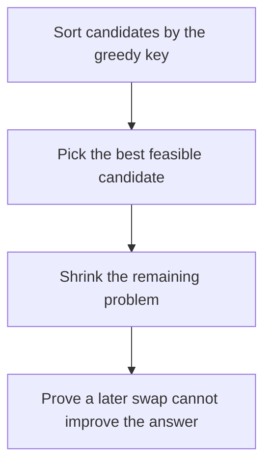

# D02-T020 — Greedy algorithms

Topic ID: `D02-T020`
Domain: Data Structures and Algorithms
Subdomain: Greedy algorithms
Importance: core
Complexity: intermediate
Dependencies: `D02-T019`, `D02-T001`, `D01-T001`, `D01-T002`
Execution status of the code in section F: unexecuted

## A. Topic Overview

A greedy algorithm locks in the locally best feasible choice and never revisits it. It is correct only when a greedy-choice property holds: some optimal solution starts with that local choice, and the remainder is itself an optimal subproblem. Interval scheduling by earliest finish time, Huffman coding, and Dijkstra with non-negative edge weights are the usual cases. A coin system that is not canonical is the usual counterexample.

In production this shows up as follows: A batch job scheduler that always runs the shortest remaining task can starve long tasks. Earliest-deadline-first is a different greedy rule and needs its own proof.

Interviewers use Greedy algorithms to see whether you can state the failure mode, not only the definition. The failure to name is: the local choice blocks a better global solution, as with a non-canonical coin system or Dijkstra on a negative edge

Prerequisites: `D02-T019`, `D02-T001`, `D01-T001`, `D01-T002`. Later notes should link here instead of repeating the mechanism.

## B. First-Principles Explanation

A greedy algorithm locks in the locally best feasible choice and never revisits it. It is correct only when a greedy-choice property holds: some optimal solution starts with that local choice, and the remainder is itself an optimal subproblem. Interval scheduling by earliest finish time, Huffman coding, and Dijkstra with non-negative edge weights are the usual cases. A coin system that is not canonical is the usual counterexample.

The useful picture is: It is like packing a suitcase by always taking the next item that finishes soonest, which works only if that rule cannot paint you into a corner.

What has to be true:

1. Sort candidates by the greedy key
2. Pick the best feasible candidate
3. Shrink the remaining problem
4. Prove a later swap cannot improve the answer

It works when those steps preserve one invariant. It fails when the local choice blocks a better global solution, as with a non-canonical coin system or Dijkstra on a negative edge. The alternative is: the problem has overlapping choices that must be compared, which is dynamic programming or search instead

## C. Internal Working and Architecture

Components involved: the caller, the state Greedy algorithms mutates or reads, and the observer that reports the gap between the greedy answer and a dynamic-programming answer on a small counterexample.

Execution:

1. Sort candidates by the greedy key
2. Pick the best feasible candidate
3. Shrink the remaining problem
4. Prove a later swap cannot improve the answer

Data moves only along that path. A retry re-enters at step 1, so the operation must say what a duplicate does. Memory and locks stay inside this mechanism. Callers see the result or a typed error, not a half-updated invariant.

State to remember: choose this when you can state the exchange argument that swapping in the greedy choice never worsens an optimal solution. Do not choose it when the problem has overlapping choices that must be compared, which is dynamic programming or search instead.

## D. Diagrams and Visual Models



Read the diagram from top to bottom. Each box is one step of Greedy algorithms. The failure mode (the local choice blocks a better global solution, as with a non-canonical coin system or Dijkstra on a negative edge) is what you look for when a later box never happens or happens twice.

## E. Examples and Analogies

Analogy: It is like packing a suitcase by always taking the next item that finishes soonest, which works only if that rule cannot paint you into a corner.

Production example: A batch job scheduler that always runs the shortest remaining task can starve long tasks. Earliest-deadline-first is a different greedy rule and needs its own proof.

A small counterexample is enough in an interview. Show the input, apply the steps, and show the broken outcome if someone uses the mechanism outside its rule: the local choice blocks a better global solution, as with a non-canonical coin system or Dijkstra on a negative edge.

## F. Code Examples

The snippet is labeled unexecuted. It illustrates the shape of the idea. It is not a benchmark and it embeds no secret.

```python
def earliest_finish(intervals):
    chosen = []
    last = float('-inf')
    for start, end in sorted(intervals, key=lambda it: it[1]):
        if start >= last:
            chosen.append((start, end))
            last = end
    return chosen
```

After the snippet, check the gap between the greedy answer and a dynamic-programming answer on a small counterexample. If that signal moves the wrong way, the snippet is the wrong tool for the workload.

## G. Practical Backend Application

Use Greedy algorithms in a service when you can state the exchange argument that swapping in the greedy choice never worsens an optimal solution.

A typical place is the production case already stated: A batch job scheduler that always runs the shortest remaining task can starve long tasks. Earliest-deadline-first is a different greedy rule and needs its own proof.

Operationally you alert on the gap between the greedy answer and a dynamic-programming answer on a small counterexample. You do not alert only on process uptime. The dashboard should show the failure mode, a success rate, and the saturation signal (queue depth, lock wait, or latency) that predicts it.

## H. Advantages, Limitations and Trade-offs

| Choice | Benefit | Cost | Choose when | Avoid when |
| --- | --- | --- | --- | --- |
| Apply Greedy algorithms | you can state the exchange argument that swapping in the greedy choice never worsens an optimal solution | Extra moving parts and a new failure mode | The failure you are preventing is already real | the problem has overlapping choices that must be compared, which is dynamic programming or search instead |
| Simpler alternative | Less code and fewer dependencies | the local choice blocks a better global solution, as with a non-canonical coin system or Dijkstra on a negative edge | The workload does not hit the limit | The invariant must hold under concurrency or failure |

Greedy algorithms is a trade. State the benefit and the cost in the same sentence when you propose it in a design review.

## I. Common Mistakes and Misconceptions

- Using greedy because it is fast, without a proof.
- Applying Dijkstra to negative weights.
- Sorting by the wrong key and still calling it optimal.
- Treating a diagram of Greedy algorithms as proof that the invariant holds in production.
- Copying a default configuration without naming the gap between the greedy answer and a dynamic-programming answer on a small counterexample.

## J. Debugging and Troubleshooting

Symptom: the local choice blocks a better global solution, as with a non-canonical coin system or Dijkstra on a negative edge

First check: the gap between the greedy answer and a dynamic-programming answer on a small counterexample.

Then compare one healthy instance against one unhealthy instance. Confirm whether retries are duplicating work. Confirm whether a timeout is shorter than the work. Fix the invariant, then watch the same metric for a full peak, not only for the next minute.

Useful questions: did the step order in section C actually happen, or did a caller skip a step? Did a deploy change the data shape that Greedy algorithms assumes?

## K. Interview Preparation

### Beginner

#### Q1. What problem does Greedy algorithms solve?

**Answer:** A greedy algorithm locks in the locally best feasible choice and never revisits it. It is correct only when a greedy-choice property holds: some optimal solution starts with that local choice, and the remainder is itself an optimal subproblem. Interval scheduling by earliest finish time, Huffman coding, and Dijkstra with non-negative edge weights are the usual cases. A coin system that is not canonical is the usual counterexample. Without it, the usual backend failure is: the local choice blocks a better global solution, as with a non-canonical coin system or Dijkstra on a negative edge.

#### Q2. Where does Greedy algorithms sit on a request path?

**Answer:** Greedy algorithms is not a library you sprinkle on every call. you can state the exchange argument that swapping in the greedy choice never worsens an optimal solution You notice it when the gap between the greedy answer and a dynamic-programming answer on a small counterexample. Name the constraint that makes this choice correct. Say what you would measure to confirm it.

#### Q3. Give a concrete example of Greedy algorithms.

**Answer:** A batch job scheduler that always runs the shortest remaining task can starve long tasks. Earliest-deadline-first is a different greedy rule and needs its own proof. Walk the input, the state change, and the observable output. Name the constraint that makes this choice correct.

#### Q4. What is a common mix-up around Greedy algorithms?

**Answer:** the local choice blocks a better global solution, as with a non-canonical coin system or Dijkstra on a negative edge The corrective check is the gap between the greedy answer and a dynamic-programming answer on a small counterexample. Name the constraint that makes this choice correct. Say what you would measure to confirm it. Say which alternative you rejected and why.

#### Q5. When would you skip Greedy algorithms?

**Answer:** the problem has overlapping choices that must be compared, which is dynamic programming or search instead Skipping is a decision with a measured cost, not a slogan. Name the constraint that makes this choice correct. Say what you would measure to confirm it. Say which alternative you rejected and why.

### Intermediate

#### Q1. What invariant makes Greedy algorithms correct?

**Answer:** A greedy algorithm locks in the locally best feasible choice and never revisits it. It is correct only when a greedy-choice property holds: some optimal solution starts with that local choice, and the remainder is itself an optimal subproblem. Interval scheduling by earliest finish time, Huffman coding, and Dijkstra with non-negative edge weights are the usual cases. A coin system that is not canonical is the usual counterexample. State the invariant before you name the tool.

#### Q2. How do you test Greedy algorithms?

**Answer:** Assert the failure mode directly: the local choice blocks a better global solution, as with a non-canonical coin system or Dijkstra on a negative edge. The assertion should watch the gap between the greedy answer and a dynamic-programming answer on a small counterexample. Include a concurrent or retry case if the bug only appears then. Name the constraint that makes this choice correct.

#### Q3. What signal tells you Greedy algorithms is misbehaving in production?

**Answer:** Watch the gap between the greedy answer and a dynamic-programming answer on a small counterexample. The user-visible symptom is usually the local choice blocks a better global solution, as with a non-canonical coin system or Dijkstra on a negative edge. Name the constraint that makes this choice correct. Say what you would measure to confirm it.

#### Q4. How would you introduce Greedy algorithms into a legacy service?

**Answer:** you can state the exchange argument that swapping in the greedy choice never worsens an optimal solution Ship it behind a metric so you can compare the old path. Roll back if the local choice blocks a better global solution, as with a non-canonical coin system or Dijkstra on a negative edge gets worse. Name the constraint that makes this choice correct. Say what you would measure to confirm it.

#### Q5. What do you trade away by choosing Greedy algorithms?

**Answer:** you can state the exchange argument that swapping in the greedy choice never worsens an optimal solution the problem has overlapping choices that must be compared, which is dynamic programming or search instead Say the cost in latency, storage, or operational load. Name the constraint that makes this choice correct. Say what you would measure to confirm it. Say which alternative you rejected and why.

### Advanced

#### Q1. What breaks if a dependency of Greedy algorithms is slow or down?

**Answer:** the local choice blocks a better global solution, as with a non-canonical coin system or Dijkstra on a negative edge Degrade using the rule: the problem has overlapping choices that must be compared, which is dynamic programming or search instead. Timeouts must be shorter than the caller's deadline. Name the constraint that makes this choice correct. Say what you would measure to confirm it.

#### Q2. How does Greedy algorithms behave under retries?

**Answer:** Retries repeat work, so Greedy algorithms must define what a duplicate does. the local choice blocks a better global solution, as with a non-canonical coin system or Dijkstra on a negative edge Idempotency keys or fences belong next to the write, not in a comment. Name the constraint that makes this choice correct. Say what you would measure to confirm it.

#### Q3. What is the capacity limit of Greedy algorithms?

**Answer:** The limit shows up as the gap between the greedy answer and a dynamic-programming answer on a small counterexample. Add capacity only after you know whether the bottleneck is CPU, lock wait, or network. Name the constraint that makes this choice correct. Say what you would measure to confirm it.

#### Q4. How do you evolve Greedy algorithms without a flag day?

**Answer:** you can state the exchange argument that swapping in the greedy choice never worsens an optimal solution Version the contract or the on-disk format. Readers should tolerate one old and one new shape during the rollout. Name the constraint that makes this choice correct. Say what you would measure to confirm it.

#### Q5. What security or correctness bug hides inside Greedy algorithms?

**Answer:** the local choice blocks a better global solution, as with a non-canonical coin system or Dijkstra on a negative edge Check authorization and tenancy at the same boundary as the mechanism. A cache or queue must not widen who can read the data. Name the constraint that makes this choice correct. Say what you would measure to confirm it.

### Scenario

#### Q1. Incident: the local choice blocks a better global solution, as with a non-canonical coin system or Dijkstra on a negative edge. What do you check first?

**Answer:** Start with the gap between the greedy answer and a dynamic-programming answer on a small counterexample. Compare a good host and a bad host before you restart anything. A greedy algorithm locks in the locally best feasible choice and never revisits it. It is correct only when a greedy-choice property holds: some optimal solution starts with that local choice, and the remainder is itself an optimal subproblem. Interval scheduling by earliest finish time, Huffman coding, and Dijkstra with non-negative edge weights are the usual cases. A coin system that is not canonical is the usual counterexample.

#### Q2. A reviewer wants the clever version. What data settles it?

**Answer:** you can state the exchange argument that swapping in the greedy choice never worsens an optimal solution the problem has overlapping choices that must be compared, which is dynamic programming or search instead Bring the gap between the greedy answer and a dynamic-programming answer on a small counterexample from a load test or from production, not a slogan. Name the constraint that makes this choice correct. Say what you would measure to confirm it. Say which alternative you rejected and why.

#### Q3. You have one hour to explain Greedy algorithms at a whiteboard.

**Answer:** Draw the happy path in four boxes. Then draw the failure: the local choice blocks a better global solution, as with a non-canonical coin system or Dijkstra on a negative edge. End with the metric you would page on. Name the constraint that makes this choice correct.

#### Q4. The bug only appears under two concurrent callers.

**Answer:** the local choice blocks a better global solution, as with a non-canonical coin system or Dijkstra on a negative edge Reproduce with a barrier so both sides enter the critical window. Confirm the fix with the gap between the greedy answer and a dynamic-programming answer on a small counterexample. Name the constraint that makes this choice correct. Say what you would measure to confirm it.

#### Q5. Leadership wants this on every service next week.

**Answer:** the problem has overlapping choices that must be compared, which is dynamic programming or search instead you can state the exchange argument that swapping in the greedy choice never worsens an optimal solution Roll it out where the failure mode is already hurting users. Name the constraint that makes this choice correct. Say what you would measure to confirm it. Say which alternative you rejected and why.

### Follow-up

#### Q1. What did you assume about the data size or the clock?

**Answer:** A greedy algorithm locks in the locally best feasible choice and never revisits it. It is correct only when a greedy-choice property holds: some optimal solution starts with that local choice, and the remainder is itself an optimal subproblem. Interval scheduling by earliest finish time, Huffman coding, and Dijkstra with non-negative edge weights are the usual cases. A coin system that is not canonical is the usual counterexample. Clocks are not a total order across machines. State whether the algorithm needs bounded size or a single leader.

#### Q2. What would you measure after the change ships?

**Answer:** Page on the gap between the greedy answer and a dynamic-programming answer on a small counterexample. Keep a before/after dashboard for one week. Alert on the failure mode, not only on CPU. Name the constraint that makes this choice correct.

#### Q3. Which neighboring topic did you deliberately not re-teach?

**Answer:** This note owns Greedy algorithms. Related identifiers are in section N. Shared ideas are linked, not copied. Name the constraint that makes this choice correct.

## L. Practical Exercises

Solutions are in `EXERCISES/solutions/D02-T020.md`, not in this section.

1. Whiteboard the four steps of Greedy algorithms and mark where `the local choice blocks a better global solution, as with a non-canonical coin system or Dijkstra on a negative edge` enters.
2. Read the snippet in section F and write the assertion that would catch that failure. The assertion must mention `the gap between the greedy answer and a dynamic-programming answer on a small counterexample`.
3. Argue for or against using Greedy algorithms on a service you know. Use the choose and avoid rows from section H. Do not appeal to popularity.

## M. Revision Notes

- Mechanism: A greedy algorithm locks in the locally best feasible choice and never revisits it.
- Failure: the local choice blocks a better global solution, as with a non-canonical coin system or Dijkstra on a negative edge
- Metric: the gap between the greedy answer and a dynamic-programming answer on a small counterexample
- Choose when: you can state the exchange argument that swapping in the greedy choice never worsens an optimal solution
- Avoid when: the problem has overlapping choices that must be compared, which is dynamic programming or search instead

## N. Related Topics

Dependencies to review first: `D02-T019`, `D02-T001`, `D01-T001`, `D01-T002`.

Shared ideas stay in those notes. This note does not restate them.

## O. Completion Criteria

- You can explain Greedy algorithms without reading this note, including the failure mode.
- You can draw the diagram in section D from memory.
- You can say when not to use it, using the avoid condition in section H.
- You can name the metric you would watch after shipping it.
