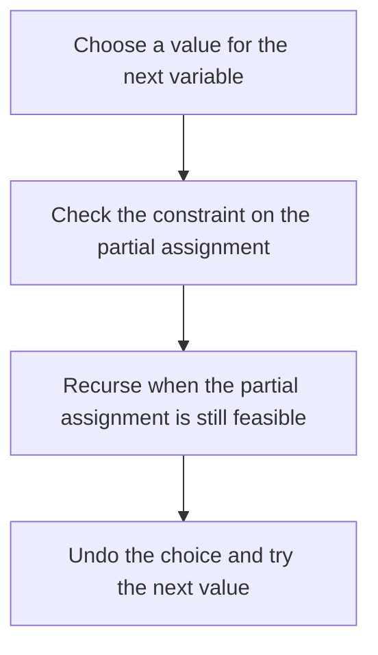

# D02-T021 — Backtracking

Topic ID: `D02-T021`
Domain: Data Structures and Algorithms
Subdomain: Backtracking
Importance: core
Complexity: intermediate
Dependencies: `D02-T020`, `D02-T001`, `D01-T001`, `D01-T002`
Execution status of the code in section F: unexecuted

## A. Topic Overview

Backtracking searches a decision tree and undoes a choice when it violates a constraint. It is depth-first enumeration with pruning. Correctness comes from exploring every feasible partial assignment, not from greediness. Pruning is safe only when a partial assignment can never be extended to a solution.

In production this shows up as follows: A constraint solver that places shipments into trucks backtracks when weight or delivery windows fail. Without a timeout it can pin a worker for the whole request.

Interviewers use Backtracking to see whether you can state the failure mode, not only the definition. The failure to name is: pruning a branch that still contains a solution, or exploring a tree so large that latency exceeds the request deadline

Prerequisites: `D02-T020`, `D02-T001`, `D01-T001`, `D01-T002`. Later notes should link here instead of repeating the mechanism.

## B. First-Principles Explanation

Backtracking searches a decision tree and undoes a choice when it violates a constraint. It is depth-first enumeration with pruning. Correctness comes from exploring every feasible partial assignment, not from greediness. Pruning is safe only when a partial assignment can never be extended to a solution.

The useful picture is: It is walking a maze and stepping back to the last junction when a corridor is blocked.

What has to be true:

1. Choose a value for the next variable
2. Check the constraint on the partial assignment
3. Recurse when the partial assignment is still feasible
4. Undo the choice and try the next value

It works when those steps preserve one invariant. It fails when pruning a branch that still contains a solution, or exploring a tree so large that latency exceeds the request deadline. The alternative is: a closed-form or greedy rule already exists, or n is large and you only need one good answer

## C. Internal Working and Architecture

Components involved: the caller, the state Backtracking mutates or reads, and the observer that reports nodes visited versus solutions found, and p99 latency of the search call.

Execution:

1. Choose a value for the next variable
2. Check the constraint on the partial assignment
3. Recurse when the partial assignment is still feasible
4. Undo the choice and try the next value

Data moves only along that path. A retry re-enters at step 1, so the operation must say what a duplicate does. Memory and locks stay inside this mechanism. Callers see the result or a typed error, not a half-updated invariant.

State to remember: choose this when the search space is small after pruning, or you need every feasible answer. Do not choose it when a closed-form or greedy rule already exists, or n is large and you only need one good answer.

## D. Diagrams and Visual Models



Read the diagram from top to bottom. Each box is one step of Backtracking. The failure mode (pruning a branch that still contains a solution, or exploring a tree so large that latency exceeds the request deadline) is what you look for when a later box never happens or happens twice.

## E. Examples and Analogies

Analogy: It is walking a maze and stepping back to the last junction when a corridor is blocked.

Production example: A constraint solver that places shipments into trucks backtracks when weight or delivery windows fail. Without a timeout it can pin a worker for the whole request.

A small counterexample is enough in an interview. Show the input, apply the steps, and show the broken outcome if someone uses the mechanism outside its rule: pruning a branch that still contains a solution, or exploring a tree so large that latency exceeds the request deadline.

## F. Code Examples

The snippet is labeled unexecuted. It illustrates the shape of the idea. It is not a benchmark and it embeds no secret.

```python
def subsets(nums):
    out = []
    def dfs(i, path):
        if i == len(nums):
            out.append(list(path))
            return
        path.append(nums[i])
        dfs(i + 1, path)
        path.pop()
        dfs(i + 1, path)
    dfs(0, [])
    return out
```

After the snippet, check nodes visited versus solutions found, and p99 latency of the search call. If that signal moves the wrong way, the snippet is the wrong tool for the workload.

## G. Practical Backend Application

Use Backtracking in a service when the search space is small after pruning, or you need every feasible answer.

A typical place is the production case already stated: A constraint solver that places shipments into trucks backtracks when weight or delivery windows fail. Without a timeout it can pin a worker for the whole request.

Operationally you alert on nodes visited versus solutions found, and p99 latency of the search call. You do not alert only on process uptime. The dashboard should show the failure mode, a success rate, and the saturation signal (queue depth, lock wait, or latency) that predicts it.

## H. Advantages, Limitations and Trade-offs

| Choice | Benefit | Cost | Choose when | Avoid when |
| --- | --- | --- | --- | --- |
| Apply Backtracking | the search space is small after pruning, or you need every feasible answer | Extra moving parts and a new failure mode | The failure you are preventing is already real | a closed-form or greedy rule already exists, or n is large and you only need one good answer |
| Simpler alternative | Less code and fewer dependencies | pruning a branch that still contains a solution, or exploring a tree so large that latency exceeds the request deadline | The workload does not hit the limit | The invariant must hold under concurrency or failure |

Backtracking is a trade. State the benefit and the cost in the same sentence when you propose it in a design review.

## I. Common Mistakes and Misconceptions

- Forgetting to undo state after the recursive call.
- Pruning on a heuristic that is not a real constraint.
- Using recursion depth as an excuse to skip an explicit stack and a deadline.
- Treating a diagram of Backtracking as proof that the invariant holds in production.
- Copying a default configuration without naming nodes visited versus solutions found, and p99 latency of the search call.

## J. Debugging and Troubleshooting

Symptom: pruning a branch that still contains a solution, or exploring a tree so large that latency exceeds the request deadline

First check: nodes visited versus solutions found, and p99 latency of the search call.

Then compare one healthy instance against one unhealthy instance. Confirm whether retries are duplicating work. Confirm whether a timeout is shorter than the work. Fix the invariant, then watch the same metric for a full peak, not only for the next minute.

Useful questions: did the step order in section C actually happen, or did a caller skip a step? Did a deploy change the data shape that Backtracking assumes?

## K. Interview Preparation

### Beginner

#### Q1. What problem does Backtracking solve?

**Answer:** Backtracking searches a decision tree and undoes a choice when it violates a constraint. It is depth-first enumeration with pruning. Correctness comes from exploring every feasible partial assignment, not from greediness. Pruning is safe only when a partial assignment can never be extended to a solution. Without it, the usual backend failure is: pruning a branch that still contains a solution, or exploring a tree so large that latency exceeds the request deadline.

#### Q2. Where does Backtracking sit on a request path?

**Answer:** Backtracking is not a library you sprinkle on every call. the search space is small after pruning, or you need every feasible answer You notice it when nodes visited versus solutions found, and p99 latency of the search call. Name the constraint that makes this choice correct. Say what you would measure to confirm it.

#### Q3. Give a concrete example of Backtracking.

**Answer:** A constraint solver that places shipments into trucks backtracks when weight or delivery windows fail. Without a timeout it can pin a worker for the whole request. Walk the input, the state change, and the observable output. Name the constraint that makes this choice correct.

#### Q4. What is a common mix-up around Backtracking?

**Answer:** pruning a branch that still contains a solution, or exploring a tree so large that latency exceeds the request deadline The corrective check is nodes visited versus solutions found, and p99 latency of the search call. Name the constraint that makes this choice correct. Say what you would measure to confirm it. Say which alternative you rejected and why.

#### Q5. When would you skip Backtracking?

**Answer:** a closed-form or greedy rule already exists, or n is large and you only need one good answer Skipping is a decision with a measured cost, not a slogan. Name the constraint that makes this choice correct. Say what you would measure to confirm it. Say which alternative you rejected and why.

### Intermediate

#### Q1. What invariant makes Backtracking correct?

**Answer:** Backtracking searches a decision tree and undoes a choice when it violates a constraint. It is depth-first enumeration with pruning. Correctness comes from exploring every feasible partial assignment, not from greediness. Pruning is safe only when a partial assignment can never be extended to a solution. State the invariant before you name the tool.

#### Q2. How do you test Backtracking?

**Answer:** Assert the failure mode directly: pruning a branch that still contains a solution, or exploring a tree so large that latency exceeds the request deadline. The assertion should watch nodes visited versus solutions found, and p99 latency of the search call. Include a concurrent or retry case if the bug only appears then. Name the constraint that makes this choice correct.

#### Q3. What signal tells you Backtracking is misbehaving in production?

**Answer:** Watch nodes visited versus solutions found, and p99 latency of the search call. The user-visible symptom is usually pruning a branch that still contains a solution, or exploring a tree so large that latency exceeds the request deadline. Name the constraint that makes this choice correct. Say what you would measure to confirm it.

#### Q4. How would you introduce Backtracking into a legacy service?

**Answer:** the search space is small after pruning, or you need every feasible answer Ship it behind a metric so you can compare the old path. Roll back if pruning a branch that still contains a solution, or exploring a tree so large that latency exceeds the request deadline gets worse. Name the constraint that makes this choice correct. Say what you would measure to confirm it.

#### Q5. What do you trade away by choosing Backtracking?

**Answer:** the search space is small after pruning, or you need every feasible answer a closed-form or greedy rule already exists, or n is large and you only need one good answer Say the cost in latency, storage, or operational load. Name the constraint that makes this choice correct. Say what you would measure to confirm it. Say which alternative you rejected and why.

### Advanced

#### Q1. What breaks if a dependency of Backtracking is slow or down?

**Answer:** pruning a branch that still contains a solution, or exploring a tree so large that latency exceeds the request deadline Degrade using the rule: a closed-form or greedy rule already exists, or n is large and you only need one good answer. Timeouts must be shorter than the caller's deadline. Name the constraint that makes this choice correct. Say what you would measure to confirm it.

#### Q2. How does Backtracking behave under retries?

**Answer:** Retries repeat work, so Backtracking must define what a duplicate does. pruning a branch that still contains a solution, or exploring a tree so large that latency exceeds the request deadline Idempotency keys or fences belong next to the write, not in a comment. Name the constraint that makes this choice correct. Say what you would measure to confirm it.

#### Q3. What is the capacity limit of Backtracking?

**Answer:** The limit shows up as nodes visited versus solutions found, and p99 latency of the search call. Add capacity only after you know whether the bottleneck is CPU, lock wait, or network. Name the constraint that makes this choice correct. Say what you would measure to confirm it.

#### Q4. How do you evolve Backtracking without a flag day?

**Answer:** the search space is small after pruning, or you need every feasible answer Version the contract or the on-disk format. Readers should tolerate one old and one new shape during the rollout. Name the constraint that makes this choice correct. Say what you would measure to confirm it.

#### Q5. What security or correctness bug hides inside Backtracking?

**Answer:** pruning a branch that still contains a solution, or exploring a tree so large that latency exceeds the request deadline Check authorization and tenancy at the same boundary as the mechanism. A cache or queue must not widen who can read the data. Name the constraint that makes this choice correct. Say what you would measure to confirm it.

### Scenario

#### Q1. Incident: pruning a branch that still contains a solution, or exploring a tree so large that latency exceeds the request deadline. What do you check first?

**Answer:** Start with nodes visited versus solutions found, and p99 latency of the search call. Compare a good host and a bad host before you restart anything. Backtracking searches a decision tree and undoes a choice when it violates a constraint. It is depth-first enumeration with pruning. Correctness comes from exploring every feasible partial assignment, not from greediness. Pruning is safe only when a partial assignment can never be extended to a solution.

#### Q2. A reviewer wants the clever version. What data settles it?

**Answer:** the search space is small after pruning, or you need every feasible answer a closed-form or greedy rule already exists, or n is large and you only need one good answer Bring nodes visited versus solutions found, and p99 latency of the search call from a load test or from production, not a slogan. Name the constraint that makes this choice correct. Say what you would measure to confirm it. Say which alternative you rejected and why.

#### Q3. You have one hour to explain Backtracking at a whiteboard.

**Answer:** Draw the happy path in four boxes. Then draw the failure: pruning a branch that still contains a solution, or exploring a tree so large that latency exceeds the request deadline. End with the metric you would page on. Name the constraint that makes this choice correct.

#### Q4. The bug only appears under two concurrent callers.

**Answer:** pruning a branch that still contains a solution, or exploring a tree so large that latency exceeds the request deadline Reproduce with a barrier so both sides enter the critical window. Confirm the fix with nodes visited versus solutions found, and p99 latency of the search call. Name the constraint that makes this choice correct. Say what you would measure to confirm it.

#### Q5. Leadership wants this on every service next week.

**Answer:** a closed-form or greedy rule already exists, or n is large and you only need one good answer the search space is small after pruning, or you need every feasible answer Roll it out where the failure mode is already hurting users. Name the constraint that makes this choice correct. Say what you would measure to confirm it. Say which alternative you rejected and why.

### Follow-up

#### Q1. What did you assume about the data size or the clock?

**Answer:** Backtracking searches a decision tree and undoes a choice when it violates a constraint. It is depth-first enumeration with pruning. Correctness comes from exploring every feasible partial assignment, not from greediness. Pruning is safe only when a partial assignment can never be extended to a solution. Clocks are not a total order across machines. State whether the algorithm needs bounded size or a single leader.

#### Q2. What would you measure after the change ships?

**Answer:** Page on nodes visited versus solutions found, and p99 latency of the search call. Keep a before/after dashboard for one week. Alert on the failure mode, not only on CPU. Name the constraint that makes this choice correct.

#### Q3. Which neighboring topic did you deliberately not re-teach?

**Answer:** This note owns Backtracking. Related identifiers are in section N. Shared ideas are linked, not copied. Name the constraint that makes this choice correct.

## L. Practical Exercises

Solutions are in `EXERCISES/solutions/D02-T021.md`, not in this section.

1. Whiteboard the four steps of Backtracking and mark where `pruning a branch that still contains a solution, or exploring a tree so large that latency exceeds the request deadline` enters.
2. Read the snippet in section F and write the assertion that would catch that failure. The assertion must mention `nodes visited versus solutions found, and p99 latency of the search call`.
3. Argue for or against using Backtracking on a service you know. Use the choose and avoid rows from section H. Do not appeal to popularity.

## M. Revision Notes

- Mechanism: Backtracking searches a decision tree and undoes a choice when it violates a constraint.
- Failure: pruning a branch that still contains a solution, or exploring a tree so large that latency exceeds the request deadline
- Metric: nodes visited versus solutions found, and p99 latency of the search call
- Choose when: the search space is small after pruning, or you need every feasible answer
- Avoid when: a closed-form or greedy rule already exists, or n is large and you only need one good answer

## N. Related Topics

Dependencies to review first: `D02-T020`, `D02-T001`, `D01-T001`, `D01-T002`.

Shared ideas stay in those notes. This note does not restate them.

## O. Completion Criteria

- You can explain Backtracking without reading this note, including the failure mode.
- You can draw the diagram in section D from memory.
- You can say when not to use it, using the avoid condition in section H.
- You can name the metric you would watch after shipping it.
