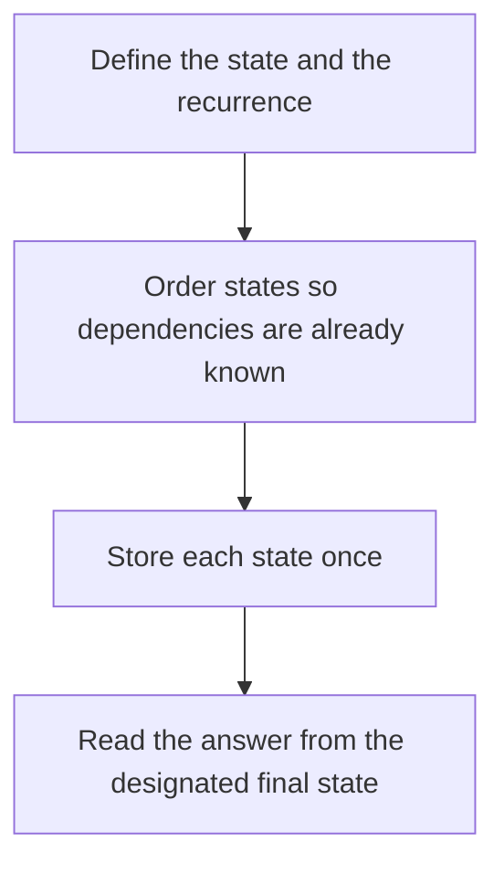

# D02-T022 — Dynamic programming

Topic ID: `D02-T022`
Domain: Data Structures and Algorithms
Subdomain: Dynamic programming
Importance: core
Complexity: intermediate
Dependencies: `D02-T021`, `D02-T001`, `D01-T001`, `D01-T002`
Execution status of the code in section F: unexecuted

## A. Topic Overview

Dynamic programming solves a problem by combining answers to overlapping subproblems and storing each answer once. It needs optimal substructure and a recurrence you can evaluate in an order that respects dependencies. Memoization is top-down. Tabulation is bottom-up. The state must be small enough to store.

In production this shows up as follows: A pricing service that computes the cheapest way to cover a cart with promotions uses a knapsack-style recurrence. If the state omits the promotion stack, two carts collide in one cell.

Interviewers use Dynamic programming to see whether you can state the failure mode, not only the definition. The failure to name is: a state that forgets a dimension the recurrence needs, so two different futures share one stored answer

Prerequisites: `D02-T021`, `D02-T001`, `D01-T001`, `D01-T002`. Later notes should link here instead of repeating the mechanism.

## B. First-Principles Explanation

Dynamic programming solves a problem by combining answers to overlapping subproblems and storing each answer once. It needs optimal substructure and a recurrence you can evaluate in an order that respects dependencies. Memoization is top-down. Tabulation is bottom-up. The state must be small enough to store.

The useful picture is: It is filling a spreadsheet where each cell is a formula over earlier cells, and you never recompute a cell.

What has to be true:

1. Define the state and the recurrence
2. Order states so dependencies are already known
3. Store each state once
4. Read the answer from the designated final state

It works when those steps preserve one invariant. It fails when a state that forgets a dimension the recurrence needs, so two different futures share one stored answer. The alternative is: the recurrence is wrong or the state space is exponential in a dimension you cannot drop

## C. Internal Working and Architecture

Components involved: the caller, the state Dynamic programming mutates or reads, and the observer that reports number of states times work per transition, and whether the cached answer matches a brute-force oracle on small n.

Execution:

1. Define the state and the recurrence
2. Order states so dependencies are already known
3. Store each state once
4. Read the answer from the designated final state

Data moves only along that path. A retry re-enters at step 1, so the operation must say what a duplicate does. Memory and locks stay inside this mechanism. Callers see the result or a typed error, not a half-updated invariant.

State to remember: choose this when subproblems overlap and the state fits in memory. Do not choose it when the recurrence is wrong or the state space is exponential in a dimension you cannot drop.

## D. Diagrams and Visual Models



Read the diagram from top to bottom. Each box is one step of Dynamic programming. The failure mode (a state that forgets a dimension the recurrence needs, so two different futures share one stored answer) is what you look for when a later box never happens or happens twice.

## E. Examples and Analogies

Analogy: It is filling a spreadsheet where each cell is a formula over earlier cells, and you never recompute a cell.

Production example: A pricing service that computes the cheapest way to cover a cart with promotions uses a knapsack-style recurrence. If the state omits the promotion stack, two carts collide in one cell.

A small counterexample is enough in an interview. Show the input, apply the steps, and show the broken outcome if someone uses the mechanism outside its rule: a state that forgets a dimension the recurrence needs, so two different futures share one stored answer.

## F. Code Examples

The snippet is labeled unexecuted. It illustrates the shape of the idea. It is not a benchmark and it embeds no secret.

```python
def coin_change(coins, amount):
    inf = amount + 1
    dp = [0] + [inf] * amount
    for a in range(1, amount + 1):
        for c in coins:
            if c <= a:
                dp[a] = min(dp[a], dp[a - c] + 1)
    return dp[amount] if dp[amount] < inf else -1
```

After the snippet, check number of states times work per transition, and whether the cached answer matches a brute-force oracle on small n. If that signal moves the wrong way, the snippet is the wrong tool for the workload.

## G. Practical Backend Application

Use Dynamic programming in a service when subproblems overlap and the state fits in memory.

A typical place is the production case already stated: A pricing service that computes the cheapest way to cover a cart with promotions uses a knapsack-style recurrence. If the state omits the promotion stack, two carts collide in one cell.

Operationally you alert on number of states times work per transition, and whether the cached answer matches a brute-force oracle on small n. You do not alert only on process uptime. The dashboard should show the failure mode, a success rate, and the saturation signal (queue depth, lock wait, or latency) that predicts it.

## H. Advantages, Limitations and Trade-offs

| Choice | Benefit | Cost | Choose when | Avoid when |
| --- | --- | --- | --- | --- |
| Apply Dynamic programming | subproblems overlap and the state fits in memory | Extra moving parts and a new failure mode | The failure you are preventing is already real | the recurrence is wrong or the state space is exponential in a dimension you cannot drop |
| Simpler alternative | Less code and fewer dependencies | a state that forgets a dimension the recurrence needs, so two different futures share one stored answer | The workload does not hit the limit | The invariant must hold under concurrency or failure |

Dynamic programming is a trade. State the benefit and the cost in the same sentence when you propose it in a design review.

## I. Common Mistakes and Misconceptions

- Caching a function of too few arguments.
- Iterating coins and amounts in an order the recurrence does not allow.
- Calling memoization and tabulation different algorithms when they share one recurrence.
- Treating a diagram of Dynamic programming as proof that the invariant holds in production.
- Copying a default configuration without naming number of states times work per transition, and whether the cached answer matches a brute-force oracle on small n.

## J. Debugging and Troubleshooting

Symptom: a state that forgets a dimension the recurrence needs, so two different futures share one stored answer

First check: number of states times work per transition, and whether the cached answer matches a brute-force oracle on small n.

Then compare one healthy instance against one unhealthy instance. Confirm whether retries are duplicating work. Confirm whether a timeout is shorter than the work. Fix the invariant, then watch the same metric for a full peak, not only for the next minute.

Useful questions: did the step order in section C actually happen, or did a caller skip a step? Did a deploy change the data shape that Dynamic programming assumes?

## K. Interview Preparation

### Beginner

#### Q1. What problem does Dynamic programming solve?

**Answer:** Dynamic programming solves a problem by combining answers to overlapping subproblems and storing each answer once. It needs optimal substructure and a recurrence you can evaluate in an order that respects dependencies. Memoization is top-down. Tabulation is bottom-up. The state must be small enough to store. Without it, the usual backend failure is: a state that forgets a dimension the recurrence needs, so two different futures share one stored answer.

#### Q2. Where does Dynamic programming sit on a request path?

**Answer:** Dynamic programming is not a library you sprinkle on every call. subproblems overlap and the state fits in memory You notice it when number of states times work per transition, and whether the cached answer matches a brute-force oracle on small n. Name the constraint that makes this choice correct. Say what you would measure to confirm it.

#### Q3. Give a concrete example of Dynamic programming.

**Answer:** A pricing service that computes the cheapest way to cover a cart with promotions uses a knapsack-style recurrence. If the state omits the promotion stack, two carts collide in one cell. Walk the input, the state change, and the observable output. Name the constraint that makes this choice correct.

#### Q4. What is a common mix-up around Dynamic programming?

**Answer:** a state that forgets a dimension the recurrence needs, so two different futures share one stored answer The corrective check is number of states times work per transition, and whether the cached answer matches a brute-force oracle on small n. Name the constraint that makes this choice correct. Say what you would measure to confirm it. Say which alternative you rejected and why.

#### Q5. When would you skip Dynamic programming?

**Answer:** the recurrence is wrong or the state space is exponential in a dimension you cannot drop Skipping is a decision with a measured cost, not a slogan. Name the constraint that makes this choice correct. Say what you would measure to confirm it. Say which alternative you rejected and why.

### Intermediate

#### Q1. What invariant makes Dynamic programming correct?

**Answer:** Dynamic programming solves a problem by combining answers to overlapping subproblems and storing each answer once. It needs optimal substructure and a recurrence you can evaluate in an order that respects dependencies. Memoization is top-down. Tabulation is bottom-up. The state must be small enough to store. State the invariant before you name the tool.

#### Q2. How do you test Dynamic programming?

**Answer:** Assert the failure mode directly: a state that forgets a dimension the recurrence needs, so two different futures share one stored answer. The assertion should watch number of states times work per transition, and whether the cached answer matches a brute-force oracle on small n. Include a concurrent or retry case if the bug only appears then. Name the constraint that makes this choice correct.

#### Q3. What signal tells you Dynamic programming is misbehaving in production?

**Answer:** Watch number of states times work per transition, and whether the cached answer matches a brute-force oracle on small n. The user-visible symptom is usually a state that forgets a dimension the recurrence needs, so two different futures share one stored answer. Name the constraint that makes this choice correct. Say what you would measure to confirm it.

#### Q4. How would you introduce Dynamic programming into a legacy service?

**Answer:** subproblems overlap and the state fits in memory Ship it behind a metric so you can compare the old path. Roll back if a state that forgets a dimension the recurrence needs, so two different futures share one stored answer gets worse. Name the constraint that makes this choice correct. Say what you would measure to confirm it.

#### Q5. What do you trade away by choosing Dynamic programming?

**Answer:** subproblems overlap and the state fits in memory the recurrence is wrong or the state space is exponential in a dimension you cannot drop Say the cost in latency, storage, or operational load. Name the constraint that makes this choice correct. Say what you would measure to confirm it. Say which alternative you rejected and why.

### Advanced

#### Q1. What breaks if a dependency of Dynamic programming is slow or down?

**Answer:** a state that forgets a dimension the recurrence needs, so two different futures share one stored answer Degrade using the rule: the recurrence is wrong or the state space is exponential in a dimension you cannot drop. Timeouts must be shorter than the caller's deadline. Name the constraint that makes this choice correct. Say what you would measure to confirm it.

#### Q2. How does Dynamic programming behave under retries?

**Answer:** Retries repeat work, so Dynamic programming must define what a duplicate does. a state that forgets a dimension the recurrence needs, so two different futures share one stored answer Idempotency keys or fences belong next to the write, not in a comment. Name the constraint that makes this choice correct. Say what you would measure to confirm it.

#### Q3. What is the capacity limit of Dynamic programming?

**Answer:** The limit shows up as number of states times work per transition, and whether the cached answer matches a brute-force oracle on small n. Add capacity only after you know whether the bottleneck is CPU, lock wait, or network. Name the constraint that makes this choice correct. Say what you would measure to confirm it.

#### Q4. How do you evolve Dynamic programming without a flag day?

**Answer:** subproblems overlap and the state fits in memory Version the contract or the on-disk format. Readers should tolerate one old and one new shape during the rollout. Name the constraint that makes this choice correct. Say what you would measure to confirm it.

#### Q5. What security or correctness bug hides inside Dynamic programming?

**Answer:** a state that forgets a dimension the recurrence needs, so two different futures share one stored answer Check authorization and tenancy at the same boundary as the mechanism. A cache or queue must not widen who can read the data. Name the constraint that makes this choice correct. Say what you would measure to confirm it.

### Scenario

#### Q1. Incident: a state that forgets a dimension the recurrence needs, so two different futures share one stored answer. What do you check first?

**Answer:** Start with number of states times work per transition, and whether the cached answer matches a brute-force oracle on small n. Compare a good host and a bad host before you restart anything. Dynamic programming solves a problem by combining answers to overlapping subproblems and storing each answer once. It needs optimal substructure and a recurrence you can evaluate in an order that respects dependencies. Memoization is top-down. Tabulation is bottom-up. The state must be small enough to store.

#### Q2. A reviewer wants the clever version. What data settles it?

**Answer:** subproblems overlap and the state fits in memory the recurrence is wrong or the state space is exponential in a dimension you cannot drop Bring number of states times work per transition, and whether the cached answer matches a brute-force oracle on small n from a load test or from production, not a slogan. Name the constraint that makes this choice correct. Say what you would measure to confirm it. Say which alternative you rejected and why.

#### Q3. You have one hour to explain Dynamic programming at a whiteboard.

**Answer:** Draw the happy path in four boxes. Then draw the failure: a state that forgets a dimension the recurrence needs, so two different futures share one stored answer. End with the metric you would page on. Name the constraint that makes this choice correct.

#### Q4. The bug only appears under two concurrent callers.

**Answer:** a state that forgets a dimension the recurrence needs, so two different futures share one stored answer Reproduce with a barrier so both sides enter the critical window. Confirm the fix with number of states times work per transition, and whether the cached answer matches a brute-force oracle on small n. Name the constraint that makes this choice correct. Say what you would measure to confirm it.

#### Q5. Leadership wants this on every service next week.

**Answer:** the recurrence is wrong or the state space is exponential in a dimension you cannot drop subproblems overlap and the state fits in memory Roll it out where the failure mode is already hurting users. Name the constraint that makes this choice correct. Say what you would measure to confirm it. Say which alternative you rejected and why.

### Follow-up

#### Q1. What did you assume about the data size or the clock?

**Answer:** Dynamic programming solves a problem by combining answers to overlapping subproblems and storing each answer once. It needs optimal substructure and a recurrence you can evaluate in an order that respects dependencies. Memoization is top-down. Tabulation is bottom-up. The state must be small enough to store. Clocks are not a total order across machines. State whether the algorithm needs bounded size or a single leader.

#### Q2. What would you measure after the change ships?

**Answer:** Page on number of states times work per transition, and whether the cached answer matches a brute-force oracle on small n. Keep a before/after dashboard for one week. Alert on the failure mode, not only on CPU. Name the constraint that makes this choice correct.

#### Q3. Which neighboring topic did you deliberately not re-teach?

**Answer:** This note owns Dynamic programming. Related identifiers are in section N. Shared ideas are linked, not copied. Name the constraint that makes this choice correct.

## L. Practical Exercises

Solutions are in `EXERCISES/solutions/D02-T022.md`, not in this section.

1. Whiteboard the four steps of Dynamic programming and mark where `a state that forgets a dimension the recurrence needs, so two different futures share one stored answer` enters.
2. Read the snippet in section F and write the assertion that would catch that failure. The assertion must mention `number of states times work per transition, and whether the cached answer matches a brute-force oracle on small n`.
3. Argue for or against using Dynamic programming on a service you know. Use the choose and avoid rows from section H. Do not appeal to popularity.

## M. Revision Notes

- Mechanism: Dynamic programming solves a problem by combining answers to overlapping subproblems and storing each answer once.
- Failure: a state that forgets a dimension the recurrence needs, so two different futures share one stored answer
- Metric: number of states times work per transition, and whether the cached answer matches a brute-force oracle on small n
- Choose when: subproblems overlap and the state fits in memory
- Avoid when: the recurrence is wrong or the state space is exponential in a dimension you cannot drop

## N. Related Topics

Dependencies to review first: `D02-T021`, `D02-T001`, `D01-T001`, `D01-T002`.

Shared ideas stay in those notes. This note does not restate them.

## O. Completion Criteria

- You can explain Dynamic programming without reading this note, including the failure mode.
- You can draw the diagram in section D from memory.
- You can say when not to use it, using the avoid condition in section H.
- You can name the metric you would watch after shipping it.
