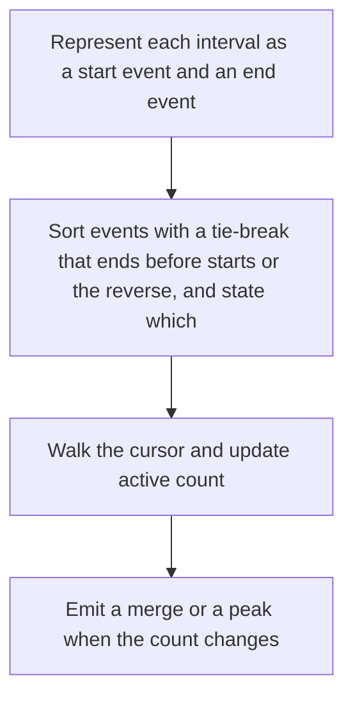

# D02-T024 — Intervals and sweep-line algorithms

Topic ID: `D02-T024`
Domain: Data Structures and Algorithms
Subdomain: Intervals and sweep-line algorithms
Importance: core
Complexity: intermediate
Dependencies: `D02-T023`, `D02-T001`, `D01-T001`, `D01-T002`
Execution status of the code in section F: unexecuted

## A. Topic Overview

Interval algorithms keep segments on a line. Sorting by start or end, then scanning once, answers overlap, merge, and minimum meeting rooms. A sweep line moves a cursor and updates a counter or a heap at each start and end event. A segment tree answers stabbing queries when the scan is not enough.

In production this shows up as follows: A booking service merges overlapping maintenance windows and counts concurrent reservations. An off-by-one at equal timestamps double-books a room that frees at noon and is reserved at noon.

Interviewers use Intervals and sweep-line algorithms to see whether you can state the failure mode, not only the definition. The failure to name is: a tie-break that closes an interval before it opens at the same timestamp, so a meeting that ends when another starts looks like an overlap

Prerequisites: `D02-T023`, `D02-T001`, `D01-T001`, `D01-T002`. Later notes should link here instead of repeating the mechanism.

## B. First-Principles Explanation

Interval algorithms keep segments on a line. Sorting by start or end, then scanning once, answers overlap, merge, and minimum meeting rooms. A sweep line moves a cursor and updates a counter or a heap at each start and end event. A segment tree answers stabbing queries when the scan is not enough.

The useful picture is: A sweep line is a cursor moving across a calendar, counting how many meetings are open at each instant.

What has to be true:

1. Represent each interval as a start event and an end event
2. Sort events with a tie-break that ends before starts or the reverse, and state which
3. Walk the cursor and update active count
4. Emit a merge or a peak when the count changes

It works when those steps preserve one invariant. It fails when a tie-break that closes an interval before it opens at the same timestamp, so a meeting that ends when another starts looks like an overlap. The alternative is: the geometry is two-dimensional or the predicate is not an interval overlap

## C. Internal Working and Architecture

Components involved: the caller, the state Intervals and sweep-line algorithms mutates or reads, and the observer that reports maximum active count against a brute-force overlap matrix on small inputs.

Execution:

1. Represent each interval as a start event and an end event
2. Sort events with a tie-break that ends before starts or the reverse, and state which
3. Walk the cursor and update active count
4. Emit a merge or a peak when the count changes

Data moves only along that path. A retry re-enters at step 1, so the operation must say what a duplicate does. Memory and locks stay inside this mechanism. Callers see the result or a typed error, not a half-updated invariant.

State to remember: choose this when queries are overlap, merge, or peak concurrency on a line. Do not choose it when the geometry is two-dimensional or the predicate is not an interval overlap.

## D. Diagrams and Visual Models



Read the diagram from top to bottom. Each box is one step of Intervals and sweep-line algorithms. The failure mode (a tie-break that closes an interval before it opens at the same timestamp, so a meeting that ends when another starts looks like an overlap) is what you look for when a later box never happens or happens twice.

## E. Examples and Analogies

Analogy: A sweep line is a cursor moving across a calendar, counting how many meetings are open at each instant.

Production example: A booking service merges overlapping maintenance windows and counts concurrent reservations. An off-by-one at equal timestamps double-books a room that frees at noon and is reserved at noon.

A small counterexample is enough in an interview. Show the input, apply the steps, and show the broken outcome if someone uses the mechanism outside its rule: a tie-break that closes an interval before it opens at the same timestamp, so a meeting that ends when another starts looks like an overlap.

## F. Code Examples

The snippet is labeled unexecuted. It illustrates the shape of the idea. It is not a benchmark and it embeds no secret.

```python
def max_overlap(intervals):
    events = []
    for start, end in intervals:
        events.append((start, 1))
        events.append((end, -1))
    events.sort()
    cur = best = 0
    for _, delta in events:
        cur += delta
        best = max(best, cur)
    return best
```

After the snippet, check maximum active count against a brute-force overlap matrix on small inputs. If that signal moves the wrong way, the snippet is the wrong tool for the workload.

## G. Practical Backend Application

Use Intervals and sweep-line algorithms in a service when queries are overlap, merge, or peak concurrency on a line.

A typical place is the production case already stated: A booking service merges overlapping maintenance windows and counts concurrent reservations. An off-by-one at equal timestamps double-books a room that frees at noon and is reserved at noon.

Operationally you alert on maximum active count against a brute-force overlap matrix on small inputs. You do not alert only on process uptime. The dashboard should show the failure mode, a success rate, and the saturation signal (queue depth, lock wait, or latency) that predicts it.

## H. Advantages, Limitations and Trade-offs

| Choice | Benefit | Cost | Choose when | Avoid when |
| --- | --- | --- | --- | --- |
| Apply Intervals and sweep-line algorithms | queries are overlap, merge, or peak concurrency on a line | Extra moving parts and a new failure mode | The failure you are preventing is already real | the geometry is two-dimensional or the predicate is not an interval overlap |
| Simpler alternative | Less code and fewer dependencies | a tie-break that closes an interval before it opens at the same timestamp, so a meeting that ends when another starts looks like an overlap | The workload does not hit the limit | The invariant must hold under concurrency or failure |

Intervals and sweep-line algorithms is a trade. State the benefit and the cost in the same sentence when you propose it in a design review.

## I. Common Mistakes and Misconceptions

- Sorting only by start and missing a nested interval.
- Using a half-open convention in one service and closed in another.
- Forgetting that a sweep's tie-break is part of the spec.
- Treating a diagram of Intervals and sweep-line algorithms as proof that the invariant holds in production.
- Copying a default configuration without naming maximum active count against a brute-force overlap matrix on small inputs.

## J. Debugging and Troubleshooting

Symptom: a tie-break that closes an interval before it opens at the same timestamp, so a meeting that ends when another starts looks like an overlap

First check: maximum active count against a brute-force overlap matrix on small inputs.

Then compare one healthy instance against one unhealthy instance. Confirm whether retries are duplicating work. Confirm whether a timeout is shorter than the work. Fix the invariant, then watch the same metric for a full peak, not only for the next minute.

Useful questions: did the step order in section C actually happen, or did a caller skip a step? Did a deploy change the data shape that Intervals and sweep-line algorithms assumes?

## K. Interview Preparation

### Beginner

#### Q1. What problem does Intervals and sweep-line algorithms solve?

**Answer:** Interval algorithms keep segments on a line. Sorting by start or end, then scanning once, answers overlap, merge, and minimum meeting rooms. A sweep line moves a cursor and updates a counter or a heap at each start and end event. A segment tree answers stabbing queries when the scan is not enough. Without it, the usual backend failure is: a tie-break that closes an interval before it opens at the same timestamp, so a meeting that ends when another starts looks like an overlap.

#### Q2. Where does Intervals and sweep-line algorithms sit on a request path?

**Answer:** Intervals and sweep-line algorithms is not a library you sprinkle on every call. queries are overlap, merge, or peak concurrency on a line You notice it when maximum active count against a brute-force overlap matrix on small inputs. Name the constraint that makes this choice correct. Say what you would measure to confirm it.

#### Q3. Give a concrete example of Intervals and sweep-line algorithms.

**Answer:** A booking service merges overlapping maintenance windows and counts concurrent reservations. An off-by-one at equal timestamps double-books a room that frees at noon and is reserved at noon. Walk the input, the state change, and the observable output. Name the constraint that makes this choice correct.

#### Q4. What is a common mix-up around Intervals and sweep-line algorithms?

**Answer:** a tie-break that closes an interval before it opens at the same timestamp, so a meeting that ends when another starts looks like an overlap The corrective check is maximum active count against a brute-force overlap matrix on small inputs. Name the constraint that makes this choice correct. Say what you would measure to confirm it. Say which alternative you rejected and why.

#### Q5. When would you skip Intervals and sweep-line algorithms?

**Answer:** the geometry is two-dimensional or the predicate is not an interval overlap Skipping is a decision with a measured cost, not a slogan. Name the constraint that makes this choice correct. Say what you would measure to confirm it. Say which alternative you rejected and why.

### Intermediate

#### Q1. What invariant makes Intervals and sweep-line algorithms correct?

**Answer:** Interval algorithms keep segments on a line. Sorting by start or end, then scanning once, answers overlap, merge, and minimum meeting rooms. A sweep line moves a cursor and updates a counter or a heap at each start and end event. A segment tree answers stabbing queries when the scan is not enough. State the invariant before you name the tool.

#### Q2. How do you test Intervals and sweep-line algorithms?

**Answer:** Assert the failure mode directly: a tie-break that closes an interval before it opens at the same timestamp, so a meeting that ends when another starts looks like an overlap. The assertion should watch maximum active count against a brute-force overlap matrix on small inputs. Include a concurrent or retry case if the bug only appears then. Name the constraint that makes this choice correct.

#### Q3. What signal tells you Intervals and sweep-line algorithms is misbehaving in production?

**Answer:** Watch maximum active count against a brute-force overlap matrix on small inputs. The user-visible symptom is usually a tie-break that closes an interval before it opens at the same timestamp, so a meeting that ends when another starts looks like an overlap. Name the constraint that makes this choice correct. Say what you would measure to confirm it.

#### Q4. How would you introduce Intervals and sweep-line algorithms into a legacy service?

**Answer:** queries are overlap, merge, or peak concurrency on a line Ship it behind a metric so you can compare the old path. Roll back if a tie-break that closes an interval before it opens at the same timestamp, so a meeting that ends when another starts looks like an overlap gets worse. Name the constraint that makes this choice correct. Say what you would measure to confirm it.

#### Q5. What do you trade away by choosing Intervals and sweep-line algorithms?

**Answer:** queries are overlap, merge, or peak concurrency on a line the geometry is two-dimensional or the predicate is not an interval overlap Say the cost in latency, storage, or operational load. Name the constraint that makes this choice correct. Say what you would measure to confirm it. Say which alternative you rejected and why.

### Advanced

#### Q1. What breaks if a dependency of Intervals and sweep-line algorithms is slow or down?

**Answer:** a tie-break that closes an interval before it opens at the same timestamp, so a meeting that ends when another starts looks like an overlap Degrade using the rule: the geometry is two-dimensional or the predicate is not an interval overlap. Timeouts must be shorter than the caller's deadline. Name the constraint that makes this choice correct. Say what you would measure to confirm it.

#### Q2. How does Intervals and sweep-line algorithms behave under retries?

**Answer:** Retries repeat work, so Intervals and sweep-line algorithms must define what a duplicate does. a tie-break that closes an interval before it opens at the same timestamp, so a meeting that ends when another starts looks like an overlap Idempotency keys or fences belong next to the write, not in a comment. Name the constraint that makes this choice correct. Say what you would measure to confirm it.

#### Q3. What is the capacity limit of Intervals and sweep-line algorithms?

**Answer:** The limit shows up as maximum active count against a brute-force overlap matrix on small inputs. Add capacity only after you know whether the bottleneck is CPU, lock wait, or network. Name the constraint that makes this choice correct. Say what you would measure to confirm it.

#### Q4. How do you evolve Intervals and sweep-line algorithms without a flag day?

**Answer:** queries are overlap, merge, or peak concurrency on a line Version the contract or the on-disk format. Readers should tolerate one old and one new shape during the rollout. Name the constraint that makes this choice correct. Say what you would measure to confirm it.

#### Q5. What security or correctness bug hides inside Intervals and sweep-line algorithms?

**Answer:** a tie-break that closes an interval before it opens at the same timestamp, so a meeting that ends when another starts looks like an overlap Check authorization and tenancy at the same boundary as the mechanism. A cache or queue must not widen who can read the data. Name the constraint that makes this choice correct. Say what you would measure to confirm it.

### Scenario

#### Q1. Incident: a tie-break that closes an interval before it opens at the same timestamp, so a meeting that ends when another starts looks like an overlap. What do you check first?

**Answer:** Start with maximum active count against a brute-force overlap matrix on small inputs. Compare a good host and a bad host before you restart anything. Interval algorithms keep segments on a line. Sorting by start or end, then scanning once, answers overlap, merge, and minimum meeting rooms. A sweep line moves a cursor and updates a counter or a heap at each start and end event. A segment tree answers stabbing queries when the scan is not enough.

#### Q2. A reviewer wants the clever version. What data settles it?

**Answer:** queries are overlap, merge, or peak concurrency on a line the geometry is two-dimensional or the predicate is not an interval overlap Bring maximum active count against a brute-force overlap matrix on small inputs from a load test or from production, not a slogan. Name the constraint that makes this choice correct. Say what you would measure to confirm it. Say which alternative you rejected and why.

#### Q3. You have one hour to explain Intervals and sweep-line algorithms at a whiteboard.

**Answer:** Draw the happy path in four boxes. Then draw the failure: a tie-break that closes an interval before it opens at the same timestamp, so a meeting that ends when another starts looks like an overlap. End with the metric you would page on. Name the constraint that makes this choice correct.

#### Q4. The bug only appears under two concurrent callers.

**Answer:** a tie-break that closes an interval before it opens at the same timestamp, so a meeting that ends when another starts looks like an overlap Reproduce with a barrier so both sides enter the critical window. Confirm the fix with maximum active count against a brute-force overlap matrix on small inputs. Name the constraint that makes this choice correct. Say what you would measure to confirm it.

#### Q5. Leadership wants this on every service next week.

**Answer:** the geometry is two-dimensional or the predicate is not an interval overlap queries are overlap, merge, or peak concurrency on a line Roll it out where the failure mode is already hurting users. Name the constraint that makes this choice correct. Say what you would measure to confirm it. Say which alternative you rejected and why.

### Follow-up

#### Q1. What did you assume about the data size or the clock?

**Answer:** Interval algorithms keep segments on a line. Sorting by start or end, then scanning once, answers overlap, merge, and minimum meeting rooms. A sweep line moves a cursor and updates a counter or a heap at each start and end event. A segment tree answers stabbing queries when the scan is not enough. Clocks are not a total order across machines. State whether the algorithm needs bounded size or a single leader.

#### Q2. What would you measure after the change ships?

**Answer:** Page on maximum active count against a brute-force overlap matrix on small inputs. Keep a before/after dashboard for one week. Alert on the failure mode, not only on CPU. Name the constraint that makes this choice correct.

#### Q3. Which neighboring topic did you deliberately not re-teach?

**Answer:** This note owns Intervals and sweep-line algorithms. Related identifiers are in section N. Shared ideas are linked, not copied. Name the constraint that makes this choice correct.

## L. Practical Exercises

Solutions are in `EXERCISES/solutions/D02-T024.md`, not in this section.

1. Whiteboard the four steps of Intervals and sweep-line algorithms and mark where `a tie-break that closes an interval before it opens at the same timestamp, so a meeting that ends when another starts looks like an overlap` enters.
2. Read the snippet in section F and write the assertion that would catch that failure. The assertion must mention `maximum active count against a brute-force overlap matrix on small inputs`.
3. Argue for or against using Intervals and sweep-line algorithms on a service you know. Use the choose and avoid rows from section H. Do not appeal to popularity.

## M. Revision Notes

- Mechanism: Interval algorithms keep segments on a line.
- Failure: a tie-break that closes an interval before it opens at the same timestamp, so a meeting that ends when another starts looks like an overlap
- Metric: maximum active count against a brute-force overlap matrix on small inputs
- Choose when: queries are overlap, merge, or peak concurrency on a line
- Avoid when: the geometry is two-dimensional or the predicate is not an interval overlap

## N. Related Topics

Dependencies to review first: `D02-T023`, `D02-T001`, `D01-T001`, `D01-T002`.

Shared ideas stay in those notes. This note does not restate them.

## O. Completion Criteria

- You can explain Intervals and sweep-line algorithms without reading this note, including the failure mode.
- You can draw the diagram in section D from memory.
- You can say when not to use it, using the avoid condition in section H.
- You can name the metric you would watch after shipping it.
