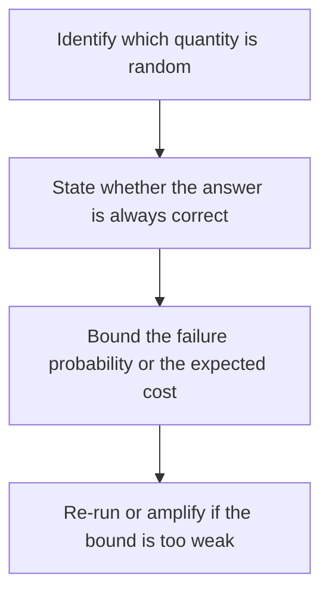

# D02-T025 — Randomized algorithms

Topic ID: `D02-T025`
Domain: Data Structures and Algorithms
Subdomain: Randomized algorithms
Importance: core
Complexity: intermediate
Dependencies: `D02-T024`, `D02-T001`, `D01-T001`, `D01-T002`
Execution status of the code in section F: unexecuted

## A. Topic Overview

A randomized algorithm draws bits to simplify a decision or to reach a good answer with high probability. A Las Vegas algorithm always returns a correct answer and bets on runtime. A Monte Carlo algorithm bets on correctness and is fast. Quicksort's random pivot and randomized hashing are the standard examples. The guarantee is a probability bound, not a promise about one unlucky draw.

In production this shows up as follows: A load balancer that picks two random backends and keeps the shorter queue beats a single random pick. One unlucky sample is not a capacity plan.

Interviewers use Randomized algorithms to see whether you can state the failure mode, not only the definition. The failure to name is: treating one lucky sample as a proof, or shipping a Monte Carlo check that can accept a wrong answer with no amplification

Prerequisites: `D02-T024`, `D02-T001`, `D01-T001`, `D01-T002`. Later notes should link here instead of repeating the mechanism.

## B. First-Principles Explanation

A randomized algorithm draws bits to simplify a decision or to reach a good answer with high probability. A Las Vegas algorithm always returns a correct answer and bets on runtime. A Monte Carlo algorithm bets on correctness and is fast. Quicksort's random pivot and randomized hashing are the standard examples. The guarantee is a probability bound, not a promise about one unlucky draw.

The useful picture is: Drawing a random pivot is shuffling the deck before you cut it, so an adversary cannot hand you the worst order every time.

What has to be true:

1. Identify which quantity is random
2. State whether the answer is always correct
3. Bound the failure probability or the expected cost
4. Re-run or amplify if the bound is too weak

It works when those steps preserve one invariant. It fails when treating one lucky sample as a proof, or shipping a Monte Carlo check that can accept a wrong answer with no amplification. The alternative is: you need a worst-case latency for a tail SLO, unless you add a deterministic fallback

## C. Internal Working and Architecture

Components involved: the caller, the state Randomized algorithms mutates or reads, and the observer that reports observed failure rate versus the published probability bound, over many seeds.

Execution:

1. Identify which quantity is random
2. State whether the answer is always correct
3. Bound the failure probability or the expected cost
4. Re-run or amplify if the bound is too weak

Data moves only along that path. A retry re-enters at step 1, so the operation must say what a duplicate does. Memory and locks stay inside this mechanism. Callers see the result or a typed error, not a half-updated invariant.

State to remember: choose this when an adversary controls input order, or an expected-time bound is enough. Do not choose it when you need a worst-case latency for a tail SLO, unless you add a deterministic fallback.

## D. Diagrams and Visual Models



Read the diagram from top to bottom. Each box is one step of Randomized algorithms. The failure mode (treating one lucky sample as a proof, or shipping a Monte Carlo check that can accept a wrong answer with no amplification) is what you look for when a later box never happens or happens twice.

## E. Examples and Analogies

Analogy: Drawing a random pivot is shuffling the deck before you cut it, so an adversary cannot hand you the worst order every time.

Production example: A load balancer that picks two random backends and keeps the shorter queue beats a single random pick. One unlucky sample is not a capacity plan.

A small counterexample is enough in an interview. Show the input, apply the steps, and show the broken outcome if someone uses the mechanism outside its rule: treating one lucky sample as a proof, or shipping a Monte Carlo check that can accept a wrong answer with no amplification.

## F. Code Examples

The snippet is labeled unexecuted. It illustrates the shape of the idea. It is not a benchmark and it embeds no secret.

```python
import random

def randomized_partition_pivot(n):
    return random.randrange(n)
```

After the snippet, check observed failure rate versus the published probability bound, over many seeds. If that signal moves the wrong way, the snippet is the wrong tool for the workload.

## G. Practical Backend Application

Use Randomized algorithms in a service when an adversary controls input order, or an expected-time bound is enough.

A typical place is the production case already stated: A load balancer that picks two random backends and keeps the shorter queue beats a single random pick. One unlucky sample is not a capacity plan.

Operationally you alert on observed failure rate versus the published probability bound, over many seeds. You do not alert only on process uptime. The dashboard should show the failure mode, a success rate, and the saturation signal (queue depth, lock wait, or latency) that predicts it.

## H. Advantages, Limitations and Trade-offs

| Choice | Benefit | Cost | Choose when | Avoid when |
| --- | --- | --- | --- | --- |
| Apply Randomized algorithms | an adversary controls input order, or an expected-time bound is enough | Extra moving parts and a new failure mode | The failure you are preventing is already real | you need a worst-case latency for a tail SLO, unless you add a deterministic fallback |
| Simpler alternative | Less code and fewer dependencies | treating one lucky sample as a proof, or shipping a Monte Carlo check that can accept a wrong answer with no amplification | The workload does not hit the limit | The invariant must hold under concurrency or failure |

Randomized algorithms is a trade. State the benefit and the cost in the same sentence when you propose it in a design review.

## I. Common Mistakes and Misconceptions

- Using a seed that is constant in production.
- Confusing expected time with a p99 bound.
- Skipping amplification on a Monte Carlo predicate.
- Treating a diagram of Randomized algorithms as proof that the invariant holds in production.
- Copying a default configuration without naming observed failure rate versus the published probability bound, over many seeds.

## J. Debugging and Troubleshooting

Symptom: treating one lucky sample as a proof, or shipping a Monte Carlo check that can accept a wrong answer with no amplification

First check: observed failure rate versus the published probability bound, over many seeds.

Then compare one healthy instance against one unhealthy instance. Confirm whether retries are duplicating work. Confirm whether a timeout is shorter than the work. Fix the invariant, then watch the same metric for a full peak, not only for the next minute.

Useful questions: did the step order in section C actually happen, or did a caller skip a step? Did a deploy change the data shape that Randomized algorithms assumes?

## K. Interview Preparation

### Beginner

#### Q1. What problem does Randomized algorithms solve?

**Answer:** A randomized algorithm draws bits to simplify a decision or to reach a good answer with high probability. A Las Vegas algorithm always returns a correct answer and bets on runtime. A Monte Carlo algorithm bets on correctness and is fast. Quicksort's random pivot and randomized hashing are the standard examples. The guarantee is a probability bound, not a promise about one unlucky draw. Without it, the usual backend failure is: treating one lucky sample as a proof, or shipping a Monte Carlo check that can accept a wrong answer with no amplification.

#### Q2. Where does Randomized algorithms sit on a request path?

**Answer:** Randomized algorithms is not a library you sprinkle on every call. an adversary controls input order, or an expected-time bound is enough You notice it when observed failure rate versus the published probability bound, over many seeds. Name the constraint that makes this choice correct. Say what you would measure to confirm it.

#### Q3. Give a concrete example of Randomized algorithms.

**Answer:** A load balancer that picks two random backends and keeps the shorter queue beats a single random pick. One unlucky sample is not a capacity plan. Walk the input, the state change, and the observable output. Name the constraint that makes this choice correct.

#### Q4. What is a common mix-up around Randomized algorithms?

**Answer:** treating one lucky sample as a proof, or shipping a Monte Carlo check that can accept a wrong answer with no amplification The corrective check is observed failure rate versus the published probability bound, over many seeds. Name the constraint that makes this choice correct. Say what you would measure to confirm it. Say which alternative you rejected and why.

#### Q5. When would you skip Randomized algorithms?

**Answer:** you need a worst-case latency for a tail SLO, unless you add a deterministic fallback Skipping is a decision with a measured cost, not a slogan. Name the constraint that makes this choice correct. Say what you would measure to confirm it. Say which alternative you rejected and why.

### Intermediate

#### Q1. What invariant makes Randomized algorithms correct?

**Answer:** A randomized algorithm draws bits to simplify a decision or to reach a good answer with high probability. A Las Vegas algorithm always returns a correct answer and bets on runtime. A Monte Carlo algorithm bets on correctness and is fast. Quicksort's random pivot and randomized hashing are the standard examples. The guarantee is a probability bound, not a promise about one unlucky draw. State the invariant before you name the tool.

#### Q2. How do you test Randomized algorithms?

**Answer:** Assert the failure mode directly: treating one lucky sample as a proof, or shipping a Monte Carlo check that can accept a wrong answer with no amplification. The assertion should watch observed failure rate versus the published probability bound, over many seeds. Include a concurrent or retry case if the bug only appears then. Name the constraint that makes this choice correct.

#### Q3. What signal tells you Randomized algorithms is misbehaving in production?

**Answer:** Watch observed failure rate versus the published probability bound, over many seeds. The user-visible symptom is usually treating one lucky sample as a proof, or shipping a Monte Carlo check that can accept a wrong answer with no amplification. Name the constraint that makes this choice correct. Say what you would measure to confirm it.

#### Q4. How would you introduce Randomized algorithms into a legacy service?

**Answer:** an adversary controls input order, or an expected-time bound is enough Ship it behind a metric so you can compare the old path. Roll back if treating one lucky sample as a proof, or shipping a Monte Carlo check that can accept a wrong answer with no amplification gets worse. Name the constraint that makes this choice correct. Say what you would measure to confirm it.

#### Q5. What do you trade away by choosing Randomized algorithms?

**Answer:** an adversary controls input order, or an expected-time bound is enough you need a worst-case latency for a tail SLO, unless you add a deterministic fallback Say the cost in latency, storage, or operational load. Name the constraint that makes this choice correct. Say what you would measure to confirm it. Say which alternative you rejected and why.

### Advanced

#### Q1. What breaks if a dependency of Randomized algorithms is slow or down?

**Answer:** treating one lucky sample as a proof, or shipping a Monte Carlo check that can accept a wrong answer with no amplification Degrade using the rule: you need a worst-case latency for a tail SLO, unless you add a deterministic fallback. Timeouts must be shorter than the caller's deadline. Name the constraint that makes this choice correct. Say what you would measure to confirm it.

#### Q2. How does Randomized algorithms behave under retries?

**Answer:** Retries repeat work, so Randomized algorithms must define what a duplicate does. treating one lucky sample as a proof, or shipping a Monte Carlo check that can accept a wrong answer with no amplification Idempotency keys or fences belong next to the write, not in a comment. Name the constraint that makes this choice correct. Say what you would measure to confirm it.

#### Q3. What is the capacity limit of Randomized algorithms?

**Answer:** The limit shows up as observed failure rate versus the published probability bound, over many seeds. Add capacity only after you know whether the bottleneck is CPU, lock wait, or network. Name the constraint that makes this choice correct. Say what you would measure to confirm it.

#### Q4. How do you evolve Randomized algorithms without a flag day?

**Answer:** an adversary controls input order, or an expected-time bound is enough Version the contract or the on-disk format. Readers should tolerate one old and one new shape during the rollout. Name the constraint that makes this choice correct. Say what you would measure to confirm it.

#### Q5. What security or correctness bug hides inside Randomized algorithms?

**Answer:** treating one lucky sample as a proof, or shipping a Monte Carlo check that can accept a wrong answer with no amplification Check authorization and tenancy at the same boundary as the mechanism. A cache or queue must not widen who can read the data. Name the constraint that makes this choice correct. Say what you would measure to confirm it.

### Scenario

#### Q1. Incident: treating one lucky sample as a proof, or shipping a Monte Carlo check that can accept a wrong answer with no amplification. What do you check first?

**Answer:** Start with observed failure rate versus the published probability bound, over many seeds. Compare a good host and a bad host before you restart anything. A randomized algorithm draws bits to simplify a decision or to reach a good answer with high probability. A Las Vegas algorithm always returns a correct answer and bets on runtime. A Monte Carlo algorithm bets on correctness and is fast. Quicksort's random pivot and randomized hashing are the standard examples. The guarantee is a probability bound, not a promise about one unlucky draw.

#### Q2. A reviewer wants the clever version. What data settles it?

**Answer:** an adversary controls input order, or an expected-time bound is enough you need a worst-case latency for a tail SLO, unless you add a deterministic fallback Bring observed failure rate versus the published probability bound, over many seeds from a load test or from production, not a slogan. Name the constraint that makes this choice correct. Say what you would measure to confirm it. Say which alternative you rejected and why.

#### Q3. You have one hour to explain Randomized algorithms at a whiteboard.

**Answer:** Draw the happy path in four boxes. Then draw the failure: treating one lucky sample as a proof, or shipping a Monte Carlo check that can accept a wrong answer with no amplification. End with the metric you would page on. Name the constraint that makes this choice correct.

#### Q4. The bug only appears under two concurrent callers.

**Answer:** treating one lucky sample as a proof, or shipping a Monte Carlo check that can accept a wrong answer with no amplification Reproduce with a barrier so both sides enter the critical window. Confirm the fix with observed failure rate versus the published probability bound, over many seeds. Name the constraint that makes this choice correct. Say what you would measure to confirm it.

#### Q5. Leadership wants this on every service next week.

**Answer:** you need a worst-case latency for a tail SLO, unless you add a deterministic fallback an adversary controls input order, or an expected-time bound is enough Roll it out where the failure mode is already hurting users. Name the constraint that makes this choice correct. Say what you would measure to confirm it. Say which alternative you rejected and why.

### Follow-up

#### Q1. What did you assume about the data size or the clock?

**Answer:** A randomized algorithm draws bits to simplify a decision or to reach a good answer with high probability. A Las Vegas algorithm always returns a correct answer and bets on runtime. A Monte Carlo algorithm bets on correctness and is fast. Quicksort's random pivot and randomized hashing are the standard examples. The guarantee is a probability bound, not a promise about one unlucky draw. Clocks are not a total order across machines. State whether the algorithm needs bounded size or a single leader.

#### Q2. What would you measure after the change ships?

**Answer:** Page on observed failure rate versus the published probability bound, over many seeds. Keep a before/after dashboard for one week. Alert on the failure mode, not only on CPU. Name the constraint that makes this choice correct.

#### Q3. Which neighboring topic did you deliberately not re-teach?

**Answer:** This note owns Randomized algorithms. Related identifiers are in section N. Shared ideas are linked, not copied. Name the constraint that makes this choice correct.

## L. Practical Exercises

Solutions are in `EXERCISES/solutions/D02-T025.md`, not in this section.

1. Whiteboard the four steps of Randomized algorithms and mark where `treating one lucky sample as a proof, or shipping a Monte Carlo check that can accept a wrong answer with no amplification` enters.
2. Read the snippet in section F and write the assertion that would catch that failure. The assertion must mention `observed failure rate versus the published probability bound, over many seeds`.
3. Argue for or against using Randomized algorithms on a service you know. Use the choose and avoid rows from section H. Do not appeal to popularity.

## M. Revision Notes

- Mechanism: A randomized algorithm draws bits to simplify a decision or to reach a good answer with high probability.
- Failure: treating one lucky sample as a proof, or shipping a Monte Carlo check that can accept a wrong answer with no amplification
- Metric: observed failure rate versus the published probability bound, over many seeds
- Choose when: an adversary controls input order, or an expected-time bound is enough
- Avoid when: you need a worst-case latency for a tail SLO, unless you add a deterministic fallback

## N. Related Topics

Dependencies to review first: `D02-T024`, `D02-T001`, `D01-T001`, `D01-T002`.

Shared ideas stay in those notes. This note does not restate them.

## O. Completion Criteria

- You can explain Randomized algorithms without reading this note, including the failure mode.
- You can draw the diagram in section D from memory.
- You can say when not to use it, using the avoid condition in section H.
- You can name the metric you would watch after shipping it.
