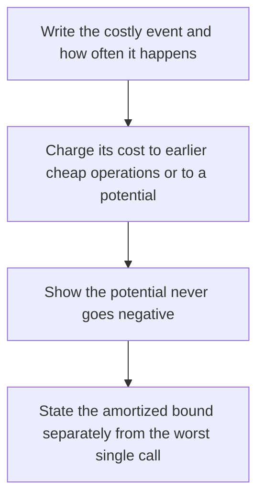

# D02-T026 — Amortized analysis

Topic ID: `D02-T026`
Domain: Data Structures and Algorithms
Subdomain: Amortized analysis
Importance: core
Complexity: intermediate
Dependencies: `D02-T025`, `D02-T001`, `D01-T001`, `D01-T002`
Execution status of the code in section F: unexecuted

## A. Topic Overview

Amortized analysis averages the cost of an operation over a sequence, so a rare expensive step can be charged to many cheap ones. Aggregate analysis divides total cost by the number of operations. The accounting method stores credit on objects. The potential method tracks a function of the whole structure. A dynamic array's doubling is the textbook case: most pushes are O(1), and the copy is paid for by the unused capacity.

In production this shows up as follows: A log buffer that flushes every megabyte has a cheap append and a rare fsync. The SLO has to budget the flush, or a request that hits it times out.

Interviewers use Amortized analysis to see whether you can state the failure mode, not only the definition. The failure to name is: using an amortized O(1) claim as a tail-latency SLO, then watching one resize stall a request

Prerequisites: `D02-T025`, `D02-T001`, `D01-T001`, `D01-T002`. Later notes should link here instead of repeating the mechanism.

## B. First-Principles Explanation

Amortized analysis averages the cost of an operation over a sequence, so a rare expensive step can be charged to many cheap ones. Aggregate analysis divides total cost by the number of operations. The accounting method stores credit on objects. The potential method tracks a function of the whole structure. A dynamic array's doubling is the textbook case: most pushes are O(1), and the copy is paid for by the unused capacity.

The useful picture is: Buying a stack of cups in bulk is expensive once, and each later coffee looks cheap if you spread that receipt across them.

What has to be true:

1. Write the costly event and how often it happens
2. Charge its cost to earlier cheap operations or to a potential
3. Show the potential never goes negative
4. State the amortized bound separately from the worst single call

It works when those steps preserve one invariant. It fails when using an amortized O(1) claim as a tail-latency SLO, then watching one resize stall a request. The alternative is: a single call has a hard deadline, in which case you need the worst-case cost or a background flush

## C. Internal Working and Architecture

Components involved: the caller, the state Amortized analysis mutates or reads, and the observer that reports the latency of the rare expensive call, not only the average over a benchmark that hides it.

Execution:

1. Write the costly event and how often it happens
2. Charge its cost to earlier cheap operations or to a potential
3. Show the potential never goes negative
4. State the amortized bound separately from the worst single call

Data moves only along that path. A retry re-enters at step 1, so the operation must say what a duplicate does. Memory and locks stay inside this mechanism. Callers see the result or a typed error, not a half-updated invariant.

State to remember: choose this when you can tolerate an occasional expensive operation and you need a bound on the sequence. Do not choose it when a single call has a hard deadline, in which case you need the worst-case cost or a background flush.

## D. Diagrams and Visual Models



Read the diagram from top to bottom. Each box is one step of Amortized analysis. The failure mode (using an amortized O(1) claim as a tail-latency SLO, then watching one resize stall a request) is what you look for when a later box never happens or happens twice.

## E. Examples and Analogies

Analogy: Buying a stack of cups in bulk is expensive once, and each later coffee looks cheap if you spread that receipt across them.

Production example: A log buffer that flushes every megabyte has a cheap append and a rare fsync. The SLO has to budget the flush, or a request that hits it times out.

A small counterexample is enough in an interview. Show the input, apply the steps, and show the broken outcome if someone uses the mechanism outside its rule: using an amortized O(1) claim as a tail-latency SLO, then watching one resize stall a request.

## F. Code Examples

The snippet is labeled unexecuted. It illustrates the shape of the idea. It is not a benchmark and it embeds no secret.

```python
class DynArray:
    def __init__(self):
        self._a = [None]
        self.n = 0
    def push(self, value):
        if self.n == len(self._a):
            self._a = self._a + [None] * len(self._a)
        self._a[self.n] = value
        self.n += 1
```

After the snippet, check the latency of the rare expensive call, not only the average over a benchmark that hides it. If that signal moves the wrong way, the snippet is the wrong tool for the workload.

## G. Practical Backend Application

Use Amortized analysis in a service when you can tolerate an occasional expensive operation and you need a bound on the sequence.

A typical place is the production case already stated: A log buffer that flushes every megabyte has a cheap append and a rare fsync. The SLO has to budget the flush, or a request that hits it times out.

Operationally you alert on the latency of the rare expensive call, not only the average over a benchmark that hides it. You do not alert only on process uptime. The dashboard should show the failure mode, a success rate, and the saturation signal (queue depth, lock wait, or latency) that predicts it.

## H. Advantages, Limitations and Trade-offs

| Choice | Benefit | Cost | Choose when | Avoid when |
| --- | --- | --- | --- | --- |
| Apply Amortized analysis | you can tolerate an occasional expensive operation and you need a bound on the sequence | Extra moving parts and a new failure mode | The failure you are preventing is already real | a single call has a hard deadline, in which case you need the worst-case cost or a background flush |
| Simpler alternative | Less code and fewer dependencies | using an amortized O(1) claim as a tail-latency SLO, then watching one resize stall a request | The workload does not hit the limit | The invariant must hold under concurrency or failure |

Amortized analysis is a trade. State the benefit and the cost in the same sentence when you propose it in a design review.

## I. Common Mistakes and Misconceptions

- Quoting amortized cost as worst-case latency.
- Forgetting that potential must stay non-negative.
- Resizing by one element and still claiming doubling's bound.
- Treating a diagram of Amortized analysis as proof that the invariant holds in production.
- Copying a default configuration without naming the latency of the rare expensive call, not only the average over a benchmark that hides it.

## J. Debugging and Troubleshooting

Symptom: using an amortized O(1) claim as a tail-latency SLO, then watching one resize stall a request

First check: the latency of the rare expensive call, not only the average over a benchmark that hides it.

Then compare one healthy instance against one unhealthy instance. Confirm whether retries are duplicating work. Confirm whether a timeout is shorter than the work. Fix the invariant, then watch the same metric for a full peak, not only for the next minute.

Useful questions: did the step order in section C actually happen, or did a caller skip a step? Did a deploy change the data shape that Amortized analysis assumes?

## K. Interview Preparation

### Beginner

#### Q1. What problem does Amortized analysis solve?

**Answer:** Amortized analysis averages the cost of an operation over a sequence, so a rare expensive step can be charged to many cheap ones. Aggregate analysis divides total cost by the number of operations. The accounting method stores credit on objects. The potential method tracks a function of the whole structure. A dynamic array's doubling is the textbook case: most pushes are O(1), and the copy is paid for by the unused capacity. Without it, the usual backend failure is: using an amortized O(1) claim as a tail-latency SLO, then watching one resize stall a request.

#### Q2. Where does Amortized analysis sit on a request path?

**Answer:** Amortized analysis is not a library you sprinkle on every call. you can tolerate an occasional expensive operation and you need a bound on the sequence You notice it when the latency of the rare expensive call, not only the average over a benchmark that hides it. Name the constraint that makes this choice correct. Say what you would measure to confirm it.

#### Q3. Give a concrete example of Amortized analysis.

**Answer:** A log buffer that flushes every megabyte has a cheap append and a rare fsync. The SLO has to budget the flush, or a request that hits it times out. Walk the input, the state change, and the observable output. Name the constraint that makes this choice correct.

#### Q4. What is a common mix-up around Amortized analysis?

**Answer:** using an amortized O(1) claim as a tail-latency SLO, then watching one resize stall a request The corrective check is the latency of the rare expensive call, not only the average over a benchmark that hides it. Name the constraint that makes this choice correct. Say what you would measure to confirm it. Say which alternative you rejected and why.

#### Q5. When would you skip Amortized analysis?

**Answer:** a single call has a hard deadline, in which case you need the worst-case cost or a background flush Skipping is a decision with a measured cost, not a slogan. Name the constraint that makes this choice correct. Say what you would measure to confirm it. Say which alternative you rejected and why.

### Intermediate

#### Q1. What invariant makes Amortized analysis correct?

**Answer:** Amortized analysis averages the cost of an operation over a sequence, so a rare expensive step can be charged to many cheap ones. Aggregate analysis divides total cost by the number of operations. The accounting method stores credit on objects. The potential method tracks a function of the whole structure. A dynamic array's doubling is the textbook case: most pushes are O(1), and the copy is paid for by the unused capacity. State the invariant before you name the tool.

#### Q2. How do you test Amortized analysis?

**Answer:** Assert the failure mode directly: using an amortized O(1) claim as a tail-latency SLO, then watching one resize stall a request. The assertion should watch the latency of the rare expensive call, not only the average over a benchmark that hides it. Include a concurrent or retry case if the bug only appears then. Name the constraint that makes this choice correct.

#### Q3. What signal tells you Amortized analysis is misbehaving in production?

**Answer:** Watch the latency of the rare expensive call, not only the average over a benchmark that hides it. The user-visible symptom is usually using an amortized O(1) claim as a tail-latency SLO, then watching one resize stall a request. Name the constraint that makes this choice correct. Say what you would measure to confirm it.

#### Q4. How would you introduce Amortized analysis into a legacy service?

**Answer:** you can tolerate an occasional expensive operation and you need a bound on the sequence Ship it behind a metric so you can compare the old path. Roll back if using an amortized O(1) claim as a tail-latency SLO, then watching one resize stall a request gets worse. Name the constraint that makes this choice correct. Say what you would measure to confirm it.

#### Q5. What do you trade away by choosing Amortized analysis?

**Answer:** you can tolerate an occasional expensive operation and you need a bound on the sequence a single call has a hard deadline, in which case you need the worst-case cost or a background flush Say the cost in latency, storage, or operational load. Name the constraint that makes this choice correct. Say what you would measure to confirm it. Say which alternative you rejected and why.

### Advanced

#### Q1. What breaks if a dependency of Amortized analysis is slow or down?

**Answer:** using an amortized O(1) claim as a tail-latency SLO, then watching one resize stall a request Degrade using the rule: a single call has a hard deadline, in which case you need the worst-case cost or a background flush. Timeouts must be shorter than the caller's deadline. Name the constraint that makes this choice correct. Say what you would measure to confirm it.

#### Q2. How does Amortized analysis behave under retries?

**Answer:** Retries repeat work, so Amortized analysis must define what a duplicate does. using an amortized O(1) claim as a tail-latency SLO, then watching one resize stall a request Idempotency keys or fences belong next to the write, not in a comment. Name the constraint that makes this choice correct. Say what you would measure to confirm it.

#### Q3. What is the capacity limit of Amortized analysis?

**Answer:** The limit shows up as the latency of the rare expensive call, not only the average over a benchmark that hides it. Add capacity only after you know whether the bottleneck is CPU, lock wait, or network. Name the constraint that makes this choice correct. Say what you would measure to confirm it.

#### Q4. How do you evolve Amortized analysis without a flag day?

**Answer:** you can tolerate an occasional expensive operation and you need a bound on the sequence Version the contract or the on-disk format. Readers should tolerate one old and one new shape during the rollout. Name the constraint that makes this choice correct. Say what you would measure to confirm it.

#### Q5. What security or correctness bug hides inside Amortized analysis?

**Answer:** using an amortized O(1) claim as a tail-latency SLO, then watching one resize stall a request Check authorization and tenancy at the same boundary as the mechanism. A cache or queue must not widen who can read the data. Name the constraint that makes this choice correct. Say what you would measure to confirm it.

### Scenario

#### Q1. Incident: using an amortized O(1) claim as a tail-latency SLO, then watching one resize stall a request. What do you check first?

**Answer:** Start with the latency of the rare expensive call, not only the average over a benchmark that hides it. Compare a good host and a bad host before you restart anything. Amortized analysis averages the cost of an operation over a sequence, so a rare expensive step can be charged to many cheap ones. Aggregate analysis divides total cost by the number of operations. The accounting method stores credit on objects. The potential method tracks a function of the whole structure. A dynamic array's doubling is the textbook case: most pushes are O(1), and the copy is paid for by the unused capacity.

#### Q2. A reviewer wants the clever version. What data settles it?

**Answer:** you can tolerate an occasional expensive operation and you need a bound on the sequence a single call has a hard deadline, in which case you need the worst-case cost or a background flush Bring the latency of the rare expensive call, not only the average over a benchmark that hides it from a load test or from production, not a slogan. Name the constraint that makes this choice correct. Say what you would measure to confirm it. Say which alternative you rejected and why.

#### Q3. You have one hour to explain Amortized analysis at a whiteboard.

**Answer:** Draw the happy path in four boxes. Then draw the failure: using an amortized O(1) claim as a tail-latency SLO, then watching one resize stall a request. End with the metric you would page on. Name the constraint that makes this choice correct.

#### Q4. The bug only appears under two concurrent callers.

**Answer:** using an amortized O(1) claim as a tail-latency SLO, then watching one resize stall a request Reproduce with a barrier so both sides enter the critical window. Confirm the fix with the latency of the rare expensive call, not only the average over a benchmark that hides it. Name the constraint that makes this choice correct. Say what you would measure to confirm it.

#### Q5. Leadership wants this on every service next week.

**Answer:** a single call has a hard deadline, in which case you need the worst-case cost or a background flush you can tolerate an occasional expensive operation and you need a bound on the sequence Roll it out where the failure mode is already hurting users. Name the constraint that makes this choice correct. Say what you would measure to confirm it. Say which alternative you rejected and why.

### Follow-up

#### Q1. What did you assume about the data size or the clock?

**Answer:** Amortized analysis averages the cost of an operation over a sequence, so a rare expensive step can be charged to many cheap ones. Aggregate analysis divides total cost by the number of operations. The accounting method stores credit on objects. The potential method tracks a function of the whole structure. A dynamic array's doubling is the textbook case: most pushes are O(1), and the copy is paid for by the unused capacity. Clocks are not a total order across machines. State whether the algorithm needs bounded size or a single leader.

#### Q2. What would you measure after the change ships?

**Answer:** Page on the latency of the rare expensive call, not only the average over a benchmark that hides it. Keep a before/after dashboard for one week. Alert on the failure mode, not only on CPU. Name the constraint that makes this choice correct.

#### Q3. Which neighboring topic did you deliberately not re-teach?

**Answer:** This note owns Amortized analysis. Related identifiers are in section N. Shared ideas are linked, not copied. Name the constraint that makes this choice correct.

## L. Practical Exercises

Solutions are in `EXERCISES/solutions/D02-T026.md`, not in this section.

1. Whiteboard the four steps of Amortized analysis and mark where `using an amortized O(1) claim as a tail-latency SLO, then watching one resize stall a request` enters.
2. Read the snippet in section F and write the assertion that would catch that failure. The assertion must mention `the latency of the rare expensive call, not only the average over a benchmark that hides it`.
3. Argue for or against using Amortized analysis on a service you know. Use the choose and avoid rows from section H. Do not appeal to popularity.

## M. Revision Notes

- Mechanism: Amortized analysis averages the cost of an operation over a sequence, so a rare expensive step can be charged to many cheap ones.
- Failure: using an amortized O(1) claim as a tail-latency SLO, then watching one resize stall a request
- Metric: the latency of the rare expensive call, not only the average over a benchmark that hides it
- Choose when: you can tolerate an occasional expensive operation and you need a bound on the sequence
- Avoid when: a single call has a hard deadline, in which case you need the worst-case cost or a background flush

## N. Related Topics

Dependencies to review first: `D02-T025`, `D02-T001`, `D01-T001`, `D01-T002`.

Shared ideas stay in those notes. This note does not restate them.

## O. Completion Criteria

- You can explain Amortized analysis without reading this note, including the failure mode.
- You can draw the diagram in section D from memory.
- You can say when not to use it, using the avoid condition in section H.
- You can name the metric you would watch after shipping it.
