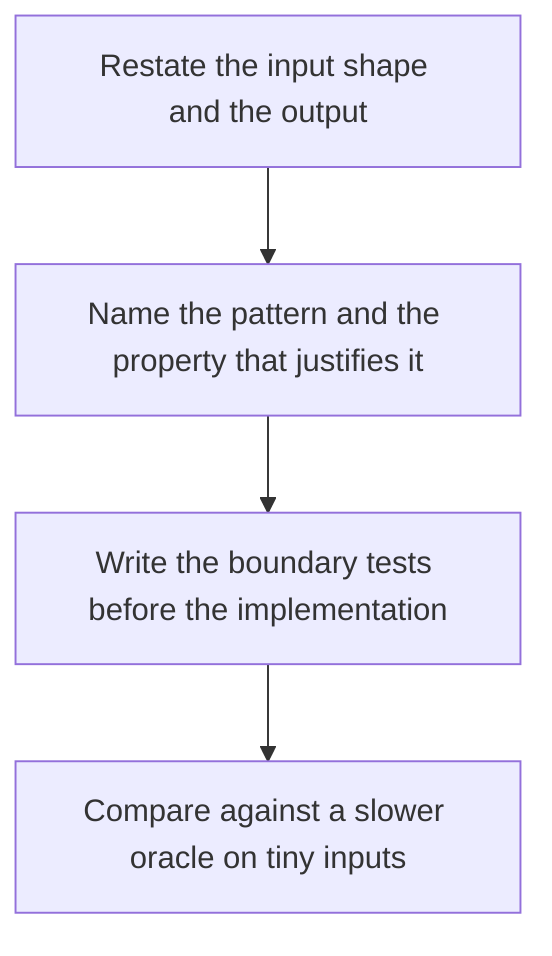

# D02-T027 — Problem-solving patterns and edge cases

Topic ID: `D02-T027`
Domain: Data Structures and Algorithms
Subdomain: Problem-solving patterns and edge cases
Importance: core
Complexity: intermediate
Dependencies: `D02-T026`, `D02-T001`, `D01-T001`, `D01-T002`
Execution status of the code in section F: unexecuted

## A. Topic Overview

Problem-solving patterns are reusable shapes: two pointers, sliding window, binary search on a predicate, monotonic stack, BFS for shortest unweighted paths, and checking edges before the happy path. A pattern is a hypothesis about the input's structure. Edge cases are empty input, one element, duplicates, overflow, and the off-by-one at the boundary.

In production this shows up as follows: An interview or a production bugfix starts by listing empty input, duplicates, and integer overflow before optimizing the inner loop.

Interviewers use Problem-solving patterns and edge cases to see whether you can state the failure mode, not only the definition. The failure to name is: forcing a pattern onto an input that lacks the required property, then missing the empty or duplicate case

Prerequisites: `D02-T026`, `D02-T001`, `D01-T001`, `D01-T002`. Later notes should link here instead of repeating the mechanism.

## B. First-Principles Explanation

Problem-solving patterns are reusable shapes: two pointers, sliding window, binary search on a predicate, monotonic stack, BFS for shortest unweighted paths, and checking edges before the happy path. A pattern is a hypothesis about the input's structure. Edge cases are empty input, one element, duplicates, overflow, and the off-by-one at the boundary.

The useful picture is: Patterns are tools on a bench. You pick the saw because the cut is straight, not because the saw is familiar.

What has to be true:

1. Restate the input shape and the output
2. Name the pattern and the property that justifies it
3. Write the boundary tests before the implementation
4. Compare against a slower oracle on tiny inputs

It works when those steps preserve one invariant. It fails when forcing a pattern onto an input that lacks the required property, then missing the empty or duplicate case. The alternative is: you have not named that structure yet, in which case a brute force oracle is the honest first step

## C. Internal Working and Architecture

Components involved: the caller, the state Problem-solving patterns and edge cases mutates or reads, and the observer that reports a table of edge cases with expected outputs, including empty, one element, and the boundary index.

Execution:

1. Restate the input shape and the output
2. Name the pattern and the property that justifies it
3. Write the boundary tests before the implementation
4. Compare against a slower oracle on tiny inputs

Data moves only along that path. A retry re-enters at step 1, so the operation must say what a duplicate does. Memory and locks stay inside this mechanism. Callers see the result or a typed error, not a half-updated invariant.

State to remember: choose this when the input really has the structure the pattern needs. Do not choose it when you have not named that structure yet, in which case a brute force oracle is the honest first step.

## D. Diagrams and Visual Models



Read the diagram from top to bottom. Each box is one step of Problem-solving patterns and edge cases. The failure mode (forcing a pattern onto an input that lacks the required property, then missing the empty or duplicate case) is what you look for when a later box never happens or happens twice.

## E. Examples and Analogies

Analogy: Patterns are tools on a bench. You pick the saw because the cut is straight, not because the saw is familiar.

Production example: An interview or a production bugfix starts by listing empty input, duplicates, and integer overflow before optimizing the inner loop.

A small counterexample is enough in an interview. Show the input, apply the steps, and show the broken outcome if someone uses the mechanism outside its rule: forcing a pattern onto an input that lacks the required property, then missing the empty or duplicate case.

## F. Code Examples

The snippet is labeled unexecuted. It illustrates the shape of the idea. It is not a benchmark and it embeds no secret.

```python
def binary_search(a, target):
    lo, hi = 0, len(a)
    while lo < hi:
        mid = (lo + hi) // 2
        if a[mid] < target:
            lo = mid + 1
        else:
            hi = mid
    return lo if lo < len(a) and a[lo] == target else -1
```

After the snippet, check a table of edge cases with expected outputs, including empty, one element, and the boundary index. If that signal moves the wrong way, the snippet is the wrong tool for the workload.

## G. Practical Backend Application

Use Problem-solving patterns and edge cases in a service when the input really has the structure the pattern needs.

A typical place is the production case already stated: An interview or a production bugfix starts by listing empty input, duplicates, and integer overflow before optimizing the inner loop.

Operationally you alert on a table of edge cases with expected outputs, including empty, one element, and the boundary index. You do not alert only on process uptime. The dashboard should show the failure mode, a success rate, and the saturation signal (queue depth, lock wait, or latency) that predicts it.

## H. Advantages, Limitations and Trade-offs

| Choice | Benefit | Cost | Choose when | Avoid when |
| --- | --- | --- | --- | --- |
| Apply Problem-solving patterns and edge cases | the input really has the structure the pattern needs | Extra moving parts and a new failure mode | The failure you are preventing is already real | you have not named that structure yet, in which case a brute force oracle is the honest first step |
| Simpler alternative | Less code and fewer dependencies | forcing a pattern onto an input that lacks the required property, then missing the empty or duplicate case | The workload does not hit the limit | The invariant must hold under concurrency or failure |

Problem-solving patterns and edge cases is a trade. State the benefit and the cost in the same sentence when you propose it in a design review.

## I. Common Mistakes and Misconceptions

- Matching a problem to a pattern by keyword.
- Skipping the empty input.
- Optimizing before an oracle exists.
- Treating a diagram of Problem-solving patterns and edge cases as proof that the invariant holds in production.
- Copying a default configuration without naming a table of edge cases with expected outputs, including empty, one element, and the boundary index.

## J. Debugging and Troubleshooting

Symptom: forcing a pattern onto an input that lacks the required property, then missing the empty or duplicate case

First check: a table of edge cases with expected outputs, including empty, one element, and the boundary index.

Then compare one healthy instance against one unhealthy instance. Confirm whether retries are duplicating work. Confirm whether a timeout is shorter than the work. Fix the invariant, then watch the same metric for a full peak, not only for the next minute.

Useful questions: did the step order in section C actually happen, or did a caller skip a step? Did a deploy change the data shape that Problem-solving patterns and edge cases assumes?

## K. Interview Preparation

### Beginner

#### Q1. What problem does Problem-solving patterns and edge cases solve?

**Answer:** Problem-solving patterns are reusable shapes: two pointers, sliding window, binary search on a predicate, monotonic stack, BFS for shortest unweighted paths, and checking edges before the happy path. A pattern is a hypothesis about the input's structure. Edge cases are empty input, one element, duplicates, overflow, and the off-by-one at the boundary. Without it, the usual backend failure is: forcing a pattern onto an input that lacks the required property, then missing the empty or duplicate case.

#### Q2. Where does Problem-solving patterns and edge cases sit on a request path?

**Answer:** Problem-solving patterns and edge cases is not a library you sprinkle on every call. the input really has the structure the pattern needs You notice it when a table of edge cases with expected outputs, including empty, one element, and the boundary index. Name the constraint that makes this choice correct. Say what you would measure to confirm it.

#### Q3. Give a concrete example of Problem-solving patterns and edge cases.

**Answer:** An interview or a production bugfix starts by listing empty input, duplicates, and integer overflow before optimizing the inner loop. Walk the input, the state change, and the observable output. Name the constraint that makes this choice correct. Say what you would measure to confirm it.

#### Q4. What is a common mix-up around Problem-solving patterns and edge cases?

**Answer:** forcing a pattern onto an input that lacks the required property, then missing the empty or duplicate case The corrective check is a table of edge cases with expected outputs, including empty, one element, and the boundary index. Name the constraint that makes this choice correct. Say what you would measure to confirm it. Say which alternative you rejected and why.

#### Q5. When would you skip Problem-solving patterns and edge cases?

**Answer:** you have not named that structure yet, in which case a brute force oracle is the honest first step Skipping is a decision with a measured cost, not a slogan. Name the constraint that makes this choice correct. Say what you would measure to confirm it. Say which alternative you rejected and why.

### Intermediate

#### Q1. What invariant makes Problem-solving patterns and edge cases correct?

**Answer:** Problem-solving patterns are reusable shapes: two pointers, sliding window, binary search on a predicate, monotonic stack, BFS for shortest unweighted paths, and checking edges before the happy path. A pattern is a hypothesis about the input's structure. Edge cases are empty input, one element, duplicates, overflow, and the off-by-one at the boundary. State the invariant before you name the tool.

#### Q2. How do you test Problem-solving patterns and edge cases?

**Answer:** Assert the failure mode directly: forcing a pattern onto an input that lacks the required property, then missing the empty or duplicate case. The assertion should watch a table of edge cases with expected outputs, including empty, one element, and the boundary index. Include a concurrent or retry case if the bug only appears then. Name the constraint that makes this choice correct.

#### Q3. What signal tells you Problem-solving patterns and edge cases is misbehaving in production?

**Answer:** Watch a table of edge cases with expected outputs, including empty, one element, and the boundary index. The user-visible symptom is usually forcing a pattern onto an input that lacks the required property, then missing the empty or duplicate case. Name the constraint that makes this choice correct. Say what you would measure to confirm it.

#### Q4. How would you introduce Problem-solving patterns and edge cases into a legacy service?

**Answer:** the input really has the structure the pattern needs Ship it behind a metric so you can compare the old path. Roll back if forcing a pattern onto an input that lacks the required property, then missing the empty or duplicate case gets worse. Name the constraint that makes this choice correct. Say what you would measure to confirm it.

#### Q5. What do you trade away by choosing Problem-solving patterns and edge cases?

**Answer:** the input really has the structure the pattern needs you have not named that structure yet, in which case a brute force oracle is the honest first step Say the cost in latency, storage, or operational load. Name the constraint that makes this choice correct. Say what you would measure to confirm it. Say which alternative you rejected and why.

### Advanced

#### Q1. What breaks if a dependency of Problem-solving patterns and edge cases is slow or down?

**Answer:** forcing a pattern onto an input that lacks the required property, then missing the empty or duplicate case Degrade using the rule: you have not named that structure yet, in which case a brute force oracle is the honest first step. Timeouts must be shorter than the caller's deadline. Name the constraint that makes this choice correct. Say what you would measure to confirm it.

#### Q2. How does Problem-solving patterns and edge cases behave under retries?

**Answer:** Retries repeat work, so Problem-solving patterns and edge cases must define what a duplicate does. forcing a pattern onto an input that lacks the required property, then missing the empty or duplicate case Idempotency keys or fences belong next to the write, not in a comment. Name the constraint that makes this choice correct. Say what you would measure to confirm it.

#### Q3. What is the capacity limit of Problem-solving patterns and edge cases?

**Answer:** The limit shows up as a table of edge cases with expected outputs, including empty, one element, and the boundary index. Add capacity only after you know whether the bottleneck is CPU, lock wait, or network. Name the constraint that makes this choice correct. Say what you would measure to confirm it.

#### Q4. How do you evolve Problem-solving patterns and edge cases without a flag day?

**Answer:** the input really has the structure the pattern needs Version the contract or the on-disk format. Readers should tolerate one old and one new shape during the rollout. Name the constraint that makes this choice correct. Say what you would measure to confirm it.

#### Q5. What security or correctness bug hides inside Problem-solving patterns and edge cases?

**Answer:** forcing a pattern onto an input that lacks the required property, then missing the empty or duplicate case Check authorization and tenancy at the same boundary as the mechanism. A cache or queue must not widen who can read the data. Name the constraint that makes this choice correct. Say what you would measure to confirm it.

### Scenario

#### Q1. Incident: forcing a pattern onto an input that lacks the required property, then missing the empty or duplicate case. What do you check first?

**Answer:** Start with a table of edge cases with expected outputs, including empty, one element, and the boundary index. Compare a good host and a bad host before you restart anything. Problem-solving patterns are reusable shapes: two pointers, sliding window, binary search on a predicate, monotonic stack, BFS for shortest unweighted paths, and checking edges before the happy path. A pattern is a hypothesis about the input's structure. Edge cases are empty input, one element, duplicates, overflow, and the off-by-one at the boundary.

#### Q2. A reviewer wants the clever version. What data settles it?

**Answer:** the input really has the structure the pattern needs you have not named that structure yet, in which case a brute force oracle is the honest first step Bring a table of edge cases with expected outputs, including empty, one element, and the boundary index from a load test or from production, not a slogan. Name the constraint that makes this choice correct. Say what you would measure to confirm it. Say which alternative you rejected and why.

#### Q3. You have one hour to explain Problem-solving patterns and edge cases at a whiteboard.

**Answer:** Draw the happy path in four boxes. Then draw the failure: forcing a pattern onto an input that lacks the required property, then missing the empty or duplicate case. End with the metric you would page on. Name the constraint that makes this choice correct.

#### Q4. The bug only appears under two concurrent callers.

**Answer:** forcing a pattern onto an input that lacks the required property, then missing the empty or duplicate case Reproduce with a barrier so both sides enter the critical window. Confirm the fix with a table of edge cases with expected outputs, including empty, one element, and the boundary index. Name the constraint that makes this choice correct. Say what you would measure to confirm it.

#### Q5. Leadership wants this on every service next week.

**Answer:** you have not named that structure yet, in which case a brute force oracle is the honest first step the input really has the structure the pattern needs Roll it out where the failure mode is already hurting users. Name the constraint that makes this choice correct. Say what you would measure to confirm it. Say which alternative you rejected and why.

### Follow-up

#### Q1. What did you assume about the data size or the clock?

**Answer:** Problem-solving patterns are reusable shapes: two pointers, sliding window, binary search on a predicate, monotonic stack, BFS for shortest unweighted paths, and checking edges before the happy path. A pattern is a hypothesis about the input's structure. Edge cases are empty input, one element, duplicates, overflow, and the off-by-one at the boundary. Clocks are not a total order across machines. State whether the algorithm needs bounded size or a single leader.

#### Q2. What would you measure after the change ships?

**Answer:** Page on a table of edge cases with expected outputs, including empty, one element, and the boundary index. Keep a before/after dashboard for one week. Alert on the failure mode, not only on CPU. Name the constraint that makes this choice correct.

#### Q3. Which neighboring topic did you deliberately not re-teach?

**Answer:** This note owns Problem-solving patterns and edge cases. Related identifiers are in section N. Shared ideas are linked, not copied. Name the constraint that makes this choice correct.

## L. Practical Exercises

Solutions are in `EXERCISES/solutions/D02-T027.md`, not in this section.

1. Whiteboard the four steps of Problem-solving patterns and edge cases and mark where `forcing a pattern onto an input that lacks the required property, then missing the empty or duplicate case` enters.
2. Read the snippet in section F and write the assertion that would catch that failure. The assertion must mention `a table of edge cases with expected outputs, including empty, one element, and the boundary index`.
3. Argue for or against using Problem-solving patterns and edge cases on a service you know. Use the choose and avoid rows from section H. Do not appeal to popularity.

## M. Revision Notes

- Mechanism: Problem-solving patterns are reusable shapes: two pointers, sliding window, binary search on a predicate, monotonic stack, BFS for shortest unweighted paths, and checking edges before the happy path.
- Failure: forcing a pattern onto an input that lacks the required property, then missing the empty or duplicate case
- Metric: a table of edge cases with expected outputs, including empty, one element, and the boundary index
- Choose when: the input really has the structure the pattern needs
- Avoid when: you have not named that structure yet, in which case a brute force oracle is the honest first step

## N. Related Topics

Dependencies to review first: `D02-T026`, `D02-T001`, `D01-T001`, `D01-T002`.

Shared ideas stay in those notes. This note does not restate them.

## O. Completion Criteria

- You can explain Problem-solving patterns and edge cases without reading this note, including the failure mode.
- You can draw the diagram in section D from memory.
- You can say when not to use it, using the avoid condition in section H.
- You can name the metric you would watch after shipping it.
