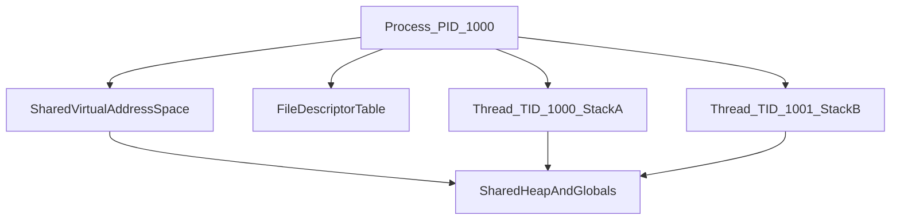

# D03-T001 — Processes vs threads

Topic ID: `D03-T001`
Domain: Operating Systems
Subdomain: Processes vs threads
Importance: core
Complexity: intermediate
Dependencies: `D01-T001`, `D01-T002`
Execution status of the code in section F: unexecuted

## A. Topic Overview

A process is an instance of a running program with its own virtual address space, file descriptors, and security context. A thread is a schedulable unit of execution inside a process that shares that process's memory and descriptors but has its own stack and register set.

The distinction exists because isolation and sharing pull in opposite directions. Banks want a bug in one request handler to not read another customer's memory. High-throughput servers want thousands of connections without paying the cost of a full process per connection.

In production you choose processes for isolation (separate services, worker pools in different containers) and threads or async tasks for throughput inside one service. Interviewers use this topic to see whether you know what is shared, what is copied, and what breaks when you confuse the two.

Prerequisites: basic language execution model (`D01-T001`, `D01-T002`). Later topics on scheduling, syscalls, and synchronization assume you can name process versus thread resources.

## B. First-Principles Explanation

The CPU executes instructions from one program counter at a time per core, but the OS multiplexes many programs by saving and restoring register state. A process is the kernel's container for that multiplexing: it owns page tables that map virtual addresses, an identifier (PID), credentials, and a table of open files.

A thread is a lighter container: the kernel still schedules it, but multiple threads in one process use the same page tables. Each thread has its own stack (for local variables and call frames) and its own saved registers when it is not running. The heap and global data are shared unless you add synchronization.

What happens on `fork()` on Linux: the kernel clones the address space (often copy-on-write), duplicates the file descriptor table (with shared file offset for some types), and creates a new process with a new PID. The child continues from the return of `fork`. On `pthread_create`, the kernel or runtime allocates a stack, sets up thread-local storage, and adds a schedulable entity to the same address space.

Why it works: the MMU enforces boundaries between processes. Within a process, the language runtime and locks enforce boundaries between threads. Limitations: shared mutable state races without locks; process creation is slower and heavier than thread creation; too many threads increase context-switch overhead and memory for stacks.

Terms: **PID** is the process identifier. **TID** is the thread identifier inside the kernel. **Address space** is the set of virtual mappings. **File descriptor table** is the per-process index into open files and sockets.

## C. Internal Working and Architecture

Components:

- The **process control block** (task struct on Linux) holds PID, memory map pointer, signal disposition, rlimits, and cgroup membership.
- **Threads** are often implemented as tasks sharing `mm_struct` (memory) but distinct `thread_struct` and kernel stacks.
- The **scheduler** picks a runnable thread on each CPU; it does not schedule "processes" separately from threads on modern Unix.
- **Clone flags** on Linux (`clone(2)`) decide what is shared: memory, files, signal handlers, namespace.

Execution path for a Java HTTP server using a thread pool:

1. One JVM process holds the heap and metaspace.
2. The acceptor thread blocks on `accept` (syscall).
3. On a connection, work is handed to a pool thread; both threads share the same heap objects.
4. A bug that mutates a singleton without synchronization affects all threads.

Data flow: inbound bytes arrive on a socket FD shared by all threads in the process. Each thread reads into buffers on its own stack or into heap objects it allocates. Response writes go through the same kernel socket object; ordering must be enforced by protocol design or per-connection state.

State: a process is `running`, `sleeping`, `zombie` (exited but not reaped), or `stopped`. Threads inherit process state but have their own kernel scheduling state. Memory: typical thread stacks are 1–8 MiB each; 10,000 threads can mean tens of gigabytes of stack alone before heap.

## D. Diagrams and Visual Models



Read top to bottom: one process box owns address space and FD table. Two threads each have private stacks but reach the same heap. A second process would be a separate diagram with no arrow to this heap.

## E. Examples and Analogies

Analogy: a process is an apartment with its own lease and keys; a thread is a roommate sharing the kitchen. If one roommate leaves food out, everyone is affected. A different apartment (process) cannot see your fridge unless you explicitly pass food through the door (IPC).

Technical example: PostgreSQL uses a process per connection for isolation. Node.js uses one thread for JavaScript and a pool for some I/O, sharing one address space with careful async discipline. nginx uses multiple worker **processes**, not threads in the workers, so a crash in one worker does not corrupt another's memory.

Backend example: running payment and search in one JVM thread pool is fast but a memory leak or rogue native library affects both. Splitting into two containers (two processes) adds RPC latency but bounds blast radius.

Do not spawn unbounded threads per request on Java or Go servers without measuring stack and scheduler overhead. Do not assume `fork` is cheap at high frequency. Do not store per-request state in static fields without isolation.

## F. Code Examples

File: `examples/d03_t001_fork_vs_thread.c`

Dependencies: POSIX threads (`-pthread`), Linux or macOS.

```c
/* Build: cc -pthread -o d03_t001 examples/d03_t001_fork_vs_thread.c */
#include <pthread.h>
#include <stdio.h>
#include <stdlib.h>
#include <unistd.h>

static int shared_counter = 0; /* shared across threads in one process */

static void *thread_fn(void *arg) {
    int local = 0;
    for (int i = 0; i < 100000; i++) {
        shared_counter++;
        local++;
    }
    printf("thread local=%d shared=%d pid=%d\n", local, shared_counter, getpid());
    return NULL;
}

int main(void) {
    pthread_t t;
    if (pthread_create(&t, NULL, thread_fn, NULL) != 0) {
        perror("pthread_create");
        return 1;
    }
    thread_fn(NULL);
    pthread_join(t, NULL);
    printf("final shared=%d pid=%d\n", shared_counter, getpid());
    return 0;
}
```

How to run: compile and execute `./d03_t001` from the exercises examples folder when copied there.

Expected output: two lines from `thread_fn` and a final line; `shared_counter` may be less than 200000 without synchronization (race). Both threads report the same PID.

Important lines: `shared_counter` lives in the data segment shared by threads; `local` is on each thread's stack. `getpid()` is the same in both threads. The race demonstrates why later topics add mutexes.

This example was not executed in CI for this note. Treat output as illustrative until you run it locally.

## G. Practical Backend Application

A typical microservice is one process (or one container equals one main process). Inside it, a web framework uses a thread pool or an event loop plus thread pool for blocking work. Database connection pools are shared across threads; each connection object must not be used concurrently from two threads unless the driver documents thread safety.

Concurrent requests do not get separate processes unless you use a prefork model (some Python WSGI servers). They share heap caches, metric registries, and singleton clients. Misconfigured shared caches cause cross-tenant data leaks.

Error handling: an uncaught exception in one thread may abort the whole JVM or Node process depending on runtime. Observability: tag logs with thread name or async trace id, not only PID. Security: secrets in environment variables are visible to all threads in the process. Scaling: horizontal scale adds processes; vertical scale adds threads until CPU, locks, or memory contend.

## H. Advantages, Limitations and Trade-offs

| Choice | Benefit | Cost | Choose when | Avoid when |
| --- | --- | --- | --- | --- |
| Multiple processes | Strong isolation, independent crash | Higher memory, slower IPC | Security boundaries, workers | Tight loops needing shared RAM |
| Multiple threads | Fast shared state, cheaper create | Races, harder debugging | I/O-bound pool inside one service | CPU-bound parallel work without design |
| Single-threaded event loop | No locks on handlers | Blocking call stalls all I/O | High fan-out I/O | Heavy CPU per request |
| Process per connection | Simple mental model | RAM and context switches | Traditional RDBMS design | Millions of idle connections |

Under load, thread stacks dominate RSS before heap does. Process-based isolation shifts failure to orchestration (restart pod) instead of in-process recovery.

## I. Common Mistakes and Misconceptions

- Saying threads are "lighter processes" without naming what is shared (heap, FDs, signals).
- Assuming each HTTP request is a process; most frameworks use threads or async tasks in one process.
- Using a static `HashMap` cache in a servlet without synchronization because "reads are safe".
- Calling `fork` after creating threads in a multi-threaded program (only async-signal-safe paths are valid in the child).
- Expecting `kill -9` on one thread; signals are delivered to a process, and thread targeting is runtime-specific.

Weak interview answer: "threads are faster." Strong answer: names address space, FD table, stack, and a concrete failure (race or leak).

## J. Debugging and Troubleshooting

Symptoms: memory grows with connection count; mysterious counter drift; one customer's data appears for another; CPU high with low throughput.

Diagnosis:

1. `ps -eLf` or `top -H` to see thread count and CPU per thread.
2. `pmap -x PID` or `/proc/PID/smaps` for stack and heap breakdown.
3. Heap dump or `jcmd Thread.print` for Java thread stacks.
4. Check for unbounded `new Thread` per request.

Example: `java.lang.OutOfMemoryError: unable to create new native thread` means stack or pid limit, not heap.

Mitigation: cap thread pool size, move to async I/O, or split into more processes. Long-term: load test with realistic concurrency and set ulimits (`D03-T024`).

## K. Interview Preparation

### Beginner

#### Q1. What is a process?

**Answer:** A process is a running program instance the OS manages with its own virtual address space, credentials, and resources such as open files. It has a PID and is isolated from other processes by the MMU. Interviewers want memory and FD ownership, not only "a program running."

#### Q2. What is a thread?

**Answer:** A thread is a schedulable execution context inside a process. It has its own stack and registers but shares the process heap, globals, and usually file descriptors. Multiple threads can run concurrently on multiple cores or be interleaved on one core.

#### Q3. What do threads share that processes do not?

**Answer:** Threads in the same process share the virtual address space and the file descriptor table (with caveats for `fcntl` flags). Processes do not share writable memory unless they use explicit shared memory APIs. That sharing is why threads need locks for mutable data.

#### Q4. Why use processes instead of threads for isolation?

**Answer:** A segfault or memory corruption in one process does not directly overwrite another process's memory. The kernel enforces separate page tables. Containers and separate services rely on this boundary. Threads trade isolation for performance of shared state.

#### Q5. What is the difference between concurrency and parallelism at the process level?

**Answer:** Concurrency is many tasks making progress; parallelism is many tasks running at the same instant on different CPUs. One process with many threads can be concurrent on one core and parallel on many cores. Multiple processes can also be parallel when scheduled on different cores.

### Intermediate

#### Q1. What happens on Linux `fork()`?

**Answer:** The kernel creates a new process with a new PID, duplicating the address space (often copy-on-write), file descriptor table, and signal dispositions. The child returns 0 from `fork`, the parent returns the child PID. Open file offsets may be shared, which surprises people piping to the same file.

#### Q2. How does a JVM map to processes and threads?

**Answer:** One JVM is typically one OS process. Java threads are pthreads underneath on HotSpot. The heap and metaspace are shared; each Java thread has its own stack for local frames. GC and JIT run in the same process, so a native crash in JNI can take down all threads.

#### Q3. When would you choose a process pool over a thread pool?

**Answer:** When you need crash isolation, different security contexts, or to run untrusted code (plugins). CI workers and browser tabs use process boundaries. When you need cheap shared caches and connection pools inside one service, threads or async I/O inside one process win.

#### Q4. What is copy-on-write after `fork`?

**Answer:** Parent and child initially map the same physical pages read-only. The first write to a page triggers a fault, and the kernel copies that page so each process has its own writable copy. This makes `fork` cheaper than copying all memory immediately, but write-heavy children still pay.

#### Q5. How do file descriptors relate to processes and threads?

**Answer:** The FD table is per process. All threads see the same integers for stdin, sockets, and files. Concurrent reads/writes on the same FD without coordination can interleave bytes. Some runtimes duplicate FDs on `fork`; threads do not get separate FD tables.

### Advanced

#### Q1. Explain `clone()` flags on Linux.

**Answer:** `clone` creates a new task with selective sharing. `CLONE_VM` shares memory with the parent, `CLONE_FILES` shares the FD table, `CLONE_THREAD` puts the child in the same thread group. `pthread_create` and `fork` are implemented in terms of `clone` with different flag combinations. Interview depth is about what sharing each flag enables.

#### Q2. Why is `fork` unsafe in multi-threaded programs?

**Answer:** After `fork`, only the calling thread exists in the child; other threads vanish, possibly holding locks that are never released. Allocators may hold locks. POSIX restricts the child to async-signal-safe functions until `execve`. Production servers that need to fork shells use a `pre-fork` single-threaded worker or `posix_spawn`.

#### Q3. How do containers relate to processes?

**Answer:** A container is usually one or more processes with namespaces (PID, mount, network) and cgroups for limits. It is not a VM; threads inside the container are still kernel threads on the host. Isolation is weaker than separate hardware but stronger than plain threads in one global namespace.

#### Q4. What is the cost model of creating 10,000 threads?

**Answer:** Each thread needs a kernel stack and often a megabyte-class user stack. Scheduler run queues grow; context switches rise. Memory for stacks can exceed heap. At that scale, event loops with non-blocking I/O or a smaller worker pool plus queueing is the usual fix.

#### Q5. How does Go's goroutine model differ from OS threads?

**Answer:** Goroutines are multiplexed onto a small set of kernel threads by the Go runtime. Stacks start small and grow. Blocking syscalls can spawn extra threads. You still have one process address space; races on shared maps still need mutexes or channels. The difference is scheduling granularity, not isolation.

### Scenarios

#### Q1. A Java API leaks memory only under load. Thread count grows unbounded. What is happening?

**Answer:** Likely each request creates a new `Thread` or an unbounded executor instead of a fixed pool. Stacks and thread metadata accumulate. Confirm with `jstack` and thread dump count. Fix with a bounded `ExecutorService`, backpressure, and reject or queue when saturated. Measure RSS and native thread count, not only heap.

#### Q2. Two microservices on one VM see each other's temp files. Are they threads?

**Answer:** No. They are separate processes that share a host filesystem namespace unless mount namespaces isolate them. This is a deployment and filesystem permission issue, not thread sharing. Fix with separate volumes, umask, and per-service temp directories.

#### Q3. After `fork`, a child process corrupts a log file the parent also writes. Why?

**Answer:** Parent and child share file offsets for FDs duplicated by `fork`. Interleaved writes without locking produce garbage. Use separate log FDs, `O_APPEND` with careful locking, or re-open logs after fork, or avoid `fork` in favor of a logging agent.

#### Q4. You need to run user-supplied Python in your SaaS. Thread pool or process pool?

**Answer:** Process pool with seccomp, namespaces, and tight rlimits. User code must not share address space with your credentials. Threads only protect you from pure Python bugs, not C extensions or interpreter escape. Expect higher memory per sandbox.

#### Q5. `ps` shows one Java process but `top -H` shows 200 threads at 100% CPU. Is that 200 processes?

**Answer:** No. One process, 200 kernel threads, often a thread pool hammering CPU or stuck in a tight loop. Use a profiler and thread dump to see runnable stacks. Scaling out adds more processes (pods), each with its own thread pool.

### Follow-ups

#### Q1. How does this connect to CPU scheduling?

**Answer:** The scheduler picks threads (tasks), not abstract processes, as runnable entities on Linux. All threads in a process compete for CPU time with threads in other processes according to priority, cgroup shares, and CFS weights. Understanding process versus thread sharing tells you what state is saved on a context switch: address space pointer is shared across threads in one process, so switching between them is cheaper than switching to another process's page tables. See `D03-T005` for policies and metrics like run queue latency.

#### Q2. What syscall creates a process versus a thread?

**Answer:** On Linux, both ultimately use `clone` with different flags; `fork` and `pthread_create` are library wrappers. `execve` replaces the current process image with a new program while keeping the PID. Interviewers chain this to `D03-T004`: crossing into the kernel is required for either creation path, and the return path may schedule another thread. Knowing the wrapper names in your language (Java `ProcessBuilder`, Go `os.StartProcess`) maps to these syscalls.

#### Q3. How does this relate to containers and Kubernetes pods?

**Answer:** A pod often runs one main container process that may spawn threads; sidecars are additional processes in the same cgroup namespace depending on configuration. Kubernetes restarts containers (process groups), not individual threads. Liveness probes that check HTTP assume the main thread or event loop is responsive even if worker threads are wedged. Resource requests apply to the cgroup covering all threads in the container process.

## L. Practical Exercises

Solutions are in `EXERCISES/solutions/D03-T001.md`. Try these before opening that file.

### Exercise 1 — implementation

Write a small C or Python program that prints PID and TID (or thread identifier) from two concurrent threads and from a child process after `fork`. Acceptance: same PID for both threads, different PID for child, and you document which values are shared.

### Exercise 2 — debugging

A service logs `shared_cache size=0` intermittently under load although inserts happen on every request. The cache is a static map. Explain the process versus thread model bug and name the fix class (synchronization, per-thread cache, or process isolation).

### Exercise 3 — trade-off

Choose process-per-worker versus thread-pool for a PDF rendering API with untrusted uploads. State isolation, memory, and latency trade-offs. Acceptance: you mention address space boundary and at least one limit (rlimit or cgroup).

## M. Revision Notes

- Process: own address space, PID, FD table.
- Thread: own stack; shares heap and FDs with siblings.
- `fork` duplicates process; `pthread_create` adds thread.
- Isolation: processes; throughput: threads or async inside one process.
- Unbounded threads blow stack memory and scheduler cost.
- FD table is per process, shared by all its threads.

Flashcards:

- What is shared between threads? Heap, globals, FD table (usually).
- What does `fork` return to child? 0.
- Why not `fork` after threads? Locks and allocator state.

## N. Related Topics

Understand this before: `D01-T001` (variables and memory), `D01-T002` (control flow for branching on `fork` return).

This topic supports: `D03-T002` lifecycle, `D03-T006` thread pools, `D03-T008` races on shared heap.

Often confused with: concurrency versus parallelism (`D03-T007`), goroutines versus OS threads.

Interviewers combine this with `D13-T006` locking, `D03-T024` cgroups, and container isolation.

## O. Completion Criteria

- Draw one process with two threads and label shared versus private memory.
- Explain `fork` versus `pthread_create` sharing rules.
- Diagnose unbounded thread growth from metrics and thread dumps.
- Choose process versus thread isolation for untrusted code with reasons.
- Answer a scenario on shared file offsets after `fork`.
- Name what the scheduler runs on Linux (tasks/threads).
