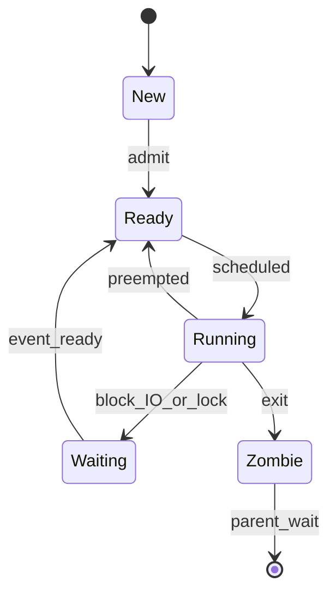

# D03-T002 — Process lifecycle and context switching

Topic ID: `D03-T002`
Domain: Operating Systems
Subdomain: Process lifecycle and context switching
Importance: core
Complexity: intermediate
Dependencies: `D03-T001`, `D01-T001`, `D01-T002`
Execution status of the code in section F: unexecuted

## A. Topic Overview

A process moves through states from creation to termination: new, ready, running, waiting, and zombie until reaped. Context switching is the kernel saving one thread's registers and stack pointer and restoring another's so multiple tasks share each CPU.

The lifecycle exists because the kernel must track which programs are runnable, which block on I/O, and which have exited but still need their status collected. Context switching exists because there are more runnable threads than cores.

Backend engineers see this in latency spikes (run-queue delay), fork storms during deploys, and zombie piles when parents do not call `wait`. Interviewers test whether you can relate p99 latency to scheduling, not only algorithm names.

Prerequisites: `D03-T001` (process versus thread). Leads into syscalls and scheduling (`D03-T004`, `D03-T005`).

## B. First-Principles Explanation

Creation: `fork`/`clone`, `execve`, or `posix_spawn` builds a new task struct, assigns a PID, sets up memory and FD tables, and places the thread on the run queue. The shell running `java -jar app.jar` forks and execs; the JVM process then creates many threads.

Running: on a timer tick or syscall return, the scheduler picks a runnable task. The CPU program counter and registers point at user code. Waiting: a thread blocks in the kernel when it calls blocking I/O, waits on a lock, or sleeps; its state moves off the run queue until the event completes.

Termination: `exit` releases userspace mappings, closes FDs (unless shared), and leaves a zombie until the parent `wait`s. The kernel keeps minimal PCB fields so the parent can read the exit code. Context switch steps: save callee-saved registers and kernel stack, switch `mm_struct` if process changes, flush TLB if needed, restore the next thread's registers, return to user mode via `iret` or equivalent.

Why it works: preemptive scheduling guarantees progress even if user code never yields. Limitations: switches cost microseconds and cache warmth; too many runnable threads inflate wait time without raising CPU utilization.

## C. Internal Working and Architecture

Linux CFS (Completely Fair Scheduler) tracks virtual runtime per task and picks the leftmost node in a red-black tree of runnable entities. On switch, `context_switch` updates `current`, flushes lazy FPU state, and may switch address spaces.

Components: run queues per CPU, wait queues for locks and I/O, timer interrupts for preemption, and `proc`/`task_struct` linked lists. When a thread blocks on `read`, it is removed from the run queue and linked to the socket's wait queue; when data arrives, the interrupt or softirq path wakes it.

Backend path: an HTTP thread runs, syscall `recv` blocks, another thread uses the CPU, the NIC interrupt wakes the first thread, scheduler runs it, it parses the request. p99 includes all waits in run queue and block queues.

Memory: each context switch may cold-cache the next process's working set. Co-locating hot services on the same host causes cache interference.

## D. Diagrams and Visual Models



Read as a state machine: only one running per CPU, many ready, blocking is distinct from ready, zombie needs parent `wait`.

## E. Examples and Analogies

Analogy: a doctor's office. Ready is checked in and waiting for a room. Running is with the doctor. Waiting is awaiting lab results. Zombie is the chart waiting for billing to close the visit.

Technical: `strace` shows `futex` waits and `read` blocking. `vmstat 1` shows `r` column (run queue length). High `r` with low CPU means runnable threads waiting for cores.

Do not confuse blocked on I/O with runnable. Do not ignore zombies; they hold PIDs. Do not assume `SIGCHLD` always handled; explicit `waitpid` loops or `SIG_IGN` for children matter.

## F. Code Examples

File: `examples/d03_t002_wait_zombie.c`

```c
#include <stdio.h>
#include <stdlib.h>
#include <unistd.h>
#include <sys/wait.h>

int main(void) {
    pid_t pid = fork();
    if (pid < 0) {
        perror("fork");
        return 1;
    }
    if (pid == 0) {
        _exit(42);
    }
    /* Parent sleeps without wait: child is zombie until wait */
    sleep(2);
    int status = 0;
    if (waitpid(pid, &status, 0) < 0) {
        perror("waitpid");
        return 1;
    }
    printf("reaped exit=%d\n", WEXITSTATUS(status));
    return 0;
}
```

How to run: `cc -o d03_t002 examples/d03_t002_wait_zombie.c && ./d03_t002`; during sleep, `ps aux | grep Z` may show zombie.

Expected output: `reaped exit=42`

Important lines: child `_exit` immediately; parent delay demonstrates zombie window; `waitpid` reaps.

This example was not executed for this note.

## G. Practical Backend Application

Deploy scripts that fork workers must reap children or use double-fork daemons. Kubernetes sends SIGTERM; graceful shutdown calls `wait` on helper processes. Thread pools do not eliminate zombie issues from subprocess shells.

Observability: `process.runtime.jvm.cpu` plus OS run-queue metrics explain tail latency. Long GC pauses look like the process not running though threads exist.

Scaling: more pods add runnable tasks cluster-wide; CPU limits in cgroup throttle effective runtime, stretching virtual time in CFS.

## H. Advantages, Limitations and Trade-offs

| Mechanism | Benefit | Cost | Use when | Avoid when |
| --- | --- | --- | --- | --- |
| Preemption | Fairness, responsive I/O | Switch overhead | General purpose OS | Hard real-time without RT patches |
| Cooperative yield | Predictable | One greedy thread stalls all | Coroutines you control | Untrusted user code |
| Many short-lived processes | Isolation | Fork + sched cost | Batch workers | High QPS RPC |
| Few long-lived threads | Amortize setup | Complex sync | Web servers | Untrusted plugins |

## I. Common Mistakes and Misconceptions

- Thinking context switch equals syscall (syscall may not switch if thread stays runnable).
- Forgetting zombies exhaust PID space on Linux eventually.
- Measuring only CPU% and missing run-queue length.
- Assuming `SIGKILL` leaves a zombie (kernel reaps on kill).

## J. Debugging and Troubleshooting

Symptoms: cannot fork (`EAGAIN`), thousands of `<defunct>`, latency grows while CPU is idle.

Steps: `ps -eo stat,pid,cmd | grep Z`, `cat /proc/loadavg`, `pid_max`, parent PID with `pstree`. Fix parent to `waitpid` with `WNOHANG` loop or avoid unnecessary subprocesses.

## K. Interview Preparation

### Beginner

#### Q1. Name the main process states.

**Answer:** New, ready, running, waiting (blocked), terminated/zombie until reaped. Runnable means on or eligible for the run queue. Blocked threads are not consuming CPU.

#### Q2. What is a context switch?

**Answer:** The kernel saves hardware state of one thread and restores another so a different task runs on the CPU. It may also switch page tables when changing processes.

#### Q3. What creates a zombie?

**Answer:** A child that exited while the parent has not called `wait`. The kernel keeps the PID and exit status until the parent reaps.

#### Q4. Who reaps orphaned children?

**Answer:** `init` or systemd (PID 1) adopts orphans and reaps them. Long-running servers must still reap their own children.

#### Q5. Does blocking I/O remove a thread from the CPU?

**Answer:** Yes. The thread blocks in the kernel and another runnable thread can run. CPU utilization can be low while many threads wait on disk or network.

### Intermediate

#### Q1. What is stored in a PCB/task struct?

**Answer:** PID, scheduling state, pointers to memory map, open files, signal handlers, credentials, and saved registers. Exact layout is kernel-specific.

#### Q2. How does preemption happen?

**Answer:** Timer interrupt or returning from syscall if a higher-priority or fairer task is runnable. The kernel calls into the scheduler.

#### Q3. Difference between interrupt context and process context?

**Answer:** Interrupt handlers run with a separate stack, cannot block on mutexes that sleep, and must be short. Process context is normal kernel code on behalf of a thread.

#### Q4. Why can run queue length rise under CPU limit?

**Answer:** Cgroups cap CPU time; threads accumulate as runnable but throttled, increasing wait time without using full host CPU.

#### Q5. What does `waitpid` return?

**Answer:** The PID of the reaped child (or 0/`EINTR` with options). Exit status encodes normal exit or signal.

### Advanced

#### Q1. Explain TLB flush on process switch.

**Answer:** Different address spaces map virtual pages differently. Switching `mm_struct` may require flushing or tagging TLB entries so stale mappings are not used. Threads sharing one process avoid full ASID switch cost.

#### Q2. How does CFS pick the next task?

**Answer:** It approximates fair CPU sharing using virtual runtime; lower vruntime runs first. Nice values and cgroup weights scale the rate vruntime advances.

#### Q3. What is the cost of a context switch?

**Answer:** Direct cost is register save/restore and kernel bookkeeping; indirect is lost cache and TLB warmth. Order of microseconds depending on hardware and whether AS switch occurs.

#### Q4. Relationship between `fork`, zombie, and double-fork daemon?

**Answer:** Classic daemon forks, parent exits so child is not session leader, child forks again so grandchild is adopted by init, middle process exits immediately to avoid zombie if parent is long-lived—patterns vary; goal is background service without controlling terminal.

#### Q5. How do JVM GC pauses interact with scheduling?

**Answer:** Stop-the-world GC makes threads not runnable briefly; from OS view the process may still be "running" one GC thread. Tail latency includes these pauses plus any run-queue wait after resume.

### Scenarios

#### Q1. After deploy, `cannot allocate memory` but RAM is free.

**Answer:** Check PID limit and zombie count. Zombies and thread explosion consume PIDs or kernel objects. `ps -eLf | wc -l` and `/proc/sys/kernel/pid_max`.

#### Q2. p99 latency up, CPU 30%, run queue 50.

**Answer:** Runnable threads wait for cores—often too many threads or CPU throttling. Reduce pool size, optimize lock contention, or raise CPU quota.

#### Q3. Parent process killed, children keep running.

**Answer:** Children reparent to init unless process group and job control apply. Orphan handling depends on signals and session. Use process groups in shells carefully in workers.

#### Q4. Container shows 1 CPU but app has 32 threads.

**Answer:** CFS time-slices one cgroup CPU; 32 runnable threads queue. Throughput may not scale; need more CPU or fewer blocking threads.

#### Q5. Frequent `fork` in Ruby app spikes latency.

**Answer:** Copy-on-write and scheduler load from new processes; prefer thread pool or external worker service.

### Follow-ups

#### Q1. How does lifecycle connect to signals?

**Answer:** SIGCHLD notifies parent of state change; SIGSTOP/SIGCONT alter runnable state. SIGTERM begins graceful shutdown path where process may move to zombie after exit. Signal delivery is process-directed with thread-specific masks in pthreads. See `D03-T022`.

#### Q2. How does context switch relate to user versus kernel mode?

**Answer:** Every syscall and interrupt may trigger reschedule on return. Mode switch to kernel is required to save state atomically. User code cannot context switch itself without yielding via syscall or voluntary sched_yield.

#### Q3. How does Kubernetes termination grace work?

**Answer:** SIGTERM to PID 1 in container; process should stop accepting work and exit; after grace, SIGKILL. Zombie if PID 1 does not reap subprocesses it spawned—use minimal init or reap loop in app.

## L. Practical Exercises

Solutions in `EXERCISES/solutions/D03-T002.md`.

### Exercise 1 — implementation

Demonstrate zombie window with sleep before `waitpid` and document `ps` output.

### Exercise 2 — debugging

Given run queue 40 and CPU 25%, list three causes and metrics to distinguish them.

### Exercise 3 — trade-off

Choose prefork versus threaded server for 10k idle connections; cite lifecycle costs.

## M. Revision Notes

- States: ready, running, waiting, zombie.
- Context switch saves/restores registers; may switch AS.
- Zombies need `wait`; orphans reparent to init.
- Run queue length explains latency without high CPU.
- Blocking I/O frees the CPU for other threads.

Flashcards:

- Zombie cause? Child exited, parent not waited.
- Preemption trigger? Timer tick / syscall return schedule.

## N. Related Topics

Understand: `D03-T001`. Supports: `D03-T005` scheduling, `D03-T004` syscalls that block.

Confused with: thread blocked vs process zombie.

Combine: `D03-T024` limits, observability metrics.

## O. Completion Criteria

- Draw lifecycle state diagram from memory.
- Explain zombie and fix in a server.
- Interpret run queue vs CPU utilization.
- Describe what happens on context switch between processes vs threads.
- Tie p99 latency to scheduling wait.
