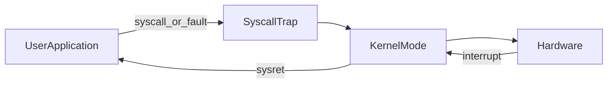

# D03-T003 — User mode vs kernel mode

Topic ID: `D03-T003`
Domain: Operating Systems
Subdomain: User mode vs kernel mode
Importance: advanced
Complexity: advanced
Dependencies: `D03-T002`, `D03-T001`, `D01-T001`, `D01-T002`
Execution status of the code in section F: unexecuted

## A. Topic Overview

User mode (ring 3) is where application code runs with restricted privileges: it cannot program the MMU, touch device registers directly, or disable interrupts. Kernel mode (ring 0) is where the OS runs with full hardware access to enforce isolation, schedule CPUs, and mediate every I/O path.

The split exists so a buggy HTTP handler cannot reformat the disk. The CPU hardware checks privilege on sensitive instructions and memory accesses; violations trap into the kernel or kill the process.

Backend impact: every database query, file read, and network send crosses the boundary via syscalls. High syscall rates and mode switches show up in profiling (`perf`, eBPF). Interviewers probe Meltdown/Spectre mitigations, why user pointers must be copied, and why kernel bugs are critical.

Prerequisites: process model (`D03-T001`, `D03-T002`). Leads to syscalls (`D03-T004`).

## B. First-Principles Explanation

The CPU privilege level is stored in a status register. In user mode, instructions like `cli`, `lgdt`, or direct port I/O fault. Access to kernel virtual addresses in page tables is forbidden; user pages are marked with a user/supervisor bit.

Entering the kernel: syscall instruction (`syscall`/`svc`), software interrupt (`int 0x80` legacy), page fault, or hardware interrupt. The CPU switches stack pointer to a per-CPU kernel stack, saves minimal state, and jumps to a handler. Returning uses `sysret`/`iret` to restore user registers.

Why it works: the kernel is the trusted computing base; it validates every operation that could affect other processes. Limitations: syscall overhead, kernel bugs are total compromise, and speculative execution side channels blurred the boundary until microcode and KPTI.

Terms: **KPTI** kernel page table isolation separates user and kernel page tables on return to user. **SMEP/SMAP** block the kernel from executing or accessing user pages unsafely.

## C. Internal Working and Architecture

On Linux x86-64, `entry_SYSCALL_64` validates the syscall number, copies arguments from user registers, and dispatches via `sys_call_table`. VDSO provides user-readable kernel helpers for `gettimeofday` without full syscall cost.

Interrupt path: device raises IRQ, CPU jumps to IDT entry in kernel, driver top half runs, may wake threads. This can preempt user code without a syscall.

Backend: JVM bytecode runs in user mode; JNI into native code still user unless it syscalls. Container still shares one kernel; namespaces do not add a new ring.

## D. Diagrams and Visual Models



User code only reaches hardware through kernel gates except for userspace mappings like VDSO.

## E. Examples and Analogies

Analogy: user mode is a tenant; kernel mode is building management. Tenants use the front desk (syscalls) for keys and utilities, not wire their own power.

Meltdown: speculative kernel memory read from user. Mitigation: do not map kernel in user page tables when running user code (KPTI), cost extra TLB work on syscalls.

Do not mmap kernel memory. Do not assume `/dev/mem` in production containers.

## F. Code Examples

File: `examples/d03_t003_getpid_syscall.c`

```c
#include <stdio.h>
#include <unistd.h>
#include <sys/syscall.h>

int main(void) {
    pid_t p1 = getpid();
    pid_t p2 = (pid_t)syscall(SYS_getpid);
    printf("libc=%d raw_syscall=%d\n", (int)p1, (int)p2);
    return 0;
}
```

How to run: `cc -o d03_t003 examples/d03_t003_getpid_syscall.c && ./d03_t003`

Expected: matching PIDs.

Important lines: `syscall(SYS_getpid)` crosses user/kernel boundary; glibc `getpid` may cache in user space in some libc versions—document if they differ after long run.

Not executed for this note.

## G. Practical Backend Application

Seccomp-BPF profiles limit which syscalls a container may invoke. Service meshes and sidecars still run in user mode with kernel networking stacks.

Observability: `perf stat -e syscalls:sys_enter_*` on hot paths. High `read`/`write` counts suggest buffering opportunities.

Security: run as non-root so even if RCE, many syscalls are denied by capability and namespace rules.

## H. Advantages, Limitations and Trade-offs

| Choice | Benefit | Cost | Choose when | Avoid when |
| --- | --- | --- | --- | --- |
| Strict seccomp | Shrinks attack surface | Breaks some runtimes | Sandboxed workers | Arbitrary plugin hosts without tuning |
| VDSO time | Fast timestamps | Platform-specific | Latency metrics | Need monotonic cross-node sync alone |
| Kernel module offload | Performance | Safety risk | Trusted appliances | Multi-tenant cloud |
| User-space drivers (DPDK) | Bypass kernel net stack | Complexity | Packet processing | Typical REST API |

## I. Common Mistakes and Misconceptions

- Believing containers have their own kernel (they do not on Linux).
- Thinking user threads can schedule each other without the kernel.
- Ignoring that `strace` changes timing and can fail on seccomp.

## J. Debugging and Troubleshooting

Symptoms: `Operation not permitted` in container, sudden SIGSEGV on syscall, high `cpu` in kernel `%sys`.

Use `strace -f -e trace=%network`, `auditd`, `dmesg` for OOM killer. Compare syscall allow lists with base image updates.

## K. Interview Preparation

### Beginner

#### Q1. What is user mode?

**Answer:** The CPU privilege level where application code runs, unable to directly configure hardware or access other processes' memory.

#### Q2. What is kernel mode?

**Answer:** Privileged CPU level where the OS runs, managing memory, devices, and scheduling.

#### Q3. How does user code request kernel services?

**Answer:** Through system calls and defined interfaces (sockets, files) implemented by kernel code.

#### Q4. What happens on a privilege violation?

**Answer:** The CPU traps to the kernel, which may deliver SIGSEGV or kill the process.

#### Q5. Why separate modes?

**Answer:** Isolation and stability: buggy apps cannot corrupt the whole machine.

### Intermediate

#### Q1. Name ways to enter kernel mode.

**Answer:** Syscall, interrupt, exception (page fault, divide by zero), some VM exits.

#### Q2. What is KPTI?

**Answer:** Kernel Page Table Isolation: separate page tables so user mode does not map most kernel memory, mitigating some speculative attacks at syscall cost.

#### Q3. What is SMEP?

**Answer:** Supervisor Mode Execution Prevention: kernel cannot execute user pages, blocking some exploit chains.

#### Q4. Why copy user buffers in `read`/`write`?

**Answer:** To avoid TOCTOU races where user memory changes while kernel accesses it; also validate pointers.

#### Q5. Difference between syscall and library call?

**Answer:** `malloc` may not syscall every time; `read` always enters kernel for real FDs.

### Advanced

#### Q1. Explain syscall fast path on x86-64.

**Answer:** `syscall` instruction with MSR-stored entry; arguments in registers; `sysret` returns; vDSO for selected routines.

#### Q2. How do interrupts differ from syscalls for scheduling?

**Answer:** Both can invoke scheduler; interrupt context has stricter locking rules.

#### Q3. What is a microkernel vs monolithic regarding modes?

**Answer:** Microkernel runs more services in user space with IPC; Linux is monolithic with most services in kernel same mode.

#### Q4. Container escape relevance?

**Answer:** Escape is a kernel bug or misconfigured capability giving kernel-level power, not leaving user mode legally.

#### Q5. eBPF's mode?

**Answer:** Verified programs run in kernel context with restricted instructions; extends observability without full modules.

### Scenarios

#### Q1. Java app works on VM, fails in container with seccomp.

**Answer:** Profile needs extra syscalls (`clone3`, `futex`, specific `ioctl`). Loosen seccomp or use compatible base image.

#### Q2. High `%sys` CPU in `top`.

**Answer:** Syscall-heavy workload or lock contention in kernel paths; profile with `perf top` in kernel symbols.

#### Q3. CVE in kernel TCP stack.

**Answer:** Patch kernel on host; containers do not isolate kernel defects; mitigate with network policies and updated images.

#### Q4. App uses `rdtsc` for latency; numbers jump after patch.

**Answer:** Spectre mitigations and frequency scaling affect counters; prefer `CLOCK_MONOTONIC` via vDSO/`clock_gettime`.

#### Q5. Non-root user still reads `/etc/shadow`.

**Answer:** Misconfiguration or capability (`CAP_DAC_READ_SEARCH`); not a mode bypass by user code alone without privilege bug.

### Follow-ups

#### Q1. How does this connect to system calls?

**Answer:** Syscalls are the intentional API from user to kernel mode. Each syscall number maps to a kernel function that validates arguments and performs the operation. The cost is mode switch plus kernel work. Tuning backend performance often means batching I/O and using larger buffers to reduce syscall frequency. See `D03-T004` for the full lifecycle from libc wrapper to `sys_enter` tracepoint.

#### Q2. How do page faults relate to modes?

**Answer:** A page fault is an exception that enters kernel mode to allocate pages, swap in data, or deliver SIGSEGV. Demand paging is invisible to user code except latency. Major faults indicate cold memory or swapped pages. This ties user pointers to physical memory only after kernel validation.

#### Q3. How does Kubernetes interact with kernel privileges?

**Answer:** Pods run processes in user mode inside the host kernel. Security contexts drop capabilities and may enforce seccomp profiles. Privileged pods can access host devices because the kernel allows it. Node patching is kernel patching for all tenants. Network policies are kernel datapath rules combined with iptables or eBPF.

## L. Practical Exercises

Solutions: `EXERCISES/solutions/D03-T003.md`.

### Exercise 1 — implementation

Use `strace` to list syscalls for a minimal HTTP client and count `read`/`write`.

### Exercise 2 — debugging

Container fails with `Operation not permitted` on start; propose seccomp diagnosis steps.

### Exercise 3 — trade-off

Compare VDSO `clock_gettime` versus `time()` syscall for latency histograms.

## M. Revision Notes

- User mode: restricted; kernel mode: full hardware control.
- Syscalls, faults, interrupts enter kernel.
- KPTI/SMEP harden boundaries; containers share one kernel.
- High `%sys` implies syscall or kernel path hot.

Flashcards:

- Enter kernel how? Syscall, interrupt, exception.
- Do containers have their own kernel? No on Linux.

## N. Related Topics

Understand: `D03-T002`. Supports: `D03-T004` syscalls, `D03-T014` page faults.

Confused with: hypervisor rings versus OS user/kernel.

Combine: seccomp, capabilities, `D03-T024` limits.

## O. Completion Criteria

- Explain why user code cannot program MMU directly.
- List three kernel entry paths.
- Interpret `%sys` CPU and strace in diagnosis.
- Describe KPTI trade-off in one sentence.
- Relate container security to kernel privileges.
