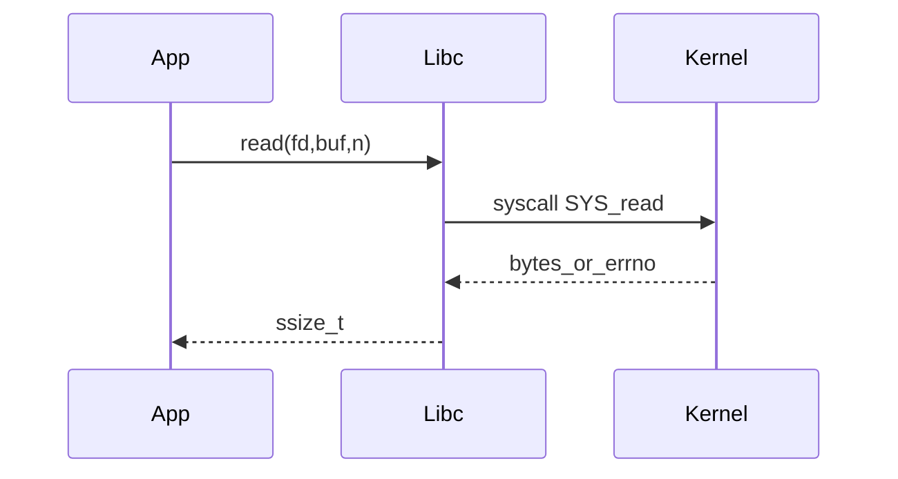

# D03-T004 — System calls

Topic ID: `D03-T004`
Domain: Operating Systems
Subdomain: System calls
Importance: core
Complexity: intermediate
Dependencies: `D03-T003`, `D03-T001`
Execution status of the code in section F: unexecuted

## A. Topic Overview

System calls are the intentional boundary from user mode into the kernel: open files, read sockets, map memory, create tasks, and wait on children. libc wrappers such as `read`, `write`, and `epoll_wait` place the syscall number and arguments in registers and execute the `syscall` instruction.

Without syscalls, applications could not use the network or disk securely. Backend latency and throughput often hinge on how many syscalls you perform per request and whether those calls block threads.

Interviewers expect errno semantics, EINTR restart rules, `strace`/`perf trace`, seccomp in containers, and batching strategies (`writev`, `sendfile`, `io_uring`).

## B. First-Principles Explanation

User code cannot manipulate the FD table or NIC rings directly. It invokes a numbered kernel entry; the kernel validates pointers with `copy_from_user`, performs the operation, and returns a result or negative errno.

Blocking syscalls park the thread on a wait queue; the scheduler runs other threads until the resource is ready. Non-blocking syscalls return `EAGAIN` so an event loop can poll readiness.

VDSO maps read-only kernel helper pages into user space for cheap `clock_gettime` without full entry cost.

## C. Internal Working and Architecture

Path: application → glibc → `syscall` → `entry_SYSCALL_64` → `sys_call_table[n]` → subsystem (VFS, socket, mm). Return restarts user instructions with result in `%rax`.

Signals may interrupt slow syscalls; `SA_RESTART` controls automatic restart for some calls. Partial reads/writes are normal on sockets and pipes.

## D. Diagrams and Visual Models



## E. Examples and Analogies

Analogy: syscalls are calling the building manager, not rewiring the elevator yourself. Backend: logging one line per `write` syscall can dominate CPU at high QPS—buffer or use an agent.

## F. Code Examples

File: `examples/d03_t004_read_loop.c`

```c
#include <errno.h>
#include <fcntl.h>
#include <stdio.h>
#include <unistd.h>

int main(void) {
    int fd = open("/etc/hosts", O_RDONLY);
    char buf[128];
    ssize_t n;
    do {
        n = read(fd, buf, sizeof buf);
    } while (n < 0 && errno == EINTR);
    if (n > 0) printf("read %zd bytes\n", n);
    close(fd);
    return 0;
}
```

How to run: `cc examples/d03_t004_read_loop.c && ./a.out`

Expected output: `read N bytes`

Important lines: EINTR retry loop; production code also handles `n == 0` EOF and partial reads on sockets.

Not executed for this note.

## G. Practical Backend Application

Profile syscall rates during load tests. JDBC drivers, DNS lookups per request, and unbuffered logs are common syscall multipliers. Seccomp profiles must allow the syscalls your runtime actually uses (`clone`, `futex`, `epoll_wait`).

## H. Advantages, Limitations and Trade-offs

| Choice | Benefit | Cost | Choose when | Avoid when |
| --- | --- | --- | --- | --- |
| Buffered I/O | Fewer syscalls | Extra copies | Logging, disk | Latency-sensitive socket control |
| io_uring | Batch async I/O | Complexity | NVMe heavy | Simple REST |
| sendfile | Kernel-side copy | Platform limits | Static file serve | TLS terminate in app |
| strace in prod | Deep visibility | Huge overhead | Short canary debug | Steady state |

## I. Common Mistakes and Misconceptions

- Assuming `printf` is one syscall.
- Ignoring EINTR and partial I/O.
- Treating `EAGAIN` as fatal on non-blocking FDs.
- Forgetting closed FD races across threads.

## J. Debugging and Troubleshooting

Use `strace -c -p PID`, `perf trace`, and errno-tagged metrics. Correlate syscall spikes with deploys and log format changes.

## K. Interview Preparation

### Beginner

#### Q1. What is a system call?

**Answer:** A controlled transition to kernel mode to perform privileged work on behalf of the process.

#### Q2. Name three syscalls a web server uses.

**Answer:** `accept`, `read`/`recv`, `write`/`send`, `epoll_wait`, `close`.

#### Q3. What is errno?

**Answer:** Thread-local error indicator set when a syscall returns -1.

#### Q4. What is EINTR?

**Answer:** Syscall interrupted by a signal; often retry `read`/`write`.

#### Q5. `read` versus `fread`?

**Answer:** `fread` uses stdio buffering; may batch before hitting the kernel.

### Intermediate

#### Q1. Cost of a syscall?

**Answer:** Mode switch plus kernel work; blocking adds scheduling wait.

#### Q2. What is vDSO?

**Answer:** User-mapped kernel helpers to avoid syscall for some time functions.

#### Q3. Why seccomp?

**Answer:** Restrict syscalls to shrink container attack surface.

#### Q4. What is io_uring?

**Answer:** Shared submission/completion rings for batched async I/O.

#### Q5. How does strace work?

**Answer:** ptrace/seccomp stops on syscall enter/exit to log arguments.

### Advanced

#### Q1. Restartable syscalls?

**Answer:** Some restart after signals if `SA_RESTART` is set.

#### Q2. `copy_from_user` purpose?

**Answer:** Safely access user pointers; prevents kernel crashes and TOCTOU issues.

#### Q3. Syscall overhead at 1M QPS?

**Answer:** Becomes dominant; batch writes and use larger frames.

#### Q4. Java NIO mapping?

**Answer:** JNI down to `epoll_wait` and socket `read`/`write`.

#### Q5. Difference syscall vs hypercall?

**Answer:** Hypercall enters VMM; syscall enters host kernel.

### Scenarios

#### Q1. Latency up after unbuffered logs?

**Answer:** Each line may syscall; add buffering or logging agent.

#### Q2. Container cannot bind :80?

**Answer:** Missing `CAP_NET_BIND_SERVICE` or use higher port.

#### Q3. Spike in `connect` syscalls?

**Answer:** Missing connection pool; pool TCP connections.

#### Q4. `EAGAIN` on non-blocking socket?

**Answer:** Normal; wait on epoll and retry.

#### Q5. EBADF on Linux only?

**Answer:** FD closed or used from wrong thread after close.

### Follow-ups

#### Q1. How do syscalls relate to scheduling?

**Answer:** Blocking syscalls remove threads from the run queue until data is ready, which is why thread pools can exhaust workers under blocking I/O even when CPU is idle. When the syscall returns, the thread becomes runnable and may wait again on the run queue if cores are busy. Tuning epoll and non-blocking sockets reduces time spent in D states. This chain links directly to `D03-T005` scheduling metrics and p99 latency.

#### Q2. How do file descriptors connect?

**Answer:** Syscalls use integer FDs indexing a per-process table shared by all threads. `dup`, `fork`, and `close` races cause classic EBADF bugs that look like application errors. `sendfile` and `splice` still operate on FDs but move data inside the kernel. Understanding FD lifetime is mandatory for zero-copy designs and graceful shutdown.

#### Q3. Kubernetes and syscalls?

**Answer:** Containers share the host syscall table; seccomp and AppArmor profiles differ per pod securityContext. Kernel version on the node determines availability of syscalls like `clone3`. Privileged pods can bypass many restrictions, which is why payment workloads avoid them. Upgrading nodes is upgrading syscall behavior for every pod scheduled there.

## L. Practical Exercises

Solutions: `EXERCISES/solutions/D03-T004.md`.

### Exercise 1 — implementation

Loop `read()` retrying on EINTR; log partial reads.

### Exercise 2 — debugging

`strace` shows 50k `write`/s from info logs—explain and fix.

### Exercise 3 — trade-off

Buffered versus direct socket writes for a metrics agent.

## M. Revision Notes

- Syscall = kernel API; errno/EINTR/partial I/O matter.
- Batch and buffer to reduce enter/exit.
- strace/perf trace for verification.

Flashcards:

- EINTR? Retry many slow syscalls.
- vDSO? Fast time without full syscall.

## N. Related Topics

Understand: `D03-T003`. Supports: `D03-T019` I/O models. Confused with: libc versus syscall. Combine: networking, containers.

## O. Completion Criteria

- Trace read from libc to VFS.
- Handle EINTR and partial I/O correctly.
- Propose syscall reduction for hot logging path.
