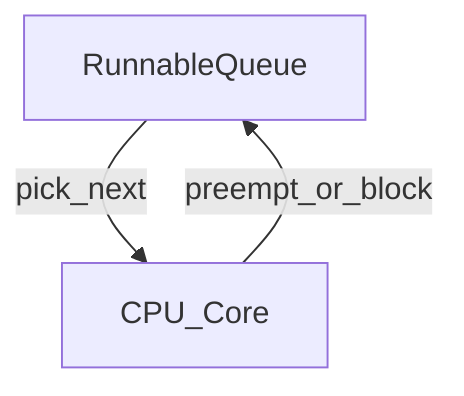

# D03-T005 — CPU scheduling

Topic ID: `D03-T005`
Domain: Operating Systems
Subdomain: CPU scheduling
Importance: core
Complexity: intermediate
Dependencies: `D03-T004`, `D03-T001`
Execution status of the code in section F: unexecuted

## A. Topic Overview

CPU scheduling decides which runnable thread executes on each core. Linux CFS approximates fair CPU sharing using virtual runtime; real-time classes exist for low-latency tasks. cgroups v2 can throttle CPU, stretching wall-clock time while utilization looks moderate.

Backend p99 latency often includes **run-queue wait** plus time blocked in syscalls, not only service time. Interviewers connect scheduling to thread-pool sizing, GOMAXPROCS, and Kubernetes CPU limits.

## B. First-Principles Explanation

Runnable threads sit on per-CPU runqueues. Timer interrupts and syscall returns invoke the scheduler. Blocking threads are removed until I/O completes. Priorities and nice values bias vruntime accumulation; RT priorities can starve CFS tasks if misused.

## C. Internal Working and Architecture

`schedule()` picks `next`; context switch saves registers and may switch address spaces. Load average reflects runnable + uninterruptible tasks. Container CPU quotas slice cgroup bandwidth per period.

## D. Diagrams and Visual Models



## E. Examples and Analogies

Checkout lanes: more threads than lanes means waiting in line even if each customer is quick. A JVM GC pause stops application threads from making progress—tail latency includes those pauses.

## F. Code Examples

File: `examples/d03_t005_sched.c`

```c
#include <sched.h>
#include <stdio.h>
int main(void) {
    int pol = sched_getscheduler(0);
    printf("policy=%d\n", pol);
    return 0;
}
```

How to run: `cc examples/d03_t005_sched.c && ./a.out` — not executed.

## G. Practical Backend Application

Match worker threads to CPU quota; avoid CPU-bound work on event-loop threads. Alert on run-queue latency and throttling counters in cgroups.

## H. Advantages, Limitations and Trade-offs

| Choice | Benefit | Cost | Choose when | Avoid when |
| --- | --- | --- | --- | --- |
| CFS default | Fair | Not hard RT | Web APIs | Strict jitter SLO |
| CPU limits | Noisy neighbor control | Throttling | Multi-tenant nodes | Latency-sensitive without headroom |
| Fewer threads | Less queueing | Less parallel I/O | CPU-bound | Blocking I/O heavy |
| More threads | Hide I/O wait | Scheduler overhead | JDBC blocking | CPU-bound compute |

## I. Common Mistakes and Misconceptions

- Equating low CPU% with healthy latency.
- Setting thread pool to 10× cores without measurement.
- Ignoring cgroup throttling metrics.

## J. Debugging and Troubleshooting

Use `mpstat`, `pidstat`, `cat /sys/fs/cgroup/.../cpu.stat`, and `perf sched`. Correlate p99 with `nr_throttled`.

## K. Interview Preparation

### Beginner

#### Q1. What does the scheduler do?

**Answer:** Chooses which runnable thread runs on each CPU.

#### Q2. Runnable vs blocked?

**Answer:** Runnable is ready for CPU; blocked waits on I/O or locks.

#### Q3. What is preemption?

**Answer:** Kernel forcibly switches threads on timer tick or higher priority.

#### Q4. What is nice value?

**Answer:** Biases CPU share among CFS tasks.

#### Q5. Why p99 matters for scheduling?

**Answer:** Queueing delay hits tail requests first.

### Intermediate

#### Q1. What is CFS vruntime?

**Answer:** Virtual time accounting to approximate fair sharing.

#### Q2. cgroup CPU throttling symptom?

**Answer:** High latency at moderate utilization; `nr_throttled` grows.

#### Q3. Load average meaning?

**Answer:** Avg runnable + uninterruptible tasks; not CPU% alone.

#### Q4. Thread count vs cores rule of thumb?

**Answer:** Measure; I/O-bound may exceed cores; CPU-bound should not far exceed without gain.

#### Q5. GOMAXPROCS role?

**Answer:** Caps parallel OS threads executing Go code simultaneously.

### Advanced

#### Q1. RT vs CFS?

**Answer:** RT can starve CFS; needs capacity planning.

#### Q2. NUMA scheduling?

**Answer:** Memory local to socket affects performance when tasks migrate.

#### Q3. Work conservation?

**Answer:** Idle CPU should run runnable work unless throttled/isolated.

#### Q4. sched_yield use?

**Answer:** Voluntary give-up; rarely fixes overload.

#### Q5. EEVDF (newer CFS)?

**Answer:** Latency-aware fair scheduling improvements in recent kernels—know conceptually.

### Scenarios

#### Q1. p99 up, CPU 30%, run queue 50?

**Answer:** Runnable threads wait for cores or throttling; reduce threads or raise quota.

#### Q2. One thread 100% CPU?

**Answer:** Parallelism 1 for that code path; optimize or shard.

#### Q3. After K8s CPU limit cut, timeouts?

**Answer:** Throttling; increase limit or reduce work per request.

#### Q4. GC pause spikes latency?

**Answer:** STW pauses; tune GC or heap, show in scheduler/wall time.

#### Q5. irqbalance / isolated CPUs?

**Answer:** Dedicated cores for latency-sensitive daemons.

### Follow-ups

#### Q1. How does scheduling connect to thread pools?

**Answer:** Pools cap runnable threads but blocking tasks still consume slots; queue depth adds wait time before threads even reach the scheduler. Right-sizing pools uses both CPU quota and I/O wait profiles. Oversized pools increase context switches without throughput gain. See `D03-T006`.

#### Q2. How do syscalls interact with scheduling?

**Answer:** Blocking syscalls deschedule threads, which can look like low CPU while latency grows. Non-blocking models keep fewer threads runnable. Syscall-heavy paths still contend for cores when work resumes.

#### Q3. Kubernetes CPU requests/limits?

**Answer:** Limits throttle via cgroups; requests affect placement. Burstable QoS can throttle unexpectedly. Horizontal scaling adds processes across nodes, changing per-node queueing.

## L. Practical Exercises

Solutions: `EXERCISES/solutions/D03-T005.md`.

### Exercise 1 — implementation

Print scheduling policy of current process.

### Exercise 2 — debugging

Explain run queue high with low CPU.

### Exercise 3 — trade-off

Pick thread count vs GOMAXPROCS for mixed I/O API.

## M. Revision Notes

- Scheduler picks runnable tasks; blocked != runnable.
- CFS fairness; cgroups throttle.
- p99 includes queueing.

Flashcards:

- nr_throttled? cgroup CPU throttling events.
- CFS? Completely Fair Scheduler.

## N. Related Topics

Understand: `D03-T002`. Supports: `D03-T006`. Confused with: parallelism. Combine: JVM GC, K8s limits.

## O. Completion Criteria

- Explain run-queue vs CPU utilization.
- Read cgroup cpu.stat throttling.
- Size pools using measurements.
