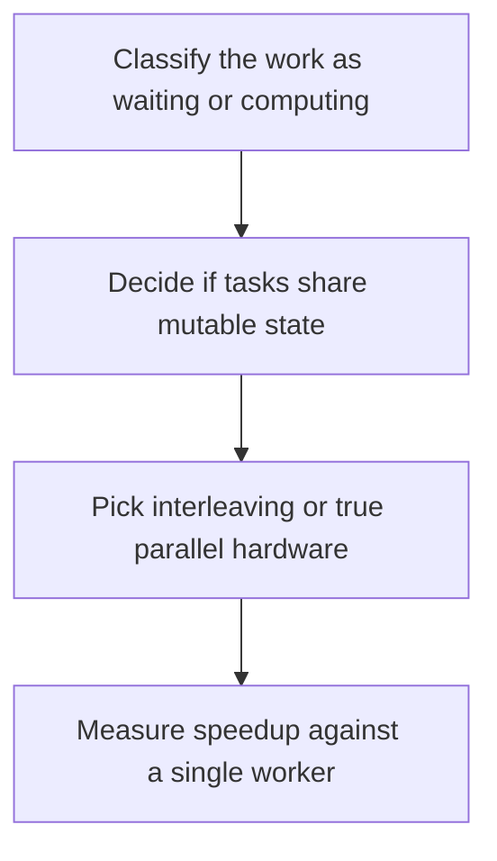

# D03-T007 — Concurrency vs parallelism

Topic ID: `D03-T007`
Domain: Operating Systems
Subdomain: Concurrency vs parallelism
Importance: core
Complexity: intermediate
Dependencies: `D03-T006`, `D03-T001`, `D01-T001`, `D01-T002`
Execution status of the code in section F: unexecuted

## A. Topic Overview

Concurrency is dealing with multiple tasks that can be in progress at once, including by interleaving on one core. Parallelism is actually executing on more than one core at the same instant. You can have concurrent code that never runs in parallel, and parallel code that does not share state. The distinction decides whether a lock or a process boundary is the tool.

In production this shows up as follows: A web handler waiting on a database is concurrent I/O. A video transcode is parallel CPU. Mixing the two thread pools is how a service stalls both.

Interviewers use Concurrency vs parallelism to see whether you can state the failure mode, not only the definition. The failure to name is: adding threads to a CPU-bound Python workload and expecting parallelism from code the GIL serializes

Prerequisites: `D03-T006`, `D03-T001`, `D01-T001`, `D01-T002`. Later notes should link here instead of repeating the mechanism.

## B. First-Principles Explanation

Concurrency is dealing with multiple tasks that can be in progress at once, including by interleaving on one core. Parallelism is actually executing on more than one core at the same instant. You can have concurrent code that never runs in parallel, and parallel code that does not share state. The distinction decides whether a lock or a process boundary is the tool.

The useful picture is: Concurrency is several conversations you switch between. Parallelism is several people talking at the same time.

What has to be true:

1. Classify the work as waiting or computing
2. Decide if tasks share mutable state
3. Pick interleaving or true parallel hardware
4. Measure speedup against a single worker

It works when those steps preserve one invariant. It fails when adding threads to a CPU-bound Python workload and expecting parallelism from code the GIL serializes. The alternative is: you use the words as synonyms and then pick the wrong pool

## C. Internal Working and Architecture

Components involved: the caller, the state Concurrency vs parallelism mutates or reads, and the observer that reports CPU time versus wall time, and whether throughput scales with core count.

Execution:

1. Classify the work as waiting or computing
2. Decide if tasks share mutable state
3. Pick interleaving or true parallel hardware
4. Measure speedup against a single worker

Data moves only along that path. A retry re-enters at step 1, so the operation must say what a duplicate does. Memory and locks stay inside this mechanism. Callers see the result or a typed error, not a half-updated invariant.

State to remember: choose this when you need to name whether the spare time is waiting or spare cores. Do not choose it when you use the words as synonyms and then pick the wrong pool.

## D. Diagrams and Visual Models



Read the diagram from top to bottom. Each box is one step of Concurrency vs parallelism. The failure mode (adding threads to a CPU-bound Python workload and expecting parallelism from code the GIL serializes) is what you look for when a later box never happens or happens twice.

## E. Examples and Analogies

Analogy: Concurrency is several conversations you switch between. Parallelism is several people talking at the same time.

Production example: A web handler waiting on a database is concurrent I/O. A video transcode is parallel CPU. Mixing the two thread pools is how a service stalls both.

A small counterexample is enough in an interview. Show the input, apply the steps, and show the broken outcome if someone uses the mechanism outside its rule: adding threads to a CPU-bound Python workload and expecting parallelism from code the GIL serializes.

## F. Code Examples

The snippet is labeled unexecuted. It illustrates the shape of the idea. It is not a benchmark and it embeds no secret.

```python
import concurrent.futures

def classify(io_bound: bool, cores: int) -> str:
    if io_bound:
        return 'threads or async'
    return f'processes up to {cores}'
```

After the snippet, check CPU time versus wall time, and whether throughput scales with core count. If that signal moves the wrong way, the snippet is the wrong tool for the workload.

## G. Practical Backend Application

Use Concurrency vs parallelism in a service when you need to name whether the spare time is waiting or spare cores.

A typical place is the production case already stated: A web handler waiting on a database is concurrent I/O. A video transcode is parallel CPU. Mixing the two thread pools is how a service stalls both.

Operationally you alert on CPU time versus wall time, and whether throughput scales with core count. You do not alert only on process uptime. The dashboard should show the failure mode, a success rate, and the saturation signal (queue depth, lock wait, or latency) that predicts it.

## H. Advantages, Limitations and Trade-offs

| Choice | Benefit | Cost | Choose when | Avoid when |
| --- | --- | --- | --- | --- |
| Apply Concurrency vs parallelism | you need to name whether the spare time is waiting or spare cores | Extra moving parts and a new failure mode | The failure you are preventing is already real | you use the words as synonyms and then pick the wrong pool |
| Simpler alternative | Less code and fewer dependencies | adding threads to a CPU-bound Python workload and expecting parallelism from code the GIL serializes | The workload does not hit the limit | The invariant must hold under concurrency or failure |

Concurrency vs parallelism is a trade. State the benefit and the cost in the same sentence when you propose it in a design review.

## I. Common Mistakes and Misconceptions

- Equating async with parallel.
- Sizing a CPU pool to the number of database connections.
- Ignoring shared-state bugs because the machine has one core.
- Treating a diagram of Concurrency vs parallelism as proof that the invariant holds in production.
- Copying a default configuration without naming CPU time versus wall time, and whether throughput scales with core count.

## J. Debugging and Troubleshooting

Symptom: adding threads to a CPU-bound Python workload and expecting parallelism from code the GIL serializes

First check: CPU time versus wall time, and whether throughput scales with core count.

Then compare one healthy instance against one unhealthy instance. Confirm whether retries are duplicating work. Confirm whether a timeout is shorter than the work. Fix the invariant, then watch the same metric for a full peak, not only for the next minute.

Useful questions: did the step order in section C actually happen, or did a caller skip a step? Did a deploy change the data shape that Concurrency vs parallelism assumes?

## K. Interview Preparation

### Beginner

#### Q1. What problem does Concurrency vs parallelism solve?

**Answer:** Concurrency is dealing with multiple tasks that can be in progress at once, including by interleaving on one core. Parallelism is actually executing on more than one core at the same instant. You can have concurrent code that never runs in parallel, and parallel code that does not share state. The distinction decides whether a lock or a process boundary is the tool. Without it, the usual backend failure is: adding threads to a CPU-bound Python workload and expecting parallelism from code the GIL serializes.

#### Q2. Where does Concurrency vs parallelism sit on a request path?

**Answer:** Concurrency vs parallelism is not a library you sprinkle on every call. you need to name whether the spare time is waiting or spare cores You notice it when CPU time versus wall time, and whether throughput scales with core count. Name the constraint that makes this choice correct. Say what you would measure to confirm it.

#### Q3. Give a concrete example of Concurrency vs parallelism.

**Answer:** A web handler waiting on a database is concurrent I/O. A video transcode is parallel CPU. Mixing the two thread pools is how a service stalls both. Walk the input, the state change, and the observable output.

#### Q4. What is a common mix-up around Concurrency vs parallelism?

**Answer:** adding threads to a CPU-bound Python workload and expecting parallelism from code the GIL serializes The corrective check is CPU time versus wall time, and whether throughput scales with core count. Name the constraint that makes this choice correct. Say what you would measure to confirm it. Say which alternative you rejected and why.

#### Q5. When would you skip Concurrency vs parallelism?

**Answer:** you use the words as synonyms and then pick the wrong pool Skipping is a decision with a measured cost, not a slogan. Name the constraint that makes this choice correct. Say what you would measure to confirm it. Say which alternative you rejected and why.

### Intermediate

#### Q1. What invariant makes Concurrency vs parallelism correct?

**Answer:** Concurrency is dealing with multiple tasks that can be in progress at once, including by interleaving on one core. Parallelism is actually executing on more than one core at the same instant. You can have concurrent code that never runs in parallel, and parallel code that does not share state. The distinction decides whether a lock or a process boundary is the tool. State the invariant before you name the tool.

#### Q2. How do you test Concurrency vs parallelism?

**Answer:** Assert the failure mode directly: adding threads to a CPU-bound Python workload and expecting parallelism from code the GIL serializes. The assertion should watch CPU time versus wall time, and whether throughput scales with core count. Include a concurrent or retry case if the bug only appears then. Name the constraint that makes this choice correct.

#### Q3. What signal tells you Concurrency vs parallelism is misbehaving in production?

**Answer:** Watch CPU time versus wall time, and whether throughput scales with core count. The user-visible symptom is usually adding threads to a CPU-bound Python workload and expecting parallelism from code the GIL serializes. Name the constraint that makes this choice correct. Say what you would measure to confirm it.

#### Q4. How would you introduce Concurrency vs parallelism into a legacy service?

**Answer:** you need to name whether the spare time is waiting or spare cores Ship it behind a metric so you can compare the old path. Roll back if adding threads to a CPU-bound Python workload and expecting parallelism from code the GIL serializes gets worse. Name the constraint that makes this choice correct. Say what you would measure to confirm it.

#### Q5. What do you trade away by choosing Concurrency vs parallelism?

**Answer:** you need to name whether the spare time is waiting or spare cores you use the words as synonyms and then pick the wrong pool Say the cost in latency, storage, or operational load. Name the constraint that makes this choice correct. Say what you would measure to confirm it. Say which alternative you rejected and why.

### Advanced

#### Q1. What breaks if a dependency of Concurrency vs parallelism is slow or down?

**Answer:** adding threads to a CPU-bound Python workload and expecting parallelism from code the GIL serializes Degrade using the rule: you use the words as synonyms and then pick the wrong pool. Timeouts must be shorter than the caller's deadline. Name the constraint that makes this choice correct. Say what you would measure to confirm it.

#### Q2. How does Concurrency vs parallelism behave under retries?

**Answer:** Retries repeat work, so Concurrency vs parallelism must define what a duplicate does. adding threads to a CPU-bound Python workload and expecting parallelism from code the GIL serializes Idempotency keys or fences belong next to the write, not in a comment. Name the constraint that makes this choice correct. Say what you would measure to confirm it.

#### Q3. What is the capacity limit of Concurrency vs parallelism?

**Answer:** The limit shows up as CPU time versus wall time, and whether throughput scales with core count. Add capacity only after you know whether the bottleneck is CPU, lock wait, or network. Name the constraint that makes this choice correct. Say what you would measure to confirm it.

#### Q4. How do you evolve Concurrency vs parallelism without a flag day?

**Answer:** you need to name whether the spare time is waiting or spare cores Version the contract or the on-disk format. Readers should tolerate one old and one new shape during the rollout. Name the constraint that makes this choice correct. Say what you would measure to confirm it.

#### Q5. What security or correctness bug hides inside Concurrency vs parallelism?

**Answer:** adding threads to a CPU-bound Python workload and expecting parallelism from code the GIL serializes Check authorization and tenancy at the same boundary as the mechanism. A cache or queue must not widen who can read the data. Name the constraint that makes this choice correct. Say what you would measure to confirm it.

### Scenario

#### Q1. Incident: adding threads to a CPU-bound Python workload and expecting parallelism from code the GIL serializes. What do you check first?

**Answer:** Start with CPU time versus wall time, and whether throughput scales with core count. Compare a good host and a bad host before you restart anything. Concurrency is dealing with multiple tasks that can be in progress at once, including by interleaving on one core. Parallelism is actually executing on more than one core at the same instant. You can have concurrent code that never runs in parallel, and parallel code that does not share state. The distinction decides whether a lock or a process boundary is the tool.

#### Q2. A reviewer wants the clever version. What data settles it?

**Answer:** you need to name whether the spare time is waiting or spare cores you use the words as synonyms and then pick the wrong pool Bring CPU time versus wall time, and whether throughput scales with core count from a load test or from production, not a slogan. Name the constraint that makes this choice correct. Say what you would measure to confirm it. Say which alternative you rejected and why.

#### Q3. You have one hour to explain Concurrency vs parallelism at a whiteboard.

**Answer:** Draw the happy path in four boxes. Then draw the failure: adding threads to a CPU-bound Python workload and expecting parallelism from code the GIL serializes. End with the metric you would page on. Name the constraint that makes this choice correct.

#### Q4. The bug only appears under two concurrent callers.

**Answer:** adding threads to a CPU-bound Python workload and expecting parallelism from code the GIL serializes Reproduce with a barrier so both sides enter the critical window. Confirm the fix with CPU time versus wall time, and whether throughput scales with core count. Name the constraint that makes this choice correct. Say what you would measure to confirm it.

#### Q5. Leadership wants this on every service next week.

**Answer:** you use the words as synonyms and then pick the wrong pool you need to name whether the spare time is waiting or spare cores Roll it out where the failure mode is already hurting users. Name the constraint that makes this choice correct. Say what you would measure to confirm it. Say which alternative you rejected and why.

### Follow-up

#### Q1. What did you assume about the data size or the clock?

**Answer:** Concurrency is dealing with multiple tasks that can be in progress at once, including by interleaving on one core. Parallelism is actually executing on more than one core at the same instant. You can have concurrent code that never runs in parallel, and parallel code that does not share state. The distinction decides whether a lock or a process boundary is the tool. Clocks are not a total order across machines. State whether the algorithm needs bounded size or a single leader.

#### Q2. What would you measure after the change ships?

**Answer:** Page on CPU time versus wall time, and whether throughput scales with core count. Keep a before/after dashboard for one week. Alert on the failure mode, not only on CPU. Name the constraint that makes this choice correct.

#### Q3. Which neighboring topic did you deliberately not re-teach?

**Answer:** This note owns Concurrency vs parallelism. Related identifiers are in section N. Shared ideas are linked, not copied. Name the constraint that makes this choice correct.

## L. Practical Exercises

Solutions are in `EXERCISES/solutions/D03-T007.md`, not in this section.

1. Whiteboard the four steps of Concurrency vs parallelism and mark where `adding threads to a CPU-bound Python workload and expecting parallelism from code the GIL serializes` enters.
2. Read the snippet in section F and write the assertion that would catch that failure. The assertion must mention `CPU time versus wall time, and whether throughput scales with core count`.
3. Argue for or against using Concurrency vs parallelism on a service you know. Use the choose and avoid rows from section H. Do not appeal to popularity.

## M. Revision Notes

- Mechanism: Concurrency is dealing with multiple tasks that can be in progress at once, including by interleaving on one core.
- Failure: adding threads to a CPU-bound Python workload and expecting parallelism from code the GIL serializes
- Metric: CPU time versus wall time, and whether throughput scales with core count
- Choose when: you need to name whether the spare time is waiting or spare cores
- Avoid when: you use the words as synonyms and then pick the wrong pool

## N. Related Topics

Dependencies to review first: `D03-T006`, `D03-T001`, `D01-T001`, `D01-T002`.

Shared ideas stay in those notes. This note does not restate them.

## O. Completion Criteria

- You can explain Concurrency vs parallelism without reading this note, including the failure mode.
- You can draw the diagram in section D from memory.
- You can say when not to use it, using the avoid condition in section H.
- You can name the metric you would watch after shipping it.
